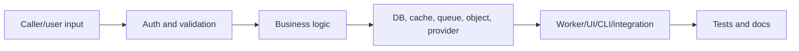
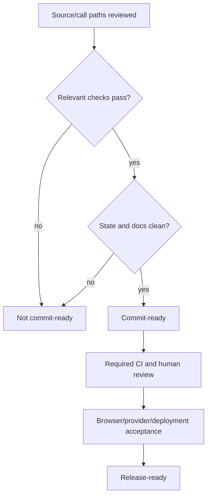

# Supercheck code review

Use every domain skill touched by the diff. Review is read-only unless the user also asks to fix findings.

## Establish scope

- Identify repositories, branch/base, commits, staged/unstaged/untracked files, submodules, generated outputs, and existing unrelated changes.
- Review the effective combined change, not only staged or unstaged fragments when both exist.
- Classify each file as architecture/data, auth/security, API/action, UI/hooks, execution/worker, monitoring, storage, SRE, deployment, testing/docs, CLI, recorder, billing, or another integration.

## Trace behavior

For each changed contract, follow:

- A diff that looks correct locally can still break a caller, worker, old deployment, CLI, extension, migration, or retry path.
- Treat reported findings as hypotheses. Confirm through current source, call paths, tests, and runtime contracts before recommending changes.
- Do not convert intentional hardening into a finding merely because it is stricter than generic guidance.

## Critical review areas

- Authentication mechanism and exact RBAC resource/action for cookie, bearer, trigger, admin, and public routes.
- Organization/project ownership on reads, writes, joins, cache keys, streams, objects, queue jobs, and provider identities.
- Zod/input bounds, uploads, HTML/browser messages, SSRF/redirect/DNS behavior, webhook signatures, and output allowlists.
- Secret encryption/redaction and absence from client data, config, queues, logs, errors, model prompts, and artifacts.
- Migration existing-data safety, constraints/indexes, lock duration, destructive operations, rollback/recovery, and version skew.
- Queue payload parity, atomic capacity, retries/idempotency, duplicate delivery, cancellation, terminal cleanup, and worker loss.
- React server/client boundary, query-key/invalidation parity, stale data, accessibility, error/loading/empty behavior.
- Visual design against `DESIGN.md`: raw palette, hex or `hsl(...)` colours outside the central maps, a recoloured or non-black primary button, a status colour without text or an icon, copied toolbar/pagination components, and missing light/dark or 390px checks.
- External effects: timeout, retry safety, idempotency, cancellation, billing/usage exactly-once behavior, and provider reconciliation.
- Deployment: immutable versions, secret handling, gVisor/network/namespace isolation, resource ceilings, autoscaling, health, and destructive blast radius.
- CLI/recorder public compatibility and AGPL versus Apache/third-party NOTICE obligations.

## Prove before reporting

Report a finding only when all four hold. Otherwise drop it or downgrade it to a question.

1. You can cite the exact file and line.
2. You can name the concrete failure: the input, the path, and the wrong outcome.
3. You read the current source, not the diff alone, and the call path still reaches the defect.
4. You know what would catch it — a test, a type error, a runtime guard — or why nothing can.

A finding that fails 1 or 2 is a hypothesis. Label it, or leave it out.

## Silent failures

This product's job is noticing failure. An error swallowed on a failure path is therefore a critical defect, not a style note: the check reads healthy, the alert never sends, the run looks finished, the capacity is never released. Look for:

- `catch {}` or `.catch(() => {})` around alert delivery, run finalisation, capacity release, audit writes, queue enqueue, or cleanup.
- A rejected operation whose rejection is dropped: a missing `await`, a floating promise, `Promise.all` without a handler, a callback nobody awaits.
- A failure path that returns the success shape (`{ success: true }`, `up`, `passed`, 2xx) or skips the terminal write.
- A retry or timeout that ends without a terminal state, leaving a run `running` or a reservation held.
- A default that erases the difference between "no data" and "healthy": a missing region counted up, an unstarted check rendered as a pass, an unreadable certificate rendered as valid.

Say which status, alert or record is wrong, and for whom.

## Findings format

- Order by severity: critical/security/data loss, functional regression, reliability/performance, maintainability, suggestion.
- Give exact file/line, concrete failure scenario, affected users/system, and smallest safe correction.
- Avoid style-only noise unless repository tooling enforces it or it materially obscures correctness.
- Record important investigated claims that are not defects so reviewers understand intentional behavior.
- For a pull-request review, give every finding a disposition: fixed, declined with the reason, or stale because the code moved. Never drop one silently, and never treat an unanswered thread as resolved.

## Verification and decision

- Run proportionate focused checks and broaden for shared/high-risk contracts (commands in `supercheck-testing-qa`).
- CI coverage gaps to account for: `*.db.spec.ts` suites run only under `npm run test:db`, not `npm test`; the PR E2E job only typechecks and lists specs (`playwright test --list`), and the browser suite runs in `e2e-full.yml`. A green PR does not prove either.
- Confirm whitespace/diff checks, package contents, ignored/generated files, migrations, and docs/skills parity.
- Separate commit readiness from merge and release readiness.
- An unavailable browser/provider/production check is a disclosed acceptance boundary, never a pass.
