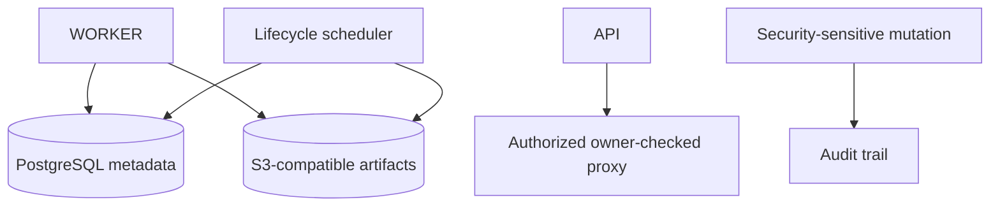

# Supercheck data storage and lifecycle

## Start here

| File | Why |
|---|---|
| `app/src/lib/s3-proxy.ts`, `app/src/lib/asset-proxy.ts` | Authorized artifact and status-page asset serving |
| `app/src/lib/data-lifecycle-service.ts`, `app/src/lib/s3-cleanup.ts` | Retention constants, cleanup scheduling, object deletion |
| `worker/src/execution/services/s3.service.ts` | Worker-side uploads (a separate client from the app's) |
| `app/src/lib/monitor-aggregation-service.ts`, `app/src/app/api/dashboard/route.ts` | Aggregates that dashboards and status pages report |
| `app/src/lib/audit-logger.ts` | Audit writes |

## PostgreSQL and object storage

- PostgreSQL holds relational state and artifact metadata; S3-compatible stores (RustFS bundled) hold large reports, traces, screenshots, and uploaded files. Exports stream inline rather than being stored.
- Generate object keys server-side from trusted tenant/resource identifiers. Never accept arbitrary bucket/key pairs or filesystem paths from clients.
- Serve artifacts through authenticated, owner-checked proxy/download routes (or `/api/assets/*` for status-page assets). Do not expose new presigned S3 URLs to browsers—direct S3 endpoints break in deployed environments. `getDocumentDownloadUrl` in `app/src/actions/documents.ts` still presigns but has no non-test callers; the proxy route `app/src/app/api/documents/[id]/download/route.ts` replaces it.
- Asset proxying allows only configured storage origins/keys and must not become a generic server-side fetch endpoint.
- Uploads enforce object class, MIME/type expectations, byte limits, timeouts, and bounded streaming. Avoid buffering untrusted large objects in app memory.
- The app and the worker each own an S3 client; both use path-style addressing for S3/R2-compatible services and self-hosted RustFS. Legacy MinIO installs migrate with `deploy/docker/migrate-minio-to-rustfs.sh`.

## Lifecycle and retention

- Retention varies by artifact/data class and legal/security purpose. Read current constants in `app/src/lib/data-lifecycle-service.ts` before changing a duration.
- Keep artifact pointers until storage deletion succeeds, and keep run callbacks fenced through cleanup (`run_callback` schema in both packages, `worker/src/execution/services/run-callback.ts`), so a late upload cannot recreate an object after its row was cleaned.
- Cleanup work is bounded, paginated, idempotent, observable, and safe under concurrent scheduler instances.
- Coordinate metadata/object deletion so retries recover from partial failure without deleting another tenant’s object or leaving permanent billable orphans.
- Prefer mark/select/delete phases or other recoverable sequencing for large cleanup sets.
- Infrastructure state, backups, billing records, and security/audit history are not ordinary test artifacts and never inherit short playground/run retention.
- Changing product retention requires user documentation, entitlement/billing consideration, migration/backfill behavior, and provider lifecycle alignment.
- Raw `monitor_results` cleanup (`MonitorResultsCleanupStrategy`, hourly at :10): organizations in id order, each organization's monitors once; per monitor, plain rows go first in single-statement `FOR UPDATE SKIP LOCKED` batches on `(monitor_id, checked_at)` (they exclude every row that may hold a report), then rows with `test_execution_id`, `test_report_s3_url` or `details ? 'reportUrl'` go through object storage then one transaction; running the report pass second keeps its scan to the kept rows. Status-change rows are kept (their reports expire). The cutoff is the UTC start of the day `retentionDays` ago (`rawCutoff`): whole days only, so the daily rollup's 7-day lookback never recomputes a partly purged day. A per-organization cap (`MONITOR_CLEANUP_SAFETY_LIMIT`) and a quarter of the budget per organization (then it is passed over like a capped one), plus a 40-minute run budget, bound a run; a stopped run returns success with `details.partial`. A budget stop saves the last finished organization as the Redis resume cursor (only if one finished); a lock stop leaves the cursor to the new owner; a full pass clears it. Cursor writes are fenced on the run's lock token. A storage failure, or one monitor's database error, keeps its rows for the next hourly run and marks the result partial instead of failing the job, and does not count against the organization's cap. Job-run cleanup falls back to its global sweep only when no organization exists, never when every organization was skipped.
- Raw windows come from one rule, `resolveRawRetention` in `app/src/lib/raw-retention.ts`, used by cleanup (`getOrganizationRetentionSettings`) and the monitor results UI (`getRawResultRetention`): the plan's row (`??`, never `||`), the shortest raw window (`TRIAL_RETENTION`) for no plan, the unlimited row on self-hosted; a plan without a `plan_limits` row, or an active/past_due subscription with no plan yet, is skipped, and a window below 1 day is never applied.
- Aggregates: hourly rows follow the plan's `aggregatedDataRetentionDays` (no plan: the shortest plan's window, `SHORTEST_AGGREGATED_RETENTION_DAYS`; active/past_due without a plan yet: the long fallback); daily rows are kept at least `minDailyAggregateRetentionDays` (90, plan catalog) on every plan for the status page uptime bar. Deletes are batched per monitor with the same budget, cap, per-organization budget share and resume cursor (`cleanup:monitor_aggregates:org-cursor`). The rollup never rewrites an existing aggregate of a period before the oldest ordinary raw row, or before the monitor's raw purge watermark (`monitors.raw_purged_before`), since rows cleanup keeps there (status changes, refused reports) are not the whole period; the never-shrink guard keeps the boundary period intact. Raw cleanup advances the watermark to its cutoff (`advanceRawPurgeWatermark`, forward only: a longer window never moves it back; dry runs never write it) before it deletes a monitor's rows, and the rollup reads it after the raw rows, so a purge in between is always seen. Aggregate cleanup never touches it.
- Lag per retention class (oldest row vs window) is best effort: measured only after a full (non-partial, non-dry) run, skipped when its query fails, and logged as `retention_lag` and captured through `reportProblem` (`sentry-lazy`) when more than 2 days past the window. `getStats` uses planner estimates, never a whole-table `count(*)`.

## Dashboards, reports, and exports

- Every aggregation is tenant-scoped and uses explicit time range, time zone, status definitions, and units.
- Avoid N+1 and unbounded scans. Use suitable composite indexes and inspect plans for high-volume queries.
- Keep aggregate semantics aligned with raw execution/monitor state so dashboards, exports, and APIs report the same answer. Uptime and regional rollups come from `app/src/lib/monitor-aggregation-service.ts`; dashboard counts must use the same status definitions (for example, error and blocked runs are not passing).
- Export generation is permission-checked, bounded, escaped against spreadsheet/formula injection where relevant, and downloaded through scoped paths.
- Cache keys include all tenant/filter dimensions and invalidate when underlying state changes.

## Audit logging

- Audit records combine userId/organizationId columns with action, createdAt, and a details JSON carrying resource, outcome, IP, user-agent, and safe metadata; there is no first-class project scope.
- Log sensitive mutations and denials according to policy without recording secrets, tokens, full request payloads, provider credentials, or decrypted variables.
- Audit writes are best-effort today (logging failures never fail the request); decide deliberately when new critical actions must fail closed on missing audit evidence.
- Audit views require elevated (org admin+) permission, pagination, tenant scope, and appropriate retention. `GET /api/audit` supports a keyset `cursor` (microsecond `to_char` timestamp plus id, fetch `limit + 1`) next to `page`; in cursor mode only `totalCount`, `limit`, `hasNext` and `nextCursor` are returned.

## Verify

- Test cross-tenant object access, forged keys, unsupported types, oversized streams, missing objects, and partial cleanup failures.
- Test cleanup idempotency/concurrency and DB/object reconciliation.
- Compare report queries with representative raw records and inspect query plans.
- Verify audit metadata and redaction for success, denial, and failure paths.
