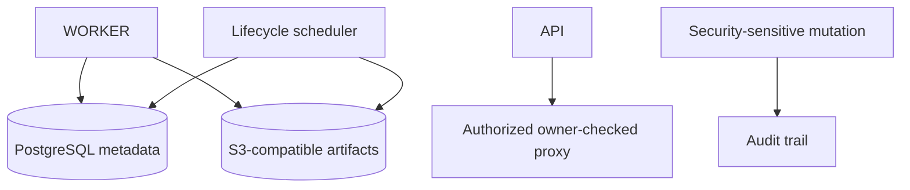

# Supercheck data storage and lifecycle

## Start here

| File | Why |
|---|---|
| `app/src/lib/s3-proxy.ts`, `app/src/lib/asset-proxy.ts` | Authorized artifact and status-page asset serving |
| `app/src/lib/data-lifecycle-service.ts`, `app/src/lib/s3-cleanup.ts` | Retention constants, cleanup scheduling, object deletion |
| `worker/src/execution/services/s3.service.ts` | Worker-side uploads (a separate client from the app's) |
| `app/src/lib/monitor-aggregation-service.ts`, `app/src/app/api/dashboard/route.ts` | Aggregates that dashboards and status pages report |
| `app/src/lib/audit-logger.ts` | Audit writes |

## PostgreSQL and object storage

- PostgreSQL holds relational state and artifact metadata; S3-compatible stores (RustFS bundled) hold large reports, traces, screenshots, and uploaded files. Exports stream inline rather than being stored.
- Generate object keys server-side from trusted tenant/resource identifiers. Never accept arbitrary bucket/key pairs or filesystem paths from clients.
- Serve artifacts through authenticated, owner-checked proxy/download routes (or `/api/assets/*` for status-page assets). Do not expose new presigned S3 URLs to browsers—direct S3 endpoints break in deployed environments. `getDocumentDownloadUrl` in `app/src/actions/documents.ts` still presigns but has no non-test callers; the proxy route `app/src/app/api/documents/[id]/download/route.ts` replaces it.
- Asset proxying allows only configured storage origins/keys and must not become a generic server-side fetch endpoint.
- Uploads enforce object class, MIME/type expectations, byte limits, timeouts, and bounded streaming. Avoid buffering untrusted large objects in app memory.
- The app and the worker each own an S3 client; both use path-style addressing for S3/R2-compatible services and self-hosted RustFS. Legacy MinIO installs migrate with `deploy/docker/migrate-minio-to-rustfs.sh`.

## Lifecycle and retention

- Retention varies by artifact/data class, plan, and legal/security purpose. Read current constants in `app/src/lib/data-lifecycle-service.ts` before changing a duration.
- Keep artifact pointers until storage deletion succeeds, and keep run callbacks fenced through cleanup (`run_callback` schema in both packages, `worker/src/execution/services/run-callback.ts`), so a late upload cannot recreate an object after its row was cleaned.
- Cleanup work is bounded, paginated, idempotent, observable, and safe under concurrent scheduler instances.
- Coordinate metadata/object deletion so retries recover from partial failure without deleting another tenant’s object or leaving permanent billable orphans.
- Prefer mark/select/delete phases or other recoverable sequencing for large cleanup sets.
- Infrastructure state, backups, billing records, and security/audit history are not ordinary test artifacts and never inherit short playground/run retention.
- Changing product retention requires user documentation, entitlement/billing consideration, migration/backfill behavior, and provider lifecycle alignment.

## Dashboards, reports, and exports

- Every aggregation is tenant-scoped and uses explicit time range, time zone, status definitions, and units.
- Avoid N+1 and unbounded scans. Use suitable composite indexes and inspect plans for high-volume queries.
- Keep aggregate semantics aligned with raw execution/monitor state so dashboards, exports, and APIs report the same answer. Uptime and regional rollups come from `app/src/lib/monitor-aggregation-service.ts`; dashboard counts must use the same status definitions (for example, error and blocked runs are not passing).
- Export generation is permission-checked, bounded, escaped against spreadsheet/formula injection where relevant, and downloaded through scoped paths.
- Cache keys include all tenant/filter dimensions and invalidate when underlying state changes.

## Audit logging

- Audit records combine userId/organizationId columns with action, createdAt, and a details JSON carrying resource, outcome, IP, user-agent, and safe metadata; there is no first-class project scope.
- Log sensitive mutations and denials according to policy without recording secrets, tokens, full request payloads, provider credentials, or decrypted variables.
- Audit writes are best-effort today (logging failures never fail the request); decide deliberately when new critical actions must fail closed on missing audit evidence.
- Audit views require elevated (org admin+) permission, pagination, tenant scope, and appropriate retention.

## Verify

- Test cross-tenant object access, forged keys, unsupported types, oversized streams, missing objects, and partial cleanup failures.
- Test cleanup idempotency/concurrency and DB/object reconciliation.
- Compare report queries with representative raw records and inspect query plans.
- Verify audit metadata and redaction for success, denial, and failure paths.
