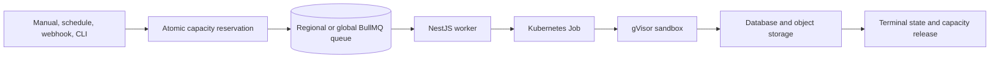

# Supercheck execution engine

## Start here

| File | Why |
|---|---|
| `app/src/lib/capacity-manager.ts` | Atomic Redis reserve/release (app-side admission) |
| `worker/src/execution/services/execution-admission.service.ts`, `execution-queue-fairness.service.ts` | Worker-side admission and fairness, the enforcement point |
| `app/src/lib/queue.ts`, `app/src/lib/job-scheduler.ts`, `app/src/lib/monitor-scheduler.ts` | Queues, connections, schedulers |
| `app/src/lib/status-page-scheduler.ts`, `app/src/lib/sre/incident-renotify.ts`, `app/src/sre/lib/background-alert-triage-processor.ts` | App-owned BullMQ workers (`status-page-jobs`, `sre-incident-renotify`, `sre-alert-triage`); `closeQueue()` in `queue.ts` closes each on SIGTERM, so new ones need a shutdown hook there and an entry in the Bull dashboard and worker queue alerting |
| `app/src/lib/location-registry.ts`, `app/src/lib/monitor-location-routing.ts` | Location normalization and queue routing |
| `worker/src/common/security/container-executor.service.ts` (+ `.spec.ts`) | Kubernetes Job rendering: runtime class, deadlines, TTL |

## Workload model

- App routes/actions/schedulers admit and enqueue Playwright, k6, and monitor work.
- Scheduler processors execute in the app tier so scheduled work passes through central capacity policy. Workers must not consume scheduler payloads.
- Worker processors under `worker/src/execution`, `worker/src/k6`, and `worker/src/monitor` run independently from the app release.
- Regional queues target configured locations; global queues are used only when any eligible worker may process the job.
- Queue constants, payload types, status enums, retries, timeout meanings, IDs, and result contracts must remain in app/worker parity.

## Capacity and idempotency

- Organization-level admission is the capacity source of truth. Running and queued reservations use atomic Redis operations and fail closed if capacity state cannot be trusted. App-side checks are advisory; worker admission enforces.
- Reserve before dispatch. Release exactly once on every terminal path: completion, terminal failure, cancellation, timeout, dispatch failure, and unrecoverable worker loss.
- Retryable BullMQ attempts retain the reservation until the job becomes terminal.
- Duplicate delivery, scheduler overlap, API retries, and webhook retries must not create duplicate executions or double-release capacity.
- Keep configured app capacity, worker replicas, per-processor concurrency, and Kubernetes resource ceilings coherent.

## Redis and BullMQ

- Redis must use `maxmemory-policy noeviction`; evicting queue keys can lose or corrupt jobs.
- General queue operations may share appropriate base connections.
- Every `QueueEvents` consumer needs its own dedicated connection because blocking `XREAD` cannot share a normal command connection. In the app, pass Redis options (`buildRedisOptions(...)`) so BullMQ creates and owns it; an external `duplicate()` gets duplicated again and leaks.
- Do not set `commandTimeout` on shared options inherited by QueueEvents (see the note in `app/src/lib/queue.ts`); non-blocking clients such as the stalled-job handler may set it. Keep bounded connection establishment while allowing intentional failover reconnection.
- With no `commandTimeout`, commands wait in ioredis's offline queue during an outage. Enqueue entry points (the `add*ToQueue` producers, the execution rate limiter, the API-key trigger route and the scheduler tick) call `assertExecutionQueueReady()` / check `status === 'ready'` before any run row or reservation, so the request gets the existing 503 (`EXECUTION_QUEUE_UNAVAILABLE` / `EXECUTION_ADMISSION_UNAVAILABLE`) instead of hanging.
- Promotion deletes nothing it still needs: the payload `capacity:job:<id>` gets a short expiry in the promotion script and is deleted after `queue.add`, so a crash in between lets the worker's orphan sweep recover the run (once it is past its 30-minute age bar) instead of after 48h. The drift reconciler corrects the running counter by compare-and-set against the value it read, so a concurrent INCR/DECR is never overwritten.
- A scheduler tick is idempotent: its run carries `metadata.scheduleTickKey` (`<repeat job id>:<attemptsMade>`) and a redelivered tick that already created a run is skipped; a BullMQ retry (higher `attemptsMade`) is a new tick on purpose. Usage is metered per attempt (`runId:attempt:N`).
- Monitor connection count across app replicas, workers, schedulers, dashboards, and event streams.

## Payloads, secrets, and artifacts

- Queue payloads contain trusted identifiers and bounded safe execution inputs—not decrypted tenant secrets.
- Workers resolve current scoped variables immediately before execution and redact values from output.
- Large scripts/results/artifacts belong in bounded payload/storage paths, not oversized Redis values or unbounded process memory.
- Artifact upload failures have explicit timeout/retry behavior and cannot leave runs permanently active.

## Cancellation and failures

- Cancellation is idempotent: mark intent, stop queued work or signal active work, terminate the execution Job when necessary, persist one terminal state, and release capacity once.
- Runs cancelled before any worker picks them up must still be finalized, and give-up paths (for example capacity-wait timeouts) must not overwrite an existing cancellation marker. Cancellation is asynchronous to API callers and E2E tests.
- Capacity and unverifiable-execution give-up paths use `DbService.failRunUnlessCancelled`; its single guarded write prevents a late cancellation from being overwritten and preserves terminal results.
- Let BullMQ retry eligible failures; do not swallow processor errors after marking an intermediate state. Once an execution container has run, a post-run failure (report upload, result save) is `UnrecoverableError`: a retry would run the test against the customer's target again.
- A busy pod throws `ExecutionCapacityError` before any reservation so the processor delays the job (`deferForCapacity`) without spending an attempt.
- Stalled-job policy is bounded: Playwright and k6 workers use a 5-minute `lockDuration`, while monitor workers use 15 minutes to allow for slow synthetic checks. Locks are renewed while workers are alive, so a crashed worker frees its run quickly, and the age-based stalled-run sweep stays above the 60-minute maximum run.
- Worker shutdown stops queue intake and reports not-ready, then drains for `WORKER_SHUTDOWN_DRAIN_MS` (max 65 minutes) while in-flight work finishes. The drain counts everything picked up (`trackInFlight`), not only runs that already have a Job, and nothing creates a Job after it ends. Remaining Jobs are then deleted.
- A restart-interrupted run is `interrupted`, never a user cancellation. If its pod never started it is delayed with `ExecutionCapacityError` (no attempt, no billing) and another worker runs it. If it had started it is terminal: not re-run, stored with "Interrupted by worker restart" and each engine's existing error status (Playwright `failed`, k6 `error`), and it sends no job notification or alert (treated like `cancelled` by `handleJobNotifications`).
- Teardown that in-flight runs depend on (the shared Redis client, SMTP transport, queue workers) runs in `onApplicationShutdown`, after the drain. `ContainerExecutorService.onModuleDestroy` owns the drain: it stops intake, drains in-flight work, clears cancellation timers and deletes the remaining Jobs. Other `onModuleDestroy` hooks only stop intake and timers. Queue workers close only after the drain.

## Production sandbox

- Production execution runs in a dedicated namespace with `runtimeClassName: gvisor` and fails closed if required isolation is unavailable.
- `EXECUTION_RUNTIME_CLASS_NAME=none` is local-development only.
- Jobs use the zero-permission execution service account, non-root identity, read-only root filesystem, dropped capabilities, no privilege escalation, bounded writable storage, CPU/memory/ephemeral limits, and deadline/cleanup settings.
- Namespace LimitRange/ResourceQuota and worker-configured ceilings stay aligned.
- NetworkPolicy denies by default and allows only required DNS/egress. Application SSRF protection remains required even with network isolation.

## Verification

- Test races at capacity boundaries, duplicate dispatch, retries, cancellation timing, Redis loss/recovery, worker loss, timeout, upload failure, and cleanup.
- Test rolling app/worker compatibility and location normalization/routing.
- Render the actual Kubernetes Job and security policy; source-template review alone is insufficient.
