# Supercheck MCP server

The app exposes a read-only Model Context Protocol endpoint for AI clients. It is off unless `MCP_SERVER_ENABLED=true` (`app/src/lib/mcp/config.ts`).

```mermaid
flowchart LR
  CLIENT[MCP client] --> ROUTE["/api/mcp route"]
  ROUTE --> ORIGIN[Origin check]
  ORIGIN --> TOKEN[OAuth access token verified]
  TOKEN --> BODY[Bounded body read]
  BODY --> LIMIT[Admission keyed on token claims]
  LIMIT --> CTX[Call context: org, project, role]
  CTX --> TOOL[Read-only tool]
  TOOL --> RBAC[assertCanView resource]
  RBAC --> QUERY[Org- and project-scoped query]
  QUERY --> REDACT[safeText / safeTarget]
```

## Start here

| File | Why |
|---|---|
| `app/src/app/api/mcp/route.ts` | Transport, `hasTrustedRequestOrigin`, admission, body read |
| `app/src/lib/mcp/tools.ts` | Tool registry (`registerMcpTools`) and the tool helper every tool goes through |
| `app/src/lib/mcp/context.ts` | `resolveMcpCallContext` from token claims, `assertCanView` |
| `app/src/lib/mcp/call-limits.ts` | Per-client and per-user message rates, batch and concurrency caps, `readMcpBody` |
| `app/src/lib/mcp/redact.ts`, `http-policy.ts`, `auth-plugins.ts` | Output redaction, OAuth endpoint deny list, OAuth plugin setup |

User docs: `docs/content/docs/mcp/` (`tools.mdx`, `security.mdx`, `connect.mdx`).

## Tool rules

- Tools are read-only: register with the shared annotations (`readOnlyHint: true`, `destructiveHint: false`). A write tool needs its own scope, RBAC action, quota preflight, and audit design first; do not add one as a small change.
- Register every tool through the `tool(...)` helper in `tools.ts` with an RBAC resource; it runs `assertCanView`, maps errors to `forbidden`/`not_found`/`internal_error`, and writes an `mcp_tool_call` audit event with ids and timing only (never arguments or results).
- Scope every query with the call's `organizationId` and `projectId` (the `scope()` helper). A connection is bound to one project. Tables without an organization column (`runs`, `project_variables`) are scoped through the owning project (`exists` on `projects`), and child rows (job tests, requirement links, component monitors) through a project-scoped parent.
- Validate arguments with Zod: ids are UUIDs, lists use the shared `page` shape (`limit` capped at `MAX_LIMIT`, cursor is the last id).
- Never return scripts, secrets, variable values (`list_variables` returns variable metadata without values: id, key, type, isSecret, description, updatedAt), headers, auth or request bodies (`get_monitor` uses an allow-list of scalar settings), notification channels or trigger keys, status page subscribers, investigation prompts, agent state, evidence or cost, or raw response bodies. Pass user-controlled text through `safeText` (bounded, redacted) and monitor targets through `safeTarget` (no credentials or query strings).
- Tools returning stored data end their description with the `UNTRUSTED` suffix (the static `prepare_local_authoring` hint is the exception): returned text comes from test output or incidents and is prompt-injection input for the client.
- Do not expose billable AI SRE actions (triage, investigate, Copilot chat, evidence briefs): they spend credits and stream output. Stored results are readable (`list_investigations`, `get_investigation`); starting work needs a separate scope, consent wording and cost guard.
- Return `ok(...)`/`fail(code, message)`: structured content plus a JSON text copy; errors are stable codes, not stack traces.

## Transport and auth rules

- Request order in `route.ts`: `POST` checks the origin (`hasTrustedRequestOrigin`), then `requireMcpAuth` verifies the token; inside `handle`, a Content-Length precheck, bounded body read (`readMcpBody`, `MAX_BODY_BYTES` and a `MCP_BODY_READ_TIMEOUT_MS` deadline answered with 408), admission (`admitMcpCall`, keyed on the verified `sub`/`azp` claims: rate, batch, concurrency), then per-call context resolution. Admission cannot move ahead of token verification. Every new code path must stay behind the same checks, and the permit must be released on every exit.
- Tokens come from the Better Auth OAuth provider; OAuth HTTP endpoints outside the supported flow are denied (`isOAuthEndpointDenied`) and pruned from discovery metadata.
- `resolveMcpCallContext` re-checks the user on every call: banned or inactive owners are rejected (`isCredentialOwnerActive`), not only at connect time.

## Verify

- Each tool: happy path, cross-org and cross-project denial, wrong role, malformed id, pagination edge, redaction of secrets and URLs in output.
- Route: forged origin, oversized body, rate and concurrency limits, disabled flag returns no endpoint.
- DB-backed specs (`*.db.spec.ts`) run only with `npm run test:db`.
- Update `docs/content/docs/mcp/tools.mdx` when the tool surface changes.
