# Supercheck MCP server

The app exposes a Model Context Protocol endpoint for AI clients: read tools under `mcp:read`, plus optional incident write tools (`mcp:incidents:write`) and billable AI SRE tools (`mcp:sre`). It is off unless `MCP_SERVER_ENABLED=true` (`app/src/lib/mcp/config.ts`).

```mermaid
flowchart LR
  CLIENT[MCP client] --> ROUTE["/api/mcp route"]
  ROUTE --> ORIGIN[Origin check]
  ORIGIN --> TOKEN[OAuth access token verified]
  TOKEN --> BODY[Bounded body read]
  BODY --> LIMIT[Admission keyed on token claims]
  LIMIT --> CTX[Call context: org, project, role]
  CTX --> TOOL[Tool, gated by scope]
  TOOL --> RBAC[assertCanView resource]
  RBAC --> QUERY[Org- and project-scoped query]
  QUERY --> REDACT[safeText / safeTarget]
```

## Start here

| File | Why |
|---|---|
| `app/src/app/api/mcp/route.ts` | Transport, `hasTrustedRequestOrigin`, admission, body read |
| `app/src/lib/mcp/tools.ts` | Tool registry (`registerMcpTools`) and the tool helper every tool goes through |
| `app/src/lib/mcp/sre-tools.ts` | Optional-scope tools; each call re-checks scope and live RBAC |
| `app/src/lib/mcp/context.ts` | `resolveMcpCallContext` from token claims, `assertCanView` |
| `app/src/lib/mcp/call-limits.ts` | Per-client and per-user message rates, batch and concurrency caps, `readMcpBody` |
| `app/src/lib/mcp/redact.ts`, `http-policy.ts`, `auth-plugins.ts` | Output redaction, OAuth endpoint deny list, OAuth plugin setup |

User docs: `docs/content/docs/mcp/` (`tools.mdx`, `security.mdx`, `connect.mdx`).

## Tool rules

- Read tools use the shared annotations (`readOnlyHint: true`, `destructiveHint: false`). A new write or billable tool goes under an optional scope (granted only when both the stored consent and the token carry it), checks its RBAC action per call, reuses the REST route's rate limits and gates, and gets consent copy.
- Register every tool through the `tool(...)` helper in `tools.ts` with an RBAC resource; it runs `assertCanView`, maps errors to `forbidden`/`not_found`/`internal_error`, and writes an `mcp_tool_call` audit event with ids and timing only (never arguments or results).
- Scope every query with the call's `organizationId` and `projectId` (the `scope()` helper). A connection is bound to one project. Tables without an organization column (`runs`, `project_variables`) are scoped through the owning project (`exists` on `projects`), and child rows (job tests, requirement links, component monitors) through a project-scoped parent.
- Validate arguments with Zod: ids are UUIDs, lists use the shared `page` shape (`limit` capped at `MAX_LIMIT`, cursor is the last id).
- Never return scripts, secrets, variable values (`list_variables` returns variable metadata without values: id, key, type, isSecret, description, updatedAt), headers, auth or request bodies (`get_monitor` uses an allow-list of scalar settings), notification channels or trigger keys, status page subscribers, investigation prompts, agent state, evidence or cost, or raw response bodies. Pass user-controlled text through `safeText` (bounded, redacted) and monitor targets through `safeTarget` (no credentials or query strings).
- Tools returning stored data end their description with the `UNTRUSTED` suffix (the static `prepare_local_authoring` hint is the exception; the write and SRE tools carry it too, via `UNTRUSTED` in `config.ts`): returned text comes from test output or incidents and is prompt-injection input for the client.
- Billable AI SRE tools (`mcp:sre`: triage, investigate, evidence brief) run the same gates as the REST routes and return `accepted` at once (triage and brief first refuse with `conflict` when a run of that kind is active and not stale, as `investigate_incident` does; `startGate`); the run continues in `after()` and the client polls `list_investigations` / `get_investigation`. Copilot chat is not exposed (streaming).
- Return `ok(...)`/`fail(code, message)`: structured content plus a JSON text copy; errors are stable codes, not stack traces.

## Transport and auth rules

- Request order in `route.ts`: `POST` checks the origin (`hasTrustedRequestOrigin`), then `requireMcpAuth` verifies the token; inside `handle`, a Content-Length precheck, admission (`admitMcpCall`, keyed on the verified `sub`/`azp` claims: rate and concurrency, with the one-message charge taken up front), then the bounded body read (`readMcpBody`, `MAX_BODY_BYTES` and a `MCP_BODY_READ_TIMEOUT_MS` deadline answered with 408; a batch is charged for its extra messages after parsing), then per-call context resolution. Admission cannot move ahead of token verification. Every new code path must stay behind the same checks, and the permit must be released on every exit.
- Consent: `mcp:read` is always required (rejected at `/oauth2/authorize` with `invalid_scope`, re-checked in the consent route, which never records a read-less row). The consent row holds the union of scopes approved for (client, project): the consent route wraps approval in `withMergedConsentScopes` (`connections.ts`), since Better Auth's upsert overwrites. Only Disconnect removes scopes.
- Auth refusals: a rejected token gets `error="invalid_token"` and `error.data.code: invalid_token`; an empty batch is `-32600`; non-POST methods are 405 with `Allow: POST`.
- Tokens come from the Better Auth OAuth provider; OAuth HTTP endpoints outside the supported flow are denied (`isOAuthEndpointDenied`) and pruned from discovery metadata.
- `resolveMcpCallContext` re-checks the user on every call: banned or inactive owners are rejected (`isCredentialOwnerActive`), not only at connect time.

## Verify

- Each tool: happy path, cross-org and cross-project denial, wrong role, malformed id, pagination edge, redaction of secrets and URLs in output.
- Route: forged origin, oversized body, rate and concurrency limits, disabled flag returns no endpoint.
- DB-backed specs (`*.db.spec.ts`) run only with `npm run test:db`.
- Update `docs/content/docs/mcp/tools.mdx` when the tool surface changes.
