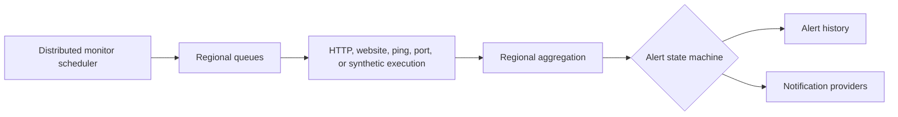

# Supercheck monitoring and alerts

## Start here

| File | Why |
|---|---|
| `worker/src/monitor/monitor.service.ts` | Check execution per monitor type |
| `worker/src/monitor/monitor-evaluator.ts` | Threshold, transition, and alert logic (`evaluateAndSendAlert`); uses `fetchPublicEndpoint` for SSRF-safe requests |
| `app/src/lib/monitor-cycles.ts`, `worker/src/monitor-control/` (`cycle-policy.ts`, `monitor-cycle.processor.ts`) | Durable check cycles: missing, late, and skipped regions |
| `app/src/lib/monitor-aggregation-service.ts` | Regional rollup and uptime |
| `worker/src/notification/notification.service.ts`, `app/src/db/schema/notification.ts` | Providers, delivery, alert history |

## Monitor definition and execution

- Monitor definitions are tenant-owned configuration; executions and regional results are immutable observations.
- Preserve target, type, request/check config (method, headers/body, auth, timeouts, expected status/keywords, SSL checks), synthetic test reference, frequency, location selection, alert thresholds/flags, muted state, enabled state, and notification relationships across schema, APIs, UI, scheduler, queue, and worker. Monitor `retryStrategy` is deprecated and ignored.
- Monitor destinations are untrusted. Validate URL shape at configuration time; enforce SSRF-safe DNS-pinned resolution at execution time, re-applied on every redirect and against DNS changes.
- Scheduling is safe across multiple app replicas via BullMQ repeatable monitor jobs keyed by a stable jobId, with a Redis NX lock guarding startup re-scheduling (`app/src/lib/monitor-scheduler.ts`). Restarts or overlapping ticks must not duplicate dispatch.
- Location selection maps deterministically to worker queues and rejects unknown/unavailable locations deliberately.

## Aggregation

- A regional result and aggregate monitor state are separate. Never infer global health from one region.
- Define how missing, late, timed-out, and conflicting regional results affect aggregate status; preserve that rule across dashboards, APIs, and alert evaluation. Check cycles own that rule (`worker/src/monitor-control/cycle-policy.ts`): skipped cycles close neutrally and do not count against uptime, a cycle stays retryable through a verification outage, and a processor must ignore cycles owned by another monitor.
- Use consistent units and boundaries for latency, uptime, thresholds, and time windows.
- Store enough immutable evidence to explain why an alert transitioned without retaining secrets or unrestricted response bodies.

## Alert state and history

- Model transitions explicitly using the current states and consecutive-failure/recovery policy.
- Persist state transitions with the result that caused them; `alert_history` records each delivery attempt (provider, status, outcome).
- Deduplicate repeated failing observations while preserving meaningful reminders/escalations configured by the product.
- Recovery closes the active condition once (one recovery alert per outage); failure reminders back off exponentially and are capped at 3 per sequence.
- Acknowledgement is not implemented. Manual status changes require permission, tenant scope, audit events, and race-safe updates.

## Notification providers

- Provider definitions (email, Slack, webhook, Telegram, Discord, Teams; webhook presets for PagerDuty, Opsgenie, Splunk On-Call, Better Stack, and incident.io) are scoped to their owning tenant and secrets remain encrypted/redacted.
- Render messages from bounded, escaped data. Do not leak headers, variables, tokens, raw response bodies, or internal errors.
- Delivery uses bounded timeouts with provider-appropriate retry behavior (Slack, Telegram, Discord, and Teams retry; webhook and email are single-attempt today).
- Webhook destinations use SSRF protection (allowlisted hosts, DNS pinning). Notification delivery is strictly outbound; no inbound callback route exists.
- Record delivery outcome and safe provider diagnostics without blocking the monitor’s terminal persistence indefinitely.

## Verify

- Unit-test threshold boundaries, state transitions, deduplication, recovery, and partial/missing region behavior.
- Integration-test scheduler ownership, queue routing, worker output, and provider retry/idempotency.
- Test cross-tenant provider/monitor access and secret redaction.
- Use disposable provider endpoints and clean them up; live delivery acceptance remains separate from automated tests.
