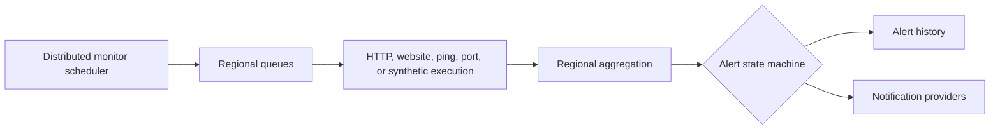

# Supercheck monitoring and alerts

## Start here

| File | Why |
|---|---|
| `worker/src/monitor/monitor.service.ts` | Check execution per monitor type; SSRF-safe probes via `requestPinnedMonitorTarget` (`common/utils/pinned-monitor-request.ts`); cycle arrival recording |
| `worker/src/monitor/monitor-evaluator.ts` | Threshold, transition, and alert logic (`evaluateAndSendAlert`) |
| `app/src/lib/monitor-cycles.ts`, `worker/src/monitor-control/` (`cycle-policy.ts`, `monitor-cycle.service.ts`, `monitor-cycle.processor.ts`) | Durable check cycles: regional quorum, closing, aborting |
| `app/src/lib/monitor-aggregation-service.ts` | Regional rollup and uptime |
| `worker/src/notification/notification.service.ts`, `app/src/db/schema/notification.ts` | Providers, delivery, alert history |

## Monitor definition and execution

- Monitor definitions are tenant-owned configuration; executions and regional results are immutable observations.
- Preserve target, type, request/check config (method, headers/body, auth, timeouts, expected status/keywords, SSL checks), synthetic test reference, frequency, location selection, alert thresholds/flags, enabled state, and notification relationships across schema, APIs, UI, scheduler, queue, and worker. Monitor `retryStrategy` is deprecated and ignored.
- `ALLOW_INTERNAL_TARGETS=true` alone lets monitors reach intranet hosts (webhook channels additionally need `SELF_HOSTED`, via `allowInternalWebhookTargets()`); metadata and link-local addresses are always blocked for monitors, in the worker (`resolvePublicAddresses`) and the app (`monitor-target-policy.ts`).
- Check classification (worker `monitor.service.ts`, `common/utils/network-error.ts`): timeouts are detected by `isTimeoutError` (code `ETIMEDOUT` incl. inside `AggregateError`, or message, case-insensitive). DNS failures and `MonitorRedirectError` (limit, invalid or non-http redirect) are `down`; validation and system faults stay `error`. Ping counts `ECONNREFUSED` as up (host answered) and times only the answering attempt. TCP `expectClosed` passes on refusal, and on timeout only when the ping probe finds the host alive (else down; the probe starts with the connect, tries both ports in parallel on the same vetted lookup and shares the configured timeout). Ping counts any ECONNREFUSED in an AggregateError as alive. An oversized 3xx body is `error` (redirect unverified). UDP connect failures surface as `error`. UDP probes on a connected socket: ICMP refusal = closed, reply = open, silence = open|filtered (up; fails `expectClosed`). HTTP pins every vetted address with `autoSelectFamily`; `responseSize` is bytes; a body over the size cap is `up`/`down` by status (`error` with no status or a keyword check). `isExpectedStatus` is strict and case-insensitive (`/^[1-5]xx$/`, `NNN`, `NNN-NNN` ascending, 100-599); malformed entries never match and the API rejects them.
- Monitor destinations are untrusted. Validate URL shape at configuration time; enforce SSRF-safe DNS-pinned resolution at execution time, re-applied on every redirect and against DNS changes.
- Scheduling is safe across multiple app replicas via BullMQ repeatable monitor jobs keyed by a stable jobId, with a Redis NX lock guarding startup re-scheduling and orphan cleanup (`app/src/lib/monitor-scheduler.ts`). Cleanup removes only repeatables whose monitor is deleted, disabled, paused or has a non-null `scheduledJobId` that differs from its id; it keeps one repeatable per enabled, non-paused monitor at its current cadence (`scheduledJobId` null or matching) and removes extras or stale-cadence ones left by a frequency edit that raced a sync. Init re-reads each monitor row before scheduling it and renews the 120 s lock every 30 s. A periodic repair sweep (`repairMonitorSchedules`, every 5 min, same Redis lock as init, 100 monitors per sweep) reschedules enabled, non-paused monitors whose `scheduledJobId` is null or whose repeatable is missing, so a failed reconcile heals without a restart. A resume racing this is safe: it commits its status first, and init reads active monitors after its removals and re-schedules them. Restarts or overlapping ticks must not duplicate dispatch.
- `PATCH /api/monitors/{id}` merges `config` and `alertConfig` with `mergePatch` (RFC 7396: arrays replace, `null` deletes) in `app/src/lib/monitor-write.ts`; `PUT` replaces `config`. `PATCH .../status` takes only `up`, `down`, `paused`, `pending`, keeps `enabled` in step with `paused` and reconciles the schedule under a per-monitor lock. Turning a paused monitor back on goes through `withResumeWithinPlan` (plan-limit lock, 402/403/503), and the worker never un-pauses a monitor from an in-flight check. SSL expiry alerts are suppressed in maintenance like other alerts.
- Website SSL: the worker reads the certificate when due (`shouldPerformSslCheck`: `sslCheckFrequencyHours`, default 24; 6 h within 2x the warning window; 1 h inside it) and saves it with `sslLastCheckedAt` on `monitors.config.sslCertificate` through a jsonb merge (`recordSslCheck`). Both are worker-owned (`WORKER_OWNED_CONFIG_KEYS`): clients can neither set them on create nor wipe them on PUT. The stored copy carries `host`; a missing certificate, a host that differs from the target, or `valid: false` makes the check due on every run. Only a certificate verdict (expired, not yet valid, untrusted, hostname mismatch) fails the website check; a probe that read no certificate sets `sslWarning`, is not stamped, and retries next run. `checkSslExpirationAlert` alerts from `sslCertificate`, never from `sslWarning` text; a probe that reads no certificate keeps worker-owned `sslProbeFailure` `{since, host}` (new host restarts the clock; cleared by `recordSslCheck` or when SSL Check is off) and alerts once it is 24 h old, only while the site is up. The detail page badge reads the stored certificate, falling back to recent results.
- Monitor write paths (create, `PUT`/`PATCH /api/monitors/{id}`, collection `PUT`) share helpers in `app/src/lib/monitor-write.ts`: `frequencyMinutesError` (whole minutes 1-1440), `timeoutFrequencyError(previous, next)` (`config.timeoutSeconds` may not exceed `frequencyMinutes * 60`; rejects only a save that widens an existing excess, so a legacy invalid row keeps saving), `sanitizeMonitorFields` (name, target, `customMessage`; credentials in `config.auth` are never rewritten) and `thrownStatusResponse`. Every `alertConfig` write (including `null` and a disabled config) validates provider ids against the project and replaces `monitor_notification_settings` rows in the same transaction as the monitor row (`syncMonitorProviderRows`); `POST`/`DELETE .../notifications` mirror the rows back into `alertConfig.notificationProviders` (`mirrorProviderRowsToAlertConfig`). The collection `PUT` only touches `alertConfig` when the body has it. After a write that changes the check, routes call `reconcileMonitorSchedule` (`app/src/lib/monitor-schedule-reconcile.ts`, per-monitor lock) and answer 503 with a retry message when Redis fails; the row stays saved.
- Location selection maps deterministically to worker queues and rejects unknown/unavailable locations deliberately.

## Aggregation

- A regional result and aggregate monitor state are separate. Never infer global health from one region.
- Define how missing, late, timed-out, and conflicting regional results affect aggregate status; preserve that rule across dashboards, APIs, and alert evaluation. Cycle status is `open`, `closed`, or `aborted` (`app/src/db/schema/monitor-cycles.ts`), and the work is split:
  - `decideMonitorCycle` in `worker/src/monitor-control/cycle-policy.ts` computes the regional quorum decision only.
  - `MonitorCycleService.closeCycle` (`monitor-cycle.service.ts`) applies it: monitor status, synthetic missing-region results, and alert evaluation.
  - `monitor-cycle.service.ts` aborts cycles for paused or disabled monitors. An aborted cycle writes no synthetic failures, so it does not count against uptime.
  - `monitor-cycle.processor.ts` backs off and retries closure when a dependency check is temporarily unavailable, instead of failing the cycle.
  - `recordCycleArrival` in `worker/src/monitor/monitor.service.ts` treats a cycle owned by another monitor as absent, and a result for a closed or aborted cycle never re-evaluates it.
- Multi-region status is judged over the regions enqueued for that check (`expectedLocations` in the job data, `LocationService.calculateAggregatedStatus`'s third argument, and the persisted cycle's `expected_locations`), not every configured region. The app skips regions with no live worker heartbeat; those never count as down. The legacy aggregation path names them in the alert reason ("not run: …"); the cycle-closure path (`MISSING_CYCLE_CLOSURE_ENABLED`) judges only the expected set and does not list them. An enqueued region with no result is never counted as up: the legacy grouped path waits for every expected result before judging status (a job that fails for good writes an error result), while the cycle-closure path closes at its quorum or deadline and counts missing regions as down. The app persists the cycle with `publish_pending = true` and clears it after `addBulk`; a cycle still pending at its deadline with no results and no arrival is aborted, never closed as missing-region downtime (older apps leave it false and keep the old behaviour). The mark is retried 3 times and an error naming the cycle is logged if it still fails; any result or arrival row makes a stale flag irrelevant. Residual case: mark failed on all attempts and every region silent, so a genuine all-down cycle is aborted without an alert (the error log is the only signal). Alert `locationResults` come from the frozen closure (synthetic row for a missing region, rows up to the observed time), not a fresh newest-row query. Jobs without `expectedLocations` (rolling deploy) fall back to the configured regions. The Redis `monitor:aggr:completed:<group>` marker lives 2 hours (`AGGREGATION_COMPLETED_TTL_SECONDS`); the persisted `aggregationEvaluation` in the DB is the durable duplicate guard.
- Use consistent units and boundaries for latency, uptime, thresholds, and time windows.
- Uptime counts CHECKS, not regional rows: rows sharing an `execution_group_id` are one cycle, up or down by the monitor's region rule (`isCycleUp` in `monitor-aggregation-service.ts`, same math as the worker's `decideMonitorCycle`; the persisted `monitor_cycles` snapshot when present, else the monitor's current `locationConfig`; a missing region is down). Rows without a group count once each. A cycle still missing a region is left out until its persisted `deadline_at`, or 60 minutes after its first row when there is no cycle row (not shown as down while in flight), and a stale aggregate is deleted only when raw rows exist from before its period (raw retention is shorter than aggregate retention). The combined (`location` null) aggregate row and the `/stats` route use this; per-location rows and `/location-stats` stay per region. A cycle belongs to the period of its earliest row. Aggregate rows written before this rule keep regional counts until recomputed (hourly 24h, daily 7 days; `runDailyAggregation(days)` rebuilds further back within raw retention). Response times are up checks only (> 0 ms) everywhere. 24h p95 is raw `percentile_cont`; 30d p95 merges the daily rows' log-bucket `response_histogram` (within ~2.5%). Aggregation visits every monitor with raw rows in the lookback, including paused ones, and `/stats` reads raw rows for every period without an aggregate row. Unknown `location` filters answer 400 on `/stats` and `/results`.
- Store enough immutable evidence to explain why an alert transitioned without retaining secrets or unrestricted response bodies.

## Alert state and history

- Model transitions explicitly using the current states and consecutive-failure/recovery policy.
- Persist state transitions with the result that caused them; `alert_history` records each delivery attempt (provider, status, outcome).
- Deduplicate repeated failing observations while preserving meaningful reminders/escalations configured by the product.
- Recovery closes the active condition once (one recovery alert per outage). Monitor failure alerts are capped at 3 per sequence: the first at the threshold, then reminders when `N * (2^k - 1)` failures have passed it (k = alerts already sent, N = `max(5, 2 x threshold)`), so the gap doubles. Each alert has a window of N checks starting at `N * (2^k - 1)` after the threshold, but never earlier than `lastAlertCount - threshold + N * 2^(k-1)` (k = windows used): a late alert keeps the full scheduled gap. The counter and `config.aggregatedAlertState.lastAlertCount` are persisted after a delivered send (single-location too, via `jsonb_set`/`jsonb_build_object`), so an undelivered alert stays due and retries on each check until its window closes, and an unsent alert may use later windows. A delivery consumes its window and `alertsSentForFailure` stores the windows used (at most 3 alerts). `persistAggregatedAlertState` writes only `config.aggregatedAlertState` via `jsonb_set`. `alert_history` error and message text has URL credentials and query values redacted. There is no mute feature: `monitors.muted_until` is gone from the Drizzle schemas, the API and OpenAPI; the column was dropped by migration 0070 (workers of the previous release still select it, so their checks can fail until they are replaced).
- Stale scheduled checks: the scheduler sets `scheduledCheck: true` in job data; `MonitorDynamicWorkerService.isStale` skips a first-start job older than `max(3 x scheduling interval, 3 min)` (by `job.timestamp`; synthetic interval is at least 5 min) only when its cycle is already closed or a real (non-synthetic) `monitor_results` row checked after `job.timestamp` exists for the same monitor and region (any region for a legacy all-region job); otherwise, or if that lookup fails, it runs late, so a backlog does not by itself freeze status. A cycle job whose cycle already closed is skipped at any age (inside the bound quietly: debug log, not counted as a stale skip); this cannot undo a down result or alert the cycle already recorded at its deadline. A skip records no result, downtime or alert. Known limits: `checkedAt` is worker time and `job.timestamp` app time, so a worker clock far ahead can cause a false skip; concurrent stale jobs for one monitor can each run once before the first result lands. The region is dropped from the group's expected set like a no-live-worker region, so the others are still judged: `MonitorService.dropStaleRegion` shrinks the cycle's `expected_locations` and writes an arrival hint, or (legacy) adds it to Redis `monitor:aggr:dropped:<group>` and re-evaluates now. Manual runs (no flag), retries and deferrals (`attemptsStarted > 1`) never skip; a delayed drop is resumed by the `_regionDropped` flag. The worker has no metrics endpoint, so skips are logged individually (info) and as one aggregated warning per minute; a burst means clock skew or queue saturation.
- Job failure/timeout alerts are attributed to a run: `alert_history.run_id` plus the partial unique index `(job_id, run_id, provider)` (migration 0055). The worker takes a per-job advisory lock, inserts a `pending` claim, then marks it `sent` or `failed`; a failed provider is retried for the same run, and reminders stay capped at 3.
- Monitor alerts are claimed per provider before sending (migrations 0068 columns, 0069 index): `alert_history` rows keyed `(monitor_id, outage_key, type, alert_ordinal, provider)` under a partial unique index (`outage_key` and `alert_ordinal` set; old and unkeyed rows stay outside it). `outage_key` identifies one failure sequence and the recovery that ends it, minted where the counters are committed: multi-location in `aggregatedAlertState.outageKey` (`getNextAggregatedAlertState`, inside the cycle-close/`prepareGroupEvaluation` transaction; dropped for uncounted cycles), single-location in the result row `details.outageKey` (`nextOutageKey`, carried by `saveMonitorResultToDb` and synthetic cycle rows). `alert_ordinal` is the reminder window index (0-2) for failures and 0 for the recovery. `MonitorAlertService.claimProviders` upserts `pending` rows in one statement (ids sorted), taking over a `failed` row with `claim_attempts` below 5 or a `pending` one older than 2 minutes (`sent_at` is the claim clock until the row is finished), and only the claimed providers are sent to. `delivered` means no provider is still owed the alert, so one failed channel keeps the alert due and is retried alone; a lost counter write cannot resend because the next in-window check finds every row `sent` (`alreadySent`) and only catches the counters up. A claim that cannot be made falls back to sending unclaimed. When every provider has used its attempts (`gaveUp`) the evaluator treats the window as terminal: counters advance like a delivery but it is not reported as sent. Each provider's row is finished as soon as its own send settles (`sendNotificationToMultipleProviders` `onSettled`), with up to 5 in-process write attempts; an outcome that still cannot be written is retried before this process's next claim, and for a failure alert the incident is opened from the known delivery (`enqueueSourceFailure`), since a row left `pending` is skipped by triage. A stale `pending` takeover cannot tell a crash from a lost write, so a database error while recording can still repeat an alert after 2 minutes (documented as a rare duplicate). Without an outage key (state or rows written by an older worker, incident-only monitors) the alert is sent and recorded unclaimed. Rollout: migrations 0068, 0069 and 0070 run on app start (0070 drops `monitors.muted_until`, so roll workers promptly after the app) and must run before the new worker (0069 builds the claim index CONCURRENTLY outside a transaction, so `alert_history` stays writable; until it exists the claim fails and the alert is sent unclaimed); workers of the previous release write rows without keys and drop `outageKey` when they rewrite the alert state, so mid-rollout an outage can alert twice. A recovery held by another evaluator's live claim is retried (`deliveryFailed`) so a dead holder cannot lose it. Known limits: a provider that keeps failing past its window gets the next window's alert while the others get a repeat, and two simultaneous first checks of one single-location monitor can mint two keys. Retention (`AlertHistoryCleanupStrategy`) keeps keyed rows of monitors currently `down` or `error`.
- SSL renewed notice: delivering an `ssl_expiring` warning stores `config.sslAlertState` `{id, host, validTo?, warnedAt}` (worker-owned; kept for the same host). A later certificate read that is valid with `daysRemaining` above the warning window, or a later `validTo`, sends one `ssl_renewed` notice claimed under `sslAlertState.id`, then clears the state; none without a stored warning, held back in maintenance, retried on the next read if undelivered, and given up (state cleared) once every channel used its 5 attempts. A warning that was an unreadable certificate has no `validTo`, so its notice reads "readable again". The state is also dropped when SSL alerts, alerts or SSL Check are turned off: at write time by `dropStaleSslAlertState` in `updateMonitorHandler` (deletion is the only client-side change to this worker-owned key), and by the worker when it next evaluates; with SSL Check off `checkSslExpirationAlert` returns before any SSL alert, so an in-flight read cannot warn after checking was disabled. A new outage never reuses the key of a recovered one: `getNextAggregatedAlertState` reuses a key only while `consecutiveFailureCount > 0`. `ssl_renewed` never goes to incident triage (worker skips it, `background-alert-triage` and `isActionableAlertForIncident` ignore it) and webhooks get `resolve` with the `ssl:` dedup key.
- Alerts open incidents: a sent or failed (not pending) `alert_history` row is queued for `app/src/sre/lib/background-alert-triage.ts`, which opens or joins one incident per monitor or job. `alertConfig` carries `incidentEnabled` (default on), `incidentSeverity` (`auto` or `sev1`-`sev4`) and `autoResolveIncident` (default on); a recovery resolves the open auto-opened incident when it is on, even if recovery alerts are off. Only `SRE_ENABLED` is needed; `SRE_AUTOMATION_ENABLED` gates AI triage. A monitor with alerts off but `incidentEnabled: true` is incident-only (`isIncidentOnly`, `tracksAlertState` in the evaluator; `incidentsEnabled` in `app/src/lib/incident-settings.ts`), and `channelsOptional` there lets an enabled alert have no notification channel when it still opens incidents. `sre_incidents.alert_count` and `last_alert_at` (migration 0063) count the opening alert plus repeats. Keep these fields in sync across the app schema, worker, CLI schema, MCP tools and OpenAPI.
- Alert acknowledgement is not implemented; incident acknowledgement is (see the SRE operations skill). Manual status changes require permission, tenant scope, audit events, and race-safe updates.

## Notification providers

- Provider definitions (email, Slack, webhook, Telegram, Discord, Teams; webhook presets for PagerDuty, Opsgenie, Splunk On-Call, Better Stack, and incident.io) are scoped to their owning tenant and secrets remain encrypted/redacted.
- Render messages from bounded, escaped data. Do not leak headers, variables, tokens, raw response bodies, or internal errors.
- Delivery uses bounded timeouts with provider-appropriate retry behavior (Slack, Telegram, Discord, and Teams retry; webhook and email are single-attempt today).
- Notification text is sanitized centrally: monitor targets and URLs inside messages have userinfo and sensitive query values redacted, Slack text escapes `&`, `<`, `>`, webhook delivery errors go through `safeSendError`, an email with no deliverable recipient is a failure, and a synthetic monitor whose variables or secrets cannot be resolved reports `error` without running the test. `sanitizeResponseBody` truncates before redacting and uses bounded regexes.
- Webhook destinations use SSRF protection (allowlisted hosts, DNS pinning). Notification delivery is strictly outbound; no inbound callback route exists.
- Record delivery outcome and safe provider diagnostics without blocking the monitor’s terminal persistence indefinitely.

## Verify

- Unit-test threshold boundaries, state transitions, deduplication, recovery, and partial/missing region behavior.
- Integration-test scheduler ownership, queue routing, worker output, and provider retry/idempotency.
- Test cross-tenant provider/monitor access and secret redaction.
- Use disposable provider endpoints and clean them up; live delivery acceptance remains separate from automated tests.
