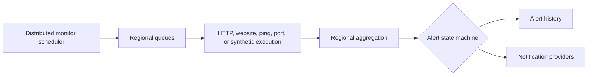

# Supercheck monitoring and alerts

## Start here

| File | Why |
|---|---|
| `worker/src/monitor/monitor.service.ts` | Check execution per monitor type; SSRF-safe probes via `requestPinnedMonitorTarget` (`common/utils/pinned-monitor-request.ts`); cycle arrival recording |
| `worker/src/monitor/monitor-evaluator.ts` | Threshold, transition, and alert logic (`evaluateAndSendAlert`) |
| `app/src/lib/monitor-cycles.ts`, `worker/src/monitor-control/` (`cycle-policy.ts`, `monitor-cycle.service.ts`, `monitor-cycle.processor.ts`) | Durable check cycles: regional quorum, closing, aborting |
| `app/src/lib/monitor-aggregation-service.ts` | Regional rollup and uptime |
| `worker/src/notification/notification.service.ts`, `app/src/db/schema/notification.ts` | Providers, delivery, alert history |

## Monitor definition and execution

- Monitor definitions are tenant-owned configuration; executions and regional results are immutable observations.
- Preserve target, type, request/check config (method, headers/body, auth, timeouts, expected status/keywords, SSL checks), synthetic test reference, frequency, location selection, alert thresholds/flags, muted state, enabled state, and notification relationships across schema, APIs, UI, scheduler, queue, and worker. Monitor `retryStrategy` is deprecated and ignored.
- `ALLOW_INTERNAL_TARGETS=true` alone lets monitors reach intranet hosts (webhook channels additionally need `SELF_HOSTED`, via `allowInternalWebhookTargets()`); metadata and link-local addresses are always blocked for monitors, in the worker (`resolvePublicAddresses`) and the app (`monitor-target-policy.ts`).
- Check classification (worker `monitor.service.ts`, `common/utils/network-error.ts`): timeouts are detected by `isTimeoutError` (code `ETIMEDOUT` incl. inside `AggregateError`, or message, case-insensitive). DNS failures and `MonitorRedirectError` (limit, invalid or non-http redirect) are `down`; validation and system faults stay `error`. Ping counts `ECONNREFUSED` as up (host answered) and times only the answering attempt. TCP `expectClosed` passes on refusal, and on timeout only when the ping probe finds the host alive (else down; the probe runs both ports in parallel on the same vetted lookup within the remaining budget, min 1s). Ping counts any ECONNREFUSED in an AggregateError as alive. An oversized 3xx body is `error` (redirect unverified). UDP connect failures surface as `error`. UDP probes on a connected socket: ICMP refusal = closed, reply = open, silence = open|filtered (up; fails `expectClosed`). HTTP pins every vetted address with `autoSelectFamily`; `responseSize` is bytes; a body over the size cap is `up`/`down` by status (`error` with no status or a keyword check). `isExpectedStatus` is strict and case-insensitive (`/^[1-5]xx$/`, `NNN`, `NNN-NNN` ascending, 100-599); malformed entries never match and the API rejects them.
- Monitor destinations are untrusted. Validate URL shape at configuration time; enforce SSRF-safe DNS-pinned resolution at execution time, re-applied on every redirect and against DNS changes.
- Scheduling is safe across multiple app replicas via BullMQ repeatable monitor jobs keyed by a stable jobId, with a Redis NX lock guarding startup re-scheduling and orphan cleanup (`app/src/lib/monitor-scheduler.ts`). Cleanup removes only repeatables whose monitor is deleted, disabled, paused or has a non-null `scheduledJobId` that differs from its id; it keeps an enabled, non-paused monitor's repeatable whose `scheduledJobId` is null or matches. A resume racing this is safe: it commits its status first, and init reads active monitors after its removals and re-schedules them. Restarts or overlapping ticks must not duplicate dispatch.
- `PATCH /api/monitors/{id}` merges `config` and `alertConfig` with `mergePatch` (RFC 7396: arrays replace, `null` deletes) in `app/src/lib/monitor-write.ts`; `PUT` replaces `config`. `PATCH .../status` takes only `up`, `down`, `paused`, `pending`, keeps `enabled` in step with `paused` and reconciles the schedule under a per-monitor lock. Turning a paused monitor back on goes through `withResumeWithinPlan` (plan-limit lock, 402/403/503), and the worker never un-pauses a monitor from an in-flight check. SSL expiry alerts are suppressed in maintenance like other alerts.
- Location selection maps deterministically to worker queues and rejects unknown/unavailable locations deliberately.

## Aggregation

- A regional result and aggregate monitor state are separate. Never infer global health from one region.
- Define how missing, late, timed-out, and conflicting regional results affect aggregate status; preserve that rule across dashboards, APIs, and alert evaluation. Cycle status is `open`, `closed`, or `aborted` (`app/src/db/schema/monitor-cycles.ts`), and the work is split:
  - `decideMonitorCycle` in `worker/src/monitor-control/cycle-policy.ts` computes the regional quorum decision only.
  - `MonitorCycleService.closeCycle` (`monitor-cycle.service.ts`) applies it: monitor status, synthetic missing-region results, and alert evaluation.
  - `monitor-cycle.service.ts` aborts cycles for paused or disabled monitors. An aborted cycle writes no synthetic failures, so it does not count against uptime.
  - `monitor-cycle.processor.ts` backs off and retries closure when a dependency check is temporarily unavailable, instead of failing the cycle.
  - `recordCycleArrival` in `worker/src/monitor/monitor.service.ts` treats a cycle owned by another monitor as absent, and a result for a closed or aborted cycle never re-evaluates it.
- Multi-region status is judged over the regions enqueued for that check (`expectedLocations` in the job data, `LocationService.calculateAggregatedStatus`'s third argument, and the persisted cycle's `expected_locations`), not every configured region. The app skips regions with no live worker heartbeat; those never count as down. The legacy aggregation path names them in the alert reason ("not run: …"); the cycle-closure path (`MISSING_CYCLE_CLOSURE_ENABLED`) judges only the expected set and does not list them. An enqueued region with no result is never counted as up: the legacy grouped path waits for every expected result before judging status (a job that fails for good writes an error result), while the cycle-closure path closes at its quorum or deadline and counts missing regions as down. Jobs without `expectedLocations` (rolling deploy) fall back to the configured regions. The Redis `monitor:aggr:completed:<group>` marker lives 2 hours (`AGGREGATION_COMPLETED_TTL_SECONDS`); the persisted `aggregationEvaluation` in the DB is the durable duplicate guard.
- Use consistent units and boundaries for latency, uptime, thresholds, and time windows.
- Store enough immutable evidence to explain why an alert transitioned without retaining secrets or unrestricted response bodies.

## Alert state and history

- Model transitions explicitly using the current states and consecutive-failure/recovery policy.
- Persist state transitions with the result that caused them; `alert_history` records each delivery attempt (provider, status, outcome).
- Deduplicate repeated failing observations while preserving meaningful reminders/escalations configured by the product.
- Recovery closes the active condition once (one recovery alert per outage); failure reminders back off exponentially and are capped at 3 per sequence.
- Stale scheduled checks: the scheduler sets `scheduledCheck: true` in job data; `MonitorDynamicWorkerService.isStale` skips a first-start job older than `max(3 x scheduling interval, 3 min)` (by `job.timestamp`; synthetic interval is at least 5 min) only when its cycle is already closed or a real (non-synthetic) `monitor_results` row checked after `job.timestamp` exists for the same monitor and region (any region for a legacy all-region job); otherwise, or if that lookup fails, it runs late, so a backlog does not by itself freeze status. A cycle job whose cycle already closed is skipped at any age (inside the bound quietly: debug log, not counted as a stale skip); this cannot undo a down result or alert the cycle already recorded at its deadline. A skip records no result, downtime or alert. Known limits: `checkedAt` is worker time and `job.timestamp` app time, so a worker clock far ahead can cause a false skip; concurrent stale jobs for one monitor can each run once before the first result lands. The region is dropped from the group's expected set like a no-live-worker region, so the others are still judged: `MonitorService.dropStaleRegion` shrinks the cycle's `expected_locations` and writes an arrival hint, or (legacy) adds it to Redis `monitor:aggr:dropped:<group>` and re-evaluates now. Manual runs (no flag), retries and deferrals (`attemptsStarted > 1`) never skip; a delayed drop is resumed by the `_regionDropped` flag. The worker has no metrics endpoint, so skips are logged individually (info) and as one aggregated warning per minute; a burst means clock skew or queue saturation.
- Job failure/timeout alerts are attributed to a run: `alert_history.run_id` plus the partial unique index `(job_id, run_id, provider)` (migration 0055). The worker takes a per-job advisory lock, inserts a `pending` claim, then marks it `sent` or `failed`; a failed provider is retried for the same run, and reminders stay capped at 3.
- Alerts open incidents: a sent or failed (not pending) `alert_history` row is queued for `app/src/sre/lib/background-alert-triage.ts`, which opens or joins one incident per monitor or job. `alertConfig` carries `incidentEnabled` (default on), `incidentSeverity` (`auto` or `sev1`-`sev4`) and `autoResolveIncident` (default on); a recovery resolves the open auto-opened incident when it is on, even if recovery alerts are off. Only `SRE_ENABLED` is needed; `SRE_AUTOMATION_ENABLED` gates AI triage. A monitor with alerts off but `incidentEnabled: true` is incident-only (`isIncidentOnly`, `tracksAlertState` in the evaluator; `incidentsEnabled` in `app/src/lib/incident-settings.ts`), and `channelsOptional` there lets an enabled alert have no notification channel when it still opens incidents. `sre_incidents.alert_count` and `last_alert_at` (migration 0063) count the opening alert plus repeats. Keep these fields in sync across the app schema, worker, CLI schema, MCP tools and OpenAPI.
- Alert acknowledgement is not implemented; incident acknowledgement is (see the SRE operations skill). Manual status changes require permission, tenant scope, audit events, and race-safe updates.

## Notification providers

- Provider definitions (email, Slack, webhook, Telegram, Discord, Teams; webhook presets for PagerDuty, Opsgenie, Splunk On-Call, Better Stack, and incident.io) are scoped to their owning tenant and secrets remain encrypted/redacted.
- Render messages from bounded, escaped data. Do not leak headers, variables, tokens, raw response bodies, or internal errors.
- Delivery uses bounded timeouts with provider-appropriate retry behavior (Slack, Telegram, Discord, and Teams retry; webhook and email are single-attempt today).
- Webhook destinations use SSRF protection (allowlisted hosts, DNS pinning). Notification delivery is strictly outbound; no inbound callback route exists.
- Record delivery outcome and safe provider diagnostics without blocking the monitor’s terminal persistence indefinitely.

## Verify

- Unit-test threshold boundaries, state transitions, deduplication, recovery, and partial/missing region behavior.
- Integration-test scheduler ownership, queue routing, worker output, and provider retry/idempotency.
- Test cross-tenant provider/monitor access and secret redaction.
- Use disposable provider endpoints and clean them up; live delivery acceptance remains separate from automated tests.
