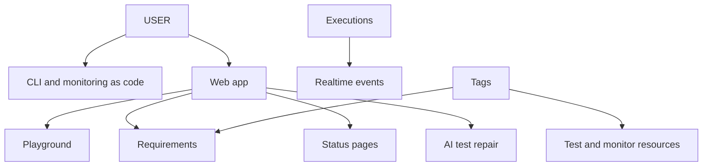

# Supercheck platform features

## CLI

- Source: `cli`; package: `@supercheck/cli`; binary: `supercheck`; license: Apache-2.0 (from 0.3.1); supported Node runtime begins at 20 unless package metadata changes.
- Config is declarative monitoring-as-code. Config loading validates schema and rejects embedded live/test/trigger token patterns, including legacy trigger formats.
- Secret variable values become environment references; file variables are excluded from generated config and use supported multipart/dashboard paths.
- Authentication storage uses the local `conf` store (static obfuscation key—not encryption); prefer `SUPERCHECK_TOKEN` from a secret store in CI, and never print tokens.
- Preserve interactive and non-interactive behavior for every registered command. The source of truth is the `addCommand` list in `cli/src/bin/supercheck.ts` (commands live in `cli/src/commands/`); read it rather than relying on a copied list. Aliases include `incident`/`incidents`, `service`/`services`, `alert`/`alerts`, `notification`/`notifications`.
- `--json` mode is enforced centrally in `cli/src/bin/supercheck.ts` (`exitOverride`, a `postAction` hook that emits a success object when a command printed nothing); new commands must not bypass it.
- `login --json` prints the device URL and code and returns immediately; the approval UI lives in `app/src/app/(device)/device/`.
- Resource kinds in config: monitors (with `tags`), tests (`@title`/`@priority`/`@tags` file annotations), jobs (no `tags`), `requirements[]`, `statusPages[]` (settings, branding, notifications, components), notification providers, variables, tags. `pull`, `diff`, `deploy` and `destroy` cover requirements and status pages; `requirement` (alias `requirements`) is the imperative command group. Keep schema (`cli/src/config/schema.ts`), `cli/src/utils/resources.ts`, `reconcile.ts`, `status-pages.ts`, docs (`docs/content/docs/cli`), `cli/CHANGELOG.md` and the bundled guides in `cli/src/commands/skills.ts` in step.
- Config semantics: omitted optional fields (requirement `tags`/`tests`, status page `notifications` flags, test annotations) leave the remote value alone and `[]` clears; tag names compare case-insensitively; status page `subdomain` is read-only (pulled, never sent); remote-only status page components are removed only with `deploy --delete`. A server without the write APIs must fail before any write with a clear message.
- AI SRE CLI contracts are `incident list/get/timeline/assign/unassign/ack/resolve` (`list --assignee me|unassigned|<id>`; `assign --user <id|me> [--commander]`), `sre triage/investigate/status/ask/brief`, and read-only `service list/get/health/dependencies`. Use `/api/sre/*` routes with unified CLI-token/session authentication; never call browser-only server actions from the CLI.
- Keep AI SRE tenant scope and RBAC server-side: incident reads need `sre_incident:view`, assign, acknowledge and resolve need `sre_incident:update`, investigations need both incident and investigation `investigate`, service reads need `sre_service:view`, and live connector tools additionally need `sre_connector:investigate`.
- Treat deep investigation as asynchronous HTTP 202 acceptance. Do not describe it as streaming; stream Copilot chat and evidence briefs only. In JSON mode emit NDJSON for streams, enforce bounded event buffers and idle timeout, support Ctrl-C, and never retry side-effecting POST requests after uncertain completion.
- Require confirmation and a non-empty audited summary for incident resolution (`--summary`, `--comment` is an alias); `--force` is the automation escape hatch. Do not add runbook execution or private-agent startup until versioned server protocols, authorization, approvals, and operational safety contracts exist.
- Notification provider JSON uses `--payload` (`--data` alias); retain legacy `--config` compatibility and reject multiple simultaneous payload options.
- Human output goes to readable terminal streams; `--json` output must remain machine-parseable without progress/noise on stdout.
- Subprocess signal termination and command failures return nonzero status. Retry only idempotent network requests.
- Reusable CI distinguishes a job trigger key from the CLI token required for polling/waiting. Bind workflow inputs through environment variables/quoted arrays, not shell interpolation.
- Verify with typecheck, lint, all Jest suites, build, and `npm pack --dry-run`; inspect packaged files and executable entrypoint.

## Realtime SSE

- Authenticate and authorize private subscriptions before opening streams; bind each stream to the permitted tenant/resource/run.
- Use dedicated blocking Redis connections where QueueEvents is involved.
- Emit typed, bounded events and heartbeats; preserve event ordering/identity expected by clients.
- Close subscriptions, timers, listeners, and Redis resources on abort, completion, timeout, navigation, and errors.
- Reconnection/resubscription must not leak other resources or create duplicate UI state.

## Requirements

- Requirements are traceability and coverage objects. They are never executed and do not own an independent pass/fail state.
- Coverage is derived from linked test executions and must remain explainable.
- Requirement, document, test, and tag links are tenant-scoped and protected against cross-project IDOR.
- Browser requirements follow the recorder-first authoring path where applicable.
- REST: `app/src/app/api/requirements/**` (list/create, `[id]`, `[id]/tests`, `[id]/tags`, `export`). Shared logic lives in `app/src/lib/requirements/service.ts`, which dashboard server actions and REST both call; add behavior there, not in a route or action alone.
- AI requirement processing uses sanitized bounded content and validated structured output.

## Tags

- Tags are scoped by organization and project and use consistent normalization/color/uniqueness rules.
- Resource joins preserve tenant scope. Filtering semantics remain aligned across API, UI, CLI, and reports.
- Deletion checks all supported relationships and returns conflict when a tag is still in use if that is the current contract.

## Status pages

- Public status endpoints expose an explicit safe field allowlist; admin APIs require RBAC and ownership.
- Support public/private status, service associations, incidents/maintenance, branding policy, and verified custom domains according to current schema.
- Custom-domain verification and any outbound DNS/HTTP checks use hardened resolution and SSRF controls.
- Preserve cloud and self-hosted routing, CNAME guidance, TLS behavior, and branding configuration.
- REST writes: `POST /api/status-pages`, `PUT /api/status-pages/[id]`, and `[id]/components` (+ `[componentId]`). Shared logic lives in `app/src/lib/status-pages/service.ts`, called by both dashboard actions and REST. Monitor tags: `app/src/app/api/monitors/[id]/tags/route.ts`. Public/CLI contract changes also need `docs/openapi.json` and the CLI updated.

## AI test repair and providers

- Sanitize scripts, errors, logs, and user instructions before model use; defend against prompt injection and secret inclusion.
- Keep provider credentials server-side and separate provider namespaces from storage credentials (notably Bedrock AWS versus S3/R2).
- Validate generated code/patch structure and run it only through normal script validation and isolated execution.
- Apply timeout, cancellation, retry, usage accounting, configured provider/model selection, and safe error behavior across supported providers.

## Web playground

- Playground execution is untrusted and ephemeral: enforce strict resource/time limits, isolation, rate limits, result bounds, and short retention.
- It must not bypass normal script validation, SSRF policy, capacity controls, or secret boundaries.
- Preserve zero-install UX while keeping durable project resources separate from temporary runs.

## Verify

- Test tenant/RBAC denial and malformed input for every feature API.
- Test SSE disconnect cleanup and cross-tenant isolation.
- Test CLI compatibility and JSON output as public contracts.
- Use browser tests for recorder-first, status-domain, and realtime UI behavior that unit tests cannot prove.
