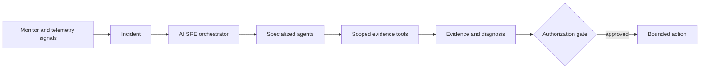
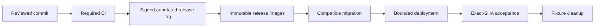

# Supercheck SRE operations

## AI SRE architecture

- AI SRE source is split between `app/src/sre`, `app/src/lib/sre`, API routes, components, and matching worker schema/types.
- Incidents, services, connectors, private agents, conversations, messages, evidence, tool calls, and usage remain scoped to their owning organization/project.
- Authorization is enforced server-side for every tool call and persisted resource. Model instructions and UI visibility are not authorization.
- Automatic alert triage is opt-in: it runs only when `SRE_AUTOMATION_ENABLED=true|1`; `SRE_ENABLED=false` disables all SRE work. Keep the app and worker gates in sync.
- Prefer read-only evidence gathering. Mutations require explicit user authority, least-privilege credentials, bounded targets, audit records, and observable outcomes.
- Kubernetes access uses namespace-scoped service accounts and allowed resources/actions; never grant `cluster-admin`.
- Preserve stable assistant/user message identity through streaming, persistence, polling/reconciliation, retries, and reloads.
- Incident lifecycle (assign, unassign, acknowledge, commander, resolve) is in `app/src/actions/sre-incident-lifecycle.ts` and `/api/sre/incidents/{id}/assign|acknowledge|resolve`, all gated by `sre_incident:update`. Resolve needs a summary (max 2000 characters); assignees must be org owner/admin or project admin/editor. Incident notifications use a fixed body and never include AI text or raw evidence.
- Connector and private-agent credentials stay encrypted/server-side and are never placed in prompts, browser payloads, logs, or model-visible errors.

## Tool and provider behavior

- Tool schemas validate inputs and bound output size. Treat provider/tool output as untrusted evidence.
- Jira, Confluence, and Notion are read-only knowledge connectors (Notion is direct only; Jira and Confluence also run on a Private Agent in `worker/src/private-agent/private-agent-knowledge.ts`). Page text is redacted, size-capped, fenced as untrusted document evidence, and fetched for top results only. Slack, Teams, Webhook, Kafka, and RabbitMQ are not evidence sources; unsupported records show as Unsupported and must be disableable.
- Cancellation and timeout propagate through model streams, tools, polling, persistence, and UI state.
- MCP connectors are Private Agent only, Streamable HTTP only, never stdio. Only tools allowlisted by a user with `sre_connector:configure` can run (description and schema are pinned at allowlist time); arguments are validated against the saved schema in `app/src/sre/tools/mcp-tools.ts` and again in `worker/src/private-agent/mcp-client.ts`. Output is text/JSON only, redacted, and untrusted; server read-only hints never authorize a call. The agent must run the same release as the app.
- Retry only transient/idempotent operations; prevent duplicate messages, actions, tool records, usage events, and charges.
- Observability providers (Jaeger, New Relic, Splunk, Google Cloud, Azure Monitor) live in `app/src/lib/sre/connectors/providers/` and are copied to `worker/src/private-agent/providers/`; edit the app files and run `npm run sync:sre-providers` in `app/`. Queries are read-only (reject Splunk write commands, non-SELECT NRQL, KQL control commands) and always time-windowed. New Relic, Google Cloud, and Azure call fixed vendor hosts.
- Provider fallback (including deterministic evidence-brief fallbacks) must preserve tenant scope, safety policy, configured model selection, usage accounting, and error semantics.
- Investigation results are structured and validated in `app/src/sre/lib/investigation-output.ts` (conclusion, confidence, ranked hypotheses; Inconclusive is valid; a hypothesis is Validated only with evidence from this incident). Similar past incidents (5 resolved, 180 days, same project) and user feedback notes are hints, never evidence. Post-mortem drafts are rate limited (5 per user per incident per hour) and fall back to a deterministic template. Changes under `app/src/sre/**` run the `sre-eval` CI gate.
- Redact secrets and sensitive telemetry before model invocation and persisted transcripts.

## Resilience

- External calls have explicit connection/operation timeouts and abort handling.
- Use exponential backoff with jitter for safe transient retries; no circuit-breaker abstraction exists yet, so introduce one deliberately if sustained dependency failure needs containment.
- Fallbacks degrade explicitly and never bypass authentication, authorization, capacity, billing, or audit controls.
- Redis connections intentionally survive failover; QueueEvents blocking connections remain isolated from normal command timeout behavior.
- Distributed schedulers/locks use ownership tokens and bounded leases so one instance cannot release another’s lock.

## Memory and performance

- Bound transcripts, evidence, logs, tool output, arrays, caches, queue payloads, and export/result sizes.
- Stream large responses/artifacts and paginate growing datasets.
- Clean up timers, listeners, subscriptions, AbortControllers, child processes, temporary files, and browser contexts on every terminal path.
- Optimize database access from measured query plans/cardinality; preserve exact React Query cache-key parity between prefetch and hooks.
- Do not trade tenant/security checks for caching or performance.

## Environment configuration

- Environment access is mixed: the app reads `process.env` directly, and the worker combines `@nestjs/config` (`ConfigModule.forRoot()` plus injected `ConfigService`) with direct `process.env` reads in several services. No central schema helper exists today.
- Keep app, worker, deployment manifests, examples, docs, and health/config diagnostics synchronized. Self-hosting assets live in `deploy/docker/` (compose variants, `install.sh`, `init-secrets.sh`, `setup-k3s.sh`, `setup-gvisor.sh`) and are tested by `compose.spec.py` and `install.spec.py`; the user guide is `docs/content/docs/app/deployment/`.
- AI SRE gates live in `app/src/sre/lib/feature-gates.ts`: `SRE_ENABLED` defaults on, `SRE_AUTOMATION_ENABLED` and `SRE_AGENT_SANDBOX_ENABLED` default off. The worker reads its own copy of `SRE_ENABLED` and `SRE_AUTOMATION_ENABLED` (`worker/src/monitor/services/sre-alert-triage-queue.service.ts`), so a change to those gates must land in both.
- AI SRE HTTP routes authorize through `app/src/app/api/sre/_auth.ts`; dynamic `[id]` routes reject malformed UUIDs before database access.
- Daily AI token cap per organization: `SRE_DAILY_TOKEN_LIMIT_PER_ORG` (default 2000000, `0` disables, UTC day, needs Redis, app only) in `app/src/lib/sre/sre-daily-token-limit.ts`. Investigations, triage, briefs, and Copilot share it; keep it in `app/.env.example`, the self-hosted docs table, and the AI SRE setup page. Investigation runs stuck for 5 minutes are marked failed by `stale-run-recovery.ts`.
- Validate required production values and fail closed when security-critical settings are missing.
- Never expose secrets through health endpoints, startup logs, client-prefixed variables, build output, or configuration APIs.
- Use distinct credentials/key namespaces for auth, encryption, object storage, AI providers, billing, email, and infrastructure.
- BullMQ Redis requires `noeviction`; production execution requires gVisor/isolation settings.

## Release management

- Use semantic project versions and immutable image tags/digests; never deploy `main`, another branch name, or `latest` to production.
- Release tags must be annotated and signed with a key listed in `.github/release-allowed-signers`; unsigned, lightweight, or unlisted-key tags fail the publish gate. Agents never create, move, or delete tags or dispatch publish workflows (`docs/releasing.md`).
- Review database compatibility before rollout and order app/worker/migration changes for version skew.
- Migration `0043_sre_incident_management.sql` (incident assignee, acknowledgement, commander, resolution summary, post-mortem columns) is forward-only and must be applied before the app that reads it is deployed.
- CI must not use `pull_request_target` with untrusted contributor code or expose secrets to fork builds.
- A successful build/deploy workflow is not release acceptance. Verify deployed SHA, health, migrations, browser flows, RBAC/flags, workers/control plane, provider/billing gates, and cleanup.
- Keep changelog, package versions, deployment defaults, docs, and release evidence synchronized.

## Verify

- Cover tenant/RBAC denial before model/provider/tool execution.
- Cover cancellation, provider failure, transcript identity, retries, audit, usage/billing exactly-once behavior, and connector/private-agent boundaries.
- Use disposable non-production fixtures. Never inject failures into production, use customer credentials/data, exhaust limits, or spend quota only to repeat a proven scenario.
