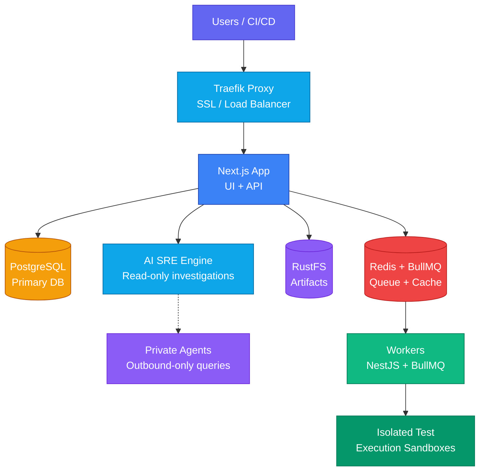

<h1> Supercheck</h1>

**Open-source testing, monitoring, and AI SRE — as code.**

Supercheck brings Playwright test automation, k6 performance testing, uptime and synthetic monitoring, incident investigation, and public status communication into one platform. Use the web application, manage resources from the CLI, and record browser tests with the Supercheck Recorder.

[](https://supercheck.io)
[](https://supercheck.io/docs/app/welcome)
[](https://www.npmjs.com/package/@supercheck/cli)
[](LICENSE)

## What Supercheck includes

- **Test automation:** browser, API, database, custom, and k6 performance tests, with AI-assisted creation and failure analysis.
- **Monitoring:** HTTP, website and SSL, ping, port, and scheduled synthetic browser checks.
- **Investigation:** run logs, screenshots, traces, linked artifacts, and read-only AI SRE investigation over Supercheck evidence and configured connectors.
- **Communication:** alerts through email, Slack, Discord, Telegram, Microsoft Teams, and webhooks, plus public status pages and subscriber notifications.
- **Governance:** organizations, projects, six RBAC roles, API keys, audit trails, requirements traceability, and coverage snapshots.
- **Secure execution:** isolated execution environments, network restrictions, and resource limits for Playwright and k6 workloads.

## Competitive landscape

Supercheck combines capabilities that are commonly split across test automation, synthetic monitoring, load testing, status communication, and incident-investigation products. The comparison below describes each product's primary, natively documented scope; integrations or adjacent products may extend it.

| Platform | Primary focus | Test automation | Synthetic / uptime | Load testing | Status pages | AI SRE |
| --- | --- | :---: | :---: | :---: | :---: | :---: |
| **Supercheck** | Unified reliability | ✅ | ✅ | ✅ | ✅ | ✅ |
| Checkly | Synthetic monitoring & testing | ✅ | ✅ | — | ✅ | Partial |
| Datadog | Observability & synthetics | Partial | ✅ | — | — | Partial |
| Better Stack | Observability & incident management | — | ✅ | — | ✅ | Partial |
| UptimeRobot | Uptime monitoring | — | ✅ | — | ✅ | — |
| BrowserStack | Browser & device cloud | ✅ | Partial | — | — | Partial |
| Sauce Labs | Browser & device cloud | ✅ | Partial | — | — | Partial |
| Cypress Cloud | Cypress orchestration | ✅ | — | — | — | Partial |
| Grafana k6 | Performance & load testing | — | Partial | ✅ | — | Partial |
| Azure | Cloud test execution | ✅ | — | ✅ | — | — |
| Statuspage | Status communication | — | — | — | ✅ | — |
| Instatus | Status pages & uptime | — | ✅ | — | ✅ | Partial |
| HolmesGPT | AI SRE investigation | — | Partial | — | — | ✅ |
| PagerDuty | Event intelligence & response | — | — | — | — | ✅ |
| Resolve AI | AI production ops | — | — | — | — | ✅ |

\* Comparison snapshot: October 2026. Product capabilities may change.

## Get started

### Self-host Supercheck

Follow the [self-hosting guide](https://supercheck.io/docs/app/deployment/self-hosted) to install Supercheck on a Linux server and configure HTTPS, optional integrations, backups, and worker scaling.

### Install the CLI

The CLI requires Node.js 20 or later.

```bash
npm install -g @supercheck/cli
supercheck init
```

Create a token under **Organization Admin > CLI Tokens**, then authenticate:

```bash
supercheck login --token sck_live_...
supercheck pull
supercheck diff
supercheck deploy
```

Manual AI SRE triage and investigations are enabled by default with a configured AI provider. Automatic AI work and live connector access remain opt-in. On-call engineers can use the incident number shown by `incident list` or its UUID:

```bash
supercheck incident list
supercheck sre triage <incident-number-or-uuid>
supercheck sre investigate <incident-number-or-uuid> --live-connectors
supercheck sre ask "Summarize the strongest evidence" --incident <incident-number-or-uuid>
```

See the [CLI guide](cli/) and [command reference](https://supercheck.io/docs/cli/commands) for resource management, local execution, and CI/CD usage.

### Install the recorder

Record browser interactions and save Playwright tests directly to Supercheck:

- [Chrome Web Store](https://chromewebstore.google.com/detail/supercheck-recorder/gfmbcelfhhfmifdkccnbgdadibdfhioe)
- [Microsoft Edge Add-ons](https://microsoftedge.microsoft.com/addons/detail/supercheck-recorder/ngmlkgfgmdnfpddohcbfdgihennolnem)
- [Source and build instructions](recorder/)
- [Recorder documentation](https://supercheck.io/docs/recorder)

## Architecture



The application stores platform data in PostgreSQL, schedules work through Redis and BullMQ, and keeps execution artifacts in S3-compatible storage (RustFS in the bundled stack). Workers consume execution queues and run Playwright or k6 workloads in isolated execution environments. Increase `WORKER_REPLICAS` and set `RUNNING_CAPACITY` to the same value to increase execution capacity.

## Repository layout

| Path | Purpose | License |
| --- | --- | --- |
| [`app/`](app/) | Next.js web application and API | AGPL-3.0-only |
| [`worker/`](worker/) | NestJS orchestration and execution worker | AGPL-3.0-only |
| [`cli/`](cli/) | `@supercheck/cli` source and documentation | Apache-2.0 |
| [`recorder/`](recorder/) | Browser recorder based on Playwright CRX | Apache-2.0 |
| [`docs/`](docs/) | Product and deployment documentation | AGPL-3.0-only |
| [`deploy/`](deploy/) | Docker Compose deployment assets | AGPL-3.0-only |

## Documentation

- [Welcome](https://supercheck.io/docs/app/welcome)
- [Deployment](https://supercheck.io/docs/app/deployment)
- [Automate: tests, jobs, and runs](https://supercheck.io/docs/app/automate)
- [Monitor](https://supercheck.io/docs/app/monitor)
- [Investigate with AI SRE](https://supercheck.io/docs/app/investigate)
- [Communicate: alerts and status pages](https://supercheck.io/docs/app/communicate)
- [Administration](https://supercheck.io/docs/app/admin)
- [CLI](https://supercheck.io/docs/cli/commands)
- [Recorder](https://supercheck.io/docs/recorder)

## Contributing and security

Contributions are welcome. Before opening a pull request, read [CONTRIBUTING.md](CONTRIBUTING.md) and follow the [Code of Conduct](CODE_OF_CONDUCT.md). Governance and release expectations are described in [GOVERNANCE.md](GOVERNANCE.md), help is listed in [SUPPORT.md](SUPPORT.md), and release history is in [CHANGELOG.md](CHANGELOG.md).

Use the [issue chooser](https://github.com/supercheck-io/supercheck/issues/new/choose) for reproducible bugs, documentation fixes, and feature requests, and [GitHub Discussions](https://github.com/supercheck-io/supercheck/discussions) for proposals and questions.

Please report vulnerabilities privately as described in [SECURITY.md](SECURITY.md).

## Community integrations

| Integration | Description |
| --- | --- |
| [Azure DevOps](https://marketplace.visualstudio.com/items?itemName=ClinicalSupportSystems.supercheck-integration) | Community-maintained pipeline tasks and dashboard widget |

Community integrations are maintained outside the core Supercheck repository. If you have built one, open a [Discussion](https://github.com/supercheck-io/supercheck/discussions) to share it.

## License

The Supercheck app, worker (including Private Agent mode), documentation, and deployment assets are licensed under [AGPL-3.0-only](LICENSE). The [CLI](cli/LICENSE), from version 0.3.1, and [recorder](recorder/LICENSE) are Apache-2.0. Third-party licenses and notices remain in effect; earlier releases retain their original terms.

Contributors keep ownership of their work; see the [contributor agreement](CLA.md). The Supercheck name and logo are covered by the [trademark policy](TRADEMARKS.md).

## Community

[](https://github.com/supercheck-io/supercheck/issues)
[](https://github.com/supercheck-io/supercheck/discussions)
