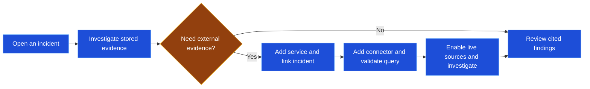

Organization owners and admins configure AI SRE from **Settings → Organization** (Project Admins do not see this page). Responders start from **Respond → Incidents**; raw alerts are in **Communicate → Notifications → Delivery history**. **Copilot** and **Services** sit under **Respond**.

Open **Setup guide** (under **More** on Integrations, or beside **Add service** and **Add query**) to review setup status.

<Callout type="info">
**Self-hosted:** Configure an [AI provider](/docs/app/deployment/self-hosted#optional-configuration) to use AI SRE. Start with stored evidence. Connectors and Private Agents are optional.
</Callout>

<Cards className="grid-cols-1 sm:grid-cols-3">
<Card icon={<Boxes className="text-blue-500" />} title="Services">
Define the systems responders recognize
</Card>
<Card icon={<Plug className="text-green-500" />} title="Integrations">
Read-only connectors and saved queries
</Card>
<Card icon={<Network className="text-purple-500" />} title="Private Agents">
Reach providers inside your network
</Card>
</Cards>

## Services

Use **Services** to define systems such as `checkout-service` or `payment-gateway`. Select **Add service** to register one.

For each service, add its owner, environment, tier, repository, and telemetry name. The service detail page has three sections.

| Section | Shows |
|---|---|
| **Activity** | Opens first. Recent incidents, alerts, and deployments |
| **Resources** | Linked monitors, jobs, tests, k6 runs, and status components |
| **Dependencies** | Service relationships. Expand **Suggested dependencies** to approve or reject discoveries and review past decisions |

Service health shows its status and an explanation. Nonzero incident and alert counts stay visible. Expand **Service details** for tier, owner, available health score, and calculation time.

<Callout type="info">
Suggested relationships are not used as service dependencies or for alert correlation until an authorized user approves them.
</Callout>

## Integrations

Use **Settings → Organization → Integrations** to add read-only evidence sources. Each connector has a service scope, validation status, execution mode, and output limits. Select **Add connector** to connect providers such as Prometheus, Grafana, Loki, or GitHub.

Use the narrowest credential and service scope that supports your queries, and validate the connector after setup. See [Connectors](/docs/app/investigate/connectors) for supported providers and query examples.

Connectors are optional. Start with stored Supercheck evidence, then add external sources your team needs.

## Saved queries (optional)

Saved queries are named templates for read-only questions your team repeats, such as a service's 5xx rate over the last five minutes. You do not need one to investigate stored evidence or run supported live connector searches.

In **Settings → Organization → Integrations**, choose **More → Saved queries** to open the saved queries dialog, then select **Add query**.

| Property | Behavior |
|---|---|
| **Connector** | Each query is tied to one enabled connector |
| **Validation** | Parameters and allowlist are validated |
| **Limits** | Returned rows, output size, and runtime are limited |
| **Query types** | Depend on the connector. Include PromQL, LogQL, TraceQL, and HTTP GET |
| **Disabling** | Prevents future executions. Evidence already collected stays |

## Private Agents

Use a Private Agent when a supported provider is reachable only inside your network. On Supercheck Cloud, you keep using the cloud dashboard and run only the agent locally. No inbound firewall access is required.

<Steps>
<Step>

### Register the agent

Go to **Settings → Organization → Private Agents** and register it. Search and filter the list by status, scope, or network, and select a row to see its version, last heartbeat, and the connectors that use it.

</Step>
<Step>

### Run it

[Run it with Docker Compose](/docs/app/deployment/private-agent) inside your network and confirm it shows **connected**.

</Step>
<Step>

### Add a connector

In **Settings → Organization → Integrations**, add a connector, choose **Private Agent**, and select the registered agent.

</Step>
<Step>

### Validate

Validate the connector, then enable live sources in an incident investigation when you need its evidence.

</Step>
</Steps>

Keep provider credentials in the connector's dedicated credential fields.

## Setup Order

Scroll horizontally on smaller screens to view all steps.

<Steps>
<Step>

Investigate an incident using stored Supercheck evidence.

</Step>
<Step>

Add service context when you need service links, dependencies, or live connectors.

</Step>
<Step>

Optionally add connectors for external evidence. If a provider is private, deploy a Private Agent first.

</Step>
<Step>

Optionally save a query if responders repeat the same bounded question.

</Step>
<Step>

Validate each connector and run an investigation with live sources enabled before relying on it during an incident.

</Step>
</Steps>

## Usage limit and stuck runs

Each organization has a daily AI usage limit shared by investigations, triage, evidence briefs, and Copilot chat. The limit counts tokens reported by the AI provider and resets at 00:00 UTC. When it is reached, new AI requests return a "daily AI usage limit" message and evidence briefs fall back to the deterministic summary.

Self-hosted deployments set the limit with `SRE_DAILY_TOKEN_LIMIT_PER_ORG` (default `2000000`; `0` disables the limit). The limit needs Redis and is enforced by the app only.

If an investigation stops reporting because the server restarted while it ran, it is marked failed after about five minutes. You can then start a new run for the same incident. Failed runs are not charged.

## Permissions

| Task | Required permission |
|---|---|
| Manage integrations, saved queries, or Private Agents | Connector configure |
| Edit service metadata, dependencies, or links | Service update |
| Approve topology suggestions | Service configure |
| Create or investigate incidents | Matching incident permission |
