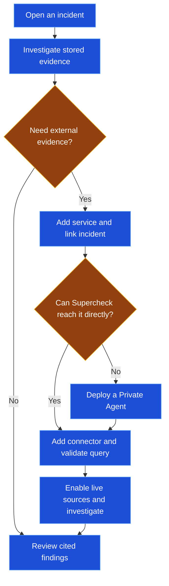

Organization owners and admins configure AI SRE from **Settings → Organization** (Project Admins do not see this page). Responders start from **Respond → Incidents**; **Copilot** and **Services** sit under **Respond**. Open **Setup guide** (under **More** on Integrations, or beside **Add service** and **Add query**) to review setup status.

<Callout type="info">
**Self-hosted:** configure an [AI provider](/docs/app/deployment/self-hosted#optional-configuration) to use AI SRE. Connectors and Private Agents are optional; start with stored evidence.
</Callout>

<Cards className="grid-cols-1 sm:grid-cols-3">
<Card icon={<Boxes className="text-blue-500" />} title="Services">
Systems responders recognize
</Card>
<Card icon={<Plug className="text-green-500" />} title="Integrations">
Connectors and saved queries
</Card>
<Card icon={<Network className="text-purple-500" />} title="Private Agents">
Providers inside your network
</Card>
</Cards>

## Services

**Add service** registers a system such as `checkout-service` or `payment-gateway`.

Set name, tier, **Status** (**Active** or **Deprecated**), environment, owner team, **Owner**, OpenTelemetry service name, **Slack channel**, repository URL, **Tags** and **Description**. **Owner** is one project editor or admin: an alert incident for the service is assigned to them, and they are emailed when someone else opens a SEV1 or SEV2 if the project's incident policy has **Email the service owners for SEV1 and SEV2** on. The list opens on **Active** services; archiving marks a service deprecated, and the **Status** filter shows it again (it can also list merged services). The detail page has three sections.

| Section | Shows |
|---|---|
| **Activity** | Opens first. Recent incidents for the service, open and resolved |
| **Resources** | Linked monitors, jobs, tests, k6 runs, and status components |
| **Dependencies** | Service relationships. Expand **Suggested dependencies** to approve or reject discoveries and review past decisions |

Beside the tabs, **Service health** shows the status with an explanation, counts of active incidents, firing alerts, linked resources and dependencies, and the service's owner, repository, Slack channel and tags. The health score appears when nothing is open or firing. **Recent alerts** and **Recent deployments** follow. Suggested relationships are not used as dependencies or for alert correlation until an authorized user approves them.

## Integrations

In **Settings → Organization → Integrations**, select **Add connector**, choose the **Connector type** and set its service scope. Use the narrowest credential and scope your queries need, and validate after setup. See [Connectors](/docs/app/investigate/connectors) for providers. Connectors are optional.

## Saved queries (optional)

Saved queries are named templates for read-only questions your team repeats, such as a service's 5xx rate over five minutes. You do not need one for stored evidence or live connector searches. In **Settings → Organization → Integrations**, choose **More → Saved queries**, then **Add query**.

| Property | Behavior |
|---|---|
| **Connector** | Each query is tied to one enabled connector |
| **Validation** | Parameters and allowlist are validated |
| **Limits** | Returned rows, output size, and runtime are limited |
| **Query types** | Depend on the connector, such as PromQL, LogQL, TraceQL and HTTP GET |
| **Disabling** | Prevents future executions. Evidence already collected stays |

Query names must be unique per connector among active queries.

<Accordions>
<Accordion title="Parameter rules and connector settings" id="saved-query-rules">

- A parameter that can be free text must sit inside quotes in the template, such as `{service="$service"}`.
- Outside quotes, constrain it with an **enum**, an **allowlist** or a **pattern** that admits only plain tokens (letters, digits and similar; no spaces or query syntax). Over-broad patterns such as `.*` are rejected on save.
- `allowParens` works only on Azure Monitor connectors, in `metrics:` templates.
- **Grafana** connectors need the service account token saved under `apiKey`, `api_key` or `secret`. Any other key name is rejected when you save.
- A connector's **default time window** is 60 minutes unless you change it. A longer search is refused with a message naming the limit; raise the window or shorten the search.

</Accordion>
</Accordions>

## Private Agents

Use a Private Agent when a provider is reachable only inside your network. On Supercheck Cloud you keep the cloud dashboard and run only the agent locally; no inbound firewall access is required.

<Steps>
<Step>

### Register the agent

In **Settings → Organization → Private Agents**, register it. Filter the list by status, scope or network; select a row for its version, last heartbeat and the connectors that use it.

</Step>
<Step>

### Run it

[Run it with Docker Compose](/docs/app/deployment/private-agent) in your network until it shows **connected**.

</Step>
<Step>

### Add a connector

Add a connector in **Integrations**, choose **Private Agent** and select the agent.

</Step>
<Step>

### Validate

Validate the connector, then enable live sources in an investigation.

</Step>
</Steps>

Keep provider credentials in the connector's credential fields.

## Setup order

Optionally save a query for questions responders repeat, and validate each connector with live sources enabled before an incident.

<Accordions>
<Accordion title="Usage limit and stuck runs" id="usage-limit">

Each organization has a daily AI usage limit shared by investigations, triage, evidence briefs and Copilot chat. It counts tokens reported by the AI provider and resets at 00:00 UTC. When reached, new AI requests return a "daily AI usage limit" message and evidence briefs fall back to a plain summary.

Self-hosted: set `SRE_DAILY_TOKEN_LIMIT_PER_ORG` in `.env` (default `2000000`; `0` disables the limit) and recreate the app.

If an investigation stops reporting, wait five minutes, then start a new run. Failed runs are not charged and do not use the free-trial allowance.

</Accordion>
</Accordions>

## Permissions

| Task | Required permission |
|---|---|
| Manage integrations, saved queries, or Private Agents | Connector configure |
| Edit service metadata, dependencies, or links | Service update |
| Approve topology suggestions | Service configure |
| Create or investigate incidents | Matching incident permission |
