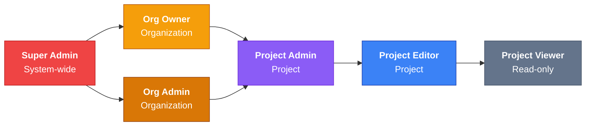

Pick a role by the tasks a teammate needs, then check the matrix for exact permissions.

## Role overview

Members can view all active projects in their organization. **Project Admin** and **Project Editor** gain additional permissions only in assigned projects; their access to other projects stays read-only. Organization administrators manage all projects in their organization.

| Role | Level | Description |
|------|-------|-------------|
| **Super Admin** | System | Platform-wide control, user management, impersonation |
| **Org Owner** | Organization | Full organization control including deletion |
| **Org Admin** | Organization | Organization management without deletion rights |
| **Project Admin** | Project | Full control of assigned projects |
| **Project Editor** | Project | Create and edit resources in assigned projects |
| **Project Viewer** | Organization | Read-only access to all projects |

## Role hierarchy

Scroll horizontally to view the full diagram.

## Permission matrix

Project Admin and Project Editor permissions apply only in assigned projects. Other active projects stay readable.

### Organization

| Resource | Super Admin | Org Owner | Org Admin | Project Admin | Project Editor | Project Viewer |
|----------|:-----------:|:---------:|:---------:|:-------------:|:--------------:|:--------------:|
| **View organization** | ✓ | ✓ | ✓ | ✓ | ✓ | ✓ |
| **Update organization** | ✓ | ✓ | ✓ | — | — | — |
| **Delete organization** (request, then cancel during the window) | Limited ¹ | ✓ | — | — | — | — |
| **Invite, manage and remove members** | ✓ | ✓ | ✓ | — | — | — |

¹ A Super Admin can request deletion only of an organization that has no members left, and cannot cancel it.

### Projects

| Resource | Super Admin | Org Owner | Org Admin | Project Admin | Project Editor | Project Viewer |
|----------|:-----------:|:---------:|:---------:|:-------------:|:--------------:|:--------------:|
| **View projects** | ✓ | ✓ | ✓ | ✓ | ✓ | ✓ |
| **Create projects** | ✓ | ✓ | ✓ | — | — | — |
| **Update projects** | ✓ | ✓ | ✓ | ✓ | — | — |
| **Delete projects** (restorable for 7 days) | ✓ | ✓ | ✓ | — | — | — |
| **Restore deleted projects** | ✓ | ✓ | ✓ | — | — | — |
| **Manage project members** | ✓ | ✓ | ✓ | ✓ | — | — |

### Project resources

Super Admin, Org Owner, Org Admin and Project Admin share one column because their permissions match here.

| Resource | Action | Project Viewer | Project Editor | Project Admin and above |
|----------|--------|:--------------:|:--------------:|:-----------------------:|
| **Tests, jobs, requirements** | View | ✓ | ✓ | ✓ |
| | Create, edit, run or trigger | — | ✓ | ✓ |
| | Delete | — | — | ✓ |
| **Monitors, status pages** | View | ✓ | ✓ | ✓ |
| | Create, edit, pause or resume | — | ✓ | ✓ |
| | Delete | — | — | ✓ |
| **Test runs** | View | ✓ | ✓ | ✓ |
| | Cancel | — | ✓ | ✓ |
| | Delete | — | — | ✓ |
| **CLI tokens** | View, create, edit | — | ✓ | ✓ |
| | Delete | — | — | ✓ |
| **Notifications, tags** | View | ✓ | ✓ | ✓ |
| | Create, edit | — | ✓ | ✓ |
| | Delete | — | — | ✓ |

### AI SRE

| Action | Super Admin | Org Owner | Org Admin | Project Admin | Project Editor | Project Viewer |
|--------|:-----------:|:---------:|:---------:|:-------------:|:--------------:|:--------------:|
| **View services and incidents** | ✓ | ✓ | ✓ | ✓ | ✓ | ✓ |
| **Create and update services** | ✓ | ✓ | ✓ | ✓ | ✓ | — |
| **Delete services** | ✓ | ✓ | ✓ | ✓ | — | — |
| **Create and update incidents** (assign, acknowledge, resolve, post updates) | ✓ | ✓ | ✓ | ✓ | ✓ | — |
| **Delete incidents** | ✓ | ✓ | ✓ | ✓ | — | — |
| **Watch or unwatch an incident** | ✓ | ✓ | ✓ | ✓ | ✓ | ✓ |
| **Post an incident update to a status page** (also needs status page update permission) | ✓ | ✓ | ✓ | ✓ | ✓ | — |
| **Edit a project's incident notifications** (needs project update permission, see [Organization](/docs/app/admin/organization#projects)) | ✓ | ✓ | ✓ | ✓ | — | — |
| **Investigate stored evidence** | ✓ | ✓ | ✓ | ✓ | ✓ | — |
| **Configure and investigate live connectors** | ✓ | ✓ | ✓ | ✓ | — | — |
| **Approve topology suggestions** | ✓ | ✓ | ✓ | ✓ | — | — |

Project Editors can investigate stored evidence and manage incidents but cannot query or configure live connectors.

## Variables and secrets

| Action | Super Admin | Org Owner | Org Admin | Project Admin | Project Editor | Project Viewer |
|--------|:-----------:|:---------:|:---------:|:-------------:|:--------------:|:--------------:|
| **View variables** | ✓ | ✓ | ✓ | ✓ | ✓ | ✓ |
| **Create and edit variables** | ✓ | ✓ | ✓ | ✓ | ✓ | — |
| **Delete variables** | ✓ | ✓ | ✓ | ✓ | — | — |
| **View secret values** | ✓ | ✓ | ✓ | ✓ | ✓ | — |

<Callout type="warn">
Project Editors can create and edit variables and reveal secret values in assigned projects, but cannot delete variables. Keep revealed values out of chat, logs and shared documents.
</Callout>

A Super Admin can reveal secret values only in organizations they belong to. To see secrets in another organization, impersonate one of its members.

## Super Admin and access scope

<Accordions>
<Accordion title="System administration (Super Admin only)" id="system-administration">

These permissions are exclusive to **Super Admin** users:

| Capability | Description |
|------------|-------------|
| **User management** | View, ban and unban any user |
| **User impersonation** | Log in as any user for troubleshooting |
| **View all organizations** | Access any organization's data |
| **Queue monitoring** | View and manage job queues |
| **System statistics** | View platform-wide metrics |

</Accordion>
<Accordion title="Access scope details" id="access-scope-details">

### Organization-wide access

The following roles can access **all projects** in their organization without explicit assignment:

- **Super Admin** — All organizations, all projects
- **Org Owner** — All projects in owned organizations
- **Org Admin** — All projects in administered organizations
- **Project Viewer** — Read-only access to all projects, so oversight and monitoring roles need no individual assignments

### Assigned project permissions

These roles have additional permissions in **assigned projects** and read-only access to other active projects:

- **Project Admin** — Full control, but only for assigned projects
- **Project Editor** — Create/edit permissions, but only for assigned projects

</Accordion>
</Accordions>

## Quick reference

| If you need to... | Minimum role |
|---|---|
| View tests and runs | Project Viewer |
| Run tests manually | Project Editor |
| Create new tests | Project Editor |
| Delete tests | Project Admin |
| Invite team members | Org Admin |
| Delete the organization, or cancel its pending deletion | Org Owner |
| Delete or restore a project | Org Admin |
| Ban or unban users | Super Admin |
