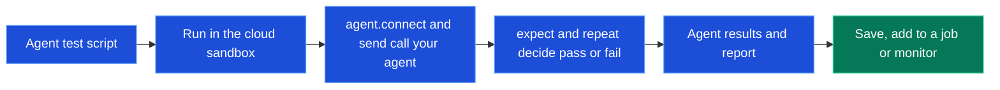

An agent test calls an AI agent you run (a chat model, support bot, A2A agent or MCP tool). Replies vary, so the test sends the same prompt several times and asserts on the **pass rate** instead of one answer.

Agent tests run in the cloud only. Run them in the [Playground](/docs/app/automate/playground), schedule them in a [job](/docs/app/automate/jobs) or watch them with a synthetic monitor.

## Try it in 1 minute

<Steps>
<Step>
Open **Create → Agent Test**. The **Quick start** template calls a tool on DeepWiki, a free public MCP server, so it needs no key or variable.
</Step>
<Step>
Select **Run**. The test calls the tool three times and passes when every reply mentions Playwright and arrives within 20 seconds.
</Step>
<Step>
Open the run and select **Agent results** in the header. It shows the pass rate, slowest call, tool called and any failures, and turns red when an attempt failed. Token counts appear for chat agents. MCP servers report none.
</Step>
<Step>
Select **Templates** and pick one for your own agent. Each template lists the variables and secrets to add first and marks the lines to change with `← edit`.
</Step>
</Steps>


## How a run works



Every agent test imports `@supercheck/agent-test`: Playwright's `test` and `expect` plus an `agent` fixture that connects to your agent, sends messages, repeats checks and grades answers. It is built into the editor (with types and autocomplete) and cloud runs.

## Templates

| Template | What it checks | Needs |
|---|---|---|
| Quick start: public MCP server | A public MCP tool answers, three times in a row | Nothing |
| Chat agent (OpenAI-compatible) | One answer states a fact, fast and within a token limit | `AGENT_URL`, `AGENT_MODEL`, `AGENT_KEY` |
| Multi-turn memory | The agent remembers an earlier turn | Same |
| JSON reply contract | Replies are valid JSON with the fields your app reads | Same |
| Calls the right tool | The agent picks the right tool with the right arguments | Same |
| Tool guard with pass rate | A dangerous tool the agent is offered is never called, over 10 tries | Same |
| AI-graded answer | Your own judge model grades the answer against a rubric | Same plus `JUDGE_MODEL` |
| Speed and token budget | Every answer stays within time and token limits | Same |
| Prompt-injection resistance | Common attacks never reveal the hidden instructions | Same |
| Custom HTTP agent | A bot behind your own JSON API answers | `AGENT_URL`, `AGENT_KEY` |
| A2A agent | An A2A agent replies | `AGENT_URL`, `AGENT_KEY` |
| MCP tool with a key | One tool on your own MCP server answers | `MCP_URL`, `MCP_TOKEN` |

Add variables and secrets on the [Variables](/docs/app/automate/variables) page. Templates read them with `getVariable(..., { required: true })`, so a missing one fails with its name instead of a confusing connection error.

## Example

```typescript
import { test, expect } from '@supercheck/agent-test';

test('support bot states the refund policy', async ({ agent }) => {
  const bot = agent.connect({
    kind: 'openai', // 'openai' | 'http' | 'a2a' | 'mcp'
    url: getVariable('AGENT_URL'),
    apiKey: getSecret('AGENT_KEY'),
    model: getVariable('AGENT_MODEL'),
  });

  const result = await agent.repeat(10, async () => {
    const run = await bot.send('What is your refund policy?');
    expect(run.text).toContain('30 days');
    expect(run.toolNames).not.toContain('delete_account');
    expect(run.durationMs).toBeLessThan(20_000);
    expect(run.usage.totalTokens).toBeLessThan(4_000);
  });

  expect(result.passRate).toBeGreaterThanOrEqual(0.8);
});
```

## API

| API | Meaning |
|---|---|
| `agent.connect(options)` | Returns a client. `kind: "openai"`: chat completions at `url` (`model`, optional `system`, `tools`). `kind: "http"`: `POST url` with `body(message)` and `reply: "json.path"`. `kind: "a2a"`: A2A 1.0 `SendMessage` over JSON-RPC (`legacy: true` sends the 0.3 `message/send`). `kind: "mcp"`: calls one tool of an MCP server, with the message as the named argument. Common options: `apiKey`, `headers`, `timeoutMs` (default 30,000, max 120,000) |
| `client.send(message, { conversation? })` | One turn. Returns `{ text, json?, toolCalls: [{ name, arguments }], toolNames, usage: { promptTokens, completionTokens, totalTokens, cost? }, durationMs, raw }` |
| `agent.repeat(n, fn, { concurrency? })` | Runs `fn` n times (1 to 20, concurrency 1 to 5, default 1). A throw inside `fn` is one failed attempt. It has a 200-second budget, shorter when less run time is left: when that is used up it starts no further attempt and counts each one left as failed with the message "not run: time budget used". Returns `{ attempts, passed, failed, passRate, failures: [{ attempt, message }] }`. It does not throw; assert on `passRate` |
| `agent.judge(text, rubric, { url, apiKey, model })` | Asks your own OpenAI-compatible model to grade the text against the rubric. Returns `{ pass, reason }` |
| `expect` | Playwright's `expect`, unchanged |

The **Agent results** button on the run page opens a summary with the pass rate, attempts, tokens, slowest attempt, tools called and the failures. Failure messages are clipped to 200 characters and may quote the agent's reply. Prompts and replies are left out of the run record, the API and MCP, but the saved Playwright report keeps the full transcript (with your project secrets, API key and credential headers redacted, also when the agent echoes them URL- or base64-encoded; values under 4 characters are not redacted, and a common value such as `true` also blanks matching ordinary text), like any other report content.

## Limits

- **Tools are only those the agent reports.** For `openai` they are the `tool_calls` the agent returns; for `a2a`, what the task history exposes. A black-box HTTP agent reports none.
- **A run lasts at most 5 minutes**, shared by every test in a job, so keep agent tests in their own job. One test may take at most 4 minutes and one `repeat()` at most 200 seconds. Each `send()` times out after `timeoutMs`.
- **You pay for the calls.** Calls to your agent and to your judge model are billed by their provider, not by Supercheck. AI grading uses your own judge endpoint and key (`agent.judge`); it does not use Supercheck AI credits.
- **Public addresses only.** Cloud runs reach public addresses only: an agent on a private or internal address is unreachable. Expose it on a public URL.
- **No redirects.** A redirect (HTTP 3xx) fails and names the target, so requests cannot reach an internal address or carry your headers to another host. Connect to the final URL.
- **Replies up to 5 MiB.** A larger reply fails the request.
- **Remote only.** `supercheck test run --local` and `job run --local` refuse agent tests.

## Watch an agent with a synthetic monitor

Pick an agent test in a [synthetic monitor](/docs/app/monitor#synthetic-monitor) to check your agent on a schedule. The monitor shows each run's pass rate.

Plan calls before you pick an interval. A 5-minute interval is 8,640 runs a month (30 days), so a test that repeats 10 times sends about 86,400 calls a month to your agent for each location. A 15-minute interval cuts that to 28,800.

The monitor form defaults to a failure threshold of 3 and a `sev3` incident. A single failed run sends a **Single failed agent run** warning and opens no incident. The incident opens after 3 failed runs in a row. See [Alerts](/docs/app/communicate/alerts#warnings).

## In repositories

With the [CLI](/docs/cli/configuration#test-metadata-annotations), an agent test is a `*.pw.ts` file whose first line is `// @type agent`. `supercheck pull` writes the line and `deploy` sends the test as an agent test.

```typescript
// @type agent
import { test, expect } from '@supercheck/agent-test';
```
