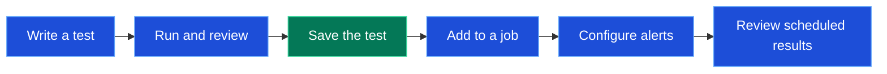

Write tests in the Playground with AI help, then schedule them or trigger them from CI/CD. Use the **Create** menu from anywhere in the app to add a test, job or monitor.

<Cards>
<Card icon={<FlaskConical className="text-purple-500" />} title="Playground" href="/docs/app/automate/playground">
Write tests, review AI suggestions, and verify results
</Card>

<Card icon={<Code className="text-blue-500" />} title="Tests" href="/docs/app/automate/tests">
Save, organize and manage your test scripts
</Card>
</Cards>

## Test types

<Cards>
<Card icon={<Chrome className="text-sky-500" />} title="Browser test" href="/docs/app/automate/browser-test">
Playwright UI flows with screenshots and traces
</Card>

<Card icon={<ArrowLeftRight className="text-teal-500" />} title="API test" href="/docs/app/automate/api-test">
HTTP and GraphQL requests with response assertions
</Card>

<Card icon={<Database className="text-cyan-500" />} title="Database test" href="/docs/app/automate/database-test">
SQL queries against PostgreSQL, MySQL and other databases
</Card>

<Card icon={<ChartSpline className="text-purple-500" />} title="Performance test" href="/docs/app/automate/performance-test">
k6 load testing with virtual users, duration and thresholds
</Card>

<Card icon={<Bot className="text-purple-500" />} title="Agent test" href="/docs/app/automate/agent-test">
Call your AI agent several times and assert on pass rate, tools, latency and tokens
</Card>

<Card icon={<SquareFunction className="text-indigo-500" />} title="Custom test" href="/docs/app/automate/custom-test">
Node.js scripts for anything the other types do not cover
</Card>
</Cards>

## Core concepts

<Cards>
<Card icon={<CalendarClock className="text-amber-500" />} title="Jobs" href="/docs/app/automate/jobs">
Group tests and run them on a schedule, manually or from CI/CD
</Card>

<Card icon={<ClipboardList className="text-emerald-500" />} title="Runs" href="/docs/app/automate/runs">
Execution history with results, screenshots, traces and logs
</Card>

<Card icon={<Variable className="text-rose-500" />} title="Variables" href="/docs/app/automate/variables">
Configuration values, encrypted secrets and file-based test data
</Card>
</Cards>

## Key features

| Area | What you get |
|---|---|
| **AI Create** | Test scripts from plain English (beta for browser tests: record first, then enhance) |
| **AI Fix** | Suggested changes for a failing test that you review, then run again |
| **AI Analyze** | Analysis reports on job runs and monitor health |
| Reports | Screenshots, interactive step-by-step traces with DOM inspection, console output, network requests and errors |
| Scheduling | Cron expressions (down to one minute via the API or CLI), CI/CD trigger endpoints and manual runs |

## Parallel execution

Tests and jobs run at the same time up to your capacity limit, and extra runs wait. The **RUNNING / QUEUED** indicator in the header opens the parallel execution panel. Open a run there to review its progress or cancel it.

Self-hosted: administrators set execution and queue capacity in the [Docker scaling reference](https://github.com/supercheck-io/supercheck/blob/v1.6.0/deploy/docker/README.md#scaling-workers).

## Workflow

Scroll horizontally on smaller screens to view all steps.

## Related

- [Playwright documentation](https://playwright.dev/docs/intro) for browser, API and database tests
- [k6 documentation](https://grafana.com/docs/k6/latest/) for performance tests
