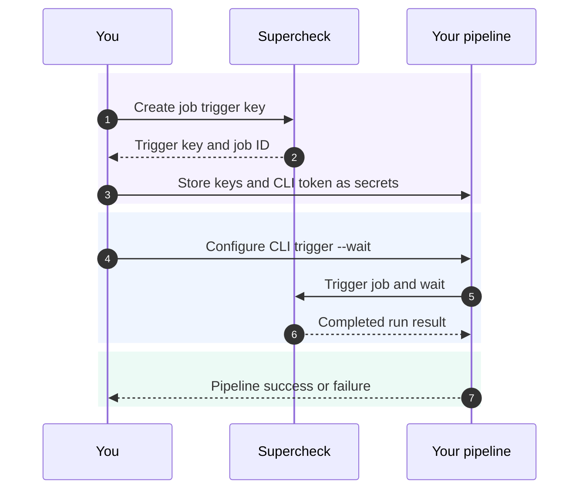

Jobs let you group tests together and run them automatically on a schedule or trigger them from your CI/CD pipeline. Use jobs to automate regression testing, smoke tests, and continuous validation of your applications.


## What Jobs Do

A job is a collection of tests that run together. When a job executes:

<Steps>
<Step>
All selected tests run in sequence (Playwright jobs). A k6 performance job runs exactly one test
</Step>
<Step>
Results are collected and aggregated
</Step>
<Step>
Your selected channels receive notifications for the alert types you enable
</Step>
<Step>
Reports are generated with full details
</Step>
</Steps>

**Use jobs for:**
- **Scheduled regression tests** — Run nightly or hourly to catch issues early
- **Smoke tests** — Quick validation after deployments
- **CI/CD integration** — Trigger tests from your build pipeline
- **Monitoring** — Regular checks of critical user flows

## Creating a Job

On Supercheck Cloud, creating or editing a job requires an active organization subscription and a valid billing customer. These billing checks do not apply to self-hosted installations.


### Step 1: Basic Information

<Steps>
<Step>
Open **Jobs** and click **Create Job** (or use **Quick Create → Playwright Job**)
</Step>
<Step>
Enter a descriptive **name** (e.g., "Nightly Regression Suite"), up to 255 characters
</Step>
<Step>
Add a **description** explaining what the job tests (required)
</Step>
</Steps>

### Step 2: Select Tests

Choose which tests to include in the job. You can select any combination of:
- Browser tests (Playwright)
- API tests
- Database tests
- Custom tests

A job can include up to 50 tests. A k6 performance job runs exactly one performance test.


<Callout type="info">
Tests run in the order you select them. Put critical tests first so failures are detected early.

The Playwright HTML report will display tests in their execution order, making it easy to trace through the test sequence.
</Callout>

### Step 3: Configure Schedule

Choose when and how the job runs:

| Schedule Type | Description | Best For |
|---------------|-------------|----------|
| **Schedule** | Pick an hourly, daily, weekly, monthly or yearly time with the schedule builder | Regular runs (hourly checks, nightly suites) |
| **Manual** | Run only when triggered manually | On-demand testing |
| **API Trigger** | Run via HTTP API call | CI/CD integration |

The builder offers hourly and longer periods. Schedules are stored as five-field cron expressions (minute, hour, day of month, month, day of week), so the CLI and API can set any cron down to one minute. Schedules run in UTC.

**Common cron examples:**

| Schedule | Cron Expression |
|----------|-----------------|
| Every hour | `0 * * * *` |
| Every day at midnight | `0 0 * * *` |
| Every Monday at 9 AM | `0 9 * * 1` |
| Every 6 hours | `0 */6 * * *` |

<Callout type="info">
The Jobs list shows your 100 most recently created jobs. A job beyond that is still reachable by its direct link.
</Callout>

### Step 4: Configure Alerts

Set up notifications for job results:


| Setting | Description |
|---------|-------------|
| **Job failures** | Notify when any test in the job fails |
| **Job success completion** | Notify when all tests pass (optional) |
| **Job timeouts** | Notify if the job exceeds its maximum execution time |
| **Notification Channels** | Select Slack, email, Discord, Telegram, or webhook |

Failure and recovery thresholds count consecutive runs, including the current run exactly once. Failed and errored runs both count toward the failure threshold. A different outcome breaks the consecutive sequence.

**Incidents** (in the same Alert Settings):

| Setting | What it does | Default |
|---------|-------------|---------|
| **Open an incident when this alerts** | Opens an incident, or joins the open one for this job | On |
| **Severity** | *Auto* derives SEV1 to SEV4 from the alert, or pick a fixed level | Auto |
| **Resolve automatically on recovery if nobody acknowledged it** | Resolves the incident when the job recovers, even if recovery alerts are off | On |

See [How alerts become incidents](/docs/app/investigate/incidents#how-alerts-become-incidents).

## Parallel Execution

Run multiple jobs or tests simultaneously to reduce total execution time. The parallel execution panel in the header shows real-time status of all running and queued executions across your organization.


**Manage executions:**

- Click the **RUNNING / QUEUED** indicator to view active and waiting runs.
- Open a run to inspect its progress.
- Cancel a run you no longer need.

Runs wait when execution capacity is full. Multiple jobs can run at once up to your capacity limit.

**Capacity limits:** self-hosted installations have configurable concurrent and queued job limits. See [Self-Hosted](/docs/app/deployment/self-hosted).

<Callout type="info">
The parallel execution indicator appears in the top navigation bar showing **RUNNING** and **QUEUED** counts. Click it to view details and manage executions.
</Callout>

## CI/CD Integration

Trigger jobs from your CI/CD pipeline to run tests after every deployment.

Create a job trigger key, store it as a secret in your CI/CD platform, and call the copied trigger URL after deployment. To make the pipeline wait for the result and fail when tests fail, use the [CLI CI/CD workflow](/docs/cli/ci-cd) with `supercheck job trigger --wait`.

A trigger key acts as the user who created it. If that user can no longer trigger the job, for example after a role change or removal from the project, the key is refused with `403`; it works again once their access is restored. Removing the user from the organization disables their trigger keys instead.

<p className="text-sm md:hidden">Scroll horizontally to view the full diagram.</p>

<div className="overflow-x-auto" role="region" aria-label="Jobs workflow diagram" tabIndex={0}>
<div className="min-w-[48rem]">



</div>
</div>

This shows the CLI workflow with `--wait`. A plain HTTP trigger starts the job but does not wait for the test result.

### Setting Up API Triggers

<Steps>
<Step>
Open the job you want to trigger
</Step>
<Step>
Open the job's **Edit** action and continue to **CI/CD Settings**
</Step>
<Step>
Click **Create Key**
</Step>
</Steps>


4. Copy the trigger URL and API key


### Triggering from CI/CD

<Tabs items={['cURL', 'GitHub Actions', 'GitLab CI']}>
<Tab value="cURL">

**Basic trigger:**

```bash
curl --fail-with-body --show-error --silent -X POST \
  "https://your-instance.example/api/jobs/YOUR_JOB_ID/trigger" \
  -H "Authorization: Bearer YOUR_API_KEY"
```

</Tab>
<Tab value="GitHub Actions">

**GitHub Actions example:**

```yaml
- name: Run Supercheck Tests
  run: |
    curl --fail-with-body --show-error --silent -X POST "${{ secrets.SUPERCHECK_TRIGGER_URL }}" \
      -H "Authorization: Bearer ${{ secrets.SUPERCHECK_API_KEY }}"
```

</Tab>
<Tab value="GitLab CI">

**GitLab CI example:**

```yaml
test:
  script:
    - |
      curl --fail-with-body --show-error --silent -X POST "$SUPERCHECK_TRIGGER_URL" \
        -H "Authorization: Bearer $SUPERCHECK_API_KEY"
```

</Tab>
</Tabs>

### API Key Security

- **Generate unique keys** for each CI/CD pipeline
- **Store keys as secrets** in your CI/CD platform
- **Rotate keys periodically** for security
- **Revoke keys** when no longer needed

## Job Execution

### Running Jobs Manually

<Steps>
<Step>
Go to **Jobs** list
</Step>
<Step>
Click the **Run** button on any job
</Step>
<Step>
View real-time progress in the execution dialog
</Step>
<Step>
Results appear when complete
</Step>
</Steps>

### Canceling Jobs

You can cancel a running job at any time:

<Steps>
<Step>
Click the **Cancel** button on the running job
</Step>
<Step>
Confirm the cancellation
</Step>
<Step>
Review the cancellation status and any partial results in the run details
</Step>
</Steps>

### Viewing Results

After a job completes:

- **Summary** — Pass/fail status, duration, test count
- **Test Results** — Individual test outcomes with details
- **Reports** — Screenshots, traces, and logs for each test
- **History** — Previous runs for comparison

## Job Notifications

Jobs send notifications through your configured alert channels:

| Notification | When | Includes |
|---|---|---|
| **Failure** | A job fails | Job name and project, which tests failed, error summary, link to full report, execution duration |
| **Success** (optional) | Enabled, and the job passes | Job name and project, all tests passed confirmation, execution duration, link to report |
| **Timeout** | A job exceeds the maximum execution time | The job is automatically stopped, a timeout notification is sent, and partial results are saved |

<Callout type="info">
**Execution Time Limits:**
- **Playwright Jobs:** Maximum runtime of **60 minutes** for the entire job execution
- **K6 Performance Jobs:** Exactly one test per job, with a maximum runtime of **60 minutes** per job execution. Scripts that set a literal `vus`, `maxVUs`, `preAllocatedVUs`, `startVUs`, or a VU stage target above **1000** (top-level `stages` or `ramping-vus` scenarios), or a literal duration above 60 minutes, are rejected
- **Individual Tests:** Each test within a job is also subject to its own timeout (5 minutes for Playwright, 60 minutes for K6)
</Callout>

<Accordions>
<Accordion title="Deleting jobs and stored artifacts" id="deleting-stored-artifacts">

Jobs with queued or running executions cannot be deleted until those executions stop. Deleting a resource with stored artifacts waits for storage cleanup to finish. If cleanup fails, Supercheck keeps the resource available for another deletion attempt. Restore storage access and retry; a partial cleanup may already have removed some artifacts.

</Accordion>
</Accordions>
