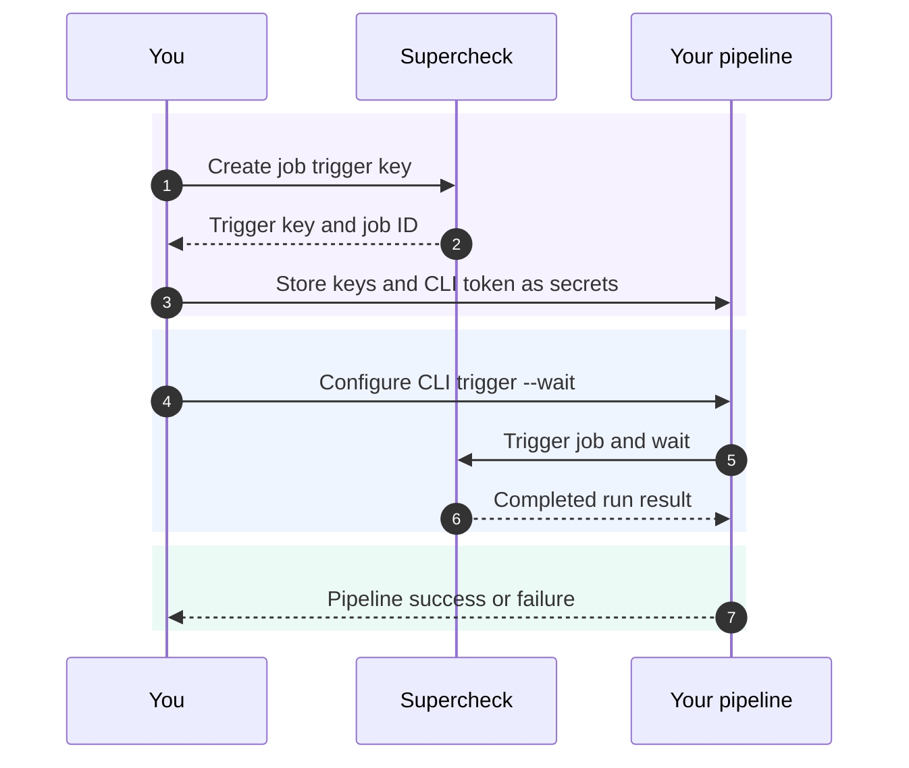

Jobs group tests and run them on a schedule, on demand or from CI/CD: nightly regression, post-deploy smoke tests and continuous checks of critical flows.


## What a job does

Selected tests run in sequence (Playwright jobs), or one test for a k6 performance job. Results are aggregated into reports, and your selected channels are notified for the alert types you enable.

## Create a job

On Supercheck Cloud, creating or editing a job requires an active organization subscription and a valid billing customer. Self-hosted installations skip these checks.


### Basic information

<Steps>
<Step>
Open **Jobs** and select **Create job**, or use **Quick Create → Playwright Job**.
</Step>
<Step>
Enter a **Title** such as "Nightly Regression Suite", up to 255 characters.
</Step>
<Step>
Add a **Description** of what the job tests, up to 2000 characters. It is required.
</Step>
</Steps>

### Select tests

Pick any mix of browser, API, database and custom tests, up to 50 per job. A k6 performance job runs exactly one performance test.


Tests run in the order you select them, and the Playwright HTML report shows them in that order. Put critical tests first so failures surface early.

### Schedule

Pick an hourly, daily, weekly, monthly or yearly time in the schedule builder, or leave the schedule empty for manual execution. Schedules are stored as five-field cron expressions (minute, hour, day of month, month, day of week) and run in UTC, so the CLI and API can set any cron down to one minute.

<Accordions>
<Accordion title="Common cron examples" id="cron-examples">

| Schedule | Cron Expression |
|----------|-----------------|
| Every hour | `0 * * * *` |
| Every day at midnight | `0 0 * * *` |
| Every Monday at 9 AM | `0 9 * * 1` |
| Every 6 hours | `0 */6 * * *` |

</Accordion>
</Accordions>

<Callout type="info">
The Jobs list shows your 100 most recently created jobs. A job beyond that is still reachable by its direct link.
</Callout>

### Alerts


| Setting | Description |
|---------|-------------|
| **Job failures** | Notify when any test in the job fails |
| **Job success completion** | Notify when all tests pass (optional) |
| **Job timeouts** | Notify if the job exceeds its maximum execution time |
| **Notification Channels** | Select email, Slack, Discord, Telegram, Microsoft Teams, or webhook |

Failure and recovery thresholds count consecutive runs. Failed and errored runs both count toward the failure threshold. A different outcome breaks the consecutive sequence.

**Incidents** (in the same Alert Settings):

| Setting | What it does | Default |
|---------|-------------|---------|
| **Open an incident when this alerts** | Opens an incident, or joins the open one for this job | On |
| **Severity** | *Auto* derives SEV1 to SEV4 from the alert, or pick a fixed level | Auto |
| **Resolve automatically on recovery if nobody acknowledged it** | Resolves the incident when the job recovers, even if recovery alerts are off | On |

See [How alerts become incidents](/docs/app/investigate/incidents#how-alerts-become-incidents).

## Parallel execution

Jobs and tests run in parallel up to your capacity, and further runs wait in the queue. Use the **RUNNING / QUEUED** indicator in the header to inspect, open or cancel runs. Self-hosted: set limits as described in [Self-hosted](/docs/app/deployment/self-hosted).


## CI/CD integration

Create a job trigger key, store it as a secret in your CI/CD platform, and call the trigger URL after each deployment. To make the pipeline wait for the result and fail when tests fail, use the [CLI CI/CD workflow](/docs/cli/ci-cd) with `supercheck job trigger --wait`.

A trigger key acts as the user who created it. If that user can no longer trigger the job, for example after a role change or removal from the project, the key is refused with `403` and works again once access is restored. Removing the user from the organization disables their trigger keys instead.

<p className="text-sm md:hidden">Scroll horizontally to view the full diagram.</p>

<div className="overflow-x-auto" role="region" aria-label="Jobs workflow diagram" tabIndex={0}>
<div className="min-w-[48rem]">



</div>
</div>

The diagram shows the CLI workflow with `--wait`. A plain HTTP trigger starts the job but does not wait for the result.

### Set up an API trigger

<Steps>
<Step>
Open the job.
</Step>
<Step>
Open its **Edit** action and go to **CI/CD Settings**.
</Step>
<Step>
Select **Create Key**, then copy the trigger URL and API key.
</Step>
</Steps>


### Trigger from CI/CD

<Tabs items={['cURL', 'GitHub Actions', 'GitLab CI']}>
<Tab value="cURL">

**Basic trigger:**

```bash
curl --fail-with-body --show-error --silent -X POST \
  "https://your-instance.example/api/jobs/YOUR_JOB_ID/trigger" \
  -H "Authorization: Bearer YOUR_API_KEY"
```

</Tab>
<Tab value="GitHub Actions">

**GitHub Actions example:**

```yaml
- name: Run Supercheck Tests
  run: |
    curl --fail-with-body --show-error --silent -X POST "${{ secrets.SUPERCHECK_TRIGGER_URL }}" \
      -H "Authorization: Bearer ${{ secrets.SUPERCHECK_API_KEY }}"
```

</Tab>
<Tab value="GitLab CI">

**GitLab CI example:**

```yaml
test:
  script:
    - |
      curl --fail-with-body --show-error --silent -X POST "$SUPERCHECK_TRIGGER_URL" \
        -H "Authorization: Bearer $SUPERCHECK_API_KEY"
```

</Tab>
</Tabs>

<Callout type="warn">
Use a unique key per pipeline, store it as a CI secret, rotate it periodically, and revoke keys you no longer need.
</Callout>

## Run a job

### Run manually

<Steps>
<Step>

Open the **Jobs** list and select **Run** on a job.

</Step>
<Step>

Follow progress in the execution dialog. Results appear when it completes.

</Step>
</Steps>

### Cancel a job

Select **Cancel run** on a running job and confirm with **Cancel Execution**. Partial results and the cancellation status are in the run details. See [Runs](/docs/app/automate/runs).

## Execution limits

| Job type | Limit |
|---|---|
| **Playwright job** | 60 minutes for the whole job. Each test also has its own 5-minute timeout |
| **k6 performance job** | Exactly one test, 60 minutes per execution |

k6 scripts are rejected when a literal `vus`, `maxVUs`, `preAllocatedVUs`, `startVUs`, or a VU stage target (top-level `stages` or `ramping-vus` scenarios) is above **1000**, or a literal duration is above 60 minutes.

## Reference

<Accordions>
<Accordion title="Notification contents" id="notification-contents">

Jobs send notifications through your configured alert channels:

| Notification | When | Includes |
|---|---|---|
| **Failure** | A job fails | Job name and project, which tests failed, error summary, link to full report, execution duration |
| **Success** (optional) | Enabled, and the job passes | Job name and project, all tests passed confirmation, execution duration, link to report |
| **Timeout** | A job exceeds the maximum execution time | The job is automatically stopped, a timeout notification is sent, and partial results are saved |


</Accordion>
<Accordion title="Deleting jobs" id="deleting-jobs">

Deleting a job takes effect at once: the job disappears from lists, its schedule is removed, and it cannot start new runs. Queued executions are cancelled, and running ones are asked to stop; a run that is already executing may finish its current step before it stops (removal waits up to 30 minutes for it). Its runs, reports and stored artifacts are then removed in the background in small batches, so a job with a long history does not slow the app down. There is no undo.

If background removal hits an error (for example, storage is briefly unavailable), it is retried automatically with a growing delay. A super admin can see and retry removals that kept failing.

</Accordion>
</Accordions>
