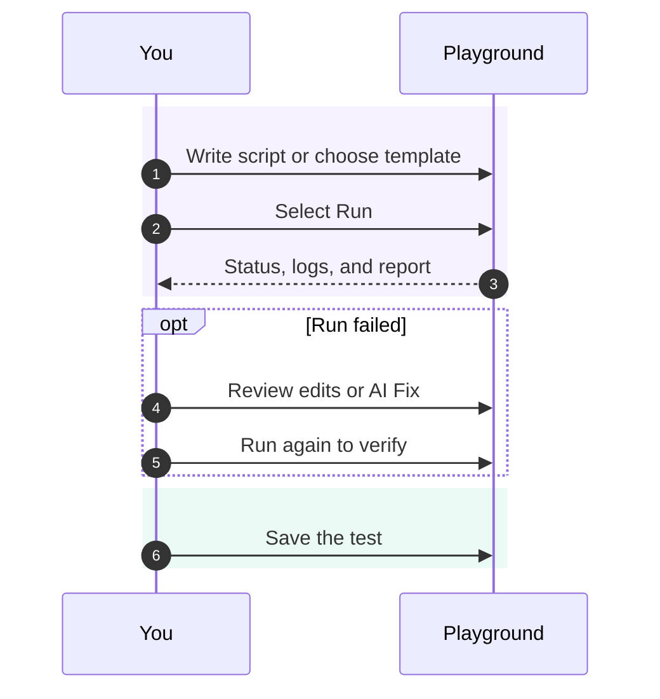

Write, run, and debug test scripts in the Playground. Review AI suggestions before applying them.


## Editor and Runs

The editor is Monaco with TypeScript/JavaScript highlighting, Playwright IntelliSense, live syntax checks, auto-formatting, and `getVariable()` / `getSecret()` for project configuration. Check a script here before adding it to a job or monitor.



Use **Cancel** to stop a running test. You can save a draft at any time, even while it is failing; run and validate it before relying on it in a job or monitor.

## AI Create

Describe the behavior you want to test. AI Create suggests a script for you to review, edit, and run.

<Callout type="warn">
**Beta Feature**: AI-generated browser tests may require refinement. For best results, **record your test first** using the [Supercheck Recorder Extension](/docs/recorder) or Playwright's codegen, then use AI Create to enhance or modify it. Review all generated code before running.
</Callout>


### How to Use AI Create

<Steps>
<Step>
Select **AI Create** and describe the test in plain language.
</Step>
<Step>
Select **Generate** and review the streamed script in the diff viewer.
</Step>
<Step>
Select **Apply to Editor**, or **Discard** to close it.
</Step>
</Steps>


<Accordions>
<Accordion title="Writing effective prompts" id="effective-prompts">

**Good prompts are specific and include:**
- The user action you want to test
- Expected outcomes or assertions
- Any specific elements or data to interact with

**Example prompts:**

| Prompt | Intended Check |
|--------|-------------------|
| "Test login with email user@example.com and password test123, verify dashboard loads" | Complete login flow with form filling, submission, and URL assertion |
| "Check that the /api/health endpoint returns 200 and includes status: ok" | API test with fetch, status check, and JSON body validation |
| "Verify user can add a product to cart, view cart, and see correct total" | Multi-step e-commerce flow with navigation and assertions |
| "Test that the contact form validates required fields and shows error messages" | Form validation test with empty submission and error checking |

</Accordion>
</Accordions>

### Review Generated Code

Check the target URL, selectors, credentials, waits, and assertions. Run the script to confirm it tests the expected behavior.

## AI Fix

After a failed run, use AI Fix to review suggested changes. Apply only changes you understand, then run the test again.

<Accordions>
<Accordion title="Access checks and AI credits" id="ai-fix-access">

Keep the run's organization selected and make sure you can view its project. AI Fix checks access to the report before using an AI credit. Cloud AI Create and Fix also share an hourly organization token guard; if it is reached, wait before retrying. Closing or cancelling a generated response stops the active provider request.

</Accordion>
</Accordions>


### Use AI Fix

<Steps>
<Step>
After a failed run, select **AI Fix**. It analyzes the error report and your code.
</Step>
<Step>
Review the original-versus-suggested diff, edit if needed, then **Accept & Apply** or **Reject**.
</Step>
<Step>
Run the test again to verify the change.
</Step>
</Steps>


<Accordions>
<Accordion title="What AI Fix can repair" id="ai-fix-repairs">

AI Fix is effective for code-level issues that can be resolved by modifying your test:

| Issue Type | Example | AI Fix Action |
|------------|---------|---------------|
| **Selector Issues** | Element not found, wrong selector | Updates selector to match current DOM |
| **Timing Problems** | Element not visible, timeout | Adds appropriate waits or increases timeout |
| **Assertion Failures** | Expected value mismatch | Corrects assertion or expected value |
| **Navigation Errors** | Page not loading, wrong URL | Fixes URL or adds navigation waits |

</Accordion>
</Accordions>

<Accordions>
<Accordion title="When AI Fix shows guidance instead" id="ai-fix-guidance">

Some failures require manual investigation rather than code changes. In these cases, AI Fix displays a guidance modal with troubleshooting steps:

- **Network Issues** — Server unreachable, DNS failures, HTTP 5xx errors
- **Authentication Failures** — Invalid credentials, expired tokens, 401/403 errors
- **Infrastructure Problems** — Database down, service unavailable
- **Permission Errors** — Access denied, insufficient privileges

</Accordion>
</Accordions>

## Templates

Start with working templates for common scenarios, then customize them.


### Available Templates

<Tabs items={['Browser', 'API', 'Database', 'Custom', 'Performance']}>
<Tab value="Browser">

| Category | Templates |
|----------|-----------|
| **Browser Fundamentals** | UI Smoke (navigation), Browser selection with tags, Comprehensive Browser Test |
| **Auth Flows** | Auth flow (login + logout) |
| **Responsive & Devices** | Mobile / responsive layout, Device emulation (geo, locale, timezone) |
| **Data-Driven** | Data-Driven Test (File Variable) |
| **Diagnostics** | Failure Diagnostics |
| **Authentication** | Passkey Registration and Sign-In |
| **AI Applications** | WebMCP Tools (Experimental, Chromium) |
| **Reliability** | Shared Resource Lock |

</Tab>
<Tab value="API">

| Category | Templates |
|----------|-----------|
| **API Health** | Health / JSON contract |
| **API CRUD** | Simulated API CRUD |
| **Authentication** | Authenticated request |
| **API Coverage** | Comprehensive API Test |

</Tab>
<Tab value="Database">

| Category | Templates |
|----------|-----------|
| **Database Checks** | SELECT health check, Query plan analysis, Database Discovery & Query |
| **Transactions** | Read-only transaction |

</Tab>
<Tab value="Custom">

| Category | Templates |
|----------|-----------|
| **Cross-layer** | Custom test fixtures, Form with API stubbing, Device emulation showcase, API response + UI input, GitHub API + Browser Integration |

</Tab>
<Tab value="Performance">

| Category | Templates |
|----------|-----------|
| **Smoke & Health** | Smoke Check (API), Basic Performance Test |
| **Load Profiles** | Ramping Load, Advanced Thresholds |
| **Resilience** | Spike + Recovery, Stress Test, Breakpoint Test |
| **Reliability** | Soak / Endurance |
| **Protocols** | WebSocket + API Load Test, gRPC + API Load Test |
| **Data-Driven** | Data-Driven Performance Test (File Variable) |
| **API Coverage** | API Checklist (GET + POST + auth), Checks & Assertions |

</Tab>
</Tabs>

### Using Templates

<Steps>
<Step>
Select **Templates** in the toolbar, browse or search, and click one to preview it.
</Step>
<Step>
Select **Apply Template**, then customize URLs, selectors, and test data.
</Step>
</Steps>

## Test Reports

Every run produces a report with debugging artifacts:


### Report Contents

| Artifact | Description | Use For |
|----------|-------------|---------|
| **Screenshots** | Captured at each step and on failure | Visual verification, debugging UI issues |
| **Trace** | Interactive step-by-step replay | Understanding test flow, timing issues |
| **Console Logs** | Browser console output | JavaScript errors, debug messages |
| **Network** | All HTTP requests and responses | API debugging, performance analysis |

<Accordions>
<Accordion title="Viewing traces" id="viewing-traces">

The Playwright Trace Viewer steps through each action, showing page state before and after, DOM, and network timing, which helps with timing and selector issues.

</Accordion>
</Accordions>

## Using Variables

Read project configuration, secrets, and file-backed test data:

```javascript

// Regular variables (logged normally)
const baseUrl = getVariable('BASE_URL');
const timeout = getVariable('TIMEOUT');

// Secrets are resolved at runtime and redacted from logs
const apiKey = getSecret('API_KEY');
const password = getSecret('DB_PASSWORD');

// File-backed test data
const usersCsv = readFile('USERS_CSV');

// Using in Playwright
await page.goto(baseUrl);
await page.fill('#password', password);
```

Keep credentials in **Secrets** and use **File** variables for non-sensitive fixtures and datasets. Avoid logging secret values.

See [Variables](/docs/app/automate/variables) for setup instructions.

<Accordions>
<Accordion title="Further reading" id="further-reading">

- [Playwright documentation](https://playwright.dev/docs/intro)
- [Locators](https://playwright.dev/docs/locators)
- [Assertions](https://playwright.dev/docs/test-assertions)
- [Trace Viewer](https://playwright.dev/docs/trace-viewer)

</Accordion>
</Accordions>

## Next steps

<Cards>
<Card title="Tests" href="/docs/app/automate/tests" description="Manage saved tests" />
<Card title="Jobs" href="/docs/app/automate/jobs" description="Schedule saved tests" />
<Card title="Variables" href="/docs/app/automate/variables" description="Config, secrets, and test data" />
</Cards>
