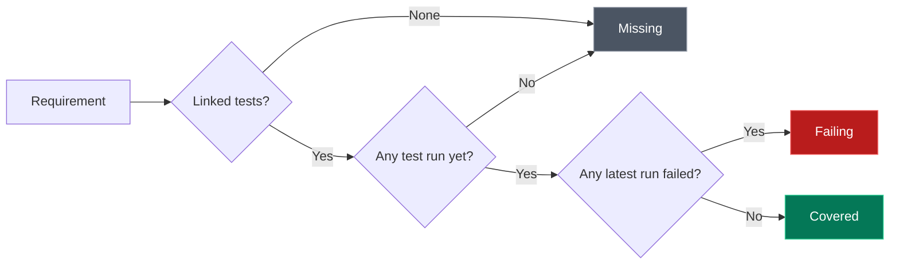

Requirements keep testable expectations next to the tests that verify them, so you can see at a glance what is covered, what is failing, and what has no tests yet.

<Cards className="grid-cols-1 sm:grid-cols-3">
<Card icon={<CheckCircle className="text-green-500" />} title="Covered">
Every linked test that has run passed
</Card>
<Card icon={<XCircle className="text-red-500" />} title="Failing">
At least one linked test failed its latest run
</Card>
<Card icon={<CircleDashed className="text-gray-400" />} title="Missing">
No linked tests, or none have run yet
</Card>
</Cards>

## Requirement Fields

| Field | Required | Details |
|---|:---:|---|
| **Title** | Yes | One behavior to verify, up to 500 characters |
| **Description** | No | Acceptance criteria or context |
| **Priority** | No | **Low**, **Medium**, or **High**. Defaults to Medium |
| **Tags** | No | Group and filter requirements. AI-extracted requirements carry an `ai` tag |
| **Linked tests** | No | The tests whose results set the coverage status |

## Add a Requirement

<Steps>
<Step>

### Open Requirements

Select the project, then open **Requirements** under **Automate** in the sidebar.

</Step>
<Step>

### Create it

Choose **Create Requirement**, enter a title, and set a priority.

</Step>
<Step>

### Link tests

Link existing tests, or create a new test from the requirement.

</Step>
<Step>

### Run a job

Add the linked tests to a [job](/docs/app/automate/jobs) and run it. Coverage updates when the job completes.

</Step>
</Steps>

## How Coverage Is Calculated

<Callout type="info">
Coverage is recalculated only when a **job** finishes. Running a test in the Playground does not change coverage, and monitors are not linked to requirements.
</Callout>

## Extract Requirements from a Document

Choose **Upload Document** to have AI draft requirements from a PRD or specification.

| Limit | Value |
|---|---|
| **Formats** | PDF (`.pdf`), Word (`.docx`), Markdown (`.md`), plain text (`.txt`) |
| **Maximum size** | 10 MB |
| **Tag added** | `ai` |
| **AI usage** | Uses your instance's AI provider and counts toward organization AI limits |

Review each extracted title, description, and priority before you add it.

<Callout type="warn">
The document is sent to your configured AI provider. Do not upload credentials or documents you are not permitted to share with that provider.
</Callout>

## Review Coverage

| Task | How |
|---|---|
| **Filter** | By priority, coverage status, tags, or search text |
| **Investigate a failure** | Open a requirement's linked tests to see the failing run |
| **Share** | Choose **Export** to download requirements as CSV |

## Permissions

| Role | View | Create and edit | Extract from document | Delete |
|---|:---:|:---:|:---:|:---:|
| Org Owner, Org Admin, Project Admin | ✓ | ✓ | ✓ | ✓ |
| Project Editor | ✓ | ✓ | ✓ | — |
| Project Viewer | ✓ | — | — | — |

See [Roles & Permissions](/docs/app/admin/roles-and-permissions) for how roles are assigned.

## Read Requirements Through the API

`GET /api/requirements` lists the active project's requirements.

| Parameter | Values | Default |
|---|---|---|
| `page` | 1 or more | `1` |
| `pageSize` | 1 to 500 | `500` |
| `search` | Text | — |
| `priority` | `low`, `medium`, `high` | — |
| `status` | `covered`, `failing`, `missing` | — |

The status filter is applied before pagination, and `total` counts matching requirements. Requirements without a coverage snapshot count as `missing`. See the [API reference](/docs/api/requirements/listRequirements) for the response format.

## Deleting Stored Artifacts

Deleting a resource with stored artifacts waits for storage cleanup to finish. If cleanup fails, the resource stays available so you can retry; a partial cleanup may already have removed some artifacts.
