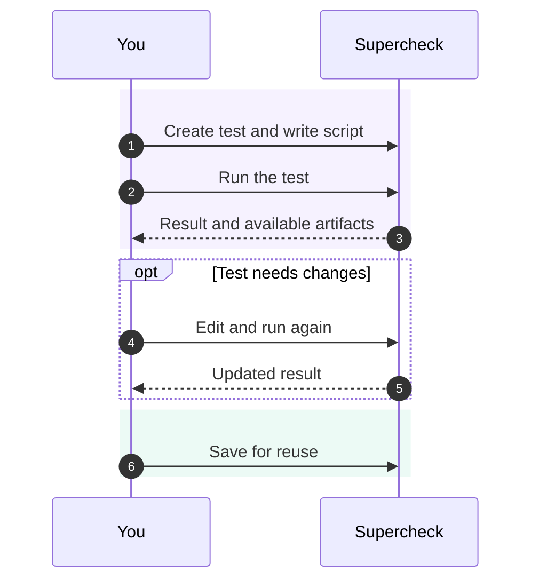

Tests are reusable scripts that validate your application. Create browser, API, database, custom, or performance tests.


The list shows the newest 200 tests; older tests are not loaded and search and filters only cover the loaded ones. Filter by type, priority, or tag, and use the **Created by** column to see who created each test.

## Test types

<Cards>
<Card icon={<Chrome className="text-sky-500" />} title="Browser Test">
Playwright-based UI testing for user flows
</Card>

<Card icon={<ArrowLeftRight className="text-teal-500" />} title="API Test">
HTTP and GraphQL endpoint validation
</Card>

<Card icon={<Database className="text-cyan-500" />} title="Database Test">
SQL queries and data validation
</Card>

<Card icon={<SquareFunction className="text-indigo-500" />} title="Custom Test">
Node.js scripts for any scenario
</Card>

<Card icon={<TrendingUp className="text-violet-500" />} title="Performance Test">
k6 load testing with configurable virtual users and thresholds
</Card>
</Cards>

## Create Test

On Supercheck Cloud, creating tests and saving changes from the Playground requires an active organization subscription and a valid billing customer. These billing checks do not apply to self-hosted installations.

<Steps>
<Step>
Open **Create** and select a test type.
</Step>
<Step>
Write a script in the [Playground](/docs/app/automate/playground), pick one from **Templates**, or use **AI Create** for a starting point.
</Step>
<Step>
Replace example URLs and data, then select **Run**.
</Step>
<Step>
Review the result and select **Save**.
</Step>
</Steps>

After a run completes, review its result and available logs, screenshots, and traces. If it fails, update the script and run it again. You can save a draft before it passes; validate it before adding it to a job or synthetic monitor.

<p className="text-sm md:hidden">Scroll horizontally to view the full diagram.</p>

<div className="overflow-x-auto" role="region" aria-label="Tests workflow diagram" tabIndex={0}>
<div className="min-w-[36rem]">



</div>
</div>

## AI Features

- **AI Create** — Generate tests from plain English descriptions (beta for browser tests)
- **AI Fix** — Review suggested changes for a failing test before applying them
- **Templates** — Pre-built scripts for common scenarios

<Callout type="info">
For browser tests, consider recording with the [Supercheck Recorder Extension](/docs/recorder) or [Playwright Codegen](https://playwright.dev/docs/codegen) first, then use AI to enhance.
</Callout>

See [Playground](/docs/app/automate/playground) for details.

## Test Examples

<Tabs items={['Browser Test', 'API Test', 'Performance Test']}>
<Tab value="Browser Test">

```typescript
import { expect, test } from '@playwright/test';

const APP_URL = 'https://demo.playwright.dev/todomvc';

test.describe('UI smoke test', () => {
  test('home page renders primary UI', async ({ page }) => {
    // Navigate to the application
    await page.goto(APP_URL);

    // Verify page title and input visibility
    await expect(page).toHaveTitle(/TodoMVC/);
    await expect(page.getByPlaceholder('What needs to be done?')).toBeVisible();

    // Perform interaction: Add a new task
    await page.getByPlaceholder('What needs to be done?').fill('Smoke task');
    await page.keyboard.press('Enter');
    
    // Verify the task was added to the list
    await expect(page.getByRole('listitem').first()).toContainText('Smoke task');
  });
});
```

📚 [Playwright Writing Tests](https://playwright.dev/docs/writing-tests) | [Locators Guide](https://playwright.dev/docs/locators)

</Tab>
<Tab value="API Test">

```typescript
import { expect, test } from '@playwright/test';

const API_URL = 'https://jsonplaceholder.typicode.com';

test.describe('API health check', () => {
  test('health endpoint responds with expected payload', async ({ request }) => {
    // Send GET request
    const response = await request.get(API_URL + '/posts/1');

    // Basic status checks
    expect(response.ok()).toBeTruthy();
    expect(response.status()).toBe(200);
    expect(response.headers()['content-type']).toContain('application/json');

    // Validate JSON structure
    const body = await response.json();
    expect(body).toMatchObject({ id: 1 });
    expect(typeof body.title).toBe('string');
  });
});
```

📚 [Playwright API Testing](https://playwright.dev/docs/api-testing)

</Tab>
<Tab value="Performance Test">

```javascript
import http from 'k6/http';
import { check, sleep } from 'k6';

export const options = {
  vus: 3,           // 3 concurrent users
  duration: '30s',  // Run for 30 seconds
  thresholds: {
    http_req_failed: ['rate<0.01'],      // Error rate < 1%
    http_req_duration: ['p(95)<800'],    // 95% of requests < 800ms
  },
};

export default function () {
  const baseUrl = 'https://test-api.k6.io';
  const response = http.get(baseUrl + '/public/crocodiles/1/');

  // Validate response
  check(response, {
    'status is 200': (res) => res.status === 200,
    'body is not empty': (res) => res.body && res.body.length > 0,
  });

  sleep(1); // Pause between requests
}
```

📚 [k6 Documentation](https://grafana.com/docs/k6/latest/) | [k6 Thresholds](https://grafana.com/docs/k6/latest/using-k6/thresholds/)

</Tab>
</Tabs>

## Tags

Organize tests with color-coded tags for easy filtering and categorization.

- **Create tags** — Add custom tags with a color
- **Filter by tags** — Quickly find tests by tag in the list view
- **Bulk operations** — Apply or remove tags from multiple tests

Tags are project-scoped, so each project can have its own tagging system.

## Execution Limits

| Test type | Maximum runtime per execution |
|---|---|
| **Playwright** | **5 minutes**. Tests exceeding this limit are automatically terminated |
| **K6 Performance** | **60 minutes**, to accommodate load testing scenarios |

## Next steps

<Cards>
<Card title="Jobs" href="/docs/app/automate/jobs" description="Group tests, schedule them, and trigger from CI/CD" />
<Card title="Playground" href="/docs/app/automate/playground" description="Write, run, and fix tests with AI" />
<Card title="Variables" href="/docs/app/automate/variables" description="Project config, secrets, and file-backed test data" />
</Cards>
