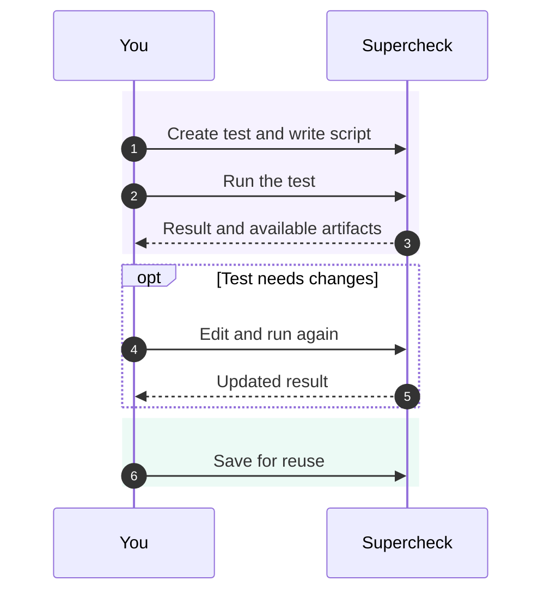

Tests are reusable scripts that validate your application. Create [browser](/docs/app/automate/browser-test), [API](/docs/app/automate/api-test), [database](/docs/app/automate/database-test), [custom](/docs/app/automate/custom-test), [agent](/docs/app/automate/agent-test) or [performance](/docs/app/automate/performance-test) tests.

The list shows the newest 200 tests. Search and filters only cover the loaded tests. Filter by type, priority or tag, and use the **Created by** column to see who created each test.

## Create a test

<Steps>
<Step>
Open **Create** and select a test type.
</Step>
<Step>
Write a script in the [Playground](/docs/app/automate/playground), pick one from **Templates**, or use **AI Create** for a starting point.
</Step>
<Step>
Replace example URLs and data, then select **Run**.
</Step>
<Step>
Review the result, logs, screenshots and traces. If it fails, update the script and run it again. Select **Save**.
</Step>
</Steps>

You can save a draft before it passes. Validate it before adding it to a job or synthetic monitor.

<Callout>
On Supercheck Cloud, creating tests and saving changes from the Playground requires an active organization subscription and a valid billing customer. Self-hosted installations skip these checks.
</Callout>

Scroll horizontally to view the full diagram.

## AI features

| Feature | What it does |
|---|---|
| **AI Create** | Generates tests from plain English descriptions (beta for browser tests) |
| **AI Fix** | Suggests changes for a failing test. You review before applying |
| **Templates** | Pre-built scripts for common scenarios |

<Callout>
For browser tests, record with the [Supercheck Recorder Extension](/docs/recorder) or [Playwright Codegen](https://playwright.dev/docs/codegen) first, then use AI to enhance. See [Playground](/docs/app/automate/playground) for details.
</Callout>

## Test examples

Each test type page has a working example: [browser](/docs/app/automate/browser-test#example), [API](/docs/app/automate/api-test#example) and [performance](/docs/app/automate/performance-test#example-script).

## Tags

Color-coded, project-scoped tags organize and filter tests. Create a custom tag with a color, filter by tag in the list, and select several tests to apply or remove tags in bulk.

## Execution limits

| Test type | Maximum runtime per execution |
|---|---|
| Playwright | 5 minutes. Longer tests are terminated |
| k6 performance | 60 minutes |

## Related

<Cards>
<Card title="Jobs" href="/docs/app/automate/jobs" description="Group tests, schedule them, and trigger from CI/CD" />
<Card title="Playground" href="/docs/app/automate/playground" description="Write, run, and fix tests with AI" />
<Card title="Variables" href="/docs/app/automate/variables" description="Project config, secrets, and file-backed test data" />
</Cards>
