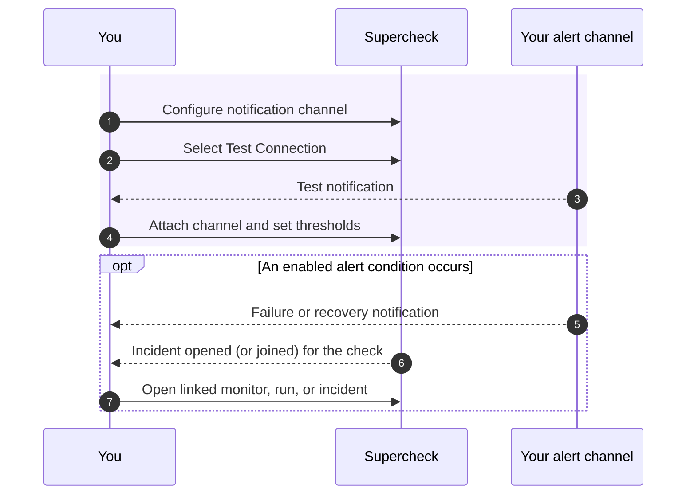

Notifications tell your team when monitors fail, jobs break, or services recover. Set up a channel, attach it to a monitor or job, and use thresholds to avoid noise.


**Communicate → Notifications** has two tabs: **Channels**, where you set up where alerts go, and **Delivery history**, which lists the latest 200 alert notifications sent for your monitors and jobs. Each failure alert also opens an incident, unless you turn that off in the check's **Incidents** settings. See [How alerts become incidents](/docs/app/investigate/incidents#how-alerts-become-incidents).

## Alert Workflow

<p className="text-sm md:hidden">Scroll horizontally to view the full diagram.</p>

<div className="overflow-x-auto" role="region" aria-label="Alerts workflow diagram" tabIndex={0}>
<div className="min-w-[48rem]">



</div>
</div>

## Set Up a Channel

<Brands names={["slack", "teams", "discord", "telegram", "webhook"]} />

Email uses your SMTP provider; the others use the service's webhook or bot token.

<Steps>
<Step>
Open **Communicate → Notifications → Channels** and select **Create channel**.
</Step>
<Step>
Pick the provider and enter its credentials (see [Provider Configuration](#provider-configuration)).
</Step>
<Step>
Select **Test Connection**, then save.

Test sends are rate limited per user: email tests allow 5 per 10 minutes and may only target your own address or members of your organization (at most 5 recipients); other channel types allow 20 tests per 10 minutes. A channel used by a monitor or job cannot be deleted until you remove it from them.
</Step>
<Step>
Select the channel in a monitor's or job's **Alert Settings**.
</Step>
</Steps>

## Alert Types

<Tabs items={['Monitors', 'Jobs']}>
<Tab value="Monitors">

| Alert | Trigger | Severity |
|-------|---------|----------|
| **Failure** | Consecutive failures reach threshold | Error |
| **Recovery** | Consecutive successes reach threshold after being down | Success |
| **SSL Expiring** | Enabled website monitor's certificate expires within its configured warning window | Warning; at most once every 24 hours |

</Tab>
<Tab value="Jobs">

| Alert | Trigger | Severity |
|-------|---------|----------|
| **Failure** | One or more tests in the job failed | Error |
| **Success** | All tests passed (optional) | Success |
| **Timeout** | Job exceeded maximum execution time | Warning |

</Tab>
</Tabs>

## Threshold Configuration

Thresholds prevent alert noise from transient issues like network blips or brief service hiccups.

<Tabs items={['Threshold Settings', 'Example']}>
<Tab value="Threshold Settings">

**Failure Threshold**

The number of consecutive failures required before sending the first failure alert. This prevents alerts from single network blips.

**Recovery Threshold**

The number of consecutive healthy checks required before sending a recovery alert after the monitor was down. Failure and recovery thresholds are 1–5; an initially healthy monitor does not send a recovery alert.

SSL expiration warnings are evaluated independently of the monitor's up/down result. Enable **SSL Expiration Alerts** on a website monitor and set its warning window; a warning is sent at most once every 24 hours while the certificate remains within that window.

**Job failures** follow the same rule as monitors: the first alert at the failure threshold, then repeats after every further `max(5, 2 × threshold)` failures, at most 3 alerts per failure streak. A passing run resets the streak.

**Alert Limiting**

At most **3 failure alerts** go out per failure streak: the first when the threshold is reached, then reminders after every further `max(5, 2 × threshold)` failures. Each recovery sends one alert. The interval is not configurable.

</Tab>
<Tab value="Example">

**Configuration:** Failure Threshold = 3, Recovery Threshold = 2

| Check | Result | Consecutive Count | Alert Sent |
|-------|--------|-------------------|------------|
| 1 | ❌ Fail | 1 failure | — |
| 2 | ❌ Fail | 2 failures | — |
| 3 | ❌ Fail | 3 failures ✓ | **Failure Alert** |
| 4 | ❌ Fail | 4 failures | — |
| 5 | ✅ Pass | 1 success | — |
| 6 | ✅ Pass | 2 successes ✓ | **Recovery Alert** |

**Notes:**
- Check 3: Failure threshold (3) reached → first failure alert sent
- Check 4: Already alerted; the next reminder waits for the reminder spacing described above
- Check 5: Status changed to passing, failure counter resets, recovery counter starts
- Check 6: Recovery threshold (2) reached → recovery alert sent

</Tab>
</Tabs>

## Provider Configuration

<Tabs items={['Email', 'Slack', 'Discord', 'Telegram', 'Microsoft Teams', 'Webhook']}>
<Tab value="Email">

Select **Email** and enter recipients in the notification channel.

<Accordions>
<Accordion title="Self-hosted" id="self-hosted-smtp">

For self-hosted deployments, an administrator configures SMTP. Set these variables:

```bash
SMTP_HOST=smtp.resend.com
SMTP_PORT=587
SMTP_FROM_EMAIL=alerts@yourdomain.com

# Optional: set BOTH only when SMTP authentication is required
SMTP_USER=resend
SMTP_PASSWORD=your-api-key
```

If your SMTP server does not require auth, leave `SMTP_USER` and `SMTP_PASSWORD` empty,
but keep `SMTP_FROM_EMAIL` set.

**Supported providers:** Resend, SendGrid, Mailgun, Amazon SES, Gmail, Office 365

</Accordion>
</Accordions>

</Tab>
<Tab value="Slack">

1. Go to [Slack API](https://api.slack.com/messaging/webhooks) and create an Incoming Webhook
2. Select the channel to post to
3. Copy the webhook URL
4. Add the URL in Supercheck

**Example:** `https://hooks.slack.com/services/T00000000/B00000000/XXXX`

</Tab>
<Tab value="Discord">

1. In Discord, go to **Server Settings → Integrations → Webhooks**
2. Create a new webhook and select the channel
3. Copy the webhook URL
4. Add the URL in Supercheck

**Example:** `https://discord.com/api/webhooks/000000000000000000/XXXX`

</Tab>
<Tab value="Telegram">

1. Create a bot with [@BotFather](https://t.me/botfather)
2. Get your bot token
3. Get your chat ID (use [@userinfobot](https://t.me/userinfobot))
4. Add both in Supercheck

</Tab>
<Tab value="Microsoft Teams">

Teams uses Power Automate Workflows to receive webhook notifications.

1. Go to the Teams channel where you want notifications
2. Click **•••** → **Workflows** → **Create a workflow**
3. Choose a template:
   - **Send webhook alerts to a channel** — posts to a Teams channel
4. Follow the prompts to select the destination channel
5. Copy the generated webhook URL
6. Add the URL in Supercheck Notification Channel

**Example:** `https://prod-00.westus.environment.api.powerplatform.com:443/powerautomate/...`

Accepted URL hosts (HTTPS only):
- Power Automate Workflows: `*.powerplatform.com`
- Azure Logic Apps: `*.logic.azure.com`
- Legacy Office 365 connectors: `*.webhook.office.com`

Other Microsoft hosts, such as `outlook.office.com` or `*.azurewebsites.net`, are rejected.

</Tab>
<Tab value="Webhook">

**Configuration:**
- **URL:** Your endpoint
- **Method:** GET, POST, or PUT (default: POST)
- **Headers JSON:** Optional string-valued headers for provider authentication such as `Authorization`
- **Body Template:** Optional custom JSON body with template variables (used for POST and PUT requests)
- **Rendered sample payload:** Preview of the JSON body generated from sample alert values before you test or save
- **Test diagnostics:** Redacted test results showing method, target host, sent header names, HTTP status, elapsed time, request hash, and response hash

Use a publicly reachable HTTPS webhook endpoint (plain HTTP is rejected); private and internal targets are blocked. Enter credentials in the channel settings and use **Test Connection** before relying on delivery.

Because webhook URLs and custom headers are treated as secrets, they are cleared when you reopen an existing channel for editing. Leave a cleared secret blank to keep its existing value, or enter a replacement to change it. The same behavior applies to masked Slack, Teams, Discord, and Telegram credentials. Use **Test Connection** after replacing a credential to confirm it works.

### Webhook Presets

The webhook channel includes presets that fill the method, headers, and JSON body template for common SRE and incident-management tools. Enter the notification credentials separately from any [read-only investigation connector](/docs/app/investigate/connectors).

| Preset | Use case | Setup docs |
|--------|----------|------------|
| Custom webhook | Default Supercheck payload or a custom JSON template | [Supercheck alerts](/docs/app/communicate/alerts) |
| PagerDuty Events API v2 | Trigger and resolve incidents using `{{pagerDutyEventAction}}` and `{{dedupKey}}` | [PagerDuty Events API v2](https://developer.pagerduty.com/docs/events-api-v2/overview/) |
| Opsgenie Alert API | Create alerts with an alias and API-key auth header | [Opsgenie Alert API](https://docs.opsgenie.com/docs/alert-api) |
| Splunk On-Call REST endpoint | Send VictorOps/Splunk On-Call `CRITICAL` and `RECOVERY` events | [Splunk On-Call REST Endpoint](https://help.victorops.com/knowledge-base/rest-endpoint-integration-guide/) |
| Better Stack webhook | Forward alert context into Better Stack workflows | [Better Stack webhooks](https://betterstack.com/docs/uptime/integrations/webhooks/) |
| incident.io alert source | Send alert-source events with deduplication context | [incident.io alert sources](https://incident.io/docs/alert-sources) |

<Callout type="warn">
Preset payloads include placeholders such as `REPLACE_WITH_PAGERDUTY_ROUTING_KEY` and `REPLACE_WITH_OPSGENIE_API_KEY`. Replace them before testing, and verify the endpoint URL in the vendor documentation because some providers generate tenant-specific webhook URLs.
</Callout>

<Accordions>
<Accordion title="Default payload" id="default-payload">

When no body template is provided, Supercheck sends a JSON payload similar to the following. `fields` and `originalPayload.metadata` vary by alert type and the metadata available for that event:

```json
{
  "title": "Monitor Down - API Health",
  "message": "Monitor \"API Health\" is down. Connection timeout",
  "fields": [
    { "title": "Monitor", "value": "API Health", "short": true },
    { "title": "Type", "value": "http_request", "short": true },
    { "title": "Status", "value": "down", "short": true },
    { "title": "Response Time", "value": "5.20s", "short": true }
  ],
  "color": "#ef4444",
  "footer": "",
  "timestamp": 1735689600,
  "originalPayload": {
    "type": "monitor_failure",
    "title": "Monitor Down - API Health",
    "message": "Monitor \"API Health\" is down. Connection timeout",
    "targetName": "API Health",
    "targetId": "...",
    "severity": "error",
    "timestamp": "2025-01-01T00:00:00.000Z",
    "metadata": {
      "responseTime": 5200,
      "status": "down",
      "targetUrl": "https://api.example.com/health",
      "monitorType": "http_request",
      "dashboardUrl": "https://app.supercheck.io/notification-monitor/..."
    }
  },
  "provider": "webhook",
  "version": "1.0"
}
```

</Accordion>
</Accordions>

### Body Template

Use a custom body template to match the format required by third-party services. Templates must be valid JSON, and template variables use `{{variableName}}` syntax. Keep placeholders inside JSON string values such as `"summary": "{{title}}"`.

<Accordions>
<Accordion title="Available template variables" id="template-variables">

| Variable | Description | Example |
|----------|-------------|---------|
| `{{title}}` | Alert title | `Monitor Down - API Health` |
| `{{message}}` | Alert message | `Monitor "API Health" is down. Connection timeout` |
| `{{severity}}` | Alert severity | `error`, `warning`, `success`, `info` |
| `{{normalizedSeverity}}` | Normalized severity for APIs that do not accept `success` | `error`, `warning`, `info` |
| `{{status}}` | Monitor or job status | `down`, `up`, `failed`, `passed` |
| `{{monitorName}}` | Monitor or target name | `API Health` |
| `{{targetName}}` | Same as monitorName | `API Health` |
| `{{targetUrl}}` | Monitored URL | `https://api.example.com/health` |
| `{{targetId}}` | Target ID | `uuid` |
| `{{timestamp}}` | ISO 8601 timestamp | `2025-01-15T10:30:00.000Z` |
| `{{type}}` | Alert type | `monitor_failure`, `monitor_recovery`, `job_failed` |
| `{{projectName}}` | Project name | `My Project` |
| `{{projectId}}` | Project ID | `uuid` |
| `{{responseTime}}` | Response time in ms | `5200` |
| `{{errorMessage}}` | Error details | `Connection timeout` |
| `{{monitorType}}` | Monitor type | `http_request`, `website`, `ping_host`, `port_check` |
| `{{dashboardUrl}}` | Link to dashboard | `https://app.supercheck.io/...` |
| `{{alertAction}}` | Lifecycle action for event APIs | `trigger`, `resolve` |
| `{{eventAction}}` | Same as alertAction | `trigger`, `resolve` |
| `{{pagerDutyEventAction}}` | PagerDuty Events API action | `trigger`, `resolve` |
| `{{victorOpsMessageType}}` | Splunk On-Call / VictorOps `message_type` | `CRITICAL`, `RECOVERY` |
| `{{splunkOnCallMessageType}}` | Alias for `victorOpsMessageType` | `CRITICAL`, `RECOVERY` |
| `{{dedupKey}}` | Stable key for correlating related events | `monitor:uuid`, `job:uuid`, `ssl:uuid` |

</Accordion>
</Accordions>

<Accordions>
<Accordion title="PagerDuty Integration" id="pagerduty-integration">

Use a webhook with a body template to send alerts to the [PagerDuty Events API v2](https://developer.pagerduty.com/api-reference/368ae3d938c9e-send-an-event-to-pager-duty):

1. In PagerDuty, go to **Services → Service Directory → select your service**
2. Go to the **Integrations** tab and click **Add Integration**
3. Search for **Events API V2** and add it
4. Copy the **Integration Key** (also called Routing Key)
5. In Supercheck, create a Webhook notification channel with:
   - **URL:** `https://events.pagerduty.com/v2/enqueue`
   - **Method:** POST
   - **Body Template:**

```json
{
  "routing_key": "YOUR_PAGERDUTY_INTEGRATION_KEY",
  "event_action": "{{pagerDutyEventAction}}",
  "dedup_key": "{{dedupKey}}",
  "payload": {
    "summary": "{{title}}",
    "severity": "{{normalizedSeverity}}",
    "source": "supercheck",
    "component": "{{monitorName}}",
    "custom_details": {
      "message": "{{message}}",
      "monitor_type": "{{monitorType}}",
      "target_url": "{{targetUrl}}",
      "response_time": "{{responseTime}}",
      "dashboard_url": "{{dashboardUrl}}"
    }
  }
}
```

<Callout type="info">
PagerDuty resolves an alert only when the resolve event has the same `dedup_key` as the original trigger event. Use `{{pagerDutyEventAction}}` and `{{dedupKey}}` together so Supercheck sends `trigger` for failures and `resolve` for recoveries using the same key. PagerDuty expects `severity` to be one of `critical`, `error`, `warning`, or `info`; `{{normalizedSeverity}}` maps Supercheck `success` alerts to `info`.
</Callout>

</Accordion>
<Accordion title="Splunk On-Call / VictorOps Integration" id="splunk-on-call-victorops-integration">

Use a webhook with a body template to send alerts to the [Splunk On-Call REST endpoint](https://help.splunk.com/en/splunk-enterprise/alert-and-respond/splunk-on-call/integrations-with-splunk-on-call/rest-endpoint-integration-for-splunk-on-call):

1. In Splunk On-Call, create a **REST Endpoint** integration and copy the routing key.
2. In Supercheck, create a Webhook notification channel and select the **Splunk On-Call REST endpoint** preset, or use:
   - **URL:** `https://alert.victorops.com/integrations/generic/20131114/alert/<routing_key>/<entity_id>`
   - **Method:** POST
   - **Body Template:**

```json
{
  "message_type": "{{victorOpsMessageType}}",
  "entity_id": "{{dedupKey}}",
  "entity_display_name": "{{title}}",
  "state_message": "{{message}}",
  "monitoring_tool": "supercheck",
  "timestamp": "{{timestamp}}"
}
```

<Callout type="info">
Splunk On-Call only treats `CRITICAL` as an incident-opening event and `RECOVERY` as a resolve event. `{{victorOpsMessageType}}` (or its `{{splunkOnCallMessageType}}` alias) maps Supercheck trigger alerts to `CRITICAL` and recoveries to `RECOVERY`. Use `{{dedupKey}}` as `entity_id` so the resolve event closes the same incident. Do not send `trigger` or `resolve` in `message_type`; those values are treated as INFO and will not auto-resolve.
</Callout>

</Accordion>
<Accordion title="OpsGenie Integration" id="opsgenie-integration">

Use a webhook with a body template to send alerts to [OpsGenie's Alert API](https://docs.opsgenie.com/docs/alert-api):

1. In OpsGenie, go to **Settings → Integration List → API**
2. Copy the **API Key**
3. In Supercheck, create a Webhook notification channel with:
   - **URL:** `https://api.opsgenie.com/v2/alerts`
   - **Method:** POST
   - **Headers JSON:** `{ "Authorization": "GenieKey YOUR_OPSGENIE_API_KEY" }`
   - **Body Template:**

```json
{
  "message": "{{title}}",
  "description": "{{message}}",
  "priority": "P2",
  "source": "supercheck",
  "tags": ["supercheck", "{{monitorType}}"],
  "details": {
    "monitor": "{{monitorName}}",
    "status": "{{status}}",
    "target_url": "{{targetUrl}}",
    "response_time": "{{responseTime}}"
  }
}
```

<Callout type="info">
The webhook UI supports custom JSON headers for provider API keys. Supercheck stores these headers in the encrypted provider config, masks them when the provider is loaded for editing, and never displays header values in the rendered payload preview or test diagnostics.
</Callout>

</Accordion>
</Accordions>

</Tab>
</Tabs>

## Delivery History

Review the latest 200 alert notifications in **Notifications → Delivery history**. Incident update notifications are not listed there. Each row shows:


- Alert type and severity
- Target (monitor or job name)
- Notification channels used
- Delivery status
- The incident the alert belongs to, linked. A sent failure alert with no incident (for example, when incidents are turned off for that check) shows **Open incident** to create one. See [How alerts become incidents](/docs/app/investigate/incidents#how-alerts-become-incidents).
- Timestamp
- Delivery correlation metadata for AI SRE, including provider type/preset, dedup key, event action, response status, attempt count, and response hash when available

<Callout type="info">
Use delivery status and HTTP diagnostics to troubleshoot failed notifications. Raw provider response bodies and credential values are not displayed.
</Callout>

<Accordions>
<Accordion title="Alert samples" id="alert-samples">

<Tabs items={['Email', 'Slack', 'Discord', 'Teams']}>
<Tab value="Email">

<div style={{maxWidth: '320px'}}>

</div>

<div style={{maxWidth: '320px'}}>

</div>

</Tab>
<Tab value="Slack">

<div style={{maxWidth: '400px'}}>

</div>

</Tab>
<Tab value="Discord">

<div style={{maxWidth: '400px'}}>

</div>

</Tab>
<Tab value="Teams">

<div style={{maxWidth: '400px'}}>

</div>

<div style={{maxWidth: '400px'}}>

</div>

</Tab>
</Tabs>

</Accordion>
</Accordions>

## Next steps

<Cards>
<Card title="Incident Investigation" href="/docs/app/investigate/incidents" description="Investigate and resolve the incident an alert opens" />
<Card title="Status Pages" href="/docs/app/communicate/status-pages" description="Tell your users about outages" />
<Card title="Monitors" href="/docs/app/monitor" description="Create the checks that send alerts" />
</Cards>
