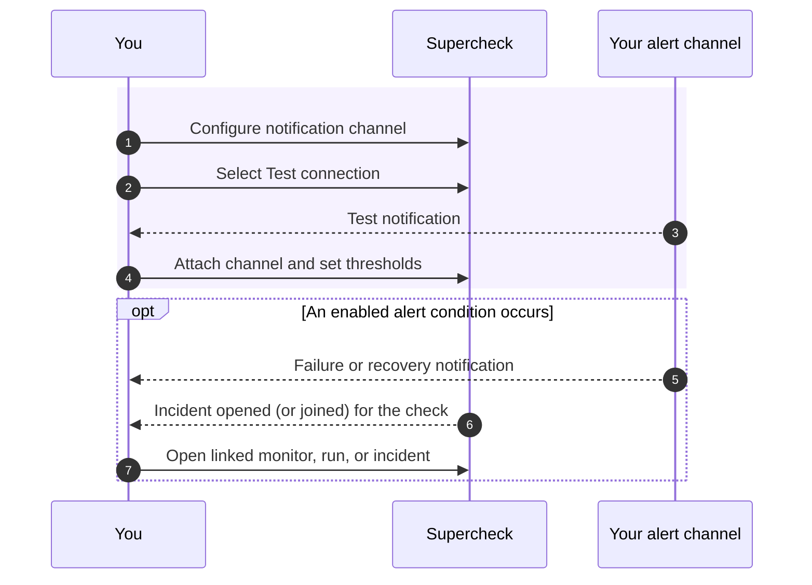

Notifications tell your team when monitors fail, jobs break or services recover. **Communicate → Notifications** has two tabs: **Channels** and **Delivery history**.


## Set up a channel

<Brands names={["slack", "teams", "discord", "telegram", "webhook"]} />


Email uses your SMTP provider; the others use the service's webhook or bot token. Paging services (PagerDuty, Jira Service Management, Splunk On-Call, Better Stack, incident.io) are webhook channels with a [preset](#webhook-presets): a failure opens a page and the recovery resolves it.

<Steps>
<Step>
### Create the channel
Open **Communicate → Notifications → Channels** and select **Create channel**.
</Step>
<Step>
### Pick the type and enter its credentials
Email, Slack, Teams, Discord, Telegram, a paging service preset or a custom webhook. See [Channel settings](#provider-configuration).
</Step>
<Step>
### Test and save
Select **Test connection**, then save.
</Step>
<Step>
### Attach it
Select the channel in a monitor's or job's **Alert Settings**. Saving replaces the linked channels with your selection; channels linked through the API show there too.
</Step>
</Steps>

| Limit | Value |
|---|---|
| Email test sends | 5 per 10 minutes per user, only to your own address or members of your organization, at most 5 recipients |
| Other test sends | 20 per 10 minutes per user |
| Deleting a channel | Blocked while a monitor or job uses it; remove it from them first |



## Channel settings [#provider-configuration]

<Tabs items={['Email', 'Slack', 'Discord', 'Telegram', 'Microsoft Teams', 'Webhook']}>
<Tab value="Email">

Select **Email** and enter the recipients.

<Accordions>
<Accordion title="Self-hosted" id="self-hosted-smtp">

An administrator configures SMTP. Set `SMTP_USER` and `SMTP_PASSWORD` only when the server requires authentication; `SMTP_FROM_EMAIL` is always required.

```bash
SMTP_HOST=smtp.resend.com
SMTP_PORT=587
SMTP_FROM_EMAIL=alerts@yourdomain.com
SMTP_USER=resend            # optional, set both or neither
SMTP_PASSWORD=your-api-key  # optional
SMTP_BLOCKED_RECIPIENT_DOMAINS=qa.yourdomain.com  # optional, comma-separated, subdomains included
```

Reserved domains that cannot receive mail are always skipped, not bounced: `example.com`, `example.net`, `example.org`, and anything under `.example`, `.invalid`, `.test` or `.localhost`. Use `SMTP_BLOCKED_RECIPIENT_DOMAINS` for more, such as a test domain without an MX record.

**Supported providers:** Resend, SendGrid, Mailgun, Amazon SES, Gmail, Office 365

</Accordion>
</Accordions>

</Tab>
<Tab value="Slack">

<Steps>
<Step>
Create an Incoming Webhook in the [Slack API](https://api.slack.com/messaging/webhooks) and select the channel to post to.
</Step>
<Step>
Copy the webhook URL and add it in Supercheck.
</Step>
</Steps>
</Tab>
<Tab value="Discord">

<Steps>
<Step>
In Discord, go to **Server Settings → Integrations → Webhooks**, create a webhook and select the channel.
</Step>
<Step>
Copy the webhook URL and add it in Supercheck.
</Step>
</Steps>
</Tab>
<Tab value="Telegram">

<Steps>
<Step>
Create a bot with [@BotFather](https://t.me/botfather) and copy its token.
</Step>
<Step>
Get your chat ID (use [@userinfobot](https://t.me/userinfobot)).
</Step>
<Step>
Add both in Supercheck.
</Step>
</Steps>
</Tab>
<Tab value="Microsoft Teams">

Teams receives webhooks through Power Automate Workflows.

<Steps>
<Step>
In the Teams channel, select **•••** → **Workflows** → **Create a workflow**.
</Step>
<Step>
Choose the **Send webhook alerts to a channel** template and select the destination channel.
</Step>
<Step>
Copy the generated webhook URL and add it in Supercheck.
</Step>
</Steps>

| Accepted host (HTTPS only) | Source |
|---|---|
| `*.powerplatform.com` | Power Automate Workflows |
| `*.logic.azure.com` | Azure Logic Apps |
| `*.webhook.office.com` | Legacy Office 365 connectors |

Other Microsoft hosts, such as `outlook.office.com` or `*.azurewebsites.net`, are rejected.

</Tab>
<Tab value="Webhook">

| Field | Notes |
|---|---|
| **URL** | Public HTTPS endpoint. Plain HTTP and private or internal targets are rejected |
| **Method** (Advanced) | GET, POST or PUT. Default POST |
| **Headers JSON** (Advanced) | Optional string-valued headers, such as `Authorization` |
| **Body template** (Advanced) | Optional JSON body with [template variables](#body-template), for POST and PUT |
| **Rendered sample payload** (Advanced) | Preview of the body built from sample alert values |
| **Test diagnostics** | Redacted method, target host, sent header names, HTTP status, elapsed time, request hash and response hash |

- **Advanced** is collapsed by default. It starts open when you edit a custom webhook with saved headers or a body template, and opens by itself when one of its fields has an error.
- Self-hosted with `SELF_HOSTED=true` and `ALLOW_INTERNAL_TARGETS=true`: webhook channels (not Slack, Teams, Discord or Telegram) may use internal hosts and `http://` URLs. Cloud metadata and link-local addresses such as `169.254.169.254` stay blocked.
- URLs, headers and other credentials are secrets and are cleared when you reopen a channel. Leave a field blank to keep its value. Saved headers survive only while the URL and preset stay the same; after changing either, enter the API key (Jira Service Management), the API token (incident.io) or the headers again (`{}` for none).

See [Webhooks and paging services](#webhook-presets) for presets and templates.

</Tab>
</Tabs>

Notifications hide credentials in a monitor's target URL: the user name and password, and values of parameters such as `token`, `key` or `password`, are replaced with `REDACTED`.

## Webhooks and paging services [#webhook-presets]

Presets fill the method, headers and JSON body for common incident tools. Each asks only for its own credential; the URL, method, headers and body stay editable under **Advanced**. Notification credentials are separate from any [read-only investigation connector](/docs/app/investigate/connectors).

| Preset | Use case | Credential | Setup docs |
|---|---|---|---|
| Custom webhook | Default Supercheck payload or a custom JSON template | Optional headers | [Supercheck alerts](/docs/app/communicate/alerts) |
| PagerDuty Events API v2 | Trigger and resolve incidents using `{{pagerDutyEventAction}}` and `{{dedupKey}}` | **Routing key** (written into the body template) | [PagerDuty Events API v2](https://developer.pagerduty.com/docs/events-api-v2/overview/) |
| Jira Service Management | Creates alerts with an alias, sent to `api.atlassian.com/jsm/ops/integration/v2/alerts` with `Authorization: GenieKey <integration key>`; recovery closes the alert by alias | **API key** (sent as `Authorization`) | [JSM integration events](https://developer.atlassian.com/cloud/jira/service-desk-ops/rest/v1/api-group-integration-events/) |
| Splunk On-Call REST endpoint | Send VictorOps/Splunk On-Call `CRITICAL` and `RECOVERY` events | Endpoint **URL** | [Splunk On-Call REST Endpoint](https://help.victorops.com/knowledge-base/rest-endpoint-integration-guide/) |
| Better Stack webhook | Sends `status: alert` on failure and `status: resolved` on recovery with `dedup_key`. In Better Stack, set the create rule to "status contains alert", the resolve rule to "status contains resolved" and the alert id to `dedup_key` | Endpoint **URL** | [Better Stack incoming webhooks](https://betterstack.com/docs/uptime/incoming-webhooks/) |
| incident.io alert source | Sends `status: firing` on failure and `status: resolved` on recovery with `deduplication_key` | Endpoint **URL** and **API token** (sent as `Authorization`) | [incident.io alert sources](https://docs.incident.io/alerts/alert-sources) |

<Callout type="warn">
Preset payloads include placeholders such as `REPLACE_WITH_PAGERDUTY_ROUTING_KEY` and `REPLACE_WITH_JSM_INTEGRATION_KEY`. The typed credential fields replace them; a channel that still holds one is rejected. Check the endpoint URL in the vendor docs, because some providers generate tenant-specific URLs.
</Callout>

<Accordions>
<Accordion title="Default payload" id="default-payload">

When no body template is provided, Supercheck sends a JSON payload similar to the following. `fields` and `originalPayload.metadata` vary by alert type and the metadata available for that event:

```json
{
  "title": "Monitor Down - API Health",
  "message": "Monitor \"API Health\" is down. Connection timeout",
  "fields": [
    { "title": "Monitor", "value": "API Health", "short": true },
    { "title": "Type", "value": "http_request", "short": true },
    { "title": "Status", "value": "down", "short": true },
    { "title": "Response Time", "value": "5.20s", "short": true }
  ],
  "color": "#ef4444",
  "footer": "",
  "timestamp": 1735689600,
  "originalPayload": {
    "type": "monitor_failure",
    "title": "Monitor Down - API Health",
    "message": "Monitor \"API Health\" is down. Connection timeout",
    "targetName": "API Health",
    "targetId": "...",
    "severity": "error",
    "timestamp": "2025-01-01T00:00:00.000Z",
    "metadata": {
      "responseTime": 5200,
      "status": "down",
      "targetUrl": "https://api.example.com/health",
      "monitorType": "http_request",
      "dashboardUrl": "https://app.supercheck.io/notification-monitor/..."
    }
  },
  "provider": "webhook",
  "version": "1.0"
}
```

</Accordion>
</Accordions>

### Body template

Templates must be valid JSON. Variables use `{{variableName}}` and go inside JSON strings, such as `"summary": "{{title}}"`.

<Accordions>
<Accordion title="Available template variables" id="template-variables">

| Variable | Description | Example |
|----------|-------------|---------|
| `{{title}}` | Alert title | `Monitor Down - API Health` |
| `{{message}}` | Alert message | `Monitor "API Health" is down. Connection timeout` |
| `{{severity}}` | Alert severity | `error`, `warning`, `success`, `info` |
| `{{normalizedSeverity}}` | Normalized severity for APIs that do not accept `success` | `error`, `warning`, `info` |
| `{{status}}` | Monitor or job status | `down`, `up`, `failed`, `passed` |
| `{{monitorName}}` | Monitor or target name | `API Health` |
| `{{targetName}}` | Same as monitorName | `API Health` |
| `{{targetUrl}}` | Monitored URL | `https://api.example.com/health` |
| `{{targetId}}` | Target ID | `uuid` |
| `{{timestamp}}` | ISO 8601 timestamp | `2025-01-15T10:30:00.000Z` |
| `{{type}}` | Alert type | `monitor_failure`, `monitor_recovery`, `job_failed` |
| `{{projectName}}` | Project name | `My Project` |
| `{{projectId}}` | Project ID | `uuid` |
| `{{responseTime}}` | Response time in ms | `5200` |
| `{{errorMessage}}` | Error details | `Connection timeout` |
| `{{monitorType}}` | Monitor type | `http_request`, `website`, `ping_host`, `port_check` |
| `{{dashboardUrl}}` | Link to dashboard | `https://app.supercheck.io/...` |
| `{{alertAction}}` | Lifecycle action for event APIs | `trigger`, `resolve` |
| `{{eventAction}}` | Same as alertAction | `trigger`, `resolve` |
| `{{pagerDutyEventAction}}` | PagerDuty Events API action | `trigger`, `resolve` |
| `{{victorOpsMessageType}}` | Splunk On-Call / VictorOps `message_type` | `CRITICAL`, `RECOVERY` |
| `{{splunkOnCallMessageType}}` | Alias for `victorOpsMessageType` | `CRITICAL`, `RECOVERY` |
| `{{dedupKey}}` | Stable key for correlating related events | `monitor:uuid`, `job:uuid`, `ssl:uuid` |

</Accordion>
<Accordion title="PagerDuty Integration" id="pagerduty-integration">

<Steps>
<Step>
In PagerDuty, open **Services → Service Directory**, select your service, then **Integrations → Add Integration → Events API V2**.
</Step>
<Step>
Copy the **Integration Key** (also called Routing Key).
</Step>
<Step>
In Supercheck, create a Webhook channel: URL `https://events.pagerduty.com/v2/enqueue`, method POST, and this body template:

```json
{
  "routing_key": "YOUR_PAGERDUTY_INTEGRATION_KEY",
  "event_action": "{{pagerDutyEventAction}}",
  "dedup_key": "{{dedupKey}}",
  "payload": {
    "summary": "{{title}}",
    "severity": "{{normalizedSeverity}}",
    "source": "supercheck",
    "component": "{{monitorName}}",
    "custom_details": {
      "message": "{{message}}",
      "monitor_type": "{{monitorType}}",
      "target_url": "{{targetUrl}}",
      "response_time": "{{responseTime}}",
      "dashboard_url": "{{dashboardUrl}}"
    }
  }
}
```
</Step>
</Steps>

PagerDuty resolves only a resolve event with the same `dedup_key` as the trigger, so use `{{pagerDutyEventAction}}` with `{{dedupKey}}`. `severity` must be `critical`, `error`, `warning` or `info`; `{{normalizedSeverity}}` maps `success` to `info`. API reference: [Events API v2](https://developer.pagerduty.com/api-reference/368ae3d938c9e-send-an-event-to-pager-duty).

</Accordion>
<Accordion title="Splunk On-Call / VictorOps Integration" id="splunk-on-call-victorops-integration">

<Steps>
<Step>
In Splunk On-Call, create a **REST Endpoint** integration and copy the routing key ([guide](https://help.splunk.com/en/splunk-enterprise/alert-and-respond/splunk-on-call/integrations-with-splunk-on-call/rest-endpoint-integration-for-splunk-on-call)).
</Step>
<Step>
In Supercheck, create a Webhook channel with the **Splunk On-Call REST endpoint** preset, or use URL `https://alert.victorops.com/integrations/generic/20131114/alert/<routing_key>/<entity_id>`, method POST and:

```json
{
  "message_type": "{{victorOpsMessageType}}",
  "entity_id": "{{dedupKey}}",
  "entity_display_name": "{{title}}",
  "state_message": "{{message}}",
  "monitoring_tool": "supercheck",
  "timestamp": "{{timestamp}}"
}
```
</Step>
</Steps>

Only `CRITICAL` opens and `RECOVERY` resolves an incident. `{{victorOpsMessageType}}` (alias `{{splunkOnCallMessageType}}`) maps triggers to `CRITICAL` and recoveries to `RECOVERY`; `{{dedupKey}}` as `entity_id` lets the recovery close the same incident. Never send `trigger` or `resolve` in `message_type`: they count as INFO and never auto-resolve.

</Accordion>
</Accordions>

## Alert types

Each failure alert also opens an incident unless you turn that off in the check's **Incidents** settings. See [How alerts become incidents](/docs/app/investigate/incidents#how-alerts-become-incidents).

<Tabs items={['Monitors', 'Jobs']}>
<Tab value="Monitors">

| Alert | Trigger | Severity |
|-------|---------|----------|
| **Failure** | Consecutive failures reach threshold | Error |
| **Recovery** | Consecutive successes reach threshold after the failure threshold was reached | Success |
| **SSL Expiring** | Website monitor's certificate is within its warning window, has expired, or could not be read for 24 hours | Warning; at most once every 24 hours |
| **SSL Renewed** | A certificate you were warned about is healthy again: valid with more days left than the warning window, or a later expiry date than the one warned about | Success; once per warning |
| **Warning** | A warning you turned on for the monitor, such as **Ping is late** on a [heartbeat monitor](/docs/app/heartbeat) | Warning; once per episode, never opens an incident |

A down MCP monitor, including a rejected login, is a normal **Failure** and opens a `sev2` incident by default.

</Tab>
<Tab value="Jobs">

| Alert | Trigger | Severity |
|-------|---------|----------|
| **Failure** | One or more tests in the job failed | Error |
| **Success** | All tests passed and consecutive successes reach the recovery threshold (optional) | Success |
| **Timeout** | Job exceeded maximum execution time | Warning |

</Tab>
</Tabs>

## Threshold configuration

**Failure Threshold** is the number of consecutive failures before the first failure alert; **Recovery Threshold** is the number of consecutive healthy checks before the recovery alert. Both accept 1–5 in the app and 1–100 in the API. A monitor that never reached the failure threshold sends no recovery alert. Thresholds keep network blips from alerting.

Example with Failure Threshold 3 and Recovery Threshold 2:

| Check | Result | Consecutive Count | Alert Sent |
|-------|--------|-------------------|------------|
| 1 | Fail | 1 failure | — |
| 2 | Fail | 2 failures | — |
| 3 | Fail | 3 failures | **Failure Alert** |
| 4 | Fail | 4 failures | — |
| 5 | Pass | 1 success | — |
| 6 | Pass | 2 successes | **Recovery Alert** |

Check 4 sends nothing because the next reminder waits for the [alert limiting](#alert-limiting) gap. Check 5 resets the failure counter and starts the recovery counter.

### SSL alerts

Turning on **SSL Check** on a website monitor also turns on **Alert on SSL certificate expiration** (you can switch it off). SSL notices are separate from the monitor's up/down result and use its **Alert in _N_ days** window.

| Notice | Sent when | How often |
|---|---|---|
| **SSL Expiring** | The certificate is inside the window or expired | At most once every 24 hours |
| **SSL Expiring** (unreadable) | The site is up but the certificate could not be read for 24 hours. A single failed read sends nothing | At most daily |
| **SSL certificate renewed (valid until _date_)** | After a warning, a check finds a valid certificate outside the window or with a later expiry | Once per warning |
| **SSL certificate readable again** | After an unreadable warning, the certificate can be read | Once per warning |

- Renewed and readable notices show as **SSL Renewed** in delivery history, go to the same channels, and never open or resolve an incident. Webhooks receive them as a resolve event with the same `ssl:` key as the warning.
- A failing channel is retried up to 5 times, then skipped. Turning off SSL alerts or **SSL Check** discards a pending notice.
- During a [maintenance window](/docs/app/monitor#maintenance-windows), failure, recovery, SSL and SSL renewed notices are held back (renewed notices are sent after the window). Checks still run and count toward uptime.

### Alert limiting

At most **3 failure alerts** go out per failure streak, for monitors and jobs: the first at the failure threshold, then reminders. With `N = max(5, 2 × threshold)`:

- **Jobs:** a reminder after every further `N` failures.
- **Monitors:** the first reminder `N` failures after the first alert, the second `2N` after that. An undeliverable alert is retried on the next checks for up to `N` checks, and the next gap counts from when it was sent.
- The interval is not configurable. A passing run resets the streak, and each recovery sends one alert.

Each channel normally gets an alert once: if one channel fails, only it is retried (up to 5 attempts), and retried checks or parallel workers do not resend. In rare failures (a worker stopping mid-send, a database error while recording the delivery, an upgrade) a channel can get an alert twice, so integrations should de-duplicate on the alert's dedup key.

## Warnings

Warnings report a problem that is not an outage yet. They:

- never open or resolve an incident and are never sent to paging services;
- don't count toward failure or recovery thresholds;
- are held back during [maintenance windows](/docs/app/monitor#maintenance-windows).

Turn them on per monitor under **Warnings** in the alert settings; only warnings that apply to the monitor type are listed. **Ping is late** is off by default. The MCP and AI endpoint warnings are on, but the slow and token warnings send nothing until you set their limit.

| Warning | Monitor type | Sent when |
|---|---|---|
| **Ping is late** | Heartbeat | A ping has not arrived on time, but the grace period has not ended. Sent once per late period. If the grace period ends without a ping, the monitor goes down and the normal failure alert follows |
| **Tools changed** (`mcp_tools_changed`) | MCP | The server's tool list, a tool description or an input schema changed since the last check. Sent once per change |
| **MCP slow** (`mcp_slow`) | MCP | Checks were slower than **Slow after (ms)** for 3 checks in a row. Sent once per slow stretch |
| **Slow first token** (`ai_slow_first_token`) | AI Endpoint | The first token was slower than **Warn when first token is slower than (ms)** for 3 checks in a row. Sent once per slow stretch |
| **Model changed** (`ai_model_changed`) | AI Endpoint | The reply came from a different model than the last check. Sent once per new model |
| **Single failed agent run** (`agent_run_failed`) | Synthetic, agent test | A run of an agent test failed but the failure threshold is not reached yet. On by default. Sent once per failed streak; the incident follows when the threshold is reached |
| **Tokens high** (`ai_tokens_high`) | AI Endpoint | A reply used more tokens than **Warn when a call uses more tokens than**. Sent once per stretch |

| Where | What a warning looks like |
|---|---|
| Delivery history | Type **Warning** |
| Email | Subject starts with "Warning:" |
| Every message | "This is a warning. No incident was opened." |
| Custom webhook | `type: "monitor_warning"`, `severity: "warning"`, `warningKind` (e.g. `heartbeat_late`), action `trigger`, dedup key `warning:<monitor id>:<kind>` |
| Monitors-as-code | `alertConfig.warnings`, e.g. `warnings: { heartbeat_late: true }` |

## Test and troubleshoot delivery

### Test a page

<Steps>
<Step>
On **Communicate → Notifications → Channels**, open the channel's menu and select **Send test page** (webhooks and paging services) or **Send test message** (other channels). Saved secrets are reused.
</Step>
<Step>
Confirm with **Send test page** in the dialog. A test page is a real page and can wake whoever is on call.
</Step>
<Step>
For a paging service, **Resolve test page** closes it again, including one left open by an earlier test.
</Step>
</Steps>

- A webhook test shows the receiver's HTTP status, the time it took, the first 1,024 characters of its response (credentials redacted) and the dedup key `test:<channel id>`.
- Editors and above can send tests, within the same per-user limits as **Test connection**. A successful test clears **Check the integration key**.
- CLI: `supercheck notification test <id>` and `supercheck notification test <id> --resolve`.

### If a page fails

| Response | Retried? | Result |
|---|---|---|
| HTTP 429, 5xx or network error | Up to 3 times, honouring `Retry-After` up to 10 seconds | — |
| HTTP 400 or 404 | No | Delivery fails |
| HTTP 401 or 403 | No, and not on later checks either | Channel shows **Check the integration key** until a delivery succeeds |

A channel whose latest delivery in the past 7 days was rejected with 401 or 403 shows **Check the integration key**; any other failed latest delivery shows **Last delivery failed**.

When a paging service still fails and the check opens an incident:

- the incident timeline records the failed page;
- the incident message goes to the project's Default policy channels;
- if nothing reaches anyone and the incident has no owner who can act, the project's owners and admins are emailed.

<Callout>
Monitors that page only a paging service and open no incidents have no fallback. Add an email or chat channel to them too.
</Callout>

### One-way paging

- Supercheck sends trigger and resolve events only. Acknowledging or closing the page in the paging service does not change the Supercheck incident, so acknowledge or resolve it in Supercheck too.
- Incident reminders and escalation are never sent to paging services; the service repeats and escalates its own page.
- A job's page resolves once, on the first passing run after the failure (past its recovery threshold), whether or not **Alert on success** is on. Later passing runs send nothing.

## Delivery history

**Notifications → Delivery history** lists the latest 200 alert notifications (not incident updates).


| Column | Shows |
|---|---|
| **Alert ID** | Short ID, click to copy |
| **Title** | Monitor or job name |
| **Type** | Alert type, and the warning kind for warnings |
| **Status** | Delivery status. Hover it for each webhook attempt's HTTP status or error and duration |
| **Incident** | The incident the alert belongs to, linked. A sent failure alert with no incident (for example, incidents turned off for that check) shows **Open incident** to create one. See [How alerts become incidents](/docs/app/investigate/incidents#how-alerts-become-incidents) |
| **Provider** | Channel type or preset used |
| **Sent At** | When it was sent |

Each row also keeps delivery metadata for AI SRE correlation (provider or preset, dedup key, event action, response status, attempt count, response hash). Raw provider response bodies and credentials are never shown.

<Accordions>
<Accordion title="Alert samples" id="alert-samples">

<Tabs items={['Email', 'Slack', 'Discord', 'Teams']}>
<Tab value="Email">

<div style={{maxWidth: '320px'}}>

</div>

<div style={{maxWidth: '320px'}}>

</div>

</Tab>
<Tab value="Slack">

<div style={{maxWidth: '400px'}}>

</div>

</Tab>
<Tab value="Discord">

<div style={{maxWidth: '400px'}}>

</div>

</Tab>
<Tab value="Teams">

<div style={{maxWidth: '400px'}}>

</div>

<div style={{maxWidth: '400px'}}>

</div>

</Tab>
</Tabs>

</Accordion>
</Accordions>

## Related

<Cards>
<Card title="Incident investigation" href="/docs/app/investigate/incidents" description="Investigate and resolve the incident an alert opens" />
<Card title="Status pages" href="/docs/app/communicate/status-pages" description="Tell your users about outages" />
<Card title="Monitors" href="/docs/app/monitor" description="Create the checks that send alerts" />
</Cards>
