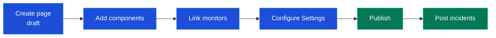
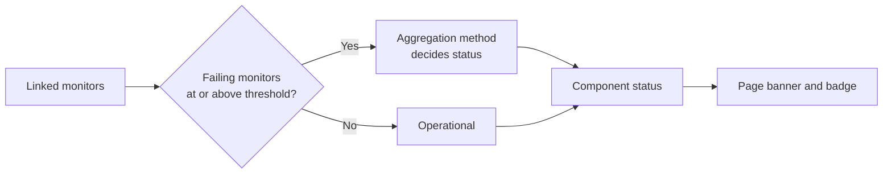
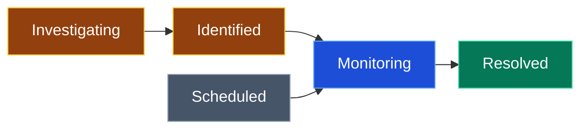
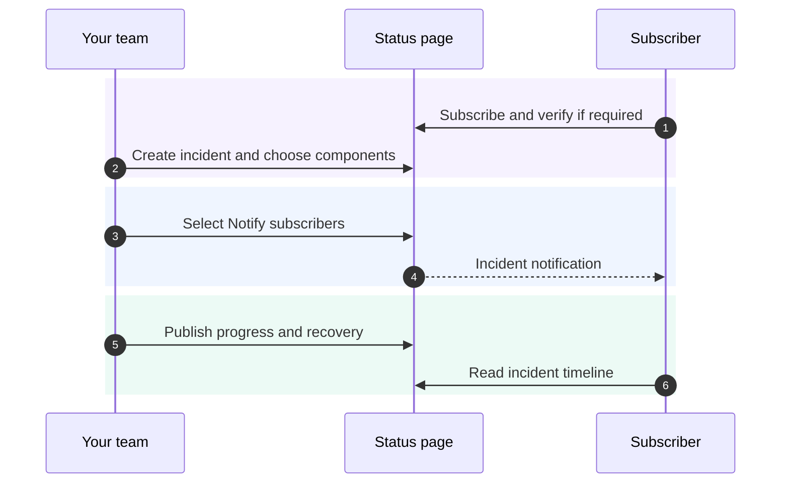
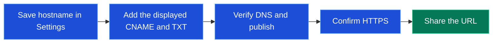

A public page, with no sign-in, that shows system health, incidents and scheduled maintenance and notifies subscribers. It is served from its own subdomain or your verified custom domain.

## Create and publish

Open **Communicate → Status Pages**, then **Manage** on a page to edit it.




<Steps>
<Step>
**Create the page.** Choose **Create Status Page** and enter a **Name** (internal), **Headline** (public title) and **Description**. It starts as a draft with a generated subdomain.


</Step>
<Step>
**Add components.** Publishing requires at least one public component.
</Step>
<Step>
**Configure settings** (optional): branding, subscriptions and a custom domain in **Settings**.
</Step>
<Step>
**Publish** and share the URL. The **Quick setup guide** (info icon by the page name) repeats these steps.
</Step>
</Steps>


| Action | Effect |
|---|---|
| **Preview** | Opens the page full screen inside the app, drafts included. **Open in new tab** shows it on its own |
| **Unpublish** | Returns to draft and stops serving. Components, incidents and subscribers are kept (both actions ask for confirmation) |
| **Archive** | Stops serving the page. Publishing again restores access |

## Public page


Selecting an incident opens its full timeline.


| Section | Shows |
|---|---|
| **Status banner** | Overall health, such as All Systems Operational |
| **Components** | Status and 90-day uptime per public component |
| **Scheduled maintenance** | Maintenance not yet started, apart from active incidents |
| **Incident history** | Active incidents and up to 500 from the last 90 days, grouped by date, never earlier than the page's creation day |
| **Subscribe** | Sign-up for incident notifications. An open incident's page also has **Subscribe**, to follow only that incident |

The page supports 24 languages, with right-to-left layout for Arabic. Automatic messages (outage, recovery, maintenance) use the page language; text you write is never translated. Unknown codes fall back to English.

### Badge and feeds

Prefix each path with your Supercheck URL. `[id]` is the status page UUID from the manage page URL.

| Endpoint | Path | Notes |
|---|---|---|
| **Badge** | `/api/status-pages/[id]/badge` | SVG, public, CORS-enabled, briefly cached. A wrong `[id]` shows `invalid id` |
| **RSS** | `/api/status-pages/[id]/rss` | Incident updates. Needs **RSS and iCal feeds** enabled |
| **iCal** | `/api/status-pages/[id]/ical` | Last 50 incidents. Same setting as RSS |

| Badge parameter | Values | Default |
|---|---|---|
| `style` | `flat`, `flat-square` | `flat` |
| `label` | Left-side text, up to 64 characters | `status` |

```markdown

```

Badge colors follow **Status colors**. With no recent data on any showcased component and no open incident, it shows `no recent data` in grey. Feeds use the page language and active public domain. Add the iCal URL to any `.ics` calendar app and the RSS URL to any feed reader.

## Components

A component is a public service. It can link to an internal service without publishing service details.


| Field | Purpose |
|---|---|
| **Basics** | Name, optional description, status. Without linked monitors, you and your status updates set it |
| **Monitors** | Linked monitors, aggregation method and **Failing monitors required**. **Weighted average** takes a weight of 1 to 100 per monitor |
| **Publish outage and recovery incidents automatically** | Optional, off by default. Posts a public update and notifies subscribers |
| **Visibility** | Show on the public page, show only while degraded, link an internal service (never published) |




| Aggregation | Component status |
|---|---|
| **Worst monitor** | Worst status among linked monitors |
| **Best monitor** | Best status among linked monitors |
| **Majority vote** | Status most linked monitors report |
| **Weighted average** | Status with the highest combined weight; ties go to the worse status |

Component statuses: **Operational** (green), **Degraded Performance** (yellow), **Partial Outage** (orange), **Major Outage** (red), **Under Maintenance** (blue, scheduled maintenance in progress).

Each component shows 90 UTC days of bars and an uptime figure. The legend lists only the colours on screen.

| Component | Bars | Uptime |
|---|---|---|
| **With linked monitors** | Coloured by the day's checks. Days without checks show no data | Successful checks divided by total checks |
| **Without monitors** | Green unless a status update affected it. Yellow for any downtime or degraded time, red from an hour of downtime in a day, blue for maintenance. Grey before the component was created | Time in the status the update set: **Major Outage** counts fully, **Partial Outage** 30%, degraded and maintenance not at all |

Without monitors, a status you set by hand with no open update colours only today and is not counted in uptime, and an update posted already resolved has no duration, so it is listed but not drawn. The banner and badge use showcased components, including those hidden while healthy.

<Accordions>
<Accordion title="Edge cases" id="component-edge-cases">

- Linked components refresh every 10 seconds. **Failing monitors required** is separate from a monitor's own alert threshold.
- If you resolve an automatic incident while its monitors still fail, it reopens only after the component returns to **Operational**.
- When every running linked monitor has missed three checks in a row (at least 15 minutes), the component shows **No recent data** and does not count toward the banner or badge. Paused monitors keep their last status.
- Paused monitors and monitors awaiting a first result are ignored while another linked monitor reports. If none reports, waiting-only components show Operational and components with paused monitors keep their last status (Operational if none).

</Accordion>
</Accordions>

## Status updates

The **Status updates** tab holds what visitors see. An update can link to an internal incident from the **Incidents** page. An automatic update links to the open internal incident its component's monitors triggered, if any.


Choose **New status update** (the page needs a component first):


Then fill in:

| Field | Notes |
|---|---|
| **Title** and **Initial message** | The message is published immediately |
| **Status** and **Impact** | Current stage and severity |
| **Affected components** | At least one, plus the status they show while active |
| **Maintenance window** | **Scheduled** only. The end must be after the start and in the future |
| **Link internal SRE incident** | Optional. Only your public title and message are published |

Keep **Notify subscribers** selected to send the update. Post progress with **Edit** in the row's **...** menu, then **Post Update** in the **Update Incident** dialog.



| Status | Meaning | Impact | Meaning |
|---|---|---|---|
| **Investigating** | Issue detected, team investigating | **None** | Informational |
| **Identified** | Root cause found, fix in progress | **Minor** | Small subset of users |
| **Monitoring** | Fix deployed, watching stability | **Major** | Significant impact |
| **Resolved** | Issue resolved | **Critical** | Complete outage |
| **Scheduled** | Planned maintenance | | |

**Scheduled maintenance:** use **Scheduled** status, set the window and enable automatic status transitions. It activates at the start and resolves at the end. Monitor alerts, including SSL expiry warnings, are suppressed during the window, while checks still run and are marked as maintenance. Those checks are excluded from uptime on monitor pages, the dashboard and the 90-day status-page bars, the same as a project maintenance window. A suppressed SSL warning is not queued: it is sent on the first SSL check after the window that finds the certificate still near expiry, subject to the alert settings and the once-per-24-hours limit.

A linked SRE incident stays private: investigation notes and evidence are never copied. Use **Internal incident** on the status update row, or the **Status page** row in the incident sidebar, to move between the two.

## Subscribers

Visitors can follow the whole page or choose **Only specific components** (shown when the page has more than one). To follow a single incident, they open it and choose **Subscribe**; this needs incident subscriptions in **Settings → Subscriptions**. Turn channels on or off in **Settings → Subscriptions**. Subscribers are notified of created, updated and resolved updates and maintenance updates, only when **Notify subscribers** was selected.



<Tabs items={['Email', 'Slack', 'Webhook']}>
<Tab value="Email">

Choose **Subscribe**, enter an email, select **Subscribe via Email** and open the verification link within 24 hours. A confirmation email follows. Each update email links to the incident's public page and carries a signed unsubscribe link and a one-click unsubscribe header; without `SECRET_ENCRYPTION_KEY` (which signs those links) no subscriber email is sent and the delivery is marked failed. Resubmitting an unverified address within 5 minutes sends no new email.


</Tab>
<Tab value="Slack">

Create a Slack app at [api.slack.com/apps](https://api.slack.com/apps), enable **Incoming Webhooks**, add one to a channel and paste its `https://hooks.slack.com` URL (the only host accepted) in the subscription dialog. Messages are color-coded by impact and link back to the page.


</Tab>
<Tab value="Webhook">

A new webhook stays **Pending** until the endpoint proves it owns the URL. The same URL is refused if resubmitted within 5 minutes. Resubmitting a never-verified URL returns a new signing secret, so use the latest.

Supercheck sends one `POST` (10-second timeout) with `type` `supercheck.webhook.verification`, a single-use `token`, `statusPageId` and `createdAt`. Reply with any `2xx` and echo the token in the `x-supercheck-verification` header or as `{ "challenge": "<token>" }` in a body under 4 KiB. Otherwise it stays pending; resend the challenge from **Subscribers**.

If the endpoint never answers, a public visitor only sees **Could not reach the endpoint**. When you resend verification from **Subscribers**, you also see a coarse reason: **Endpoint timed out**, **Connection refused** or **Host could not be resolved to an allowed public address**. A non-2xx answer shows its HTTP status, and a 2xx answer without the token says so.

Deliveries are signed in `X-Webhook-Signature` (HMAC-SHA256 of the raw JSON body) with a secret shown once after subscribing; rotate it in **Subscribers**. Delivery is at least once, so deduplicate by `incident_update_id`.

```ts title="verify-signature.ts"
import { createHmac, timingSafeEqual } from "node:crypto";

const expected = createHmac("sha256", signingSecret).update(rawBody).digest("hex");
const actual = (request.headers.get("X-Webhook-Signature") ?? "").replace(/^sha256=/, "");
const valid = actual.length === expected.length &&
  timingSafeEqual(Buffer.from(actual), Buffer.from(expected));
if (!valid) throw new Error("Invalid webhook signature");
```

</Tab>
</Tabs>


The **Subscribers** tab lists subscribers with verification status, search, CSV export, delivery history and retry for failed deliveries. Slack URLs are masked.

## Settings


| Card | Contains |
|---|---|
| **General** | Internal name, public headline, description, support contact, language |
| **Custom domain** | Hostname, verification status, DNS records |
| **Subscriptions** | Page and incident subscriptions; email, webhook and Slack channels; **RSS and iCal feeds** |
| **Branding** | Logo (630 × 420 px recommended, max 5 MB), favicon (96 × 96 px recommended, max 5 MB), status colors |

**Reset** in Branding applies at once, without **Save changes**.

### Custom domain

Use a subdomain such as `status.example.net`. Apex domains are not supported.



Add the **CNAME** target and **TXT** proof (at `_supercheck-challenge.<custom-hostname>`) shown in Settings. Publish the page before **Verify DNS**. Keep the TXT record: the records are rechecked daily, and a failed recheck does not unverify or detach the domain. To remove the domain, clear the field and save; the default URL keeps working.

<Callout type="warn">
On Cloudflare, use **DNS only** while verifying. Turn on the proxy only after the origin serves HTTPS for the hostname, with **Full** or **Full (Strict)** TLS.
</Callout>

<Accordions>
<Accordion title="Self-hosted DNS and HTTPS" id="self-hosted-dns">

| Purpose | Hostname | DNS record |
|---|---|---|
| Default page namespace (`STATUS_PAGE_DOMAIN`) | `[uuid].example.com` | Wildcard A/AAAA to your app |
| Target shown in Settings | `cname.example.com` | A/AAAA to your app; omit if the wildcard covers it |
| Custom status page | `status.example.net` | CNAME to `cname.example.com` |

Keep custom hostnames outside `STATUS_PAGE_DOMAIN`. Self-hosted verification issues no certificate: the HTTPS profile of `docker-compose.yml` routes verified hostnames through the `status-custom` Traefik router, and you supply a matching certificate in Traefik's dynamic TLS configuration or your own reverse proxy (to the app on port 3000). Supercheck Cloud issues HTTPS automatically. Local development uses `http://localhost:3000/status/[subdomain]`; custom domains need a publicly reachable `STATUS_PAGE_DOMAIN`.

</Accordion>
<Accordion title="Custom domain troubleshooting" id="custom-domain-troubleshooting">

| Problem | Check |
|---|---|
| CNAME or TXT missing or wrong | Copy the target and TXT value from Settings exactly and wait for propagation ([DNS Checker](https://dnschecker.org)) |
| Target not publicly resolvable | Point the target to your app with A/AAAA or wildcard DNS |
| Domain already in use | Remove it from the other status page first |
| 404 | Publish the page, verify DNS, and keep the hostname outside `STATUS_PAGE_DOMAIN` |
| Redirect loop or self-hosted HTTPS fails | Use Cloudflare **Full** or **Full (Strict)** and a certificate matching the hostname at your origin |

</Accordion>
</Accordions>

## Related

<Cards>
<Card title="Notifications" href="/docs/app/communicate/alerts" description="Alert your own team on failures" />
<Card title="Monitors" href="/docs/app/monitor" description="Create the monitors that drive component status" />
</Cards>
