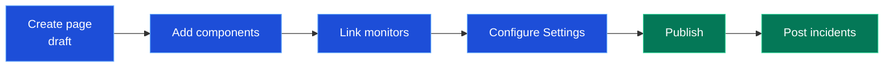
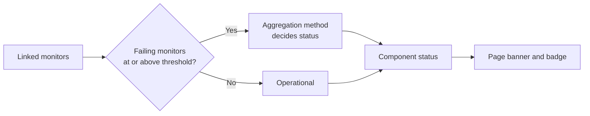
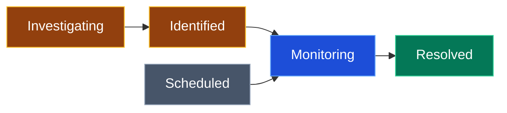
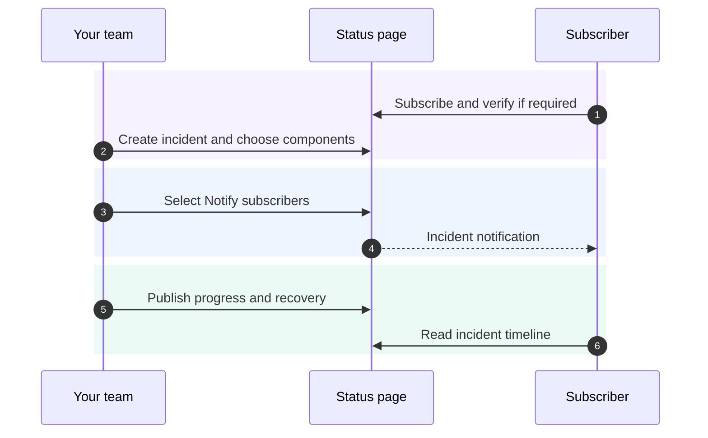
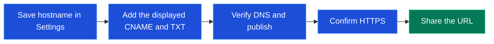

Publish a public page that shows system health, incidents, and scheduled maintenance, and notifies subscribers when something changes.

<Cards className="grid-cols-1 sm:grid-cols-3">
<Card icon={<Tally4 className="text-sky-500" />} title="Components">
Public services, with status from linked monitors and 90-day uptime
</Card>
<Card icon={<Siren className="text-rose-500" />} title="Incidents">
Outages and scheduled maintenance, with a timeline of updates
</Card>
<Card icon={<BellRing className="text-amber-500" />} title="Subscribers">
Email, Slack, webhook, RSS, and iCal updates
</Card>
</Cards>

<Callout type="info">
Status pages are public and need no sign-in. Each page is served from its own subdomain or from your verified custom domain.
</Callout>

## Create and Publish

Open **Communicate → Status Pages**, then choose **Manage** on a page to edit it.




<Steps>
<Step>

### Create the page

Choose **Create Status Page** and enter a **Name** (internal), **Headline** (public title), and **Description**. The page starts as a **draft** with a generated subdomain.


</Step>
<Step>

### Add components

Add at least one component that is shown on the public page. Publishing requires it.

</Step>
<Step>

### Configure settings (optional)

Set branding, subscriptions, and a custom domain in **Settings**.

</Step>
<Step>

### Publish

Choose **Publish** and share the URL. The **Quick setup guide** (info icon next to the page name) shows the same order.

</Step>
</Steps>


| Action | Effect |
|---|---|
| **Unpublish** | Returns the page to draft and stops serving it. Components, incidents, and subscribers are kept. |
| **Archive** | Stops serving the page and marks it archived. Publishing it again restores access. |

Both actions ask for confirmation.

## Public Page


| Section | Shows |
|---|---|
| **Status banner** | Overall health, such as All Systems Operational or Partial Outage |
| **Components** | Current status and check-based 90-day uptime for each public component |
| **Incident history** | Active incidents and up to 500 incidents from the last 90 days, grouped by date |
| **Subscribe** | Sign-up for incident notifications |

Clicking an incident opens its full timeline.


**Languages:** 24 languages, with right-to-left layout for Arabic. Supercheck writes its own automatic messages (outage, recovery, maintenance) in the page language. Text you write is never translated. Unknown language codes fall back to English.

### Status Badge and Feeds

| Endpoint | URL | Notes |
|---|---|---|
| **Badge** | `/api/status-pages/[id]/badge` | SVG, public, CORS-enabled, briefly cached |
| **RSS** | `/api/status-pages/[id]/rss` | Incident updates. Needs **Feeds (RSS and iCal)** enabled |
| **iCal** | `/api/status-pages/[id]/ical` | Last 50 incidents for calendar apps. Same setting as RSS |

Prefix each path with your Supercheck URL. `[id]` is the status page UUID from the manage page URL; a wrong value shows `invalid id` on the badge.

| Badge parameter | Values | Default |
|---|---|---|
| `style` | `flat`, `flat-square` | `flat` |
| `label` | Left-side text, up to 64 characters | `status` |

```markdown

```

Badge colors follow the page's **Status Colors** setting.

## Components

Components are the public services on your page. A component can link to an internal service without publishing any service details.


| Field | Purpose |
|---|---|
| **Basics** | Name, optional description, and status. Status is manual until you link a monitor |
| **Monitors** | Linked monitors, aggregation method, and **Failing monitors required**. Weighted vote takes a weight from 1 to 100 per monitor |
| **Automatic incidents** | Optionally publish outage and recovery incidents from component health. Off by default |
| **Visibility** | Show on the public page, show only while degraded, and link an internal service (never published) |




| Aggregation | Component status |
|---|---|
| **Worst case** | The worst status among linked monitors |
| **Best case** | The best status among linked monitors |
| **Majority vote** | The status most linked monitors report |
| **Weighted vote** | The status with the highest combined weight; ties go to the worse status |

<Callout type="info">
Linked components refresh every 10 seconds. **Failing monitors required** is the minimum number of failing linked monitors, separate from a monitor's own alert threshold. If you resolve an automatic incident while its monitors still fail, it is not reopened until the component returns to **Operational**.
</Callout>

| Status | Color | Meaning |
|--------|-------|---------|
| **Operational** | Green | Working normally |
| **Degraded Performance** | Yellow | Slower than normal |
| **Partial Outage** | Orange | Some features unavailable |
| **Major Outage** | Red | Service down |
| **Under Maintenance** | Blue | Scheduled maintenance in progress |

**Uptime** is successful checks divided by total checks over the last 90 UTC days. Days without checks show no data. It is check-based, not a time-weighted SLA. The banner and badge use showcased components, including components hidden while healthy.

## Incidents


<Steps>
<Step>

### Create the incident

Open **Incidents** and choose **Create Incident**. The page needs at least one component first.


</Step>
<Step>

### Fill in the details

| Field | Notes |
|---|---|
| **Title** and **Initial message** | The message is published immediately |
| **Status** and **Impact** | Current stage and severity |
| **Affected components** | At least one, plus the status they show while the incident is active |
| **Maintenance window** | Start and end, for **Scheduled** only. The end must be after the start and in the future |
| **Link internal SRE incident** | Optional. Only your public title and message are published |

</Step>
<Step>

### Notify and update

Keep **Notify subscribers** selected to send the update. Post progress with **Add Update** on the incident.

</Step>
</Steps>



<Tabs items={['Status', 'Impact', 'Scheduled maintenance']}>
<Tab value="Status">

| Status | Meaning |
|--------|---------|
| **Investigating** | Issue detected, team investigating |
| **Identified** | Root cause found, working on a fix |
| **Monitoring** | Fix deployed, watching stability |
| **Resolved** | Issue resolved |
| **Scheduled** | Planned maintenance |

</Tab>
<Tab value="Impact">

| Impact | Meaning |
|--------|---------|
| **None** | Informational update |
| **Minor** | Small subset of users affected |
| **Major** | Significant impact on the service |
| **Critical** | Complete outage |

</Tab>
<Tab value="Scheduled maintenance">

Create the incident with **Scheduled** status, set its window, and enable automatic status transitions. It becomes active at the start time and resolves at the end. Monitor alerts are suppressed during the window, while checks still run and count toward uptime.

</Tab>
</Tabs>

A linked SRE incident stays private: investigation notes and evidence are never copied. Use **View public status update** and **Internal SRE incident** to move between the two.

## Subscribers

Visitors can follow the whole page or pick specific components and incidents. Each channel can be turned on or off in **Settings → Subscriptions**.



<Tabs items={['Email', 'Slack', 'Webhook', 'Feeds']}>
<Tab value="Email">


Choose **Subscribe**, enter an email, select **Subscribe via Email**, then open the verification link.

</Tab>
<Tab value="Slack">


1. Create a Slack app at [api.slack.com/apps](https://api.slack.com/apps) and enable **Incoming Webhooks**
2. Add the webhook to a channel and copy its URL
3. Paste the URL in the subscription dialog

Messages are color-coded by impact and link back to the status page.

</Tab>
<Tab value="Webhook">

New webhook subscriptions stay **Pending** until the endpoint proves it owns the URL. Supercheck sends one `POST` (10-second timeout):

```json
{
  "type": "supercheck.webhook.verification",
  "token": "<single-use challenge>",
  "statusPageId": "<uuid>",
  "createdAt": "2026-10-20T00:00:00.000Z"
}
```

Reply with any `2xx` status and echo the token, either in the `x-supercheck-verification` header or as `{ "challenge": "<token>" }` in a body under 4 KiB. Otherwise the subscription stays pending; resend the challenge from **Subscribers**.

| Delivery detail | Value |
|---|---|
| **Signature** | `X-Webhook-Signature`, HMAC-SHA256 of the raw JSON body |
| **Secret** | Shown once after subscribing. Rotate it in **Subscribers** |
| **Retries** | At least once. Deduplicate by `incident_update_id` |

```ts
import { createHmac, timingSafeEqual } from "node:crypto";

const expected = createHmac("sha256", signingSecret).update(rawBody).digest("hex");
const actual = (request.headers.get("X-Webhook-Signature") ?? "").replace(/^sha256=/, "");
const valid = actual.length === expected.length &&
  timingSafeEqual(Buffer.from(actual), Buffer.from(expected));
if (!valid) throw new Error("Invalid webhook signature");
```

</Tab>
<Tab value="Feeds">

Add the iCal URL (`/api/status-pages/[id]/ical`) as a calendar subscription in Google Calendar, Apple Calendar, Outlook, or any app that reads `.ics` feeds. RSS works in any feed reader. Feeds use the page language and its active public domain.

</Tab>
</Tabs>


The **Subscribers** tab lists email, Slack, and webhook subscribers with verification status, search, CSV export, delivery history, and retry for failed deliveries. Slack webhook URLs are masked.

Subscribers are notified when an incident is created, updated, or resolved, and when you publish maintenance updates, but only for updates sent with **Notify subscribers** selected.

## Settings


| Card | Contains |
|---|---|
| **General** | Internal name, public headline, description, support contact, and language |
| **Custom domain** | Hostname, verification status, and DNS records |
| **Subscriptions** | Page and incident subscriptions; email, webhook, and Slack channels; **Feeds (RSS and iCal)** |
| **Branding** | Logo (630 × 420 px, max 5 MB), favicon (96 × 96 px, max 5 MB), and status colors |

A save bar appears while there are unsaved changes. **Reset** in Branding applies immediately, without **Save changes**.

### Custom Domain

Use a subdomain such as `status.example.net`. Apex domains are not supported.



| Step | Action |
|---|---|
| **1. Save** | Enter the hostname in **Settings** and save |
| **2. Add DNS** | A **CNAME** to the target shown in Settings, and the **TXT** proof at `_supercheck-challenge.<custom-hostname>` |
| **3. Verify** | After propagation, choose **Verify DNS**. The page must be published |
| **4. Check HTTPS** | Open the URL and confirm the certificate before sharing |

Keep the TXT record in place; ownership is rechecked daily. To remove the domain, clear the field and save; the default URL keeps working.

<Callout type="warn">
On Cloudflare, use **DNS only** while verifying. Turn on the proxy only after the origin serves HTTPS for the hostname, with **Full** or **Full (Strict)** TLS.
</Callout>

<Accordions>
<Accordion title="Self-hosted DNS and HTTPS">

| Purpose | Hostname | DNS record |
|---|---|---|
| Default page namespace (`STATUS_PAGE_DOMAIN`) | `[uuid].example.com` | Wildcard A/AAAA to your app |
| Target shown in Settings | `cname.example.com` | A/AAAA to your app; omit if the wildcard covers it |
| Custom status page | `status.example.net` | CNAME to `cname.example.com` |

Keep custom hostnames outside the `STATUS_PAGE_DOMAIN` namespace. DNS verification does not issue a certificate on self-hosted installs: the secure Compose file routes verified hostnames through the `status-custom` Traefik router, and you supply a matching certificate in Traefik's dynamic TLS configuration or your own reverse proxy (forwarding to the app on port 3000). On Supercheck Cloud, HTTPS is automatic after verification.

Local development uses `http://localhost:3000/status/[subdomain]`; custom domains need a publicly reachable `STATUS_PAGE_DOMAIN`.

</Accordion>
<Accordion title="Troubleshooting">

| Problem | Check |
|---|---|
| CNAME missing or wrong target | Match the target in Settings and wait for propagation ([DNS Checker](https://dnschecker.org)) |
| TXT proof missing or wrong | Copy the TXT name and value from Settings exactly |
| Target not publicly resolvable | Point the target to your app with A/AAAA or wildcard DNS |
| Domain already in use | Remove it from the other status page first |
| 404 | Publish the page, verify DNS, and keep the hostname outside `STATUS_PAGE_DOMAIN` |
| Cloudflare verification fails | Set the record to **DNS only** |
| Redirect loop | Use Cloudflare **Full** or **Full (Strict)** and check origin HTTPS |
| Self-hosted HTTPS fails | Install a certificate matching the hostname in your proxy |

</Accordion>
</Accordions>
