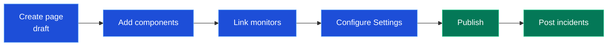
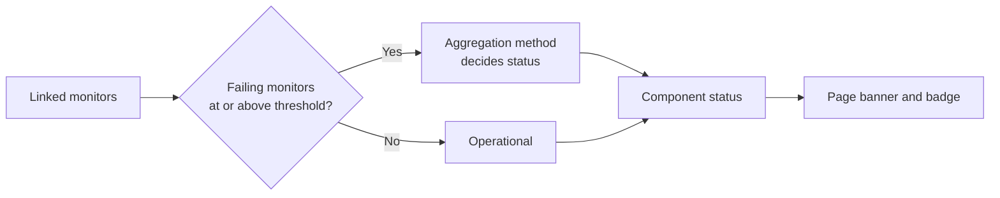
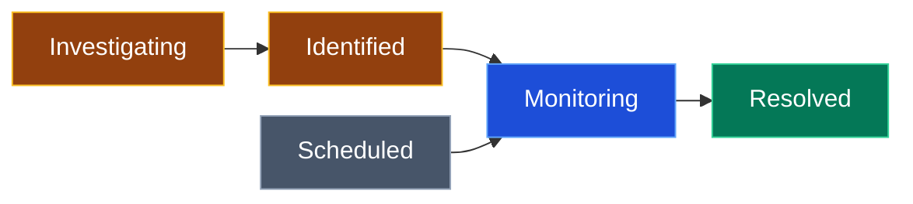
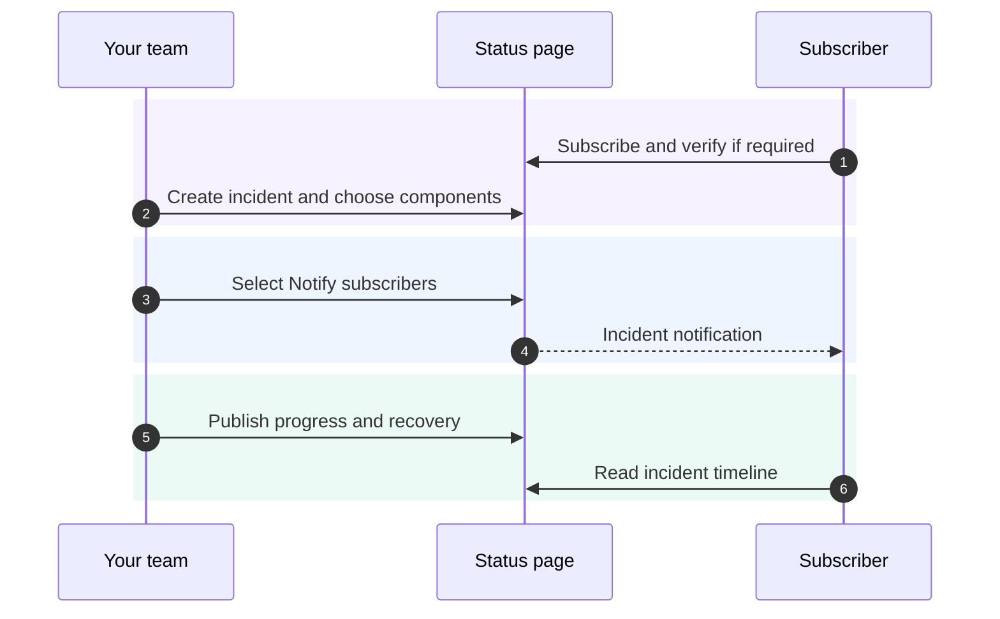
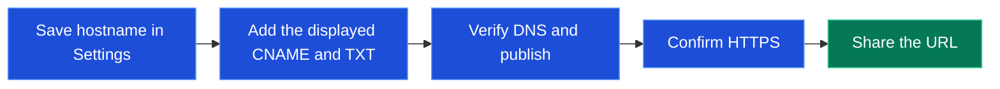

Create public status pages to communicate system health, incidents, and scheduled maintenance to your users.

<Callout type="info">
Status pages are served from a unique subdomain, or your own verified custom domain, and are publicly accessible without authentication.
</Callout>

## Managing Status Pages

Navigate to **Communicate → Status Pages** to view all your status pages.


Click **Manage** to access the management interface:


### Creating a Status Page

1. Click **Create Status Page**
2. Enter:
   - **Name** — Internal identifier
   - **Headline** — Public title shown on the page
   - **Description** — Brief description for users
3. Click **Create**


Your page is created in **draft mode** with an auto-generated subdomain. Use the **Quick setup guide** (the info icon next to the page name) for the recommended order of steps.



### Publishing

1. Add at least one component that is shown on the public page (required)
2. Optionally configure branding, subscriptions, and a custom domain in **Settings**
3. Click **Publish** to make the page public
4. Share the URL with your users

Use **Archive** in page management to remove a published page from public access while keeping its
records in the dashboard.

## Public Status Page

Once published, your status page displays real-time system health to users:


**What users see:**
- **Status Banner** — Overall system health (All Systems Operational, Partial Outage, etc.)
- **Components** — Public components with current status and check-based 90-day uptime
- **Incident History** — Active incidents and up to 500 recent incidents from the last 90 days, grouped by date
- **Subscribe Button** — Subscribe to receive incident notifications

The public layout follows right-to-left direction for Arabic. Pages support 24 translated languages.
System-generated incident and maintenance text (automatic outage and recovery updates, maintenance
start and completion updates, and the fallback initial update) is written in the page language when
the record is created. User-authored names, messages, and existing stored incidents are never
translated. Unknown language codes fall back to English.

### Status Badges

Embed dynamic status badges on external websites, READMEs, or documentation to show real-time system health.

**Badge URL Format:**
```
https://yourdomain.com/api/status-pages/[status-page-id]/badge
```

**Query Parameters:**
- `style` — Badge style: `flat` (default) or `flat-square`
- `label` — Left-side text (default: "status", max 64 characters)

**Embedding in Markdown:**
```markdown


```

**Embedding in HTML:**
```html

```

**Status Colors:**

| Status | Color | Default |
|--------|-------|---------|
| Operational | Green | #2ecc71 |
| Degraded | Yellow | #f1c40f |
| Partial Outage | Orange | #e67e22 |
| Major Outage | Red | #e74c3c |
| Maintenance | Blue | #3498db |

Colors are customizable via the status page **Settings** tab under **Status Colors**.

<Callout type="info">
The badge is a public endpoint — no authentication required. It includes CORS headers for cross-origin embedding on any website.
</Callout>

<Callout type="tip">
The badge is cached briefly. For the latest status, link directly to your status page.
</Callout>

**Testing Your Badge:**

Open your browser and visit the badge URL directly to preview the SVG output. Try different combinations:

| URL | Result |
|-----|--------|
| `/api/status-pages/ID/badge` | Default flat badge with "status" label |
| `/api/status-pages/ID/badge?style=flat-square` | Square-cornered badge |
| `/api/status-pages/ID/badge?label=API` | Custom "API" label on the left |
| `/api/status-pages/ID/badge?label=Uptime&style=flat-square` | Combined: custom label with square style |

Replace `ID` with your status page ID from the manage page URL or API response. If the badge shows `invalid id`, the path parameter is not the status page UUID.

### iCal Calendar Feed

Subscribe to status page incidents in any calendar application (Google Calendar, Apple Calendar, Outlook).

**Feed URL:**
```
https://yourdomain.com/api/status-pages/[status-page-id]/ical
```

**Subscribing:**
1. Copy the iCal feed URL for your status page
2. In your calendar app, add a new calendar subscription
3. Paste the URL and subscribe

The feed includes the last 50 incidents with impact level, status, affected services, and links to incident details.

<Callout type="info">
The iCal feed shares the **Feeds (RSS and iCal)** setting with RSS. Enable it in your status page settings to activate both feeds.
</Callout>

### Incident Details

Users can click any incident to view the full timeline of updates:


## Subscribing to Updates

Users can subscribe to receive notifications when incidents are created, updated, or resolved, when
the page and channel settings allow subscriptions. Visitors can select components and incidents to
follow. With no specific selections, the subscription covers the whole page; with selections, a
matching component or incident is sufficient to receive an update.

<Tabs items={['Email', 'Slack', 'Webhook', 'Feeds']}>
<Tab value="Email">


1. Click **Subscribe** on the status page
2. Enter email address
3. Click **Subscribe via Email**
4. Check inbox for verification email
5. Click verification link to activate subscription

</Tab>
<Tab value="Slack">


Send incident notifications directly to a Slack channel:

1. Create a Slack app at [api.slack.com/apps](https://api.slack.com/apps)
2. Enable **Incoming Webhooks**
3. Add webhook to your workspace and select channel
4. Copy the webhook URL
5. Paste URL in the subscription dialog

**Slack notifications include:**
- Rich formatted messages
- Color-coded by incident impact
- Affected services and status updates
- Direct link to status page

</Tab>
<Tab value="Webhook">

For custom integrations, subscribe via webhook:

1. Select **Webhook** tab
2. Enter your webhook endpoint URL
3. Return the ownership challenge described below
4. Copy the signing secret shown once after subscribing
5. Receive signed JSON events for matching incidents and component scopes

**Endpoint ownership challenge**

New webhook subscriptions start **pending** and receive no incident notifications until the endpoint
proves it controls the URL. Supercheck sends one `POST` with this JSON body using the same SSRF
validation and 10-second timeout as incident deliveries:

```json
{
  "type": "supercheck.webhook.verification",
  "token": "<single-use challenge>",
  "statusPageId": "<uuid>",
  "createdAt": "2026-10-20T00:00:00.000Z"
}
```

Respond with any `2xx` status and echo the token in either the `x-supercheck-verification` response
header or a JSON body field named `challenge`:

```json
{ "challenge": "<token from the request body>" }
```

A `2xx` response without the matching token, a non-`2xx` response, or a timeout leaves the
subscription pending. Pending subscriptions are listed as **Pending** under **Subscribers**; use the
resend button there to issue a fresh 24-hour challenge. Only the SHA-256 hash of the challenge is
stored. Existing webhook subscriptions created before ownership verification was introduced are
grandfathered as verified during the migration, so an upgrade does not stop live deliveries.

Incident requests include an `X-Webhook-Signature` HMAC-SHA256 header over the raw JSON body. Events include
`incident_update_id`; verify the signature before processing and deduplicate by update ID because
network ambiguity can cause an at-least-once retry.

To replace a signing secret, open **Subscribers** in the status page settings and choose
**Rotate webhook signing secret** for that subscriber. Copy the replacement before closing
the dialog and update your receiver. New deliveries immediately use the replacement secret.

For a Node.js receiver, verify the raw request bytes before parsing JSON:

```ts
import { createHmac, timingSafeEqual } from "node:crypto";

const expected = createHmac("sha256", signingSecret).update(rawBody).digest("hex");
const actual = (request.headers.get("X-Webhook-Signature") ?? "").replace(/^sha256=/, "");
const valid = actual.length === expected.length &&
  timingSafeEqual(Buffer.from(actual), Buffer.from(expected));
if (!valid) throw new Error("Invalid webhook signature");
```

</Tab>
<Tab value="Feeds">

Subscribe to the status page's feeds. RSS includes incident updates, while iCal shows incidents in
calendar applications. Feed text uses the page language, and links use the page's active public
domain.

1. Copy the iCal URL: `https://yourdomain.com/api/status-pages/[id]/ical`
2. Add a new calendar subscription in your app
3. Paste the URL and subscribe

Supports Google Calendar, Apple Calendar, Outlook, and any app that accepts `.ics` feeds.

</Tab>
</Tabs>

## Components

Components represent public-facing services or features on your status page. Internal services
remain the ownership and dependency catalog; a component can link to a service while exposing only
its public component details.


<Tabs items={['Adding Components', 'Status Types']}>
<Tab value="Adding Components">

1. Go to **Components** tab
2. Click **Add Component**
3. Enter:
   - **Basics** — Name (e.g., "API"), optional description, and status. The status is manual until a monitor is linked.
   - **Monitors** — Search and link monitors. Once linked, choose the aggregation method and **Failing monitors required**; for weighted aggregation, set a weight from 1 to 100 per monitor. Optionally publish outage and recovery incidents automatically.
   - **Visibility** — Show the component on the public page, show it only while degraded, and optionally link an internal service (internal only; never published).


**Linked Monitors and health**



Linked components refresh from monitor aggregate results every 10 seconds. Choose worst case, best
case, weighted vote, or majority vote aggregation. Weighted vote uses monitor weights as votes; the
status with the greatest combined weight wins, with ties resolved to the worse status. The failure
threshold is the minimum number of failing linked monitors; it is separate from the monitor's
consecutive-check alert threshold. A component without linked monitors remains manually managed.
You can choose whether a component is
showcased publicly, shown in the list only while degraded, and whether component health should
automatically create and resolve public incidents. Automatic incidents are off by default.

If you resolve an automatic incident manually while its monitors are still failing, Supercheck does
not recreate it on the next check. Automatic incidents stay suppressed for that component until its
calculated status returns to **Operational**; a later outage creates a new incident normally. This
prevents the same outage from reopening after a responder has already closed it.

The page banner and badge use showcased components. Hiding a component from the list while healthy
does not remove its degraded health from the overall status. Uptime is calculated from successful
observed checks divided by total observed checks over the last 90 UTC days. Days without check data
are shown as having no data; incident dates do not determine uptime. This is check-based reporting,
not a time-weighted SLA.

</Tab>
<Tab value="Status Types">

| Status | Color | Description |
|--------|-------|-------------|
| **Operational** | Green | Service functioning normally |
| **Degraded Performance** | Yellow | Running but slower than normal |
| **Partial Outage** | Orange | Some features unavailable |
| **Major Outage** | Red | Service completely down |
| **Under Maintenance** | Blue | Scheduled maintenance in progress |

</Tab>
</Tabs>

## Incidents

Incidents communicate service disruptions to your users.


<Tabs items={['Creating Incidents', 'Workflow', 'Impact']}>
<Tab value="Creating Incidents">

1. Go to **Incidents** tab
2. Click **Create Incident**
3. Enter:
   - **Title** — Brief description (e.g., "API Response Delays")
   - **Initial message** — First update, published immediately
   - **Status** and **Impact** — Current stage and severity
   - **Maintenance window** — Start and end times, shown only for **Scheduled** incidents. The end must be after the start and in the future.
   - **Affected components** — Select at least one. If the page has no components, add one first; incident creation is disabled until then.
   - **Component status during incident** — Status applied to the selected components while the incident is active
   - **Link internal SRE incident** — Optional; only your public title and message are published
4. Leave **Notify subscribers** selected in the footer to send the update
5. Click **Create Incident**


**Incident Updates**

1. Open an existing incident
2. Click **Add Update**
3. Write update message
4. Update status if changed
5. Choose whether to notify subscribers

If you set the status to **Scheduled**, both maintenance start and end times are required. The end
must be after the start and in the future. The dialog and the server action enforce the same rule, so
an update sent directly to the action without a valid window is rejected.

An SRE incident may be linked to a public status-page incident. The link preserves the investigation
record internally; only the title and message you author for the public incident appear on the
status page. Investigation notes, evidence, and other SRE details are not copied to the public page.
In management, use **View public status update** to open the linked status-page incident and
**Internal SRE incident** to return to the private investigation.

**Scheduled Maintenance**

1. Create an incident with **Scheduled** status
2. Set the maintenance start and end times
3. Enable automatic status transitions

At the start time the incident moves into its active maintenance status; at the end it resolves.
Monitor alerts are suppressed during the maintenance window, while checks continue to be collected
and included in uptime. Reminder notifications are not currently available.

</Tab>
<Tab value="Workflow">

Use these statuses to communicate progress. Update the incident as your team investigates, applies a fix, verifies recovery, and resolves it. Scheduled maintenance can advance automatically when you enable its status transitions.

<p className="text-sm">Scroll horizontally on smaller screens to view all steps.</p>

<div className="overflow-x-auto" role="region" aria-label="Status page incident lifecycle" tabIndex={0}>
<div className="min-w-[56rem]">



</div>
</div>

| Status | Description |
|--------|-------------|
| **Investigating** | Issue detected, team investigating |
| **Identified** | Root cause found, working on fix |
| **Monitoring** | Fix deployed, monitoring stability |
| **Resolved** | Issue completely resolved |
| **Scheduled** | Planned maintenance |

</Tab>
<Tab value="Impact">

| Impact | Description |
|--------|-------------|
| **None** | Informational update |
| **Minor** | Small subset of users affected |
| **Major** | Significant impact on service |
| **Critical** | Complete service outage |

</Tab>
</Tabs>

## Subscribers

Manage users who receive incident notifications.


**Features:**
- View all subscribers (email, webhook, Slack)
- See verification status
- Search and filter by email or URL
- Export to CSV
- Delete subscribers
- View statistics (total, verified, pending)
- Review notification delivery attempts and retry failed deliveries
- Slack webhook URLs are shown masked, since they act as credentials
- Webhook subscribers stay **Pending** until they answer the ownership challenge; use the resend
  action to issue a fresh challenge

Delivered, failed, and skipped delivery rows are retained for 30 days by default, then deleted by the
existing scheduler tick. Set `STATUS_PAGE_DELIVERY_RETENTION_DAYS` to a whole number from 1 to 3650 to
change the window; invalid values fall back to 30. Pending deliveries are never removed by retention.

### Notification Types

Subscribers receive notifications for:
- New incidents created
- Incident status updates
- Incident resolution
- Maintenance updates you publish with **Notify subscribers** selected

When creating or updating an incident, select **Notify subscribers** if you want to send an update. Keep the message clear about impact, current status, and the next update. Visitors can review the incident timeline on the published page even when you do not send a notification.

<p className="text-sm md:hidden">Scroll horizontally to view the full diagram.</p>

<div className="overflow-x-auto" role="region" aria-label="Status Pages workflow diagram" tabIndex={0}>
<div className="min-w-[48rem]">



</div>
</div>

## Settings

Configure page identity, custom domains, subscriptions, and branding. Settings are split into focused cards, and a save bar appears at the bottom of the screen whenever the form has unsaved changes.

- **General** — Internal page name, public headline, description, support contact, and language
- **Custom domain** — Custom hostname, verification status, and DNS records
- **Subscriptions** — Visitor-facing email, webhook, Slack, incident, and feed options
- **Branding** — Logo, favicon, and status colors


<Tabs items={['Branding', 'Subscriptions', 'Custom Domains']}>
<Tab value="Branding">

- **Logo** — Header logo for status page (630 × 420 px recommended, max 5 MB)
- **Favicon** — Browser tab icon (96 × 96 px recommended, max 5 MB)
- **Status Colors** — Customize colors for each status type
- **Reset** — Restores default colors and removes the logo and favicon immediately; it does not wait for **Save changes**

</Tab>
<Tab value="Notifications">

- **Page Subscriptions** — Allow visitors to subscribe to page updates
- **Email, Webhook, and Slack Notifications** — Enable each supported subscriber channel independently
- **Incident Subscriptions** — Allow visitors to select individual incidents
- **Feeds (RSS and iCal)** — Enable or disable both public feeds

</Tab>
<Tab value="Custom Domains">

Use a custom hostname such as `status.example.net`. Configure both DNS records shown in Settings, verify the page, then confirm HTTPS before sharing the URL.
Custom domains support CNAME subdomains only; apex domains are not supported. Expand **DNS records** under the **Custom domain** card to see the CNAME and TXT proof values. Before a hostname is entered, the panel shows example records; after it is saved, it shows the exact records and the verification status. The info icon next to the card heading summarizes the DNS rules. DNS ownership is checked daily. Existing verification is retained during transient DNS failures such as resolver timeouts, `ENOTFOUND`, `ENODATA`, or `EAI_AGAIN`. A verified hostname is revoked only after three consecutive daily checks return a definitive mismatch — a CNAME that points elsewhere or a missing/changed TXT proof. A successful manual **Verify DNS** resets the failure counter.

#### Set Up a Custom Domain

<p className="text-sm">Scroll horizontally on smaller screens to view all steps.</p>

<div className="overflow-x-auto" role="region" aria-label="Custom domain setup workflow" tabIndex={0}>
<div className="min-w-[60rem]">



</div>
</div>

| Step | Action |
|---|---|
| **1. Save** | Enter the custom hostname in the status page's **Settings**, then save. |
| **2. Configure DNS** | Add the **CNAME** from your custom hostname to the exact target shown in Settings, and add the displayed **TXT** proof at `_supercheck-challenge.<custom-hostname>`. Some providers require only the hostname label, such as `status`. |
| **3. Verify** | Wait for propagation, then select **Verify DNS**. Ensure the page is published. |
| **4. Check HTTPS** | Open the custom URL and confirm the certificate is valid before sharing it. |

**Self-hosted example:**

| Purpose | Hostname | DNS record |
|---|---|---|
| Reserved default-page namespace | `[uuid].example.com` | Wildcard A/AAAA pointing to your app |
| Target shown in Settings | `cname.example.com` | A/AAAA pointing to your app; omit if the wildcard covers it |
| Custom status page | `status.example.net` | CNAME to `cname.example.com` |

Set `STATUS_PAGE_DOMAIN` to the public namespace for default URLs. Keep custom hostnames outside that namespace. The CNAME target may use A/AAAA or wildcard DNS. Verification requires both the custom hostname's CNAME and its page-specific TXT proof (`supercheck-domain-verification=<status-page-id>`). Keep the TXT record in place; changing or removing it prevents verification. Previously verified pages continue to serve, but new verification and re-verification require the TXT record.

<Callout type="warn">
For Cloudflare, use **DNS only** during verification and initial HTTPS checks. Enable the proxy only after the origin serves HTTPS for the custom hostname; use **Full** or **Full (Strict)** TLS mode.
</Callout>

#### HTTPS / SSL

| Deployment | What to do |
|---|---|
| **Supercheck Cloud** | HTTPS is configured automatically after domain verification. |
| **Self-hosted Docker Compose** | The secure Compose file routes verified custom hostnames to the app. Configure a matching TLS certificate separately in Traefik or your reverse proxy. |
| **Traefik certificates** | Keep the `status-custom` router and supply matching certificates through dynamic TLS configuration. |
| **Other reverse proxy** | Accept the custom hostname, terminate TLS, and forward requests to the app on port 3000. |

DNS verification does not provision a self-hosted certificate. See the [HTTPS deployment guide](/docs/app/deployment/self-hosted) for the base deployment.

#### Removing a Custom Domain

Clear the domain field in **Settings** and save. The default page URL continues to work.

#### Troubleshooting

| Problem | Check |
|---|---|
| CNAME missing or wrong target | Confirm the target matches Settings, then wait for DNS propagation. Check with [DNS Checker](https://dnschecker.org). |
| TXT proof missing or wrong | Copy the TXT name and value shown in Settings exactly, then wait for DNS propagation before verifying again. |
| Target is not publicly resolvable | Point the target hostname to your app using A/AAAA or wildcard DNS. Keep the custom hostname as a CNAME only. |
| Domain already in use | Remove it from the other status page first. |
| 404 | Publish the page, verify DNS, and check that the hostname is outside the reserved `STATUS_PAGE_DOMAIN` namespace. |
| Cloudflare verification fails | Switch the custom record to **DNS only** so its CNAME remains visible. |
| Redirect loop | Use Cloudflare **Full** or **Full (Strict)**, then check origin HTTPS. |
| Self-hosted HTTPS fails | Configure a certificate matching the custom hostname and confirm your proxy accepts it. |

Local development uses `http://localhost:3000/status/[subdomain]`. Public custom domains require a publicly reachable `STATUS_PAGE_DOMAIN`; localhost and private placeholders cannot serve as the target.

</Tab>
</Tabs>
