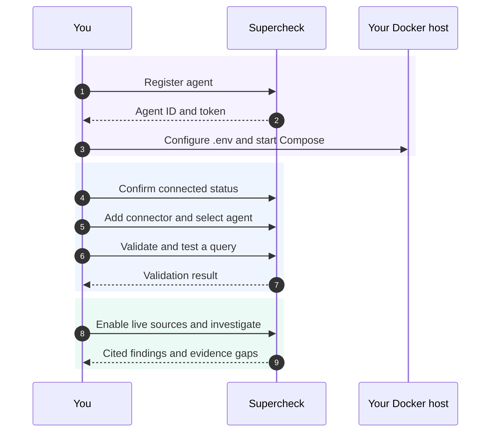

Connect private services to AI SRE investigations through an outbound-only, read-only agent. For test execution workers on separate servers, see [Multi-Server](/docs/app/deployment/multi-server).

## Prerequisites

| Requirement | Details |
|-------------|---------|
| Permission | Organization owner or admin. The server requires the connector-configure permission; an org-wide agent also needs organization-level rights. **Settings → Organization** is not shown to other roles |
| Host | Docker Engine with Compose v2 that can reach Supercheck and your provider endpoints |
| Network | Outbound HTTPS to the Supercheck API, with no browser challenge in front. No inbound ports for remote agents; colocated agents use the private Docker network |

Use the supplied Compose file: it keeps the agent non-root, read-only, and capability-free.

## Set up



<Steps>
<Step>

### Register the agent

In your Cloud or self-hosted dashboard, select the project and open **Settings → Organization → Private Agents → Register agent**. Keep project scope selected unless the agent must serve other projects.

Copy the **Agent ID** and **Registration token**. The dialog also shows the environment variables (`PRIVATE_AGENT_ID`, `PRIVATE_AGENT_TOKEN`, `SUPERCHECK_API_URL`) and the Compose file name. Start the agent within **15 minutes**, before the token expires.

</Step>
<Step>

### Start the agent

<Tabs items={['On the Supercheck host', 'Another network or Cloud']}>
  <Tab value="On the Supercheck host">
    In your existing `deploy/docker/.env`, add the credentials and the profile, keeping any existing profiles:

    ```dotenv
    COMPOSE_PROFILES=https,private-agent
    PRIVATE_AGENT_ID=your-agent-id
    PRIVATE_AGENT_TOKEN=your-registration-token
    ```

    For a local HTTP install use `COMPOSE_PROFILES=private-agent`. Then, from that directory:

    ```bash
    sudo docker compose up -d private-agent
    ```
  </Tab>
  <Tab value="Another network or Cloud">
    On the agent host, download the Compose file:

    ```bash
    mkdir -p ~/supercheck-private-agent
    cd ~/supercheck-private-agent
    curl -fsSL -o docker-compose-private-agent.yml https://raw.githubusercontent.com/supercheck-io/supercheck/v1.6.0/deploy/docker/docker-compose-private-agent.yml
    ```

    Create `.env` beside it, using your dashboard's HTTPS origin without `/api`:

    ```dotenv
    SUPERCHECK_API_URL=https://your-supercheck-instance.example
    PRIVATE_AGENT_ID=your-agent-id
    PRIVATE_AGENT_TOKEN=your-registration-token
    SUPERCHECK_VERSION=1.6.0
    ```

    ```bash
    chmod 600 .env
    sudo docker compose -f docker-compose-private-agent.yml up -d
    ```
  </Tab>
</Tabs>

</Step>
<Step>

### Connect a provider

Confirm the agent shows **connected**. In the same project's **Settings → Organization → Integrations**, add a connector, select **Private Agent**, and choose this agent.

Enter a container-reachable provider endpoint and a read-only credential, then validate the connector and test a known-result query. See [Connectors](/docs/app/investigate/connectors) for provider requirements and [Connector limits](#connector-limits).

</Step>
<Step>

### Investigate

Link the connector's service to an incident and run an investigation with **Include live sources**, or use [Copilot](/docs/app/investigate/copilot).

</Step>
</Steps>

## Agent status and options

The agent sends a heartbeat every 30 seconds. Supercheck shows it as disconnected when none arrives for 90 seconds.

| Status | Meaning |
|---|---|
| **pending** | Registered or rotated, not connected yet |
| **connected** | Heartbeats are arriving |
| **disconnected** | No heartbeat for 90 seconds |
| **unhealthy** | Connected, but it reported a problem. Also shown as disconnected once heartbeats stop |
| **disabled** | Turned off, permanently. Queued and in-flight jobs fail with `agent_disabled`, the token stops working, and the agent cannot be rotated or revived. Register a new agent to replace it |

Rotating a token revokes the old credential and returns the agent to **pending** until it connects with the new one.

<Callout type="warn">
Preserve the `private-agent-state` volume; do not use `down -v` during maintenance.
</Callout>

<Accordions>
<Accordion title="Token expired or credential revoked" id="credential-revoked">

If the registration token expires, choose **Rotate token** (not available while a super admin is impersonating a user), replace it in `.env`, and recreate the agent within 15 minutes with the start command above.

When the control plane keeps rejecting the agent's credential (HTTP 401 at least three times in a row over at least 60 seconds, after a rotation or after the agent was disabled), the agent logs `Private Agent credential revoked or agent disabled` and exits with a non-zero code. Run it under a restart policy (for example `restart: unless-stopped`) so the exit is visible to your monitoring and the agent restarts after it exits. A restart does not reload `PRIVATE_AGENT_TOKEN` from `.env`: to use a new token, edit `.env` and recreate the container (for example `docker compose up -d private-agent`), or register a replacement agent.

</Accordion>
<Accordion title="Tuning variables" id="tuning-variables">

The defaults suit most installs.

| Variable | Default | Purpose |
|---|---|---|
| `PRIVATE_AGENT_LEASE_WAIT_MS` | `25000` | How long one request waits for a job (up to 25 seconds) |
| `PRIVATE_AGENT_RETRY_INTERVAL_MS` | `5000` | Delay before retrying after an error |
| `PRIVATE_AGENT_HEARTBEAT_INTERVAL_MS` | `30000` | Heartbeat interval. Keep it well under 90 seconds |

</Accordion>
<Accordion title="Connector limits and MCP servers" id="connector-limits">

Loopback addresses such as `localhost` and cloud metadata endpoints (AWS, GCP, Azure, Alibaba) are rejected. Response size is capped per path:

| Response | Limit |
|---|---|
| Provider response | Truncated over 4 MiB (Jira and Confluence: 2 MiB) |
| Any other connector response | Over 10 MiB fails the query |
| Job result sent back by the agent | 1 MiB |

Private Agents are also the only way to use an [MCP server](/docs/app/investigate/connectors#mcp-servers-private-agent-only) inside your network. The agent connects over Streamable HTTP, applies the same endpoint policy as other connectors, and runs only tools you allowlisted. Discovery and tool calls run as agent jobs, so the agent must be connected. Each agent reports the connector types it supports; Supercheck sends it only those, and asks you to upgrade an older agent before it can run newer types such as MCP, Jira or Confluence.

</Accordion>
</Accordions>
