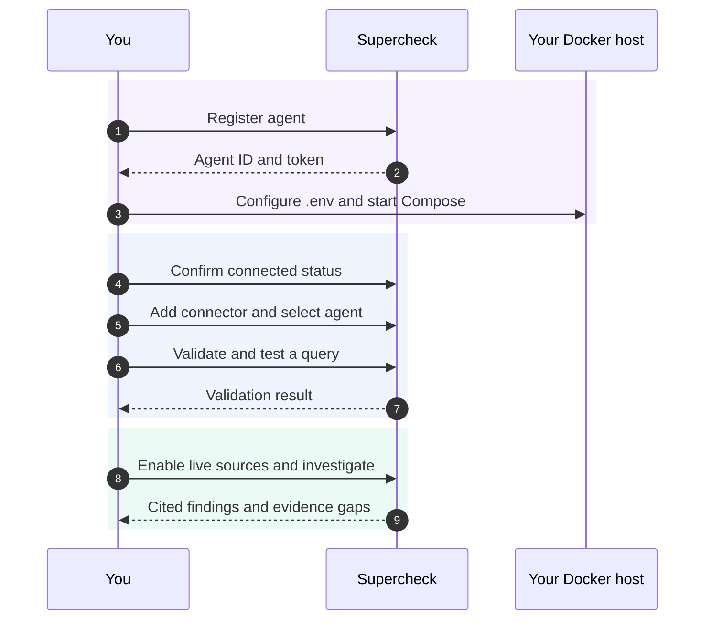

Connect private services to AI SRE investigations through an outbound-only, read-only agent. For test execution workers on separate servers, see [Multi-Server Deployment](/docs/app/deployment/multi-server).

## Setup Workflow

<p className="text-sm md:hidden">Scroll horizontally to view the full diagram.</p>

<div className="overflow-x-auto" role="region" aria-label="Private Agent workflow diagram" tabIndex={0}>
<div className="min-w-[48rem]">



</div>
</div>

## Setup

<Accordions>
  <Accordion title="Requirements" id="requirements">
    - Permission to configure connectors (for example, Project Admin or Org Admin).
    - A Docker Engine host with Compose v2 that can reach Supercheck and your provider endpoints.
    - Outbound HTTPS to the Supercheck API without interactive browser challenges; no inbound ports for remote agents. Colocated agents use the private Docker network.

    Use the supplied Compose configuration to retain its non-root user, read-only filesystem, and restricted permissions.
  </Accordion>
</Accordions>

### 1. Register the agent

In your Cloud or self-hosted dashboard, select the project and open **Organization Admin → Private Agents → Register agent**. Keep project scope selected unless the agent must serve other projects.

Copy the **Agent ID** and **Registration token**. Start the agent within **15 minutes** before the token expires.

### 2. Start the agent

<Tabs items={['On the Supercheck host', 'Another network or Cloud']}>
  <Tab value="On the Supercheck host">
    In your existing `deploy/docker/.env`, add the agent credentials and profile. Keep any existing profiles:

    ```dotenv
    COMPOSE_PROFILES=https,private-agent
    PRIVATE_AGENT_ID=your-agent-id
    PRIVATE_AGENT_TOKEN=your-registration-token
    ```

    For local HTTP evaluation, use `COMPOSE_PROFILES=private-agent`. From that directory, run:

    ```bash
    sudo docker compose up -d private-agent
    ```
  </Tab>
  <Tab value="Another network or Cloud">
    On the agent host, download the Compose file:

    ```bash
    mkdir -p ~/supercheck-private-agent
    cd ~/supercheck-private-agent
    curl -fsSL -o docker-compose-private-agent.yml https://raw.githubusercontent.com/supercheck-io/supercheck/v1.3.7-canary.16/deploy/docker/docker-compose-private-agent.yml
    ```

    Create `.env` beside it. Use your dashboard's HTTPS origin, without `/api`:

    ```dotenv
    SUPERCHECK_API_URL=https://your-supercheck-instance.example
    PRIVATE_AGENT_ID=your-agent-id
    PRIVATE_AGENT_TOKEN=your-registration-token
    SUPERCHECK_VERSION=1.3.7-canary.16
    ```

    ```bash
    chmod 600 .env
    sudo docker compose -f docker-compose-private-agent.yml up -d
    ```
  </Tab>
</Tabs>

Preserve `private-agent-state`; avoid `down -v` during maintenance. If the registration token expires, choose **Rotate token**, replace it in `.env`, and recreate the agent within 15 minutes using the startup command above.

### 3. Connect a provider

Confirm the agent shows **connected**. In the same project's **Organization Admin → Integrations**, add a connector, select **Private Agent**, and choose this agent.

Enter a container-reachable provider endpoint and a read-only credential. Loopback addresses such as `localhost` are rejected. Validate the connector and test a known-result query. See [Connectors](/docs/app/investigate/connectors) for provider requirements.

Link the connector's service to an incident and run an investigation with **Include live sources**, or use [Copilot](/docs/app/investigate/copilot).
