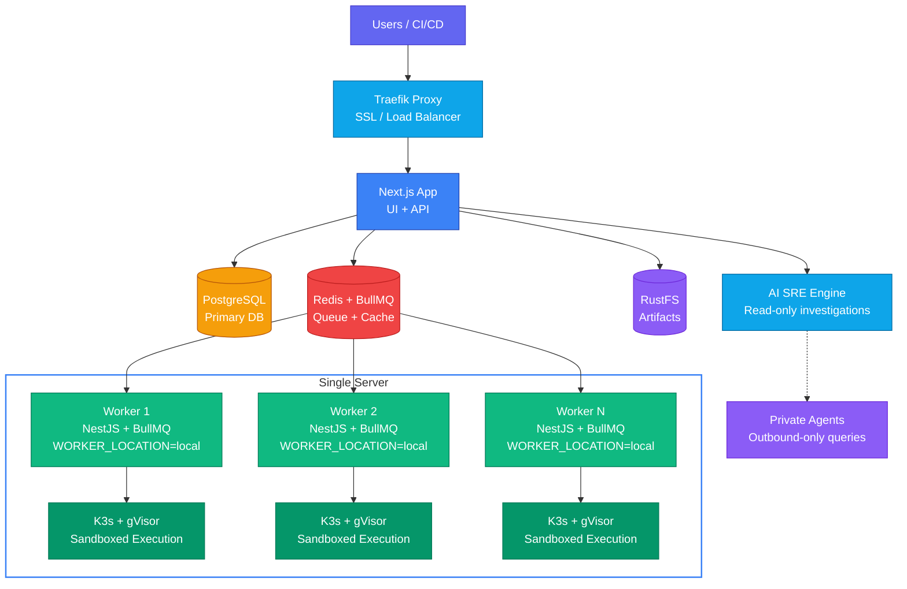

Self-host Supercheck on one Linux server.

## Architecture

<p className="text-sm md:hidden">Scroll horizontally to view the full diagram.</p>

<div className="overflow-x-auto" role="region" aria-label="Single-Location deployment layout diagram" tabIndex={0}>
<div className="min-w-[52rem]">



</div>
</div>

## Install

<Accordions>
  <Accordion title="Requirements" id="requirements">
    - Ubuntu 22.04+ or Debian 12+ server; x86_64 or ARM64.
    - At least 2 vCPU, 4 GB RAM, and 15 GB free disk; 30–50 GB is recommended.
    - Sudo access, `curl`, and internet access for downloads. Docker and Compose are installed automatically.
    - Public HTTPS: point your domain at the server, open inbound ports 80/443, and have an email for certificate notices.

    macOS, Windows, WSL2, and Docker Desktop are not supported.
  </Accordion>
</Accordions>

Run on your server to install **1.3.7-canary.16**:

```bash
curl -fsSL https://raw.githubusercontent.com/supercheck-io/supercheck/main/deploy/docker/install.sh -o install.sh && sudo bash install.sh --version 1.3.7-canary.16
```

Follow the prompts for local evaluation or HTTPS. Open the printed URL, create your account, and run a test.


## Optional Configuration

<Accordions>
  <Accordion title="Edit and apply settings" id="apply-configuration-changes">
    From `/opt/supercheck/deploy/docker` (or the directory printed by the installer), edit `.env` with `sudoedit .env` and apply:

    ```bash
    sudo env KUBECONFIG_FILE=/etc/rancher/k3s/supercheck-worker.kubeconfig docker compose up -d --force-recreate app worker
    ```

    Keep `.env` private and backed up. Preserve `SECRET_ENCRYPTION_KEY` so encrypted variables and connector credentials remain readable.
  </Accordion>

  <Accordion title="Browser Integrations (CORS)">
    Allow only trusted origins for browser integrations:

    ```dotenv
    CORS_ALLOWED_ORIGINS=https://dev.azure.com,https://*.visualstudio.com
    ```

    Empty by default.
  </Accordion>

  <Accordion title="OAuth (GitHub / Google)">
    <Tabs items={['GitHub', 'Google']}>
      <Tab value="GitHub">
        1. Go to [GitHub Developer Settings](https://github.com/settings/developers) → **OAuth Apps** → **New OAuth App**
        2. Set Callback URL: `https://app.yourdomain.com/api/auth/callback/github`
        3. Add to `.env`:
           ```bash
           GITHUB_CLIENT_ID=your-client-id
           GITHUB_CLIENT_SECRET=your-client-secret
           ```
      </Tab>
      <Tab value="Google">
        1. Go to [Google Cloud Console](https://console.cloud.google.com/) → **APIs & Services** → **Credentials**
        2. Create **OAuth client ID** with redirect URI: `https://app.yourdomain.com/api/auth/callback/google`
        3. Add to `.env`:
           ```bash
           GOOGLE_CLIENT_ID=your-client-id.apps.googleusercontent.com
           GOOGLE_CLIENT_SECRET=your-client-secret
           ```
      </Tab>
    </Tabs>
  </Accordion>

  <Accordion title="Registration Controls">
    | Variable | Default | Description |
    |----------|---------|-------------|
    | `SIGNUP_ENABLED` | `true` | Set `false` to disable open registration (invited users still work) |
    | `ALLOWED_EMAIL_DOMAINS` | *(empty)* | Comma-separated allowlist (e.g. `acme.com,acme.org`) |

    On a public server, create your account, then disable open signup or restrict allowed domains. To grant your account Super Admin access:

    ```bash
    sudo docker compose exec app node scripts/bootstrap-admin.js your-email@example.com
    ```
  </Accordion>

  <Accordion title="Email (SMTP)">
    ```bash
    SMTP_HOST=smtp.gmail.com
    SMTP_PORT=587
    SMTP_FROM_EMAIL=notifications@yourdomain.com
    SMTP_USER=your-email@gmail.com        # Optional
    SMTP_PASSWORD=your-app-password       # Optional
    ```
  </Accordion>

  <Accordion title="AI Provider">
    OpenAI GPT-6 Luna is the default. Configure one provider for the installation; set its credentials and matching model.

    <Tabs items={['OpenAI', 'Azure', 'Anthropic', 'Gemini', 'Vertex AI', 'Bedrock', 'OpenRouter', 'DeepSeek']}>
      <Tab value="OpenAI">
        ```bash
        AI_PROVIDER=openai
        AI_MODEL=gpt-6-luna
        OPENAI_API_KEY=sk-your-api-key
        ```
      </Tab>
      <Tab value="Azure">
        ```bash
        AI_PROVIDER=azure
        AZURE_RESOURCE_NAME=your-resource-name
        AZURE_API_KEY=your-api-key
        AZURE_OPENAI_DEPLOYMENT=your-deployment-name
        AZURE_INCLUDE_TEMPERATURE=false
        ```
      </Tab>
      <Tab value="Anthropic">
        ```bash
        AI_PROVIDER=anthropic
        AI_MODEL=claude-3-5-haiku-20241022
        ANTHROPIC_API_KEY=sk-ant-your-key
        ```
      </Tab>
      <Tab value="Gemini">
        ```bash
        AI_PROVIDER=gemini
        AI_MODEL=gemini-2.5-flash
        GOOGLE_GENERATIVE_AI_API_KEY=your-api-key
        ```
      </Tab>
      <Tab value="Vertex AI">
        ```bash
        AI_PROVIDER=google-vertex
        AI_MODEL=gemini-2.5-flash
        GOOGLE_VERTEX_PROJECT=your-project-id
        ```

        <Callout type="info">
        Use [Application Default Credentials](https://cloud.google.com/docs/authentication/application-default-credentials). Outside GCP, mount the service account key and set `GOOGLE_APPLICATION_CREDENTIALS` in the app container; the shipped Compose file does not do this automatically.
        </Callout>
      </Tab>
      <Tab value="Bedrock">
        ```bash
        AI_PROVIDER=bedrock
        AI_MODEL=anthropic.claude-3-5-haiku-20241022-v1:0
        BEDROCK_AWS_REGION=us-east-1
        BEDROCK_AWS_ACCESS_KEY_ID=your-access-key
        BEDROCK_AWS_SECRET_ACCESS_KEY=your-secret-key
        ```
      </Tab>
      <Tab value="OpenRouter">
        ```bash
        AI_PROVIDER=openrouter
        AI_MODEL=anthropic/claude-3.5-haiku
        OPENROUTER_API_KEY=your-api-key
        ```
      </Tab>
      <Tab value="DeepSeek">
        ```bash
        AI_PROVIDER=deepseek
        AI_MODEL=deepseek-flash
        DEEPSEEK_API_KEY=your-deepseek-api-key
        ```

        <Callout type="warn">
        DeepSeek sends prompts, code, requirement text, and evidence to its hosted API. Check your data residency requirements before enabling it; errors do not switch providers.
        </Callout>
      </Tab>
    </Tabs>
  </Accordion>

  <Accordion title="AI SRE">
    Configure an AI provider to use AI SRE. Automatic triage is enabled by default and can incur provider charges.

    Set `SRE_AUTOMATION_ENABLED=false` for manual investigations only, or `SRE_ENABLED=false` to disable AI SRE. See [AI SRE Setup](/docs/app/admin/ai-sre-setup) for services and evidence sources.
  </Accordion>
</Accordions>

## Operations

Run commands from your installation's `deploy/docker` directory (default: `/opt/supercheck/deploy/docker`).

<Accordions>
  <Accordion title="Updates" id="updates">
    Back up your data first. If your installation uses MinIO, follow **Upgrading from MinIO** below before updating.

    Set `SUPERCHECK_VERSION` to the release you want in `.env`, then run:

    ```bash
    sudo docker compose pull
    sudo env KUBECONFIG_FILE=/etc/rancher/k3s/supercheck-worker.kubeconfig docker compose up -d --wait --wait-timeout 300
    ```

    Migrations run automatically. For `.env` changes, recreate affected services; `restart` does not reload settings. Preserve data volumes. Existing HTTPS installations can keep `docker-compose-secure.yml`.

    **Upgrading from before 1.3.3:** run `sudo bash setup-k3s.sh` before updating to the isolated execution sandbox.
  </Accordion>

  <Accordion title="Upgrading from MinIO (breaking)" id="upgrading-from-minio-breaking">
    MinIO and RustFS disk formats are incompatible. From your **current checkout**, with the old stack running, migrate **before updating**:

    ```bash
    sudo curl -fsSL -o migrate-minio-to-rustfs.sh https://raw.githubusercontent.com/supercheck-io/supercheck/main/deploy/docker/migrate-minio-to-rustfs.sh
    sudo bash migrate-minio-to-rustfs.sh && sudo rm -- migrate-minio-to-rustfs.sh
    ```

    Stop any remote workers first. The script stops local app/worker, copies and verifies buckets, and backs up `.env` to `.env.pre-rustfs`. Failed migration leaves `.env` unchanged.

    Update the checkout to `v1.3.7-canary.16` with `git fetch origin tag v1.3.7-canary.16` and `git checkout --detach v1.3.7-canary.16`. Use `sudo git` for a root-owned checkout. Set `SUPERCHECK_VERSION=1.3.7-canary.16` in `.env`, then start:

    ```bash
    sudo env KUBECONFIG_FILE=/etc/rancher/k3s/supercheck-worker.kubeconfig docker compose up -d --wait --remove-orphans
    curl --fail --silent --show-error http://localhost:3000/api/health
    ```

    `--remove-orphans` removes the old MinIO container and frees port 9000. Verify a status page and test report before deleting `minio-data`. To roll back, run `sudo install -m 600 .env.pre-rustfs .env` and restore the previous checkout. If already updated without migrating, restore the old checkout and migrate first.
  </Accordion>

  <Accordion title="Backups" id="backups">
    Back up PostgreSQL, the RustFS data volume, `.env`, and the Traefik certificate volume before upgrades. To export the database:

    ```bash
    install -m 600 /dev/null "$HOME/supercheck-backup.sql" && \
      sudo docker compose exec -T postgres sh -c 'pg_dump -U "$POSTGRES_USER" "$POSTGRES_DB"' > "$HOME/supercheck-backup.sql"
    ```

    Store backups privately. The database export does not include files, `.env`, or certificates.
  </Accordion>

  <Accordion title="Scaling" id="scaling">
    Set `WORKER_REPLICAS` and `RUNNING_CAPACITY` to the same number in `.env`, then run:

    ```bash
    sudo env KUBECONFIG_FILE=/etc/rancher/k3s/supercheck-worker.kubeconfig docker compose up -d
    ```

    Keep `WORKER_LOCATION=local` for a single-server installation.
  </Accordion>
</Accordions>

## Advanced Deployment

<Accordions>
  <Accordion title="Private Agent" id="optional-private-agent">

    Register an agent in **Organization Admin → Private Agents**. Add its credentials and profile to `.env`:

    ```dotenv
    COMPOSE_PROFILES=https,private-agent
    PRIVATE_AGENT_ID=your-agent-id
    PRIVATE_AGENT_TOKEN=your-registration-token
    ```

    For local evaluation, use `COMPOSE_PROFILES=private-agent`.

    ```bash
    sudo docker compose up -d private-agent
    ```

    To stop it, run `sudo docker compose stop private-agent`, then remove its profile. Preserve its state volume. See [Private Agent](/docs/app/deployment/private-agent) for connectors and remote agents.
  </Accordion>

  <Accordion title="Status-page domains" id="configure-https">
    Point `STATUS_PAGE_DOMAIN` DNS at the server and provide wildcard or per-host certificates. Custom domains need their own certificates. With Cloudflare, use **Full (strict)** and DNS-only records until verification and origin HTTPS work.
  </Accordion>

  <Accordion title="Existing managed services" id="existing-managed-services">
    For external PostgreSQL, Redis, and S3 storage, use the [manual runbook](https://raw.githubusercontent.com/supercheck-io/supercheck/main/deploy/docker/INSTALL.md) with `docker-compose-external.yml`. Use `sudo docker compose -f docker-compose-external.yml` for maintenance.
  </Accordion>

</Accordions>

## Next Steps

- [AI SRE Setup](/docs/app/admin/ai-sre-setup) — add services and read-only evidence sources.
- [Private Agent](/docs/app/deployment/private-agent) — reach sources inside another network.
- [Multi-Location](/docs/app/deployment/multi-location) — add regional execution workers.
