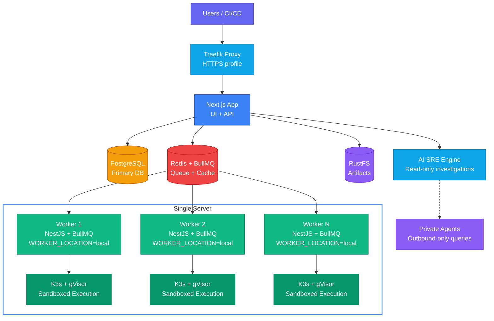

Self-host Supercheck on one Linux server. One command installs Docker, the isolated test sandbox, and every Supercheck service, then checks that it is healthy.

## Architecture

<p className="text-sm md:hidden">Scroll horizontally to view the full diagram.</p>

<div className="overflow-x-auto" role="region" aria-label="Self-Hosted deployment layout diagram" tabIndex={0}>
<div className="min-w-[52rem]">



</div>
</div>

## Prerequisites

| Requirement | Details |
|-------------|---------|
| OS | Ubuntu 22.04+ or Debian 12+ (x86_64 or arm64) |
| Resources | 2 vCPU and 4 GB RAM minimum; 10 GB free disk minimum, 15 GB to start, 30–50 GB for regular use |
| Access | `sudo` and outbound internet access. Docker and Compose are installed for you |
| Public HTTPS only | A domain pointing at the server, inbound ports 80 and 443, and an email address for certificate notices. Status pages on subdomains also need a wildcard DNS record and a [wildcard certificate](#status-page-https) |

<Callout type="warn">
**Linux only.** The test sandbox needs the Linux kernel. macOS, Windows, WSL2, and Docker Desktop are not supported.
</Callout>

## Install

<Steps>
<Step>

### Download the installer

```bash
curl -fsSL https://raw.githubusercontent.com/supercheck-io/supercheck/v1.6.0/deploy/docker/install.sh -o install.sh
```

Use the same release in the URL and in `--version`. Add `--dry-run` in the next step to preview the plan.

</Step>
<Step>

### Run it

<Tabs items={['Guided', 'Local, no prompts', 'Public HTTPS, no prompts']}>
  <Tab value="Guided">
    ```bash
    sudo bash install.sh --version 1.6.0
    ```

    The installer asks only what it cannot detect:

    | Prompt | Default | Notes |
    |--------|---------|-------|
    | `Choose` | `1` | `1` = try it on this server (HTTP on localhost); `2` = public server (HTTPS) |
    | `Domain for Supercheck` | none | Public only. A hostname such as `app.example.com`, not an IP address or URL |
    | `Email for Let's Encrypt notices` | none | Public only |
    | `Continue?` | Yes | Last confirmation before anything is installed |
  </Tab>
  <Tab value="Local, no prompts">
    ```bash
    sudo bash install.sh --version 1.6.0 --local --yes
    ```
  </Tab>
  <Tab value="Public HTTPS, no prompts">
    ```bash
    sudo bash install.sh --version 1.6.0 --domain app.example.com --email you@example.com --yes
    ```
  </Tab>
</Tabs>

Allow about 10 minutes. Re-running is safe: it keeps your `.env` and secrets.

</Step>
<Step>

### Open Supercheck

Open the URL the installer prints: `https://<your-domain>`, or `http://localhost:3000` for a local install (from your laptop: `ssh -L 3000:localhost:3000 <user>@<server>`). The HTTPS certificate can take a minute on first visit.

</Step>
</Steps>

<Callout type="warn">
On a public server, sign-up is open to anyone who can reach the URL. Create your account first, then set `SIGNUP_ENABLED=false` in `.env` (or restrict it with `ALLOWED_EMAIL_DOMAINS`) and recreate the app. See [Optional configuration](#optional-configuration).
</Callout>

<Accordions>
<Accordion title="Installer options" id="installer-options">

| Option | Purpose |
|--------|---------|
| `--local` | Evaluate on this server (HTTP on localhost, port 3000) |
| `--domain <host>` / `--email <address>` | Public HTTPS install; both are required together |
| `--status-domain <host>` | Domain for status pages (default: same as `--domain`) |
| `--yes`, `-y` | Never prompt; fail with a clear message if a value is missing |
| `--dry-run` | Run read-only checks and print the plan; change nothing |
| `--version <x.y.z>` | Release to install (default: the version bundled with the script) |
| `--upgrade` | Upgrade an existing install to `--version` (default: the script's release). See [Upgrade](#upgrade) |
| `--dir <path>` | Install location (default: `/opt/supercheck`) |
| `--no-prewarm` | Skip importing the ~3 GB worker image into the sandbox; the first test run downloads it instead |
| `--docker-group` | Add the invoking sudo user to the `docker` group (root-equivalent access) |
| `--ignore-minio` | Start with empty storage even though a volume from the retired MinIO storage exists. Without it the installer stops, so data is not left behind by accident |
| `--help`, `-h` | Show all options |

</Accordion>
</Accordions>

## Verify

Run from `/opt/supercheck/deploy/docker` (or `<your --dir>/deploy/docker`):

```bash
sudo docker compose ps
curl --fail --silent --show-error http://localhost:3000/api/health
```

All services should be healthy and the health endpoint should return `{"status":"ok"...`. For HTTPS, also open `https://<your-domain>/api/health`.

<Accordions>
<Accordion title="What gets installed" id="what-gets-installed">

| Service | Purpose | Host port |
|---------|---------|-----------|
| `app` | Next.js UI and API | `127.0.0.1:3000` (`APP_HOST_PORT`) |
| `worker` | Test execution in the gVisor sandbox | none |
| `postgres` | Database | `127.0.0.1:5432` (`DB_BIND_ADDR`, `DB_HOST_PORT`) |
| `redis` | Job queues | `127.0.0.1:6379` (`REDIS_BIND_ADDR`, `REDIS_HOST_PORT`) |
| `rustfs` | S3-compatible artifact storage | `127.0.0.1:9000` (`RUSTFS_BIND_ADDR`, `RUSTFS_HOST_PORT`) |
| `traefik` | HTTPS reverse proxy (HTTPS profile only) | `80`, `443` |

Never publish Postgres, Redis or RustFS on a public IP: keep the default `127.0.0.1` binds (or a private interface) and firewall their ports. Cloud-hosted installs also get a host rule that stops pods reaching the instance-metadata address `169.254.169.254` (this also applies to the Compose containers on that host, so they cannot use instance-role credentials).

Test runs can reach public addresses but not private networks (RFC1918, link-local, CGNAT, tailnet), mail ports (25, 465, 587, 2525) or the host's Kubernetes control ports. By default, monitors also refuse hosts that resolve to a private address. Use a [Private Agent](/docs/app/deployment/private-agent) for services inside another network.

</Accordion>
</Accordions>

## Optional configuration

Edit `.env` in `deploy/docker`, then run `sudo docker compose up -d --force-recreate app worker` (add `monitor-control` if you enabled it).

<Accordions>
<Accordion title="Common settings" id="common-settings">

| Variable | Default | Purpose |
|----------|---------|---------|
| `SIGNUP_ENABLED` | `true` | `false` disables open registration (invited users still work) |
| `ALLOWED_EMAIL_DOMAINS` | empty | Comma-separated signup allowlist, for example `acme.com,acme.org` |
| `SMTP_HOST`, `SMTP_PORT`, `SMTP_FROM_EMAIL`, `SMTP_USER`, `SMTP_PASSWORD` | unset | Email for alerts and invitations (disabled without `SMTP_HOST`) |
| `ORG_DELETION_GRACE_DAYS` | `14` | Days an owner can cancel a requested organization deletion before the data is purged (0 to 365). `0` removes the window and is honored on self-hosted installations only: the purge is queued at once and runs in the background (if queueing fails, the deletion sweep picks it up). During the window the organization is read-only |
| `ORG_DELETION_REAUTH_MINUTES` | `10` | Minutes a session may be old before an owner must sign in again to request an organization deletion (1 to 60) |
| `AUDIT_EMAIL_SCRUB_DAYS` | `30` | Days before email addresses in audit log details are replaced by a hash. Audit logs are removed after 12 months |
| `SMTP_FROM_NAME`, `SMTP_REPLY_TO` | unset | Optional display name for the From address and an optional Reply-To address on every email |
| `SMTP_BLOCKED_RECIPIENT_DOMAINS` | unset | Extra recipient domains never emailed (reserved domains such as `example.com` are always skipped) |
| `AI_PROVIDER`, `AI_MODEL`, `OPENAI_API_KEY` | `openai`, `gpt-6-luna`, unset | AI features and AI SRE. Other providers: [Docker environment reference](https://github.com/supercheck-io/supercheck/blob/v1.6.0/deploy/docker/README.md#environment-variables) |
| `SRE_AUTOMATION_ENABLED` | `false` | AI triage of alert incidents; can incur provider charges. Incidents open from alerts without it. Set in the app (the worker only needs `SRE_ENABLED`) |
| `SRE_DAILY_TOKEN_LIMIT_PER_ORG` | `2000000` | Daily AI token limit per organization for AI SRE (UTC day). `0` disables |
| `ALLOW_INTERNAL_TARGETS` | `false` | `true` lets monitors target private, loopback and reserved addresses (cloud metadata and link-local addresses stay blocked) |
| `WORKER_SHUTDOWN_DRAIN_MS` | `20000` | How long a stopping worker waits for in-flight runs before deleting their execution Jobs (max `3900000`, enough for a 60-minute run). A stopping worker takes no new jobs during this wait and reports not-ready on `/health/ready`, but keeps finishing the runs it has. A run whose execution had started and is deleted at the end is recorded with "Interrupted by worker restart" (status `failed` for Playwright, `error` for k6), is not re-run, and sends no failure alert; a run whose execution had not started is delayed and run by another worker. Keep it below the orchestrator grace period: the bundled Compose files set `stop_grace_period: 30s`; on Kubernetes raise `terminationGracePeriodSeconds` first |
| `DEVICE_AUTH_ENABLED` | `false` | Browser sign-in for `supercheck login`. Needs HTTPS (or localhost) |
| `TRUSTED_PROXY_HOPS` | `0` | Extra trusted proxies in front of Traefik, such as a CDN |
| `TRUST_CF_CONNECTING_IP` | `false` | `true` only if the server is reachable exclusively through Cloudflare |

Advanced tunables are listed, commented, in [`app/.env.example`](https://github.com/supercheck-io/supercheck/blob/main/app/.env.example) and [`worker/.env.example`](https://github.com/supercheck-io/supercheck/blob/main/worker/.env.example).


</Accordion>
<Accordion title="Super Admin access" id="super-admin-access">

```bash
sudo docker compose exec app node scripts/bootstrap-admin.js your-email@example.com
```

</Accordion>
<Accordion title="Connecting AI tools (MCP)" id="connecting-ai-tools-mcp-off-by-default">

Off by default. Set `MCP_SERVER_ENABLED=true` and recreate the app to let [MCP clients](/docs/mcp) such as Claude, Cursor and VS Code connect over OAuth. `BETTER_AUTH_URL` must be the public HTTPS URL (Docker derives it from `APP_DOMAIN`).

</Accordion>
<Accordion title="Status page HTTPS" id="status-page-https">

The app domain gets its certificate automatically (HTTP-01). Status pages are different:

| Status page URL | Certificate |
|---|---|
| `<id>.STATUS_PAGE_DOMAIN` (default) | Needs a wildcard certificate for `*.STATUS_PAGE_DOMAIN`. HTTP-01 cannot issue wildcards, so until you enable DNS-01 below, browsers warn on these pages |
| Custom domain (`status.example.net`) | Not issued automatically. Add your own certificate to Traefik, or put the domain behind a proxy that terminates TLS, such as Cloudflare |

To issue the wildcard certificate with DNS-01, work from `deploy/docker`:

<Steps>
<Step>

Add a wildcard DNS record `*.STATUS_PAGE_DOMAIN` pointing at the server (`STATUS_PAGE_DOMAIN` defaults to your app domain).

</Step>
<Step>

Find your DNS provider's code and credential variables in the [Traefik provider list](https://doc.traefik.io/traefik/https/acme/#providers), and put the credentials in `traefik-dns.env`, which only Traefik reads:

```bash
sudo install -m 600 /dev/null traefik-dns.env
sudoedit traefik-dns.env    # for example: CF_DNS_API_TOKEN=...
```

</Step>
<Step>

Add to `.env`, then apply with `sudo docker compose up -d`:

```dotenv
COMPOSE_FILE=docker-compose.yml:compose.dns01.yml
ACME_DNS_PROVIDER=cloudflare
```

</Step>
<Step>

Check `sudo docker compose logs traefik | grep -i acme`, then open `https://<id>.STATUS_PAGE_DOMAIN`.

</Step>
</Steps>

To turn it off, remove both lines from `.env` and run `sudo docker compose up -d`.

</Accordion>
</Accordions>

## Upgrade

Download the installer of the release you want and run it with `--upgrade` on the server:

```bash
curl -fsSL https://raw.githubusercontent.com/supercheck-io/supercheck/v1.6.0/deploy/docker/install.sh -o install.sh
sudo bash install.sh --upgrade
```

<Callout type="warn">
Upgrading from a release before 1.6.0 runs migration `0056`, which drops columns the previous release still reads. Upgrade in a short maintenance window and don't roll back the image afterwards; restore the pre-upgrade backup instead. Keep the same `SECRET_ENCRYPTION_KEY`: older webhook secrets are encrypted with it during the upgrade. Unsubscribe links in emails sent before the upgrade stop working.
</Callout>

Replace `v1.6.0` with the target release. Every upgrade must re-run `setup-k3s.sh` (`--upgrade` does this for you; with a manual update run it yourself): it refreshes the execution policy (NetworkPolicy, RBAC, quota) that keeps test runs off your host and private networks. To refresh only those manifests without touching K3s or gVisor, run `sudo bash setup-k3s.sh --execution-plane-only`. An outdated policy is not harmless: each run first checks that it cannot reach the Kubernetes API and refuses to start otherwise. The upgrade dumps the database to `/var/backups/supercheck/` first, applies migrations, and checks health; expect a few minutes of downtime. Keep your changes in `.env`: the upgrade stops if tracked files were edited. Then [upgrade remote workers](/docs/app/deployment/multi-server#upgrade-workers).

<Callout type="warn">
Never run `docker compose down -v`: it deletes the database, stored artifacts, and the queue.
</Callout>

<Accordions>
<Accordion title="Manual update" id="manual-update">

For an `install.sh` checkout when `--upgrade` is unavailable. Replace `<x.y.z>` with the target release. `backup.sh` ships from 1.5.0; on an older release, dump the database and copy the storage volume yourself first:

```bash
cd /opt/supercheck/deploy/docker
sudo bash backup.sh
sudo git -C /opt/supercheck fetch --depth 1 origin refs/tags/v<x.y.z>:refs/tags/v<x.y.z>
sudo git -C /opt/supercheck checkout --detach refs/tags/v<x.y.z>
sudo bash setup-k3s.sh
sudoedit .env                            # set SUPERCHECK_VERSION=<x.y.z> (no leading v)
sudo docker compose pull
# The image tag Compose resolved (honours SUPERCHECK_VERSION in .env).
WORKER_IMAGE=$(sudo docker compose config --images | grep '/worker:' | head -n1)
sudo docker save --platform "linux/$(dpkg --print-architecture)" "$WORKER_IMAGE" | sudo k3s ctr -n k8s.io images import -
sudo docker compose up -d --wait --wait-timeout 300
curl --fail --silent --show-error http://localhost:3000/api/health
```

</Accordion>
<Accordion title="Upgrading from MinIO (releases before 1.4.0)" id="upgrading-from-minio-breaking">

MinIO and RustFS disk formats are incompatible, so storage must be migrated before you update. Stop remote workers, then run the migration from your **current** checkout's `deploy/docker`, with the old stack running:

```bash
sudo curl -fsSL https://raw.githubusercontent.com/supercheck-io/supercheck/v1.6.0/deploy/docker/migrate-minio-to-rustfs.sh -o migrate-minio-to-rustfs.sh && \
sudo bash migrate-minio-to-rustfs.sh && sudo rm -- migrate-minio-to-rustfs.sh
```

It stops the app and worker while it copies. Continue only after it succeeds; it keeps the `minio-data` volume for recovery. Then upgrade and run `sudo docker compose up -d --remove-orphans` once. Check a status page and a test report before deleting the old volume.

Releases before `1.3.3` predate the current sandbox: back up, then run `sudo bash setup-k3s.sh` before upgrading.

</Accordion>
</Accordions>

## Backups

From `deploy/docker`:

```bash
sudo bash backup.sh
```

This saves the database, storage, `.env` and certificates to `/var/backups/supercheck/<UTC time>/`, stopping the app and worker for about a minute. Copy backups off the server and keep them private: they contain your secrets.

To restore, install the same release as the backup (on a new server, install it first), stop remote workers, then run the command below. It permanently replaces the current `.env`, storage and database:

```bash
sudo bash backup.sh --restore /var/backups/supercheck/<UTC time>
```

For daily backups (old backups are not deleted, so prune them to keep the disk from filling):

```bash
echo '0 3 * * * root cd /opt/supercheck/deploy/docker && bash backup.sh >>/var/log/supercheck/backup.log 2>&1' | sudo tee /etc/cron.d/supercheck-backup
```

External PostgreSQL, Redis or S3 are not covered; use your provider's backups.

## Troubleshooting

<Accordions>
<Accordion title="Installer exit codes" id="exit-codes">

| Code | Meaning | Next step |
|---|---|---|
| `0` | Installed and healthy | Open the printed URL |
| `1` | A step failed | The installer prints the last log lines; the full log is `/var/log/supercheck/install.log`. Fix the cause and re-run the same command |
| `2` | Bad usage | Check the options with `bash install.sh --help` |
| `3` | Running, but `/api/health` reports a problem | Run `curl http://localhost:3000/api/health` to see which dependency fails, then `sudo docker compose logs --tail=100 app worker` |

</Accordion>
<Accordion title="HTTPS certificate is not issued" id="acme-failure">

Let's Encrypt must reach the server on port 80 at your domain's A record.

- Check that the domain resolves to this server: `getent ahostsv4 app.example.com`.
- Allow inbound 80 and 443 in your cloud firewall or security group.
- With Cloudflare's proxy on, make sure it forwards `/.well-known/acme-challenge/` to the server, or switch the record to DNS-only until the certificate is issued.
- Read the reason: `sudo docker compose logs --tail=100 traefik | grep -i acme`.

Repeated failures hit Let's Encrypt rate limits; fix the cause before restarting Traefik again. Browser warnings on status-page subdomains mean the wildcard certificate is missing: see [Status page HTTPS](#status-page-https).

</Accordion>
<Accordion title="k3s is not ready" id="k3s-not-ready">

```bash
sudo k3s kubectl get nodes
sudo systemctl status k3s --no-pager
sudo journalctl -u k3s -n 100 --no-pager
```

Re-running `sudo bash setup-k3s.sh` is safe. If the server's IP address changed since installation, the re-run adds the new address to the k3s API certificate and rewrites the worker kubeconfig; then run `sudo docker compose up -d --force-recreate worker`.

</Accordion>
<Accordion title="Run fails with an infrastructure error" id="isolation-check">

`Infrastructure error: execution network isolation not enforced; the run was not started` means the pod could still reach the Kubernetes API, so the run was refused before any test code ran. It is not billed and not a test failure. The usual cause is an outdated `execution-egress` NetworkPolicy or a CNI that does not enforce it. Re-run `sudo bash setup-k3s.sh --execution-plane-only`, then retry the run.

`Infrastructure error: Execution pod was rejected by the cluster: ...` means Kubernetes admission control denied the execution pod; the message names the policy. Fix or relax that policy for the `supercheck-execution` namespace.

</Accordion>
<Accordion title="gVisor sandbox check fails" id="gvisor-check">

`setup-k3s.sh` ends by running a test pod with the gVisor runtime. If it fails, inspect the pod events:

```bash
sudo k3s kubectl describe pod gvisor-test -n supercheck-execution
runsc --version
```

Fix the reported cause and re-run `sudo bash setup-k3s.sh`. Do not work around it by disabling the sandbox: `EXECUTION_RUNTIME_CLASS_NAME=none` is for local development only, runs untrusted test code without isolation, and makes the worker log `Sandbox isolation is DISABLED`.

</Accordion>
<Accordion title="First test run times out" id="image-pull-timeout">

The ~3 GB worker image must be in the sandbox before a run starts. The installer imports it; if that step was skipped (`--no-prewarm`) or failed, re-run the installer, or import it yourself:

```bash
sudo k3s ctr -n k8s.io images ls -q | grep supercheck/worker
# The image tag Compose resolved (honours SUPERCHECK_VERSION in .env).
WORKER_IMAGE=$(sudo docker compose config --images | grep '/worker:' | head -n1)
sudo docker save --platform "linux/$(dpkg --print-architecture)" "$WORKER_IMAGE" | sudo k3s ctr -n k8s.io images import -
```

Use the version in your `.env` (`SUPERCHECK_VERSION`).

</Accordion>
<Accordion title="Compose says a secret is missing from .env" id="missing-secret">

`docker-compose.yml` refuses to start without `DB_PASSWORD`, `REDIS_PASSWORD`, `BETTER_AUTH_SECRET`, and the storage keys. On a new install, run `./init-secrets.sh`. On an existing install, restore the `.env` you installed with (the installer keeps `.env.bak-*` copies next to it, and each backup has one). Never generate new secrets for existing data: the database password and encryption key would no longer match.

</Accordion>
</Accordions>

## Next steps

<Cards>
  <Card title="Multi-Server" href="/docs/app/deployment/multi-server" description="Add execution workers on separate servers" />
  <Card title="AI SRE Setup" href="/docs/app/admin/ai-sre-setup" description="Add services and read-only evidence sources" />
  <Card title="Private Agent" href="/docs/app/deployment/private-agent" description="Reach sources inside another network" />
</Cards>
