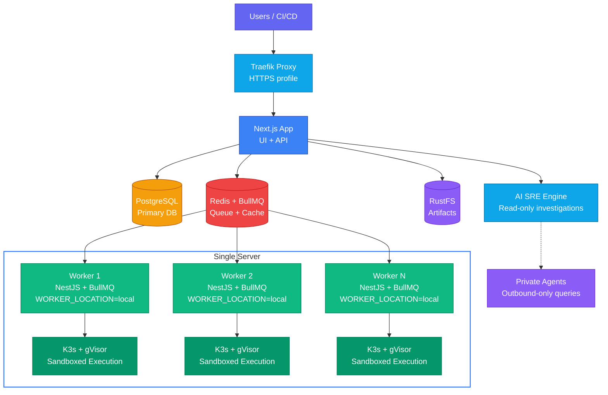

Self-host Supercheck on one Linux server. One command installs Docker, the isolated test sandbox, and every Supercheck service, then checks that it is healthy.

## Architecture

<p className="text-sm md:hidden">Scroll horizontally to view the full diagram.</p>

<div className="overflow-x-auto" role="region" aria-label="Self-Hosted deployment layout diagram" tabIndex={0}>
<div className="min-w-[52rem]">



</div>
</div>

## Prerequisites

| Requirement | Details |
|-------------|---------|
| OS | Ubuntu 22.04+ or Debian 12+ (x86_64 or arm64) |
| Resources | 2 vCPU and 4 GB RAM minimum; 10 GB free disk minimum, 15 GB to start, 30–50 GB for regular use |
| Access | `sudo` and outbound internet access. Docker and Compose are installed for you |
| Public HTTPS only | A domain pointing at the server (plus a wildcard record for status pages), inbound ports 80 and 443, and an email address for certificate notices |

<Callout type="warn">
**Linux only.** The test sandbox needs the Linux kernel. macOS, Windows, WSL2, and Docker Desktop are not supported.
</Callout>

## Install

<Steps>
<Step>

### Download the installer

```bash
curl -fsSL https://raw.githubusercontent.com/supercheck-io/supercheck/main/deploy/docker/install.sh -o install.sh
```

Read it first with `less install.sh` if you like. Add `--dry-run` in the next step to see the plan without changing anything.

</Step>
<Step>

### Run it

<Tabs items={['Guided', 'Local, no prompts', 'Public HTTPS, no prompts']}>
  <Tab value="Guided">
    ```bash
    sudo bash install.sh --version 1.4.0
    ```

    The installer asks only what it cannot detect:

    | Prompt | Default | Notes |
    |--------|---------|-------|
    | `Choose` | `1` | `1` = try it on this server (HTTP on localhost); `2` = public server (HTTPS) |
    | `Domain for Supercheck` | none | Public only. A hostname such as `app.example.com`, not an IP address or URL |
    | `Email for Let's Encrypt notices` | none | Public only |
    | `Continue?` | Yes | Last confirmation before anything is installed |
  </Tab>
  <Tab value="Local, no prompts">
    ```bash
    sudo bash install.sh --version 1.4.0 --local --yes
    ```
  </Tab>
  <Tab value="Public HTTPS, no prompts">
    ```bash
    sudo bash install.sh --version 1.4.0 --domain app.example.com --email you@example.com --yes
    ```
  </Tab>
</Tabs>

Allow about 10 minutes, mostly image downloads. Re-running is safe: it keeps your existing `.env` and secrets and skips finished steps.

</Step>
<Step>

### Open Supercheck

The installer prints the URL: `https://<your-domain>` for a public install, or `http://localhost:3000` for a local one.

Port 3000 listens on the server only. From your laptop, forward it with `ssh -L 3000:localhost:3000 <user>@<server>`. For HTTPS, the certificate is issued on first visit and can take up to a minute.

Create your account, then add a test and run it.

</Step>
</Steps>

<Callout type="warn">
On a public server, sign-up is open to anyone who can reach the URL. Create your account first, then set `SIGNUP_ENABLED=false` in `.env` (or restrict it with `ALLOWED_EMAIL_DOMAINS`) and recreate the app. See [Optional configuration](#optional-configuration).
</Callout>

<Accordions>
<Accordion title="Installer options and exit codes" id="installer-options">

| Option | Purpose |
|--------|---------|
| `--local` | Evaluate on this server (HTTP on localhost, port 3000) |
| `--domain <host>` / `--email <address>` | Public HTTPS install; both are required together |
| `--status-domain <host>` | Domain for status pages (default: same as `--domain`) |
| `--yes`, `-y` | Never prompt; fail with a clear message if a value is missing |
| `--dry-run` | Run read-only checks and print the plan; change nothing |
| `--version <x.y.z>` | Release to install (default: the version bundled with the script) |
| `--dir <path>` | Install location (default: `/opt/supercheck`) |
| `--no-prewarm` | Skip importing the ~3 GB worker image into the sandbox; the first test run downloads it instead |
| `--docker-group` | Add the invoking sudo user to the `docker` group (root-equivalent access) |

Exit codes: `0` healthy, `1` failed, `2` bad usage, `3` installed but the health check reports a problem. The log is `/var/log/supercheck/install.log`.

</Accordion>
</Accordions>

## Verify

Run from `/opt/supercheck/deploy/docker` (or `<your --dir>/deploy/docker`):

```bash
sudo docker compose ps
curl --fail --silent --show-error http://localhost:3000/api/health
```

All services should be healthy and the health endpoint should return `{"status":"ok"...`. For HTTPS, also open `https://<your-domain>/api/health`.

<Accordions>
<Accordion title="What gets installed" id="what-gets-installed">

| Service | Purpose | Host port |
|---------|---------|-----------|
| `app` | Next.js UI and API | `127.0.0.1:3000` |
| `worker` | Test execution in the gVisor sandbox | none |
| `postgres` | Database | `127.0.0.1:5432` |
| `redis` | Job queues | `127.0.0.1:6379` |
| `rustfs` | S3-compatible artifact storage | `127.0.0.1:9000` |
| `traefik` | HTTPS reverse proxy (HTTPS profile only) | `80`, `443` |

Test runs can reach public addresses but not private networks (RFC1918, link-local, CGNAT, tailnet). Use a [Private Agent](/docs/app/deployment/private-agent) for services inside another network.

</Accordion>
</Accordions>

## Optional configuration

Edit `.env` in `deploy/docker`, then run `sudo docker compose up -d --force-recreate app worker`.

<Accordions>
<Accordion title="Common settings" id="common-settings">

| Variable | Default | Purpose |
|----------|---------|---------|
| `SIGNUP_ENABLED` | `true` | `false` disables open registration (invited users still work) |
| `ALLOWED_EMAIL_DOMAINS` | empty | Comma-separated signup allowlist, for example `acme.com,acme.org` |
| `SMTP_HOST`, `SMTP_PORT`, `SMTP_FROM_EMAIL`, `SMTP_USER`, `SMTP_PASSWORD` | unset | Email for alerts and invitations (disabled without `SMTP_HOST`) |
| `AI_PROVIDER`, `AI_MODEL`, `OPENAI_API_KEY` | `openai`, `gpt-6-luna`, unset | AI features and AI SRE. Other providers: [Docker environment reference](https://github.com/supercheck-io/supercheck/blob/v1.4.0/deploy/docker/README.md#environment-variables) |
| `SRE_AUTOMATION_ENABLED` | `false` | Automatic alert triage; can incur provider charges. Set in app and worker |
| `DEVICE_AUTH_ENABLED` | `false` | Browser sign-in for `supercheck login`. Needs HTTPS (or localhost) |
| `TRUSTED_PROXY_HOPS` | `0` | Extra trusted proxies in front of Traefik, such as a CDN |
| `TRUST_CF_CONNECTING_IP` | `false` | `true` only if the server is reachable exclusively through Cloudflare |

</Accordion>
<Accordion title="Super Admin access" id="super-admin-access">

```bash
sudo docker compose exec app node scripts/bootstrap-admin.js your-email@example.com
```

</Accordion>
<Accordion title="Connecting AI tools (MCP)" id="connecting-ai-tools-mcp-off-by-default">

Off by default. Lets Claude, Cursor, VS Code and other [MCP clients](/docs/mcp) read one project over read-only OAuth 2.1.

| Step | Action |
|---|---|
| **1. Enable** | Set `MCP_SERVER_ENABLED=true` and recreate the app |
| **2. Public URL** | `BETTER_AUTH_URL` must be the public HTTPS URL (`http://localhost:3000` for local use). Docker derives it from `APP_DOMAIN` |
| **3. Check** | `/api/config/app` reports `mcp.enabled: true`; `POST /api/mcp` returns `401` with `WWW-Authenticate` |

Optional: `MCP_DYNAMIC_CLIENT_REGISTRATION=false` accepts only clients with a Client ID Metadata Document.

</Accordion>
</Accordions>

## Maintenance

<Accordions>
<Accordion title="Updates" id="updates">

<Callout type="warn">
Installations from a release that bundled MinIO must migrate storage to RustFS before updating. Run `migrate-minio-to-rustfs.sh` from your current checkout; see the [deployment README](https://github.com/supercheck-io/supercheck/blob/v1.4.0/deploy/docker/README.md#upgrading).
</Callout>

Back up first. From `deploy/docker`, set `SUPERCHECK_VERSION` in `.env`, then:

```bash
sudo docker compose pull
sudo env KUBECONFIG_FILE=/etc/rancher/k3s/supercheck-worker.kubeconfig docker compose up -d --wait --wait-timeout 300
```

Migrations run automatically. Never run `docker compose down -v`; it deletes the database, artifacts, and queue. If workers cannot read their kubeconfig after an update, re-run `sudo bash setup-k3s.sh`.

</Accordion>
<Accordion title="Backups" id="backups">

Back up PostgreSQL, the `rustfs-data` volume, `.env`, and (for HTTPS) the `traefik-letsencrypt` volume. Keep `.env` private and off the server: its secrets are needed to read encrypted data.

```bash
install -m 600 /dev/null "$HOME/supercheck-backup.sql" && \
  sudo docker compose exec -T postgres sh -c 'pg_dump -U "$POSTGRES_USER" "$POSTGRES_DB"' > "$HOME/supercheck-backup.sql"
```

The SQL export does not include files, `.env`, or certificates.

</Accordion>
</Accordions>

## Next steps

<Cards>
  <Card title="Multi-Server" href="/docs/app/deployment/multi-server" description="Add execution workers on separate servers" />
  <Card title="AI SRE Setup" href="/docs/app/admin/ai-sre-setup" description="Add services and read-only evidence sources" />
  <Card title="Private Agent" href="/docs/app/deployment/private-agent" description="Reach sources inside another network" />
</Cards>
