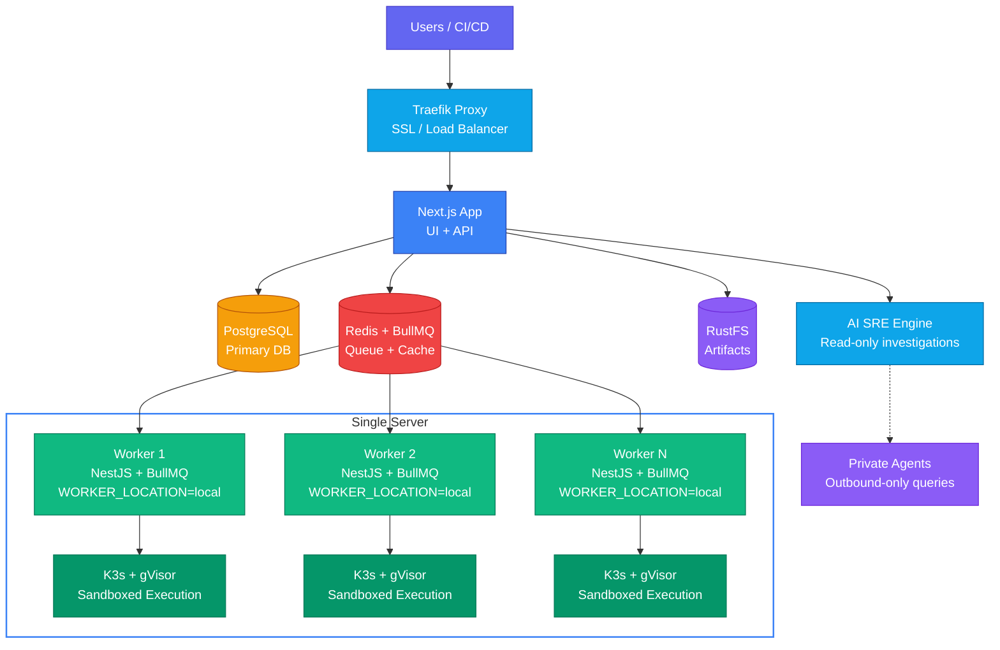

Self-host Supercheck on one Linux server.

## Architecture

<p className="text-sm md:hidden">Scroll horizontally to view the full diagram.</p>

<div className="overflow-x-auto" role="region" aria-label="Self-Hosted deployment layout diagram" tabIndex={0}>
<div className="min-w-[52rem]">



</div>
</div>

## Install

<Accordions>
  <Accordion title="Requirements" id="requirements">
    - Ubuntu 22.04+ or Debian 12+ server; x86_64 or ARM64.
    - At least 2 vCPU, 4 GB RAM, and 15 GB free disk; 30–50 GB is recommended.
    - Sudo access, `curl`, and internet access for downloads. Docker and Compose are installed automatically.
    - Public HTTPS: point your domain at the server, open inbound ports 80/443, and have an email for certificate notices.

    macOS, Windows, WSL2, and Docker Desktop are not supported.
  </Accordion>
</Accordions>

Run on your server to install **1.3.7-canary.16**:

```bash
curl -fsSL https://raw.githubusercontent.com/supercheck-io/supercheck/main/deploy/docker/install.sh -o install.sh && sudo bash install.sh --version 1.3.7-canary.16
```

Follow the prompts for local evaluation or HTTPS. Open the printed URL, create your account, and run a test.

Sandboxed execution pods can connect to public destinations, but cannot reach private network addresses, including RFC1918, link-local, CGNAT, and tailnet ranges. Use a [Private Agent](/docs/app/deployment/private-agent) when checks need access to services inside another network.

## Optional Configuration

In your installation's `deploy/docker` directory, update `.env` and run `sudo docker compose up -d --force-recreate app worker`.

### CLI Browser Login

`supercheck login` can sign users in through the browser instead of asking them to paste a token. It is off by default. To enable it, set `DEVICE_AUTH_ENABLED=true` in `.env` and recreate the app. The server must be reachable over HTTPS (or localhost); the app applies database migration 0032 when it starts. Users approve a short code on `/device` and choose the project; the CLI receives a project-scoped key that expires after 90 days and can be revoked under **CLI Tokens**. Token login (`supercheck login --token`) and `SUPERCHECK_TOKEN` always keep working.

### Connecting AI Tools (MCP, off by default)

Supercheck can let AI tools such as Claude, Cursor and VS Code read a project you choose, using OAuth 2.1 with read-only access. This release adds the sign-in half only; the MCP endpoint itself ships separately, so leave it off until then. To try the sign-in, set `MCP_SERVER_ENABLED=true` in `.env` and recreate the app. `BETTER_AUTH_URL` must be the public HTTPS URL of your server (or `http://localhost` for local use); the app refuses to start the MCP server without it. The app applies database migration 0036 when it starts. Users approve each connection and pick the project on the connect screen, and can disconnect any app under **Connected apps** in the user menu. Apps normally register themselves; set `MCP_DYNAMIC_CLIENT_REGISTRATION=false` to accept only apps that identify themselves with a Client ID Metadata Document. Browser-based clients cannot call the OAuth endpoints (no CORS headers); native and server-side clients are unaffected.

### Client IP Behind a CDN or Extra Proxy

Rate limits and the AI routes identify callers by client IP. By default Supercheck trusts one proxy that appends the client address, which matches the bundled Traefik setup. If another trusted hop sits in front (for example Cloudflare, then a load balancer, then Traefik), set `TRUSTED_PROXY_HOPS` in `.env` to the number of extra hops and recreate the app. Set `TRUST_CF_CONNECTING_IP=true` only when the origin is reachable exclusively through Cloudflare. A wrong value makes all users share one rate-limit bucket or lets clients spoof their address.

### Missing-Region Detection (Optional)

By default a multi-region monitor waits for every region before it is evaluated, so a region that stops responding blocks the result. Missing-region detection closes each run at a deadline and counts silent regions as failed. It also alerts when every regional worker is offline. It is off by default.

1. Update the app and every worker to the same release. The app applies the required migration on start.
2. Add `monitor-control` to `COMPOSE_PROFILES` in `.env` (comma-separated, for example `https,monitor-control` on an HTTPS install) and run `sudo docker compose up -d monitor-control`. Listing the profile there makes later `pull` and `up` commands update the control plane with the rest of the stack. It uses the worker image and has no Kubernetes credentials. Run exactly one instance.
3. Confirm it reports healthy with `sudo docker compose ps monitor-control`, then set `MISSING_CYCLE_CLOSURE_ENABLED=true` in `.env` and recreate the app: `sudo docker compose up -d --force-recreate app`.

`MISSING_CYCLE_DEADLINE_SECONDS` (default `300`) sets how long a run waits before silent regions count as failed; two check timeouts are added to it. Regions that report after the deadline are recorded but do not change the closed result. Alerts are delivered at least once, so a webhook receiver should deduplicate.

To turn it off, set `MISSING_CYCLE_CLOSURE_ENABLED=false` and recreate the app. **Keep the control plane running until open runs have closed** (up to the deadline plus two check timeouts), then run `sudo docker compose stop monitor-control` and remove `monitor-control` from `COMPOSE_PROFILES`. Stopping it earlier leaves those runs without a result until it starts again.

### Artifact Retention

Artifacts are cleaned automatically. Job run retention follows the self-hosted unlimited plan, seeded at 180 days; an existing `unlimited` plan value in the database is respected. Standalone playground run rows become eligible for cleanup after their terminal result has been retained for `PLAYGROUND_CLEANUP_MAX_AGE_HOURS` (default 24 hours). For older rows without a completion time, age is measured from creation. Queued and running playground runs are retained. Cleanup runs on a schedule and observes a per-run safety limit, so the configured age is an eligibility threshold rather than an exact deletion time. Optional `.env` controls: `MONITOR_CLEANUP_CRON`, `JOB_RUNS_CLEANUP_CRON`, and `PLAYGROUND_CLEANUP_CRON` for schedules; `PLAYGROUND_CLEANUP_MAX_AGE_HOURS` for playground retention.

<Accordions>
  <Accordion title="Registration Controls">
    | Variable | Default | Description |
    |----------|---------|-------------|
    | `SIGNUP_ENABLED` | `true` | Set `false` to disable open registration (invited users still work) |
    | `ALLOWED_EMAIL_DOMAINS` | *(empty)* | Comma-separated allowlist (e.g. `acme.com,acme.org`) |

    On a public server, create your account, then disable open signup or restrict allowed domains. To grant your account Super Admin access:

    ```bash
    sudo docker compose exec app node scripts/bootstrap-admin.js your-email@example.com
    ```
  </Accordion>

  <Accordion title="Email (SMTP)">
    ```bash
    SMTP_HOST=smtp.gmail.com
    SMTP_PORT=587
    SMTP_FROM_EMAIL=notifications@yourdomain.com
    SMTP_USER=your-email@gmail.com        # Optional
    SMTP_PASSWORD=your-app-password       # Optional
    ```
  </Accordion>

  <Accordion title="AI Provider">
    OpenAI GPT-6 Luna is the default. Add its API key to `.env`:

    ```dotenv
    AI_PROVIDER=openai
    AI_MODEL=gpt-6-luna
    OPENAI_API_KEY=your-api-key
    ```

    Manual AI SRE is enabled by default. Automatic alert triage is opt-in: set `SRE_AUTOMATION_ENABLED=true` in both app and worker, and note it can incur provider charges. See [AI SRE Setup](/docs/app/admin/ai-sre-setup) to configure services and evidence sources.
  </Accordion>
</Accordions>

For advanced settings, see the [Docker environment reference](https://github.com/supercheck-io/supercheck/blob/v1.3.7-canary.16/deploy/docker/README.md#environment-variables).

## Operations

Run commands from your installation's `deploy/docker` directory (default: `/opt/supercheck/deploy/docker`).

Before starting upgraded workers, make the restricted worker kubeconfig readable by the worker's `pwuser` group (GID 1001). Run this on each Docker host that runs workers, including remote worker hosts; replace the path if `KUBECONFIG_FILE` is configured differently. Do not apply this to the admin `/etc/rancher/k3s/k3s.yaml`:

```bash
sudo chgrp 1001 /etc/rancher/k3s/supercheck-worker.kubeconfig
sudo chmod 0440 /etc/rancher/k3s/supercheck-worker.kubeconfig
```

<Accordions>
  <Accordion title="Updates" id="updates">
    Back up your data first. If your installation uses MinIO, follow **Upgrading from MinIO** below before updating.

    Set `SUPERCHECK_VERSION` to the release you want in `.env`, then run:

    ```bash
    sudo docker compose pull
    sudo env KUBECONFIG_FILE=/etc/rancher/k3s/supercheck-worker.kubeconfig docker compose up -d --wait --wait-timeout 300
    ```

    Migrations run automatically. Preserve data volumes. Existing HTTPS installations can keep `docker-compose-secure.yml`.
  </Accordion>

  <Accordion title="Upgrading from MinIO (breaking)" id="upgrading-from-minio-breaking">
    MinIO and RustFS disk formats are incompatible. From your **current checkout**, with the old stack running, migrate **before updating**:

    ```bash
    sudo curl -fsSL -o migrate-minio-to-rustfs.sh https://raw.githubusercontent.com/supercheck-io/supercheck/main/deploy/docker/migrate-minio-to-rustfs.sh
    sudo bash migrate-minio-to-rustfs.sh && sudo rm -- migrate-minio-to-rustfs.sh
    ```

    Stop any remote workers first. The script stops local app/worker, copies and verifies buckets, and backs up `.env` to `.env.pre-rustfs`. Failed migration leaves `.env` unchanged.

    Update the checkout to `v1.3.7-canary.16` with `git fetch origin tag v1.3.7-canary.16` and `git checkout --detach v1.3.7-canary.16`. Use `sudo git` for a root-owned checkout. Set `SUPERCHECK_VERSION=1.3.7-canary.16` in `.env`, then start:

    ```bash
    sudo env KUBECONFIG_FILE=/etc/rancher/k3s/supercheck-worker.kubeconfig docker compose up -d --wait --remove-orphans
    curl --fail --silent --show-error http://localhost:3000/api/health
    ```

    `--remove-orphans` removes the old MinIO container and frees port 9000. Verify a status page and test report before deleting `minio-data`. To roll back, run `sudo install -m 600 .env.pre-rustfs .env` and restore the previous checkout. If already updated without migrating, restore the old checkout and migrate first.
  </Accordion>

  <Accordion title="Backups" id="backups">
    Back up PostgreSQL, the RustFS data volume, `.env`, and the Traefik certificate volume before upgrades. To export the database:

    ```bash
    install -m 600 /dev/null "$HOME/supercheck-backup.sql" && \
      sudo docker compose exec -T postgres sh -c 'pg_dump -U "$POSTGRES_USER" "$POSTGRES_DB"' > "$HOME/supercheck-backup.sql"
    ```

    Store backups privately. The database export does not include files, `.env`, or certificates.
  </Accordion>
</Accordions>

## Monitor Check Availability

Checks depend on connected workers. When multiple execution targets are configured and enabled for a monitor, checks are queued only to connected targets. Overall status and alert thresholds still evaluate the full configured set. Without [missing-region detection](#missing-region-detection-optional), missing results cannot satisfy **All**; under **Any**, one successful connected result produces **Up**; and **Majority** produces **Up** when the successful results meet the configured threshold. Otherwise, the cycle is stored as **Down**. An offline target does not switch a partial cycle to per-result thresholding. If worker-registry access fails, affected monitors remain **Down** until checks resume. Review individual check results even when the overall status is **Up**.

## Next Steps

- [Multi-Server](/docs/app/deployment/multi-server) — add execution workers on separate servers.

- [AI SRE Setup](/docs/app/admin/ai-sre-setup) — add services and read-only evidence sources.
- [Private Agent](/docs/app/deployment/private-agent) — reach sources inside another network.

## Queue durability

Bundled Redis persists execution queues in the `redis-data` named volume using append-only persistence with an every-second fsync. Ordinary container restarts preserve queued work. Use `docker compose down` to stop the stack while preserving its data. Avoid `docker compose down -v` unless you intend to permanently delete **all** Compose volumes, including `postgres-data` (database), `rustfs-data` (artifacts), and `redis-data` (queue state). Abrupt host or storage failures can lose approximately one second of writes; this single-node deployment is not a Redis backup or high-availability solution. Interrupted executions may be retried, so scripts with external side effects should tolerate retries.
