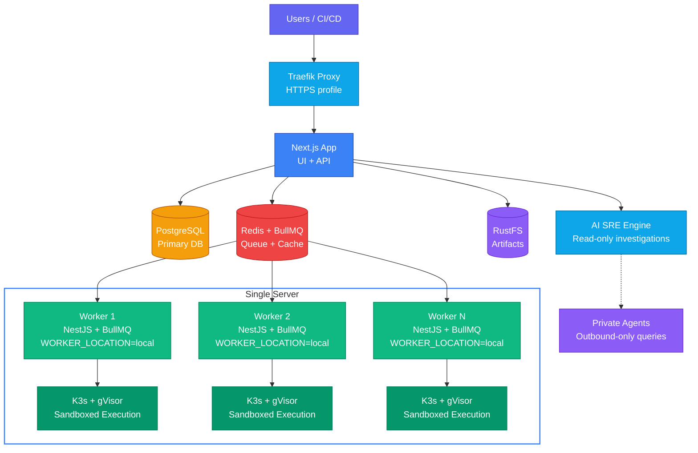

Self-host Supercheck on one Linux server. One command installs Docker, the isolated test sandbox, and every Supercheck service, then checks that it is healthy.

## Architecture

<p className="text-sm md:hidden">Scroll horizontally to view the full diagram.</p>

<div className="overflow-x-auto" role="region" aria-label="Self-Hosted deployment layout diagram" tabIndex={0}>
<div className="min-w-[52rem]">



</div>
</div>

## Prerequisites

| Requirement | Details |
|-------------|---------|
| OS | Ubuntu 22.04+ or Debian 12+ (x86_64 or arm64) |
| Resources | 2 vCPU and 4 GB RAM minimum; 10 GB free disk minimum, 15 GB to start, 30–50 GB for regular use |
| Access | `sudo` and outbound internet access. Docker and Compose are installed for you |
| Public HTTPS only | A domain pointing at the server, inbound ports 80 and 443, and an email address for certificate notices. Status pages on subdomains also need a wildcard DNS record and a [wildcard certificate](#status-page-https) |

<Callout type="warn">
**Linux only.** The test sandbox needs the Linux kernel. macOS, Windows, WSL2, and Docker Desktop are not supported.
</Callout>

## Install

<Steps>
<Step>

### Download the installer

```bash
curl -fsSL https://raw.githubusercontent.com/supercheck-io/supercheck/v1.4.0/deploy/docker/install.sh -o install.sh
```

The URL uses the release tag (`v1.4.0`), the same release you pass to `--version`, so the script and the installed version match. Read it first with `less install.sh` if you like. Add `--dry-run` in the next step to see the plan without changing anything.

</Step>
<Step>

### Run it

<Tabs items={['Guided', 'Local, no prompts', 'Public HTTPS, no prompts']}>
  <Tab value="Guided">
    ```bash
    sudo bash install.sh --version 1.4.0
    ```

    The installer asks only what it cannot detect:

    | Prompt | Default | Notes |
    |--------|---------|-------|
    | `Choose` | `1` | `1` = try it on this server (HTTP on localhost); `2` = public server (HTTPS) |
    | `Domain for Supercheck` | none | Public only. A hostname such as `app.example.com`, not an IP address or URL |
    | `Email for Let's Encrypt notices` | none | Public only |
    | `Continue?` | Yes | Last confirmation before anything is installed |
  </Tab>
  <Tab value="Local, no prompts">
    ```bash
    sudo bash install.sh --version 1.4.0 --local --yes
    ```
  </Tab>
  <Tab value="Public HTTPS, no prompts">
    ```bash
    sudo bash install.sh --version 1.4.0 --domain app.example.com --email you@example.com --yes
    ```
  </Tab>
</Tabs>

Allow about 10 minutes, mostly image downloads. Re-running is safe: it keeps your existing `.env` and secrets and skips finished steps.

</Step>
<Step>

### Open Supercheck

The installer prints the URL: `https://<your-domain>` for a public install, or `http://localhost:3000` for a local one.

Port 3000 listens on the server only. From your laptop, forward it with `ssh -L 3000:localhost:3000 <user>@<server>`. For HTTPS, the certificate is issued on first visit and can take up to a minute.

Create your account, then add a test and run it.

</Step>
</Steps>

<Callout type="warn">
On a public server, sign-up is open to anyone who can reach the URL. Create your account first, then set `SIGNUP_ENABLED=false` in `.env` (or restrict it with `ALLOWED_EMAIL_DOMAINS`) and recreate the app. See [Optional configuration](#optional-configuration).
</Callout>

<Accordions>
<Accordion title="Installer options and exit codes" id="installer-options">

| Option | Purpose |
|--------|---------|
| `--local` | Evaluate on this server (HTTP on localhost, port 3000) |
| `--domain <host>` / `--email <address>` | Public HTTPS install; both are required together |
| `--status-domain <host>` | Domain for status pages (default: same as `--domain`) |
| `--yes`, `-y` | Never prompt; fail with a clear message if a value is missing |
| `--dry-run` | Run read-only checks and print the plan; change nothing |
| `--version <x.y.z>` | Release to install (default: the version bundled with the script) |
| `--upgrade` | Upgrade an existing install to `--version` (default: the script's release). See [Upgrade](#upgrade) |
| `--dir <path>` | Install location (default: `/opt/supercheck`) |
| `--no-prewarm` | Skip importing the ~3 GB worker image into the sandbox; the first test run downloads it instead |
| `--docker-group` | Add the invoking sudo user to the `docker` group (root-equivalent access) |
| `--ignore-minio` | Start with empty storage even though a volume from the retired MinIO storage exists. Without it the installer stops, so data is not left behind by accident |
| `--no-color` | Plain output (`NO_COLOR` is honoured too) |
| `--help`, `-h` | Show all options |

Exit codes: `0` healthy, `1` failed, `2` bad usage, `3` installed but the health check reports a problem. The log is `/var/log/supercheck/install.log`.

</Accordion>
<Accordion title="Serving reports from a separate origin" id="reports-origin">

Off by default: reports are served from the app origin, as in earlier releases. Test reports are HTML produced by test code, so a separate origin keeps that code away from your session.

| Step | Action |
|---|---|
| **1. DNS and TLS** | Point a hostname such as `reports.example.net` at the same server, with a certificate. Use a different registrable domain than the app, or make sure session cookies are host-only |
| **2. Route** | Send that hostname to the app service (the same `app` container). Only `/api/test-results/` answers there |
| **3. Enable** | Set `REPORTS_ORIGIN=https://reports.example.net` (scheme and host only) and recreate the app |
| **4. Check** | `/api/config/app` reports `reports.separateOrigin: true`; a report opens in the dashboard |

Report links are signed, expire after one hour, and are tied to one report and project. Unset `REPORTS_ORIGIN` to go back. Trace viewer: the report iframe keeps `allow-same-origin`, which now only grants access to the reports origin; the viewer needs a real origin for its service worker.

</Accordion>
</Accordions>

## Verify

Run from `/opt/supercheck/deploy/docker` (or `<your --dir>/deploy/docker`):

```bash
sudo docker compose ps
curl --fail --silent --show-error http://localhost:3000/api/health
```

All services should be healthy and the health endpoint should return `{"status":"ok"...`. For HTTPS, also open `https://<your-domain>/api/health`.

<Accordions>
<Accordion title="What gets installed" id="what-gets-installed">

| Service | Purpose | Host port |
|---------|---------|-----------|
| `app` | Next.js UI and API | `127.0.0.1:3000` |
| `worker` | Test execution in the gVisor sandbox | none |
| `postgres` | Database | `127.0.0.1:5432` (`DB_BIND_ADDR`, `DB_HOST_PORT`) |
| `redis` | Job queues | `127.0.0.1:6379` (`REDIS_BIND_ADDR`, `REDIS_HOST_PORT`) |
| `rustfs` | S3-compatible artifact storage | `127.0.0.1:9000` (`RUSTFS_BIND_ADDR`) |
| `traefik` | HTTPS reverse proxy (HTTPS profile only) | `80`, `443` |

Test runs can reach public addresses but not private networks (RFC1918, link-local, CGNAT, tailnet), mail ports (25, 465, 587, 2525) or the host's Kubernetes control ports. By default, monitors also refuse hosts that resolve to a private address. Use a [Private Agent](/docs/app/deployment/private-agent) for services inside another network.

</Accordion>
</Accordions>

## Optional configuration

Edit `.env` in `deploy/docker`, then run `sudo docker compose up -d --force-recreate app worker`.

<Accordions>
<Accordion title="Common settings" id="common-settings">

| Variable | Default | Purpose |
|----------|---------|---------|
| `SIGNUP_ENABLED` | `true` | `false` disables open registration (invited users still work) |
| `ALLOWED_EMAIL_DOMAINS` | empty | Comma-separated signup allowlist, for example `acme.com,acme.org` |
| `SMTP_HOST`, `SMTP_PORT`, `SMTP_FROM_EMAIL`, `SMTP_USER`, `SMTP_PASSWORD` | unset | Email for alerts and invitations (disabled without `SMTP_HOST`) |
| `AI_PROVIDER`, `AI_MODEL`, `OPENAI_API_KEY` | `openai`, `gpt-6-luna`, unset | AI features and AI SRE. Other providers: [Docker environment reference](https://github.com/supercheck-io/supercheck/blob/v1.4.0/deploy/docker/README.md#environment-variables) |
| `SRE_AUTOMATION_ENABLED` | `false` | AI triage of alert incidents; can incur provider charges. Incidents open from alerts without it. Set in the app (the worker only needs `SRE_ENABLED`) |
| `SRE_DAILY_TOKEN_LIMIT_PER_ORG` | `2000000` | Daily AI token limit per organization for AI SRE (UTC day). `0` disables. App only |
| `DEVICE_AUTH_ENABLED` | `false` | Browser sign-in for `supercheck login`. Needs HTTPS (or localhost) |
| `TRUSTED_PROXY_HOPS` | `0` | Extra trusted proxies in front of Traefik, such as a CDN |
| `TRUST_CF_CONNECTING_IP` | `false` | `true` only if the server is reachable exclusively through Cloudflare |
| `SENTRY_DSN`, `SENTRY_ENVIRONMENT`, `SENTRY_RELEASE` | unset | Supercheck Cloud only (scrubbed server-side error reports). Ignored when `SELF_HOSTED=true`: self-hosted installs do not load the Sentry SDK or contact Sentry |

</Accordion>
<Accordion title="Super Admin access" id="super-admin-access">

```bash
sudo docker compose exec app node scripts/bootstrap-admin.js your-email@example.com
```

</Accordion>
<Accordion title="Connecting AI tools (MCP)" id="connecting-ai-tools-mcp-off-by-default">

Off by default. Lets Claude, Cursor, VS Code and other [MCP clients](/docs/mcp) read one project over read-only OAuth 2.1.

| Step | Action |
|---|---|
| **1. Enable** | Set `MCP_SERVER_ENABLED=true` and recreate the app |
| **2. Public URL** | `BETTER_AUTH_URL` must be the public HTTPS URL (`http://localhost:3000` for local use). Docker derives it from `APP_DOMAIN` |
| **3. Check** | `/api/config/app` reports `mcp.enabled: true`; `POST /api/mcp` returns `401` with `WWW-Authenticate` |

Optional: `MCP_DYNAMIC_CLIENT_REGISTRATION=false` accepts only clients with a Client ID Metadata Document.

</Accordion>
<Accordion title="Status page HTTPS" id="status-page-https">

The app domain gets its certificate automatically (HTTP-01). Status pages are different:

| Status page URL | Certificate |
|---|---|
| `<id>.STATUS_PAGE_DOMAIN` (default) | Needs a wildcard certificate for `*.STATUS_PAGE_DOMAIN`. HTTP-01 cannot issue wildcards, so until you enable DNS-01 below, browsers warn on these pages |
| Custom domain (`status.example.net`) | Not issued automatically. Add your own certificate to Traefik, or put the domain behind a proxy that terminates TLS, such as Cloudflare |

To issue the wildcard certificate with DNS-01, from `deploy/docker`:

1. Add a wildcard DNS record `*.STATUS_PAGE_DOMAIN` pointing at the server (`STATUS_PAGE_DOMAIN` defaults to your app domain).
2. Find your DNS provider's code and credential variables in the [Traefik provider list](https://doc.traefik.io/traefik/https/acme/#providers).
3. Put the credentials in `traefik-dns.env`, which only Traefik reads:

   ```bash
   sudo install -m 600 /dev/null traefik-dns.env
   sudoedit traefik-dns.env    # for example: CF_DNS_API_TOKEN=...
   ```

4. Add to `.env`, then apply with `sudo docker compose up -d`:

   ```dotenv
   COMPOSE_FILE=docker-compose.yml:compose.dns01.yml
   ACME_DNS_PROVIDER=cloudflare
   ```

5. Check `sudo docker compose logs traefik | grep -i acme`, then open `https://<id>.STATUS_PAGE_DOMAIN`.

To turn it off, remove both lines from `.env` and run `sudo docker compose up -d`.

</Accordion>
</Accordions>

## Upgrade

Download the installer of the release you want and run it with `--upgrade` on the server:

```bash
curl -fsSL https://raw.githubusercontent.com/supercheck-io/supercheck/v1.4.0/deploy/docker/install.sh -o install.sh
sudo bash install.sh --upgrade
```

Replace `v1.4.0` with the target release. `--upgrade` moves to the script's own release; add `--version <x.y.z>` for a different one, or `--dry-run` to see the plan first. The upgrade:

1. Stops early if tracked files in the installation were edited (keep changes in `.env` instead) or if the target is older than the installed release.
2. Dumps the database to `/var/backups/supercheck/pre-upgrade-<time>.dump` and keeps a copy of `.env`.
3. Checks out the release's deployment files, re-runs the sandbox setup, pulls the images and imports the worker image into the sandbox.
4. Restarts the stack, which applies database migrations, and checks health.

If `sudo bash install.sh --help` on your installed release does not list `--upgrade` (v1.4.0 and earlier), follow [Manual update](#manual-update) once; later upgrades can use the command above.

Expect a few minutes of downtime. Upgrade remote workers afterwards ([Multi-Server](/docs/app/deployment/multi-server#upgrade-workers)).

<Callout type="warn">
Never run `docker compose down -v`: it deletes the database, stored artifacts, and the queue.
</Callout>

<Accordions>
<Accordion title="Manual update" id="manual-update">

Use this for installs that are not a git checkout of a release, or when you prefer to run each step. Replace `<x.y.z>` with the target release and `/opt/supercheck` with your `--dir`:

```bash
cd /opt/supercheck/deploy/docker
sudo bash backup.sh                      # see Backups for releases without backup.sh
sudo git -C /opt/supercheck fetch --depth 1 origin refs/tags/v<x.y.z>:refs/tags/v<x.y.z>
sudo git -C /opt/supercheck checkout --detach refs/tags/v<x.y.z>
sudo bash setup-k3s.sh
sudoedit .env                            # set SUPERCHECK_VERSION=<x.y.z> (no leading v)
sudo docker compose pull
sudo docker save ghcr.io/supercheck-io/supercheck/worker:<x.y.z> | sudo k3s ctr -n k8s.io images import -
sudo docker compose up -d --wait --wait-timeout 300
curl --fail --silent --show-error http://localhost:3000/api/health
```

Importing the worker image keeps the first test run after the update from timing out while the sandbox downloads it. `docker compose pull` alone only downloads the version already selected in `.env`.

</Accordion>
<Accordion title="Upgrading from MinIO (releases before 1.4.0)" id="upgrading-from-minio-breaking">

MinIO and RustFS disk formats are incompatible, so storage must be migrated before you update. Stop remote workers, then run the migration from your **current** checkout's `deploy/docker`, with the old stack running:

```bash
sudo curl -fsSL https://raw.githubusercontent.com/supercheck-io/supercheck/v1.4.0/deploy/docker/migrate-minio-to-rustfs.sh -o migrate-minio-to-rustfs.sh && \
sudo bash migrate-minio-to-rustfs.sh && sudo rm -- migrate-minio-to-rustfs.sh
```

Continue only after it succeeds. It stops the local app and worker, copies and verifies storage, and keeps `.env.pre-rustfs` and the `minio-data` volume for recovery. Then upgrade, and run `sudo docker compose up -d --remove-orphans` once to remove the old MinIO container. Check a status page and a test report before deleting the old volume.

Releases before `1.3.3` predate the current sandbox: back up, then run `sudo bash setup-k3s.sh` before upgrading.

</Accordion>
</Accordions>

## Backups

From `deploy/docker`:

```bash
sudo bash backup.sh
```

This writes `/var/backups/supercheck/<UTC time>/` (readable by root only) with the database dump, RustFS storage (reports, artifacts, status-page assets, documents), `.env`, and the HTTPS certificates. The app and worker stop while data is copied, usually for under a minute, and start again afterwards, also if the backup fails. Use `--out <dir>` for another location.

Copy each backup off the server and keep it private: its `env` file holds the secrets needed to read encrypted data. Old backups are not deleted for you.

To restore, stop remote workers, then:

```bash
sudo bash backup.sh --restore /var/backups/supercheck/<UTC time>
```

Restore needs the same release as the backup, asks you to type `restore`, and replaces `.env` (the old file is kept as `.env.pre-restore-<time>`), storage, and the database before starting the stack and checking health. Pass `--yes` to skip the prompt in scripts. Jobs that were queued in Redis are not part of a backup, so runs queued at backup time do not resume.

<Accordions>
<Accordion title="Daily backups with cron" id="scheduled-backups">

```bash
echo '0 3 * * * root cd /opt/supercheck/deploy/docker && bash backup.sh >>/var/log/supercheck/backup.log 2>&1' | sudo tee /etc/cron.d/supercheck-backup
```

Each run briefly stops the app and worker, so pick a quiet hour.

</Accordion>
<Accordion title="Releases without backup.sh (1.4.0 and earlier)" id="backups-without-script">

Back up `.env`, a database dump and the storage volume. Run from `deploy/docker`; `docker volume ls` shows the volume name if you changed the project name:

```bash
sudo install -m 600 .env "$HOME/supercheck.env"
install -m 600 /dev/null "$HOME/supercheck-backup.sql" && \
  sudo docker compose exec -T postgres sh -c 'pg_dump -U "$POSTGRES_USER" "$POSTGRES_DB"' > "$HOME/supercheck-backup.sql"
sudo docker compose stop app worker
sudo docker run --rm -v supercheck_rustfs-data:/data:ro -v "$HOME":/backup --entrypoint tar postgres:18 \
  --numeric-owner -czf /backup/supercheck-rustfs.tar.gz -C /data .
sudo docker compose start app worker
```

</Accordion>
</Accordions>

External PostgreSQL, Redis, or S3 (`docker-compose-external.yml`) are not covered; use your provider's backups.

## Troubleshooting

<Accordions>
<Accordion title="Installer exit codes" id="exit-codes">

| Code | Meaning | Next step |
|---|---|---|
| `0` | Installed and healthy | Open the printed URL |
| `1` | A step failed | The installer prints the last log lines; the full log is `/var/log/supercheck/install.log`. Fix the cause and re-run the same command |
| `2` | Bad usage | Check the options with `bash install.sh --help` |
| `3` | Running, but `/api/health` reports a problem | Run `curl http://localhost:3000/api/health` to see which dependency fails, then `sudo docker compose logs --tail=100 app worker` |

</Accordion>
<Accordion title="HTTPS certificate is not issued" id="acme-failure">

Let's Encrypt must reach the server on port 80 at your domain's A record.

- Check that the domain resolves to this server: `getent ahostsv4 app.example.com`.
- Allow inbound 80 and 443 in your cloud firewall or security group.
- With Cloudflare's proxy on, make sure it forwards `/.well-known/acme-challenge/` to the server, or switch the record to DNS-only until the certificate is issued.
- Read the reason: `sudo docker compose logs --tail=100 traefik | grep -i acme`.

Repeated failures hit Let's Encrypt rate limits; fix the cause before restarting Traefik again. Browser warnings on status-page subdomains mean the wildcard certificate is missing: see [Status page HTTPS](#status-page-https).

</Accordion>
<Accordion title="k3s is not ready" id="k3s-not-ready">

```bash
sudo k3s kubectl get nodes
sudo systemctl status k3s --no-pager
sudo journalctl -u k3s -n 100 --no-pager
```

Re-running `sudo bash setup-k3s.sh` is safe. If the server's IP address changed since installation, the re-run adds the new address to the k3s API certificate and rewrites the worker kubeconfig; then run `sudo docker compose up -d --force-recreate worker`.

</Accordion>
<Accordion title="gVisor sandbox check fails" id="gvisor-check">

`setup-k3s.sh` ends by running a test pod with the gVisor runtime. If it fails, inspect the pod events:

```bash
sudo k3s kubectl describe pod gvisor-test -n supercheck-execution
runsc --version
```

Fix the reported cause and re-run `sudo bash setup-k3s.sh`. Do not work around it by disabling the sandbox: `EXECUTION_RUNTIME_CLASS_NAME=none` is for local development only, runs untrusted test code without isolation, and makes the worker log `Sandbox isolation is DISABLED`.

</Accordion>
<Accordion title="First test run times out" id="image-pull-timeout">

The ~3 GB worker image must be in the sandbox before a run starts. The installer imports it; if that step was skipped (`--no-prewarm`) or failed, re-run the installer, or import it yourself:

```bash
sudo k3s ctr -n k8s.io images ls -q | grep supercheck/worker
sudo docker save ghcr.io/supercheck-io/supercheck/worker:1.4.0 | sudo k3s ctr -n k8s.io images import -
```

Use the version in your `.env` (`SUPERCHECK_VERSION`).

</Accordion>
<Accordion title="Compose says a secret is missing from .env" id="missing-secret">

`docker-compose.yml` refuses to start without `DB_PASSWORD`, `REDIS_PASSWORD`, `BETTER_AUTH_SECRET`, and the storage keys. On a new install, run `./init-secrets.sh`. On an existing install, restore the `.env` you installed with (the installer keeps `.env.bak-*` copies next to it, and each backup has one). Never generate new secrets for existing data: the database password and encryption key would no longer match.

</Accordion>
</Accordions>

## Next steps

<Cards>
  <Card title="Multi-Server" href="/docs/app/deployment/multi-server" description="Add execution workers on separate servers" />
  <Card title="AI SRE Setup" href="/docs/app/admin/ai-sre-setup" description="Add services and read-only evidence sources" />
  <Card title="Private Agent" href="/docs/app/deployment/private-agent" description="Reach sources inside another network" />
</Cards>
