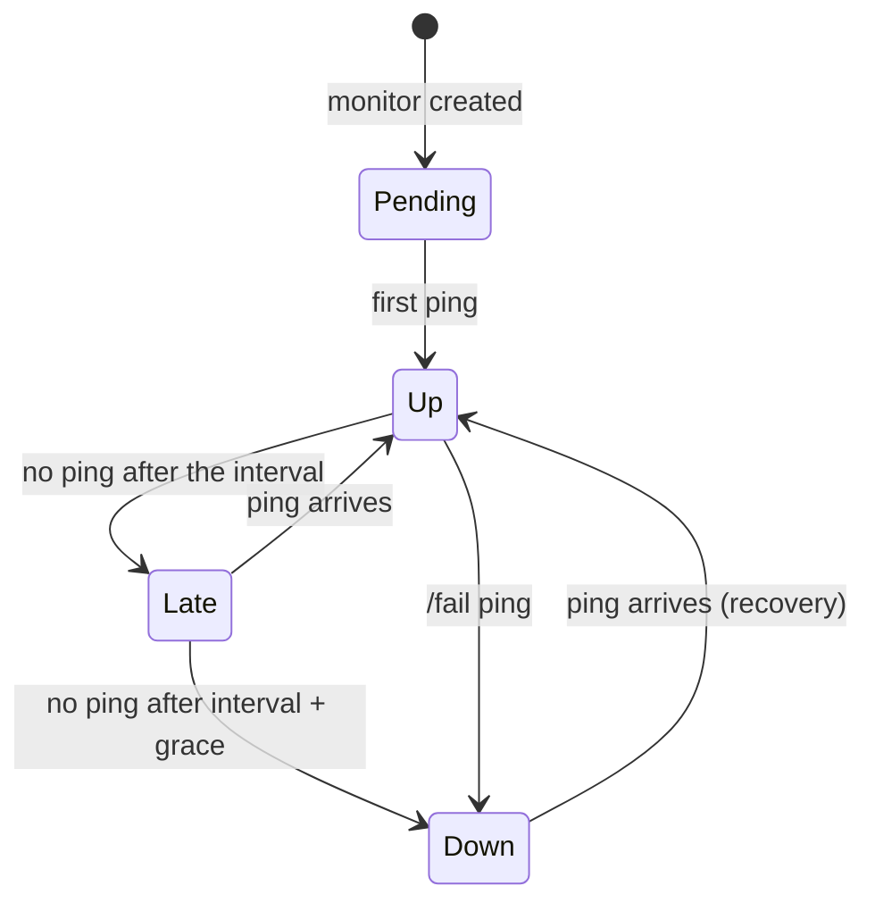

A heartbeat monitor watches work that runs on its own schedule, such as cron jobs, backups and scheduled AI agents. Your job calls a secret **ping URL** when it finishes, and the monitor goes down when the ping is late. Supercheck never calls your service.

## How it works



| State | Meaning | Alerts |
|---|---|---|
| **Pending** | No ping yet | None. A never-pinged monitor never goes down |
| **Up** | The last ping arrived on time | None |
| **Late** | Interval passed, grace period not. The monitor stays up and uptime is unaffected | Optional **Ping is late** warning, off by default ([Warnings](/docs/app/communicate/alerts#warnings)) |
| **Down** | No ping within interval + grace, or `/fail` | Failure alert and a sev2 incident (severity and incidents are configurable in the alert settings). The next ping sends a recovery alert and resolves the incident, unless someone acknowledged it |
| **Paused** | Monitoring is off | None. Pings are accepted and ignored |

The clock starts at the newest of the last ping, creation and last resume. One missed run is one failure: a silent monitor records one **Missed** entry per interval, though one still overdue when a maintenance window ends can record another sooner. Alerts are held back during [maintenance windows](/docs/app/monitor#maintenance-windows); if the job is still missing at the end, the failure alert goes out within about 3 minutes.

## Create a heartbeat monitor

<Steps>
<Step>
Go to **Monitor → Create** and select **Heartbeat Monitor**.
</Step>
<Step>
Set **Expect a ping every** to how often the job runs, from 1 minute to 31 days.
</Step>
<Step>
Set **Grace period**, how late a ping may be, from 1 minute to 1 day. The default is 20% of the interval, at least 5 minutes and at most 1 day.
</Step>
<Step>
Choose notification channels, save, then copy the ping URL into your job.
</Step>
</Steps>

From the terminal, use `supercheck monitor create --type heartbeat --every 1d --grace 1h`. The CLI prints the URL once and omits it with `--json` or `--quiet`. See [CLI commands](/docs/cli/commands#monitors).

## The ping URL

The URL looks like `https://<your-app>/api/heartbeat/hb_<32 characters>`. Anyone holding it can ping the monitor, so keep it in your job's secret store.

- **Reveal** and **Copy** show it again. Editors and above see it; viewers see it masked.
- **Rotate URL** issues a new URL and the old one stops working at once.
- It accepts `GET`, `POST` and `HEAD`. The body is ignored and never stored.
- Known chat link previews (Slack, Teams, Discord) are ignored, but mail scanners and other link openers can record a ping. Do not paste the URL into chat or email. If it leaks, rotate it.

<Callout type="warn">
The URL answers `200 OK` even for an unknown, rotated or paused-monitor token, so nobody can probe for valid URLs. Oversized or rate-limited requests return `413` or `429` first (see [Limits](#limits)), and `503` means the ping was not recorded. After adding the URL to a job, check that the monitor turns **Up**.
</Callout>

## Send pings

Ping at the end of a successful run:

```bash title="crontab"
0 2 * * * /usr/local/bin/backup.sh && curl -fsS -m 10 --retry 5 -o /dev/null https://<your-app>/api/heartbeat/hb_...
```

`-m 10` stops a slow network hanging the job; `--retry 5` stops one dropped connection raising a false alert. Two optional endpoints:

| URL | Effect |
|---|---|
| `<ping URL>/start` | The job started. The next ping records the duration (**Run duration**). State is unchanged |
| `<ping URL>/fail` | The job failed. The monitor goes down at once, without the grace period |

```bash
URL=https://<your-app>/api/heartbeat/hb_...
curl -fsS -m 10 --retry 5 -o /dev/null "$URL/start"
if /usr/local/bin/backup.sh; then
  curl -fsS -m 10 --retry 5 -o /dev/null "$URL"
else
  curl -fsS -m 10 --retry 5 -o /dev/null "$URL/fail"
fi
```

`supercheck heartbeat ping "$URL"` (with `--start` or `--fail`) does the same with retries and exit codes, and needs no login.

## Status pages and self-hosting

- On a [status page](/docs/app/communicate/status-pages), a heartbeat counts each on-time ping window as up and each missed interval as down. A daily heartbeat that pings on time never shows **No recent data**.
- The ping URL uses your instance's public app URL, with no extra setting. The job needs a network route to it, through any firewall. Deadlines that fell inside a period when Supercheck was unreachable move later, so a detected outage raises no false alerts. This does not check whether your job's network could reach the app.

## Limits

| Limit | Value |
|---|---|
| Interval | 1 minute to 31 days |
| Grace period | 1 minute to 1 day |
| Ping history | One entry per 30 seconds; pings inside 30 seconds merge |
| Pings per URL | 10 per minute; more return `429` |
| Pings per client IP | 1200 per minute across all URLs (jobs behind one NAT share it); more return `429` |
| Request size | 10 kB; larger requests return `413` |
| Schedules | A fixed interval only. No cron expressions or time zones yet |

## Related

<Cards>
<Card title="Monitors" href="/docs/app/monitor" description="Other monitor types and the details page" />
<Card title="Notifications" href="/docs/app/communicate/alerts" description="Channels, thresholds and warnings" />
<Card title="CLI commands" href="/docs/cli/commands" description="Manage heartbeat monitors from the terminal" />
</Cards>
