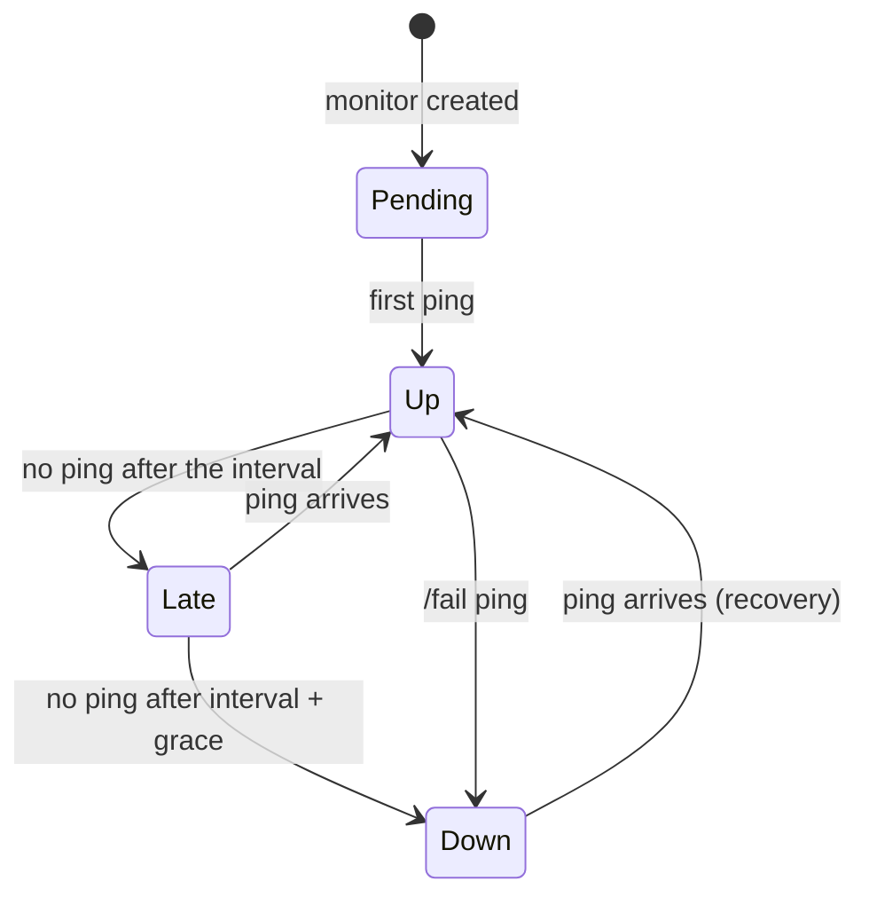

A heartbeat monitor watches work that runs on its own schedule, such as cron jobs, backups, queue workers and scheduled AI agents. Your job calls a secret **ping URL** when it finishes. The monitor goes down when the ping does not arrive on time. Supercheck never calls your service.

## How it works



| State | Meaning | Alerts |
|---|---|---|
| **Pending** | No ping has arrived yet | None. A monitor that was never pinged never goes down |
| **Up** | The last ping arrived on time | None |
| **Late** | The interval has passed, but the grace period has not. The monitor stays up and uptime is not affected | Optional **Ping is late** warning (off by default, see [Warnings](/docs/app/communicate/alerts#warnings)) |
| **Down** | No ping within interval + grace, or the job sent `/fail` | Failure alert and a sev2 incident. The next ping sends a recovery alert and resolves the incident, unless someone acknowledged it. You can change the severity or turn incidents off in the alert settings |
| **Paused** | Monitoring is off | None. Pings are accepted and ignored |

The clock starts at the newest of the last ping, the creation time and the last resume time. One missed run is one failure: a silent monitor records one **Missed** entry per interval.

## Create a heartbeat monitor

<Tabs items={['Dashboard', 'CLI']}>
<Tab value="Dashboard">

<Steps>
<Step>
Go to **Monitor → Create** and select **Heartbeat Monitor**.
</Step>
<Step>
Set **Expect a ping every** to how often the job runs, from 1 minute to 31 days.
</Step>
<Step>
Set **Grace period**, the time a ping may be late before the monitor goes down, from 1 minute to 1 day. The default is 20% of the interval, at least 5 minutes and at most 1 day (12 minutes for an hourly job).
</Step>
<Step>
Choose notification channels and save.
</Step>
<Step>
Copy the ping URL shown after saving and add it to your job.
</Step>
</Steps>

</Tab>
<Tab value="CLI">

```bash
supercheck monitor create --name "Nightly backup" --type heartbeat --every 1d --grace 1h
```

Durations accept `m`, `h` and `d`. The CLI prints the ping URL once. With `--json` or `--quiet` it leaves the URL out, so it never lands in CI logs. Run `supercheck monitor heartbeat-url <id>` to show it.

</Tab>
</Tabs>

## The ping URL

The ping URL looks like `https://<your-app>/api/heartbeat/hb_<32 characters>`. Anyone holding it can ping the monitor. Keep it in your job's secret store, not in a public repository.

- **Reveal** and **Copy** on the monitor page show it again. Editors and above see the URL; viewers see it masked. CLI: `supercheck monitor heartbeat-url <id>`.
- **Rotate URL** issues a new URL and the old one stops working at once. CLI: `supercheck monitor heartbeat-url <id> --rotate`.
- The URL accepts `GET`, `POST` and `HEAD`. The request body is ignored and never stored.
- Requests from known chat link previews (Slack, Teams, Discord and similar) are ignored. Mail scanners and other tools that open links still record a ping, so do not paste the URL into chat or email. If it leaks, rotate it.

<Callout type="warn">
The ping URL always answers `200 OK`, even when the token is unknown, rotated or belongs to a paused monitor, so nobody can probe for valid URLs. A successful request does not prove the URL is right. After you add it to a job, check that the monitor turns **Up**.
</Callout>

## Send pings

Ping at the end of a successful run.

```bash
# crontab: run the backup every night at 02:00, ping only when it succeeds
0 2 * * * /usr/local/bin/backup.sh && curl -fsS -m 10 --retry 5 -o /dev/null https://<your-app>/api/heartbeat/hb_...
```

`-m 10` stops a slow network from hanging the job. `--retry 5` stops one dropped connection from causing a false alert.

Two optional endpoints:

| URL | Effect |
|---|---|
| `<ping URL>/start` | The job started. The next ping records the run duration (shown as **Run duration**). It does not change the state |
| `<ping URL>/fail` | The job failed. The monitor goes down at once, without waiting for the grace period |

```bash
URL=https://<your-app>/api/heartbeat/hb_...
curl -fsS -m 10 --retry 5 -o /dev/null "$URL/start"
if /usr/local/bin/backup.sh; then
  curl -fsS -m 10 --retry 5 -o /dev/null "$URL"
else
  curl -fsS -m 10 --retry 5 -o /dev/null "$URL/fail"
fi
```

The CLI does the same in one command and needs no login:

```bash
supercheck heartbeat ping "$URL"          # success
supercheck heartbeat ping "$URL" --start  # job started
supercheck heartbeat ping "$URL" --fail   # job failed
```

`heartbeat ping` retries transient errors and sets exit codes your script can check. See [CLI commands](/docs/cli/commands#monitors).

Alerts are held back during [maintenance windows](/docs/app/monitor#maintenance-windows). If the job is still missing when the window ends, the failure alert goes out within about 3 minutes.

## Status pages

Add a heartbeat monitor to a status page component like any other monitor. Uptime counts each on-time ping window as up and each missed interval as down. A daily heartbeat that pings on time never shows **No recent data**.

## Self-hosted

The ping URL uses your instance's public app URL. There is no extra setting. The job must be able to reach that URL: a job in a private network needs a route to your Supercheck app, and any firewall in between must allow it. If Supercheck itself was unreachable for a while, deadlines that fell inside that time move later, so the outage raises no false alerts. This protection knows only that the app was running, not whether your job's network could reach it.

## Limits

| Limit | Value |
|---|---|
| Interval | 1 minute to 31 days |
| Grace period | 1 minute to 1 day |
| Ping history | At most one entry per 30 seconds; several pings inside 30 seconds become one entry |
| Pings per URL | 10 per minute; more return `429` |
| Pings per client IP | 1200 per minute across all URLs (many jobs behind one NAT share it); more return `429` |
| Request size | 10 kB; larger requests return `413` |
| Schedules | A fixed interval only. Cron expressions and time zones are not supported yet |

## Related

<Cards>
<Card title="Monitors" href="/docs/app/monitor" description="Other monitor types and the monitor details page" />
<Card title="Notifications" href="/docs/app/communicate/alerts" description="Channels, thresholds and warnings" />
<Card title="CLI commands" href="/docs/cli/commands" description="Create and manage heartbeat monitors from the terminal" />
</Cards>
