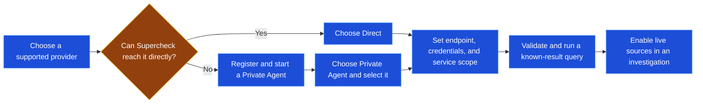

Add a connector when an investigation should use evidence from a tool your team already operates. Configure connectors under **Organization → Integrations** with a role that can configure connectors.

A connector gives access to a provider. [Saved queries](/docs/app/admin/ai-sre-setup#saved-queries-optional) are optional reusable questions that run through one enabled connector. You can search a connector during an investigation without saving a query first.

## Supported Providers

Choose one of these in **Add connector**.

| Category | Providers |
|---|---|
| **Metrics and dashboards** | Prometheus, Grafana, AWS CloudWatch |
| **Operational events** | Datadog |
| **Logs and search** | Loki, Elasticsearch / OpenSearch |
| **Distributed traces** | Grafana Tempo |
| **Cloud and orchestration** | Kubernetes |
| **Error tracking** | Sentry |
| **Code and deployments** | GitHub, GitLab |
| **Incident management** | PagerDuty, Opsgenie |

Existing records for other providers are labeled **Setup only** and cannot run searches.

## Choose How to Connect

| Your provider | Choose | What to do |
|---|---|---|
| A public API Supercheck can reach | **Direct** | Enter the endpoint and read-only credentials. Cloud endpoints must use HTTPS |
| An API reachable only inside your network | **Private Agent** | [Set up an agent with Docker Compose](/docs/app/deployment/private-agent), then select it when adding the connector |
| An internal API reachable from your self-hosted instance | **Direct** or **Private Agent** | Use Direct if your instance can reach it. Otherwise deploy an agent in that network |

Private Agent mode supports GitHub, Kubernetes, Prometheus, Grafana, Sentry, Datadog, Loki, Elasticsearch / OpenSearch, Tempo, and AWS CloudWatch. GitLab, PagerDuty, and Opsgenie support **Direct** only.

| Mode | Endpoint rules |
|---|---|
| **Supercheck Cloud, Direct** | HTTPS only. Cannot reach localhost, private, or reserved addresses, including cloud metadata |
| **Private Agent** | Reaches internal HTTP or HTTPS endpoints, except localhost and cloud metadata endpoints |
| **Self-hosted Direct** | Reaches internal HTTP or HTTPS endpoints |
| **All modes** | Reject credentials embedded in URLs |

Scroll horizontally on smaller screens to view all steps.

## Add a Connector

<Steps>
<Step>

### Open Integrations

Go to **Organization → Integrations** and select **Add connector**.

</Step>
<Step>

### Pick the provider

Select the provider type and give it a recognizable name, such as `Production GitHub`.

</Step>
<Step>

### Choose the mode

Choose **Direct** or **Private Agent**. For Private Agent, first register an agent under **Organization → Private Agents**, then select it in the dialog.

</Step>
<Step>

### Add endpoint and credential

Enter the API endpoint URL and a least-privilege read-only credential.

</Step>
<Step>

### Set the service scope

Define the **Service scope** to restrict which services may use this connector.

</Step>
<Step>

### Validate

Save, validate, then run one known-result query and one no-result query before relying on the connector during an incident.

</Step>
</Steps>

<Callout type="info">
Use the smallest service scope and query time window that answer your question. If a search returns no evidence, check the service scope, provider permissions, and time range.
</Callout>

## Query Examples

Each provider uses its own read-only query language.

| Provider | Example |
|---|---|
| **GitLab** | `project:acme/checkout deploy` |
| **PagerDuty** | `status:triggered service:checkout` |
| **Opsgenie** | `status:open AND priority:P1` |
| **Prometheus** | PromQL, such as `sum(rate(http_requests_total{status=~"5.."}[5m]))` |
| **Loki** | LogQL with a stream selector, such as `{service="checkout"} \|= "error"` |
| **Kubernetes** | `*` or a verified label selector, with an explicit namespace |

Kubernetes searches require a namespace. Grant the connector service account read-only access only to the namespaces under test. Never grant cluster-admin or write permissions.

## Credential Best Practices

Use dedicated, read-only credentials limited to the service scope.

| Provider | Minimum access |
|---|---|
| **GitHub** | Read-only token limited to the repositories needed for commit search |
| **GitLab** | Personal, project, or group access token with `read_api`, limited to the required repositories |
| **Kubernetes** | ServiceAccount with read-only permissions scoped to application namespaces |
| **Grafana** | Service Account token with `Viewer` role. Never use administrative accounts |
| **Prometheus / Loki** | Read-only bearer token or gateway credential for query endpoints |
| **Sentry** | Read-only integration token restricted to relevant project IDs |
| **Datadog** | API key plus application key with read-only event access for the correct Datadog site |
| **AWS CloudWatch** | Access key ID and secret with `cloudwatch:DescribeAlarms` and `cloudwatch:GetMetricData`. Prefer short-lived STS credentials and include the session token |

<Callout type="warn">
Store credentials in the connector credential fields, not in prompts or endpoint URLs. Supercheck encrypts stored credentials and does not include them in AI prompts.
</Callout>
