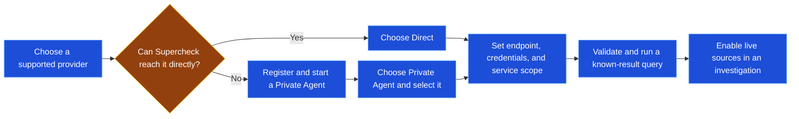

Add a connector when an investigation should use evidence from a tool your team already operates. Configure connectors under **Organization → Integrations** with a role that can configure connectors.

A connector gives access to a provider. [Saved queries](/docs/app/admin/ai-sre-setup#saved-queries-optional) are optional reusable questions that run through one enabled connector. You can search a connector during an investigation without saving a query first.

## Supported Providers

Choose one of these in **Add connector**.

| Category | Providers |
|---|---|
| **Metrics and dashboards** | Prometheus, Grafana, AWS CloudWatch, Google Cloud Monitoring, Azure Monitor |
| **Operational events** | Datadog |
| **Logs and search** | Loki, Elasticsearch / OpenSearch, Splunk, Google Cloud Logging, Azure Log Analytics |
| **Distributed traces** | Grafana Tempo, Jaeger |
| **Application performance (NRQL)** | New Relic |
| **Cloud and orchestration** | Kubernetes |
| **Error tracking** | Sentry |
| **Code and deployments** | GitHub, GitLab |
| **Incident management** | PagerDuty, Opsgenie |
| **Tickets and knowledge** | Jira, Confluence, Notion |
| **Custom tools** | MCP servers in your network (Private Agent only) |

For OpenTelemetry, connect the backend your collector exports to (Tempo, Jaeger, Loki, Prometheus, and so on). Slack, Teams and webhooks are notification channels, not connectors.

## Tickets and Knowledge Connectors

Jira, Confluence, and Notion are read-only. They find related tickets, runbooks, and post-mortems for a service, and return titles, links, and short excerpts. Page text is stored as document evidence and is treated as untrusted data: it is redacted, fenced, and labeled so the AI treats it as evidence to cite, not as instructions. This reduces, but cannot fully eliminate, prompt-injection risk, so review cited sources before acting.

| Provider | Endpoint | Credential | Least privilege |
|---|---|---|---|
| **Jira** | Cloud site URL, or Data Center base URL | Cloud: account email and API token. Data Center: leave the email empty and use a personal access token | A dedicated user that can only browse the operational projects |
| **Confluence** | Cloud site URL (`/wiki` is added), or Data Center base URL | Same as Jira | A dedicated user with view access to runbook and post-mortem spaces only |
| **Notion** | Fixed at `api.notion.com`; the endpoint field is ignored | Internal integration token | Share only the runbook pages with the integration |

Plain text queries search by text. Jira adds the investigation time window to plain text searches; JQL and CQL are passed through as written. Page and issue bodies are converted to plain text, capped in size, and fetched for the top results only. Jira and Confluence also run through a Private Agent; Notion is direct only.

## Choose How to Connect

| Your provider | Choose | What to do |
|---|---|---|
| A public API Supercheck can reach | **Direct** | Enter the endpoint and read-only credentials. Cloud endpoints must use HTTPS |
| An API reachable only inside your network | **Private Agent** | [Set up an agent with Docker Compose](/docs/app/deployment/private-agent), then select it when adding the connector |
| An internal API reachable from your self-hosted instance | **Direct** or **Private Agent** | Use Direct if your instance can reach it. Otherwise deploy an agent in that network |

Private Agent mode supports GitHub, Kubernetes, Prometheus, Grafana, Sentry, Datadog, Loki, Elasticsearch / OpenSearch, Tempo, AWS CloudWatch, Jaeger, New Relic, Splunk, Google Cloud, Azure Monitor, Jira, and Confluence. GitLab, PagerDuty, Opsgenie, and Notion support **Direct** only.

| Mode | Endpoint rules |
|---|---|
| **Supercheck Cloud, Direct** | HTTPS only. Cannot reach localhost, private, or reserved addresses, including cloud metadata |
| **Private Agent** | Reaches internal HTTP or HTTPS endpoints, except localhost and cloud metadata endpoints |
| **Self-hosted Direct** | Reaches internal HTTP or HTTPS endpoints |
| **All modes** | Reject credentials embedded in URLs |

Scroll horizontally on smaller screens to view all steps.

## Add a Connector

<Steps>
<Step>

### Open Integrations

Go to **Organization → Integrations** and select **Add connector**.

</Step>
<Step>

### Pick the provider

Select the provider type and give it a recognizable name, such as `Production GitHub`.

</Step>
<Step>

### Choose the mode

Choose **Direct** or **Private Agent**. For Private Agent, first register an agent under **Organization → Private Agents**, then select it in the dialog.

</Step>
<Step>

### Add endpoint and credential

Enter the API endpoint URL and a least-privilege read-only credential.

</Step>
<Step>

### Set the service scope

Define the **Service scope** to restrict which services may use this connector.

</Step>
<Step>

### Validate

Save, validate, then run one known-result query and one no-result query before relying on the connector during an incident.

</Step>
</Steps>

<Callout type="info">
Use the smallest service scope and query time window that answer your question. If a search returns no evidence, check the service scope, provider permissions, and time range.
</Callout>

## MCP Servers (Private Agent only)

Connect any [Model Context Protocol](https://modelcontextprotocol.io) server running inside your network as a read-only evidence source. Supercheck reaches it only through a [Private Agent](/docs/app/deployment/private-agent), so **Execution mode** must be **Private Agent**. Direct mode is rejected. Only the Streamable HTTP transport is supported. Supercheck never starts local processes or stdio servers.

<Steps>
<Step>
Add a connector of type **MCP** with the server's endpoint URL, for example `https://mcp.internal.example.com/mcp`, and the Private Agent that can reach it. An optional credential is sent as `Authorization: Bearer <value>`, or as a custom header if you set a header name.
</Step>
<Step>
Open **Manage MCP tools** from the connector menu and select **Discover tools**. The Private Agent lists the server's tools and their input schemas.
</Step>
<Step>
Tick the tools investigations may call and save. Nothing is callable until you allowlist it. You can fix some arguments, such as a namespace, to a constant value that the AI cannot override.
</Step>
</Steps>

Allowlisted tools appear to the AI as `callMcpTool` targets together with their descriptions and argument names. Each call is checked before it leaves Supercheck, and again by the agent.

| Control | Behavior |
|---|---|
| **Allowlist** | Only tools you ticked can be called. The tool description and input schema are saved when you allowlist, so later server changes do not widen access |
| **Server hints** | Annotations such as read-only or destructive are shown for reference. They never authorize a call |
| **Arguments** | Validated against the saved schema, size-limited, and unknown arguments are rejected. Tools whose schema uses unsupported JSON Schema keywords cannot be allowlisted |
| **Output** | Text and JSON only. Images, resources, and binary content are dropped. Output is redacted, truncated, and marked as untrusted data, so the AI never treats it as instructions |
| **Limits** | Calls count toward the connector search rate limit, the investigation step budget, the connector timeout, and the output size cap |
| **Audit** | Each call, including rejected ones, appears in the investigation tool trace and the connector audit log with the tool name, and results are stored as evidence |
| **Network** | The agent applies its endpoint policy: no localhost or cloud metadata targets, no redirects, and no credentials in URLs |

<Callout type="warn">
Allowlist only tools that cannot change anything. Supercheck cannot verify what a tool does on your server. Prefer a server or token that exposes read-only tools, and review each tool before ticking it.
</Callout>

## Query Examples

Each provider uses its own read-only query language.

| Provider | Example |
|---|---|
| **GitLab** | `project:acme/checkout deploy` |
| **PagerDuty** | `status:triggered service:checkout` |
| **Opsgenie** | `status:open AND priority:P1` |
| **Prometheus** | PromQL, such as `sum(rate(http_requests_total{status=~"5.."}[5m]))` |
| **Loki** | LogQL with a stream selector, such as `{service="checkout"} \|= "error"` |
| **Kubernetes** | `*` or a verified label selector, with an explicit namespace |
| **Jaeger** | `service:checkout error:true minDuration:500ms`, `trace:<id>`, or `*` to list services |
| **New Relic** | NRQL, such as `SELECT count(*) FROM Transaction WHERE appName = 'checkout' AND error IS true FACET name` |
| **Splunk** | SPL, such as `index=main service="checkout" error \| stats count by sourcetype` |
| **Google Cloud** | `logs: severity>=ERROR AND resource.labels.service_name="checkout"` or `metrics: metric.type="run.googleapis.com/request_count"` |
| **Azure Monitor** | KQL, such as `AppExceptions \| summarize count() by ProblemId`, or `metrics: resource=<resource ID> names="Http5xx" agg=Total` |

Every search is limited to the investigation time window. Supercheck adds the window for you: leave out `SINCE`/`UNTIL` in NRQL and `earliest`/`latest` in SPL, because they are replaced. Results are capped by the connector's row, size and time limits, and a truncated result is marked as such.

Queries are read-only. Supercheck rejects Splunk commands that write, notify, run scripts or fan out (`delete`, `outputlookup`, `collect`, `sendemail`, `rest`, `map`, and similar), NRQL that is not a single `SELECT`/`FROM`/`SHOW` statement, and Azure KQL control commands that start with `.`.

Kubernetes searches require a namespace. Grant the connector service account read-only access only to the namespaces under test. Never grant cluster-admin or write permissions.

## Credential Best Practices

Use dedicated, read-only credentials limited to the service scope.

| Provider | Minimum access |
|---|---|
| **GitHub** | Read-only token limited to the repositories needed for commit search |
| **GitLab** | Personal, project, or group access token with `read_api`, limited to the required repositories |
| **Kubernetes** | ServiceAccount with read-only permissions scoped to application namespaces |
| **Grafana** | Service Account token with `Viewer` role. Never use administrative accounts |
| **Prometheus / Loki** | Read-only bearer token or gateway credential for query endpoints |
| **Sentry** | Read-only integration token restricted to relevant project IDs |
| **Datadog** | API key plus application key with read-only event access for the correct Datadog site |
| **MCP** | A token for a read-only account on the MCP server, limited to the tools you allowlist |
| **AWS CloudWatch** | Access key ID and secret with `cloudwatch:DescribeAlarms` and `cloudwatch:GetMetricData`. Prefer short-lived STS credentials and include the session token |
| **Jaeger** | Jaeger has no built-in authentication. Put it behind a gateway and use a read-only bearer token, or leave the credential empty on a private network |
| **New Relic** | A User API key from a user or service user with read-only access to the account, plus the numeric account ID. Choose `us` or `eu` for the data region. Ingest and license keys do not work |
| **Splunk** | An authentication token for a user whose role has search capability and read access only to the indexes you need. Do not grant admin, delete, or lookup-write capabilities. Use the management endpoint, usually port 8089 |
| **Google Cloud** | A service account JSON key with only `roles/monitoring.viewer` and `roles/logging.viewer` on the project. Supercheck exchanges it for a short-lived token and never uses the `token_uri` in the file |
| **Azure Monitor** | An app registration (tenant ID, client ID, client secret) with `Monitoring Reader` on the resources and `Log Analytics Reader` on the workspace. Add the Log Analytics workspace ID to run KQL |

New Relic, Google Cloud, and Azure Monitor call fixed vendor API hosts, so they have no endpoint URL to set. Their sign-in requests go only to the vendor's own hosts. Jaeger and Splunk use the endpoint you enter and follow the endpoint rules above.

<Callout type="warn">
Store credentials in the connector credential fields, not in prompts or endpoint URLs. Supercheck encrypts stored credentials and does not include them in AI prompts.
</Callout>
