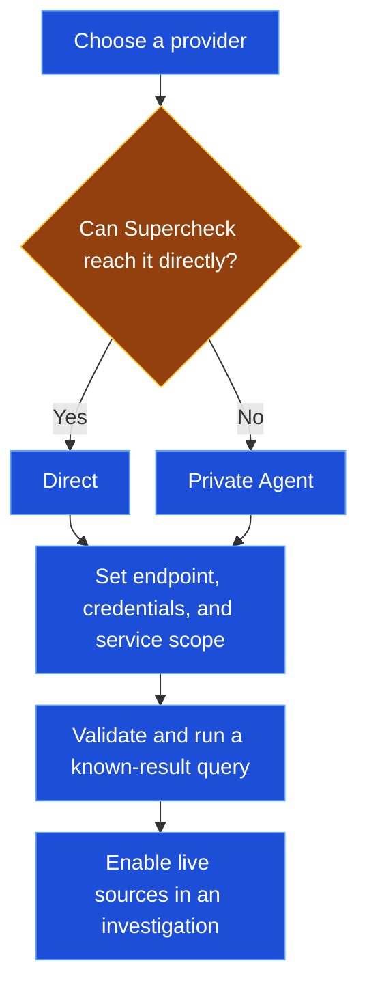

Add a connector when an investigation should use evidence from a tool your team operates. Configure connectors under **Settings → Organization → Integrations** with a role that can configure them. [Saved queries](/docs/app/admin/ai-sre-setup#saved-queries-optional) are optional reusable questions that run through one enabled connector; you can search a connector without saving one.

## Supported providers

| Category | Providers |
|---|---|
| **Metrics and dashboards** | <Brands names={["prometheus", "grafana", "aws-cloudwatch", "google-cloud", "azure"]} labels={{ "google-cloud": "Google Cloud Monitoring" }} /> |
| **Operational events** | <Brand name="datadog" /> |
| **Logs and search** | <Brands names={["loki", "elasticsearch", "opensearch", "splunk", "google-cloud", "azure"]} labels={{ "google-cloud": "Google Cloud Logging", azure: "Azure Log Analytics" }} /> |
| **Distributed traces** | <Brands names={["tempo", "jaeger"]} labels={{ tempo: "Grafana Tempo" }} /> |
| **Application performance (NRQL)** | <Brand name="new-relic" /> |
| **Cloud and orchestration** | <Brand name="kubernetes" /> |
| **Error tracking** | <Brand name="sentry" /> |
| **Code and deployments** | <Brands names={["github", "gitlab"]} /> |
| **Incident management** | <Brands names={["pagerduty"]} /> |
| **Tickets and knowledge** | <Brands names={["jira", "confluence", "notion"]} /> |
| **Custom tools** | <Brand name="mcp" label="MCP servers in your network (Private Agent only)" /> |

For OpenTelemetry, connect the backend your collector exports to (Tempo, Jaeger, Loki, Prometheus). Slack, Teams and webhooks are notification channels, not connectors.

## Choose how to connect

| Your provider | Choose | What to do |
|---|---|---|
| A public API Supercheck can reach | **Direct** | Enter the endpoint and read-only credentials. Cloud endpoints must use HTTPS |
| An API reachable only inside your network | **Private Agent** | [Set up an agent with Docker Compose](/docs/app/deployment/private-agent), then select it when adding the connector |
| An internal API your self-hosted instance can reach | **Direct** or **Private Agent** | Use Direct if reachable; otherwise deploy an agent in that network |

Private Agent mode supports every provider except GitLab, PagerDuty and Notion, which support **Direct** only.
<Accordions>
<Accordion title="Endpoint rules by mode" id="endpoint-rules">

| Mode | Endpoint rules |
|---|---|
| **Supercheck Cloud, Direct** | HTTPS only. Cannot reach localhost, private, or reserved addresses, including cloud metadata |
| **Private Agent** | Reaches internal HTTP or HTTPS endpoints, except localhost and cloud metadata endpoints |
| **Self-hosted Direct** | Reaches internal HTTP or HTTPS endpoints, including `localhost` and private ranges. Cloud metadata and link-local addresses (`169.254.0.0/16`, `100.100.100.200`, `168.63.129.16`, `192.0.0.192`, `fe80::/10`, `fd00:ec2::254`) are blocked |
| **All modes** | Reject credentials embedded in URLs, fragments (`#`), and query strings (`?`). MCP connectors may carry a query string because hosted servers sometimes put the key in the URL; Supercheck treats that URL as secret and shows only `?…` in the console. Put keys in the credential fields |

</Accordion>
</Accordions>

## Add a connector

<Steps>
<Step>

### Add the connector

In **Settings → Organization → Integrations**, select **Add connector**, pick the provider and name it, such as `Production GitHub`.

</Step>
<Step>

### Choose the mode

Choose **Direct** or **Private Agent**. For Private Agent, register an agent under **Settings → Organization → Private Agents** first, then select it.

</Step>
<Step>

### Add endpoint, credential and scope

Enter the endpoint URL and a least-privilege read-only credential, then set the **Service scope** to restrict which services may use the connector.

</Step>
<Step>

### Validate

Save, validate, then run one known-result query and one no-result query before relying on the connector in an incident. An unresolved host, a refused connection and a `404` on the endpoint path each get a specific message. A Private Agent connector cannot be probed from Supercheck, so validation shows guidance instead.

</Step>
</Steps>

Connectors belong to one project; the Integrations tab names it, with a **Switch project** button. To check what AI SRE can see, choose **Preview data** in a connector's row menu. The **Preview connector data** dialog fills in the query for the selected service with a 1-hour window. Results list time, type and message; select a row for the full text, source link and hash. If nothing matches, widen the window to 24 hours when the connector allows it. A connector that failed validation shows the reason under its status.

Use the smallest service scope and time window that answer your question. If a search returns nothing, check the service scope, provider permissions and time range.

## MCP servers (Private Agent only)

Connect a [Model Context Protocol](https://modelcontextprotocol.io) server inside your network as a read-only evidence source. Supercheck reaches it only through a [Private Agent](/docs/app/deployment/private-agent), so **Execution mode** must be **Private Agent**; Direct is rejected. Only the Streamable HTTP transport is supported; Supercheck never starts local processes or stdio servers.

<Steps>
<Step>
Add a connector of type **MCP** with the server's endpoint URL, such as `https://mcp.internal.example.com/mcp`, and the Private Agent that can reach it. An optional credential is sent as `Authorization: Bearer <value>`, or as a custom header if you set a header name.
</Step>
<Step>
Open **Manage MCP tools** from the connector menu and select **Discover tools**. The Private Agent lists the server's tools and their input schemas.
</Step>
<Step>
Tick the tools investigations may call and save. Nothing is callable until allowlisted. You can fix arguments, such as a namespace, to a constant the AI cannot override.
</Step>
</Steps>

<Accordions>
<Accordion title="How allowlisted MCP tools are controlled" id="mcp-controls">

| Control | Behavior |
|---|---|
| **Allowlist** | Only tools you ticked can be called. Later changes on the server do not widen access |
| **Server hints** | Annotations such as read-only or destructive are shown for reference. They never authorize a call |
| **Arguments** | Unknown arguments are rejected. Tools whose schema uses unsupported JSON Schema keywords cannot be allowlisted |
| **Output** | Text and JSON only. Images, resources, and binary content are dropped. Output is redacted and truncated |
| **Audit** | Each call, including rejected ones, appears in the investigation tool trace and the connector audit log with the tool name, and results are stored as evidence |

</Accordion>
</Accordions>

<Callout type="warn">
Allowlist only tools that cannot change anything; Supercheck cannot verify what a tool does on your server. Prefer a read-only server or token and review each tool before ticking it.
</Callout>

## Reference

<Accordions>
<Accordion title="Jira, Confluence and Notion" id="tickets-knowledge">

Jira, Confluence and Notion are read-only. They find related tickets, runbooks and post-mortems for a service and return titles, links and short excerpts. Page text is untrusted evidence to cite, not instructions. This reduces but cannot eliminate prompt-injection risk, so review cited sources before acting.

| Provider | Endpoint | Credential | Least privilege |
|---|---|---|---|
| **Jira** | Cloud site URL, or Data Center base URL | Cloud: account email and API token. Data Center: leave the email empty and use a personal access token | A dedicated user that can only browse the operational projects |
| **Confluence** | Cloud site URL (`/wiki` is added), or Data Center base URL | Same as Jira | A dedicated user with view access to runbook and post-mortem spaces only |
| **Notion** | Fixed at `api.notion.com`; the endpoint field is ignored | Internal integration token | Share only the runbook pages with the integration |

A Notion endpoint is still validated (a valid URL with no query string or fragment) but not used. Plain text queries search by text; Jira adds the investigation time window to them, JQL and CQL pass through as written, and Confluence and Notion have no time window. Page and issue bodies are converted to plain text, capped in size and fetched for the top results only.

</Accordion>
<Accordion title="Query examples" id="query-examples">

| Provider | Example |
|---|---|
| **GitLab** | `project:acme/checkout deploy` |
| **PagerDuty** | `status:triggered service:checkout` |
| **Prometheus** | PromQL, such as `sum(rate(http_requests_total{status=~"5.."}[5m]))` |
| **Loki** | LogQL with a stream selector, such as `{service="checkout"} \|= "error"` |
| **Kubernetes** | `*` or a verified label selector, with an explicit namespace |
| **Jaeger** | `service:checkout error:true minDuration:500ms`, `trace:<id>`, or `*` to list services |
| **New Relic** | NRQL, such as `SELECT count(*) FROM Transaction WHERE appName = 'checkout' AND error IS true FACET name` |
| **Splunk** | SPL, such as `index=main service="checkout" error \| stats count by sourcetype` |
| **Google Cloud** | `logs: severity>=ERROR AND resource.labels.service_name="checkout"` or `metrics: metric.type="run.googleapis.com/request_count"` |
| **Azure Monitor** | KQL, such as `AppExceptions \| summarize count() by ProblemId`, or `metrics: resource=<resource ID> names="Http5xx" agg=Total` |

Most searches use the investigation time window. Exceptions are Jira JQL, Confluence, Notion and Kubernetes (current pods and events in the namespace). Leave out `SINCE`/`UNTIL` in NRQL and `earliest`/`latest` in SPL; they are replaced. Results are capped by the connector's row, size and time limits, and a truncated result is marked.

Queries are read-only. Supercheck rejects Splunk commands that write, notify, run scripts or fan out (`delete`, `outputlookup`, `collect`, `sendemail`, `rest`, `map`, and similar), NRQL that is not a single `SELECT`/`FROM`/`SHOW` statement, and Azure KQL control commands that start with `.`.

Kubernetes searches require a namespace. Grant the service account read-only access to those namespaces only; never cluster-admin or write permissions.

</Accordion>
<Accordion title="Credential best practices" id="credentials">

Use dedicated, read-only credentials limited to the service scope.

| Provider | Minimum access |
|---|---|
| **GitHub** | Read-only token limited to the repositories needed for commit search |
| **GitLab** | Personal, project, or group access token with `read_api`, limited to the required repositories |
| **Kubernetes** | ServiceAccount with read-only permissions scoped to application namespaces |
| **Grafana** | Service Account token with `Viewer` role. Never use administrative accounts |
| **Prometheus / Loki** | Read-only bearer token or gateway credential for query endpoints |
| **Sentry** | Read-only integration token restricted to relevant project IDs |
| **Datadog** | API key plus application key with read-only event access. There is no site field: the endpoint selects the site (`api.datadoghq.com` for US, `api.datadoghq.eu` for EU). Validation checks both keys, and a `403` names the site to check |
| **MCP** | A token for a read-only account on the MCP server, limited to the tools you allowlist |
| **AWS CloudWatch** | Access key ID and secret with `cloudwatch:DescribeAlarms` and `cloudwatch:GetMetricData`. Prefer short-lived STS credentials and include the session token |
| **Jaeger** | Jaeger has no built-in authentication. Put it behind a gateway and use a read-only bearer token, or leave the credential empty on a private network |
| **New Relic** | A User API key from a user or service user with read-only access to the account, plus the numeric account ID. Choose `us` or `eu` for the data region; any other value is rejected. Ingest and license keys do not work |
| **Splunk** | An authentication token for a user whose role has search capability and read access only to the indexes you need. Do not grant admin, delete, or lookup-write capabilities. Use the management endpoint, usually port 8089 |
| **Google Cloud** | A service account JSON key with only `roles/monitoring.viewer` and `roles/logging.viewer` on the project. |
| **Azure Monitor** | An app registration (tenant ID, client ID, client secret) with `Monitoring Reader` on the resources and `Log Analytics Reader` on the workspace. Add the Log Analytics workspace ID to run KQL |

New Relic, Google Cloud, and Azure Monitor call fixed vendor API hosts, so they have no endpoint URL to set. Jaeger and Splunk use the endpoint you enter and follow the endpoint rules above.

<Callout type="warn">
Store credentials in the connector credential fields, not in prompts or endpoint URLs. Supercheck encrypts stored credentials and does not include them in AI prompts.
</Callout>

</Accordion>
</Accordions>

## Related

<Cards>
<Card title="Incident investigation" href="/docs/app/investigate/incidents" description="Run an investigation with live sources" />
<Card title="Private Agent" href="/docs/app/deployment/private-agent" description="Reach connectors inside your network" />
<Card title="AI SRE setup" href="/docs/app/admin/ai-sre-setup" description="Services, saved queries and provider setup" />
</Cards>
