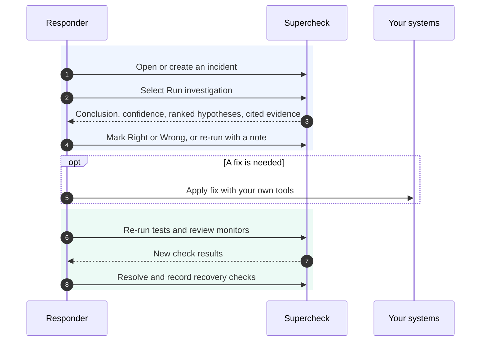

Open an incident, run a read-only investigation, and review findings with citations. Apply fixes with your own tools, then use tests or monitors to confirm recovery.

<Cards className="grid-cols-1 sm:grid-cols-3">
<Card icon={<ShieldCheck className="text-green-500" />} title="Read-only">
Supercheck recommends checks and fixes. It never changes your infrastructure
</Card>
<Card icon={<MousePointerClick className="text-blue-500" />} title="On demand">
Opening an incident does not start an investigation. Select **Run investigation** when ready
</Card>
<Card icon={<Quote className="text-purple-500" />} title="Cited">
Findings link to evidence. When the evidence is weak the result is **Inconclusive**, not a guess
</Card>
</Cards>

## Investigation Workflow

Scroll horizontally to view the full diagram.

## Native Evidence

Supercheck reads stored summaries and artifact references from its own tests, monitors, runs, and status pages.

| Source | Examples |
|---|---|
| **Monitors** | Failed monitor screenshots, historical results with P50/P95/P99 latency trends |
| **Synthetic tests** | Playwright videos, console logs, network traces |
| **Runs** | Run logs and step artifacts |
| **Status pages** | Public and private status page states |

<Callout type="info">
The agent reads bounded text evidence and artifact references. It does not watch videos or analyze screenshot contents. Open screenshots and videos yourself from the source run or monitor.
</Callout>

## Service Catalog

Register the systems you operate in the **Services** catalog. Services provide context for causal discovery, dependency tracking, and connector scoping. They are optional for stored-evidence investigations. See [AI SRE setup](/docs/app/admin/ai-sre-setup#services).

Open a service to see its health, recent incidents and alerts, linked resources, and dependencies.

## Where to Find Things

| Screen | Purpose |
|---|---|
| **Respond → [Incidents](/docs/app/investigate/incidents) → Alerts** | Grouped failure signals and delivery history. A signal that already belongs to an incident links to it (**Incident #N**); otherwise select **Open incident** |
| **Communicate → Notifications** | Notification channels. See [Alerts](/docs/app/communicate/alerts) |
| **Respond → [Incidents](/docs/app/investigate/incidents)** | Incident queue and workspaces. Run investigations, review hypotheses and similar incidents, draft post-mortems |
| **Respond → [Copilot](/docs/app/investigate/copilot)** | Ask questions about symptoms, logs, or active incident evidence |
| **Respond → Services** | Service metadata, owners, repositories, and tiers |
| **Settings → Organization → [Integrations](/docs/app/investigate/connectors)** | Read-only connectors to external tools |

## Get Started

<Steps>
<Step>

### Open an incident

Select **Open incident** on an alert signal, or choose **Respond → Incidents → New incident**.

</Step>
<Step>

### Run the investigation

Follow the [incident guide](/docs/app/investigate/incidents) to investigate, save findings, and resolve.

</Step>
<Step>

### Add sources as needed

[Connectors](/docs/app/investigate/connectors) are optional. Start with stored evidence.

</Step>
</Steps>
