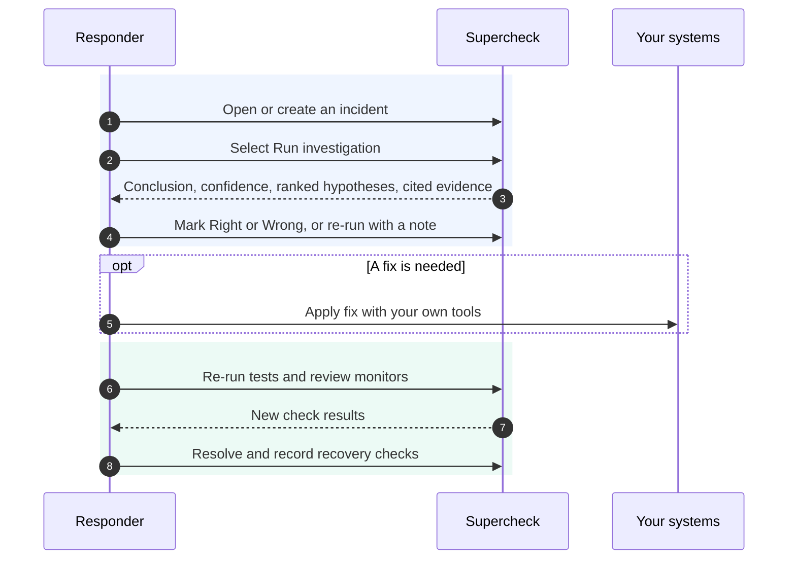

Open an incident, run a read-only investigation and review cited findings. Apply fixes with your own tools, then confirm recovery with tests or monitors.

<Cards className="grid-cols-1 sm:grid-cols-3">
<Card icon={<ShieldCheck className="text-green-500" />} title="Read-only">
Recommends checks and fixes. Never changes your infrastructure
</Card>
<Card icon={<MousePointerClick className="text-blue-500" />} title="On demand">
Starts only when you select **Run investigation**, unless the project turned on automatic investigation
</Card>
<Card icon={<Quote className="text-purple-500" />} title="Cited">
Findings link to evidence. Weak evidence gives **Inconclusive**, not a guess
</Card>
</Cards>

## Investigation workflow

Scroll horizontally to view the full diagram.

## Native evidence

Supercheck reads stored summaries and artifact references from its own tests, monitors, runs and status pages.

| Source | Examples |
|---|---|
| **Monitors** | Failed monitor screenshots, historical results with P50/P95/P99 latency trends |
| **Synthetic tests** | Playwright videos, console logs, network traces |
| **Runs** | Run logs and step artifacts |
| **Status pages** | Public and private status page states |

<Callout type="info">
The agent reads bounded text evidence and artifact references. It does not watch videos or analyze screenshots; open those from the source run or monitor.
</Callout>

## Service catalog

Register your systems in **Services** for causal discovery, dependency tracking and connector scoping. Optional for stored-evidence investigations. See [AI SRE setup](/docs/app/admin/ai-sre-setup#services).

A service shows its health, incidents, alerts, deployments, linked resources and dependencies. **Activity** lists recent incidents; **Resources** and **Dependencies** list what is linked and what the service calls or is called by. Editors get edit and remove buttons on each row. If a service cannot be opened, the page says whether it was not found, you lack access, or loading failed.

## Where to find things

| Screen | Purpose |
|---|---|
| **Communicate → Notifications → Delivery history** | Latest alert notifications. Each failure links to its incident (**#N**); otherwise select **Open incident** |
| **Communicate → Notifications** | Notification channels. See [Alerts](/docs/app/communicate/alerts) |
| **Respond → [Incidents](/docs/app/investigate/incidents)** | Incident queue and workspaces: investigations, hypotheses, similar incidents, post-mortems |
| **Respond → [Copilot](/docs/app/investigate/copilot)** | Ask questions about symptoms, logs, or active incident evidence |
| **Respond → Services** | Service metadata, owners, repositories, and tiers |
| **Settings → Organization → [Integrations](/docs/app/investigate/connectors)** | Read-only connectors to external tools |

## Get started

<Steps>
<Step>

### Open an incident

Select **Open incident** on an alert signal, or choose **Respond → Incidents → Declare incident**.

</Step>
<Step>

### Run the investigation

Follow the [incident guide](/docs/app/investigate/incidents).

</Step>
<Step>

### Add sources as needed

[Connectors](/docs/app/investigate/connectors) are optional. Start with stored evidence.

</Step>
</Steps>
