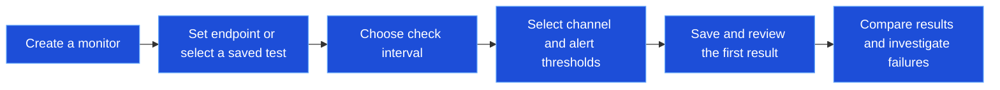

Monitors check your services on a schedule and alert you when they fail. Track availability and response time, then investigate failed checks.

## Setup Workflow

Scroll horizontally on smaller screens to view all steps.

## Monitor Types

Choose a type from **Monitor → Create** in the sidebar:

<Cards>
<Card icon={<ArrowLeftRight className="text-teal-600" />} title="HTTP Monitor">
Full-featured API and endpoint monitoring with custom headers, authentication, and response validation
</Card>

<Card icon={<LaptopMinimal className="text-sky-600" />} title="Website Monitor">
Simple website availability checks with SSL certificate expiration tracking
</Card>

<Card icon={<ChevronsLeftRightEllipsis className="text-cyan-600" />} title="Ping Monitor">
TCP reachability checks on ports 443/80 for server availability
</Card>

<Card icon={<EthernetPort className="text-blue-600" />} title="Port Monitor">
TCP/UDP port checks to verify that specific services are accepting connections
</Card>

<Card icon={<Laptop className="text-purple-600" />} title="Synthetic Monitor">
Run full Playwright browser tests on a schedule to validate complete user journeys
</Card>
</Cards>

## HTTP Monitor

The most versatile monitor type for APIs and web services.

**What it checks:**
- HTTP/HTTPS endpoint availability
- Response status codes (2xx, 3xx, 4xx, 5xx)
- Response time and latency
- Response body content (keyword validation)
- HTTPS connectivity

**Configuration options:**
- **HTTP Method** — GET, POST, PUT, DELETE, PATCH, HEAD, OPTIONS
- **Custom Headers** — Add authentication tokens, API keys, or custom headers
- **Request Body** — Send JSON or form data for POST/PUT requests
- **Authentication** — Basic Auth or Bearer Token support
- **Expected Status** — Validate specific status codes or ranges
- **Keyword Validation** — Check for presence or absence of text in response

<Callout type="info">
Use HTTP monitors for APIs, health check endpoints, and any service that responds to HTTP requests.
</Callout>

## Website Monitor

Simplified monitoring for web pages with built-in SSL tracking.

**What it checks:**
- Page returns an expected status code (2xx by default)
- SSL certificate is valid
- SSL certificate expiration date
- Optional keyword presence on page

**Best for:**
- Marketing websites
- Landing pages
- Public-facing web applications
- SSL certificate expiration alerts

Website monitors accept custom headers and Basic or Bearer authentication. They always send `GET` with no request body; use an HTTP monitor to send one.

## Ping Monitor

TCP reachability monitoring for hosts that do not expose an HTTP endpoint.

**What it checks:**
- Host is reachable over TCP on port 443 or 80
- Connection latency (response time)

**Best for:**
- Server availability
- Network infrastructure
- VPN endpoints
- Internal services

<Callout type="warn">
Ping monitors use TCP connectivity on ports 443 and 80 rather than ICMP. If the target host does not accept TCP connections on either port, the check fails.
</Callout>

## Port Monitor

Verify that specific services are listening on expected ports.

**What it checks:**
- TCP or UDP port is open and accepting connections
- Connection can be established within timeout
- Service is responding on the specified port

**Best for:**
- Database servers (PostgreSQL 5432, MySQL 3306)
- Cache servers (Redis 6379, Memcached 11211)
- Mail servers (SMTP 25/587, IMAP 993)
- Custom services on non-standard ports

UDP checks send a packet; a passing result does not confirm that the application replied. Use TCP or an application-level check when you need response verification.

## Synthetic Monitor

Run full Playwright browser tests on a schedule to validate complete user flows.

**What it checks:**
- Complete user journeys (login, checkout, form submission)
- JavaScript-rendered content
- Multi-step workflows
- Visual elements and interactions

**Best for:**
- Critical user flows (login, signup, checkout)
- Single-page applications (SPAs)
- Complex workflows requiring browser interaction
- End-to-end validation of user experience

**Set up a synthetic monitor:**
1. Create a Playwright test in the [Playground](/docs/app/automate/playground)
2. Save the test to your project
3. Create a Synthetic Monitor and select your test
4. Set the check interval (minimum 5 minutes)
5. Supercheck runs your test and reports pass/fail status

<Accordions>
<Accordion title="Multi-location synthetic checks" id="multi-location-synthetic">

When a legacy single queue job runs a synthetic monitor from several locations, it checks those locations one at a time. This lets each browser execution use an organization's single available execution slot. Lightweight HTTP, website, ping, and port checks can still run in parallel; distributed per-location jobs keep their existing behavior.

</Accordion>
</Accordions>

📚 [Playwright Documentation](https://playwright.dev/docs/intro) — Learn more about writing browser tests

## Locations

Turn on **Multi-Location Monitoring** in the monitor form, then pick two or more **Locations**. With several locations, the **Aggregation Strategy** decides the monitor's overall status.

| Strategy | Monitor is Up when |
|---|---|
| **All Locations Up** | Every location is up |
| **Majority Up** (default) | More than 50% of locations are up |
| **Any Location Up** | At least one location is up |

Synthetic monitors can only use locations that allow browser execution; others are shown but disabled. See [Super Admin](/docs/app/admin/super-admin) for location settings.

## Alert Configuration

Configure when and how you receive notifications about monitor status changes.

| Setting | What it does | Recommended |
|---------|-------------|-------------|
| **Enable Alerts** | Turns notifications on or off for this monitor | On for production |
| **Alert on Failure** | Alerts once the failure threshold is reached, then up to 3 times per outage at the reminder interval | On |
| **Alert on Recovery** | One alert per outage once the recovery threshold is reached | On for critical services |
| **Failure Threshold** | Consecutive failures before the first alert (1–5) | 2–3 |
| **Recovery Threshold** | Consecutive healthy checks before the recovery alert (1–5) | 2 |
| **SSL Expiration Alerts** | Website monitors only. Warns when a certificate is within **SSL Expiration Warning Days**, at most once per 24 hours | On |
| **Notification Channels** | Where alerts are sent | More than one for critical services |

**Incidents** (in the same Alert Settings):

| Setting | What it does | Default |
|---------|-------------|---------|
| **Open an incident when this alerts** | Opens an incident, or joins the open one for this monitor | On |
| **Severity** | *Auto* derives SEV1 to SEV4 from the alert, or pick a fixed level | Auto |
| **Resolve automatically on recovery if nobody acknowledged it** | Resolves the incident when the monitor recovers, even if recovery alerts are off | On |

See [How alerts become incidents](/docs/app/investigate/incidents#how-alerts-become-incidents).

<Accordions>
<Accordion title="Example: failure threshold 3, recovery threshold 2" id="threshold-example">

| Check | Result | Alert |
|-------|--------|-------|
| 1–2 | ❌ Fail | — |
| 3 | ❌ Fail | **Failure alert** |
| 4 | ❌ Fail | — |
| 5 | ✅ Pass | — |
| 6 | ✅ Pass | **Recovery alert** |

</Accordion>
</Accordions>

## Monitor Details Page

The monitor details page provides comprehensive visibility into your monitor's health, performance, and history.

### Header Section

| Element | Details |
|---------|---------|
| **Monitor Name** | The name you assigned to the monitor |
| **Test ID** | For synthetic monitors, the linked Playwright test ID (click to copy) |
| **Action Buttons** | Quick access to Pause, Edit, Delete, and **AI Analyze** |

### AI Analyze

Click **AI Analyze** in the header to generate an AI-powered analysis report for your monitor.

**What AI Analyze Provides:**
- **Health Assessment** — Clear status summary based on actual metrics
- **Performance Analysis** — Response time trends using your monitor's exact data
- **Issue Diagnosis** — Suggested causes with available error messages and timestamps
- **Recommendations** — Actionable next steps based on observed issues (only when problems exist)

Self-hosted: an administrator must [configure an AI provider](/docs/app/deployment/self-hosted#optional-configuration) first.

<Accordions>
<Accordion title="Key metrics" id="key-metrics">

Nine key metrics are displayed prominently below the header:

| Metric | Description |
|--------|-------------|
| **Status** | Current monitor status (Up, Down, Paused, Pending, Maintenance, Error) |
| **Interval** | How frequently checks run (e.g., 5m, 15m) |
| **Resp Time** | Latest response time from the most recent check |
| **Uptime (24h)** | Percentage of successful checks in the last 24 hours |
| **Avg Resp (24h)** | Average response time over the last 24 hours |
| **P95 Resp (24h)** | 95th percentile response time over the last 24 hours |
| **Uptime (30d)** | Percentage of successful checks in the last 30 days |
| **Avg Resp (30d)** | Average response time over the last 30 days |
| **P95 Resp (30d)** | 95th percentile response time (30d) — long-term performance indicator |

<Callout type="info">
**P95 Response Time** represents the response time that 95% of your checks complete within. This metric helps identify tail latency issues that averages might hide.
</Callout>

<Accordions>
<Accordion title="How statistics are computed" id="statistics-rollups">

All-locations history uses one combined rollup for each hour or day. For older periods that only have per-location rollups, those location rows are summed instead. Combined and location rows for the same period are never counted together. Each statistics window falls back to retained raw checks only when that window has no rollups; deleted raw history cannot be reconstructed.

</Accordion>
</Accordions>

</Accordion>
</Accordions>

<Accordions>
<Accordion title="Availability and response time charts" id="charts">

| Chart | What it shows |
|-------|---------------|
| **Availability Overview** | Bar chart of the last 100 individual checks: green bars are successful checks (monitor was up), red bars are failed checks (monitor was down). Helps you spot intermittent failures or sustained outages |
| **Response Time Chart** | Interactive line chart of the most recent 100 check results. Hover for the exact response time and timestamp; use it to identify latency spikes, trends, and anomalies, and to spot performance degradation before it impacts users |

</Accordion>
</Accordions>

<Accordions>
<Accordion title="Recent check results table" id="check-results">

A paginated table showing detailed results for each check:

| Column | Description |
|--------|-------------|
| **Result** | Pass (✓) or Fail (✗) indicator |
| **Checked At** | When the check was performed (relative time) |
| **Response Time** | How long the check took |
| **Error** | For failed checks, shows the error message or links to report |

**Features:**
- **Pagination** — Navigate through historical results (10 per page)
- **Date Filter** — Filter results by specific date
- **Location Filter** — Show results, uptime and response times for one location

</Accordion>
</Accordions>

## Monitor Reports

For **Synthetic Monitors**, detailed reports are generated when checks fail. Access reports by clicking the report icon in the **Error** column of the Recent Check Results table.

### Report Contents

| Section | Description |
|---------|-------------|
| **Test Summary** | Test name, file path, browser used, and execution duration |
| **Error Details** | Assertion failures with expected vs received values and stack trace |
| **Test Steps** | Timeline of all actions with pass/fail status and timing |
| **View Trace** | Opens trace viewer with video recording, screenshots, and network logs |

<Callout type="info">
Use **Copy Prompt** to copy error details for AI-assisted debugging.
</Callout>

## Monitor Status

| Status | Meaning | Action |
|--------|---------|--------|
| **Up** | All checks passing | No action needed |
| **Down** | Latest aggregated check failed | Review results; notifications follow your alert thresholds |
| **Paused** | Monitoring disabled | Re-enable when ready |
| **Pending** | Initial check in progress | Wait for first result |
| **Maintenance** | Under maintenance | Monitor temporarily disabled |
| **Error** | Configuration or system error | Fix monitor configuration |

A check cycle is skipped, not recorded as Down, when none of the monitor's locations has a live worker (for example during a deployment rollout that restarts workers). No result is stored and the failure count is unchanged. Because a location that permanently has no workers never turns Down this way, alert on worker health in your infrastructure monitoring to catch sustained worker absence.

## Check Intervals

Available intervals: 1 minute, 5 minutes, 10 minutes, 15 minutes, 30 minutes, 1 hour, 3 hours, 12 hours, and 24 hours. Shorter intervals detect failures sooner and use more resources. A monitor created with another interval through the CLI or API keeps it when edited; the form shows it as **(current)**.

<Callout type="info">
Synthetic monitors start at 5 minutes. Set the interval longer than your test's run time so executions do not overlap: for a 2-minute test, use 5 minutes or more.
</Callout>

## Configuration and cleanup

<Accordions>
<Accordion title="Configuration access" id="configuration-access">

Monitor viewers can read check settings and results, but request credentials, request headers, and request bodies are omitted from the configuration returned to them. Users with monitor update permission retain the full configuration needed to edit a monitor. Notification detail links check access to the monitor's own organization and project.

</Accordion>
<Accordion title="Editing a monitor and the legacy retryStrategy field" id="legacy-retry-strategy">

Updating a monitor's target, type, or configuration refreshes its scheduled checks. Paused monitors remain paused when their configuration changes.

The legacy `config.retryStrategy` field is unsupported for monitors. It is accepted for compatibility but ignored; omit it from new configurations. It does not control execution retries. This deprecation does not change monitor execution or job retry behavior, and existing saved configurations require no migration.

</Accordion>
<Accordion title="Deleting stored artifacts" id="deleting-stored-artifacts">

Deleting a resource with stored artifacts waits for storage cleanup to finish. If cleanup fails, Supercheck keeps the resource available for another deletion attempt. Restore storage access and retry; a partial cleanup may already have removed some artifacts.

</Accordion>
</Accordions>

## Next steps

<Cards>
<Card title="Notifications" href="/docs/app/communicate/alerts" description="Set up the channels that receive monitor alerts" />
<Card title="Status Pages" href="/docs/app/communicate/status-pages" description="Show monitor health to your users" />
<Card title="Incident Investigation" href="/docs/app/investigate/incidents" description="Investigate failed checks" />
</Cards>
