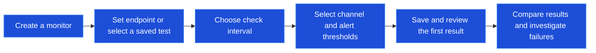

Monitors check your services on a schedule and alert you when they fail. Track availability and response time, then investigate failed checks.

## Setup Workflow

Scroll horizontally on smaller screens to view all steps.

## Monitor Types

Choose a type from **Monitor → Create** in the sidebar:

<Cards>
<Card icon={<ArrowLeftRight className="text-teal-600" />} title="HTTP Monitor">
Full-featured API and endpoint monitoring with custom headers, authentication, and response validation
</Card>

<Card icon={<LaptopMinimal className="text-sky-600" />} title="Website Monitor">
Simple website availability checks with SSL certificate expiration tracking
</Card>

<Card icon={<ChevronsLeftRightEllipsis className="text-cyan-600" />} title="Ping Monitor">
TCP reachability checks on ports 443/80 for server availability
</Card>

<Card icon={<EthernetPort className="text-blue-600" />} title="Port Monitor">
TCP/UDP port checks to verify that specific services are accepting connections
</Card>

<Card icon={<Laptop className="text-purple-600" />} title="Synthetic Monitor">
Run full Playwright browser tests on a schedule to validate complete user journeys
</Card>
</Cards>

<Callout type="warn">
Creating an HTTP, website, ping or port monitor returns `400` when the target is a private, loopback or reserved address, including a hostname that resolves to one. Changing the type or target of an existing monitor is checked the same way; updates that leave both unchanged are not. Instances can allow these with `ALLOW_INTERNAL_TARGETS=true` (see [Optional configuration](/docs/app/deployment/self-hosted#optional-configuration)); unlike webhook channels, monitors do not also need `SELF_HOSTED=true`. Cloud metadata and link-local addresses such as `169.254.169.254` stay blocked even then.
</Callout>

## HTTP Monitor

Checks availability, status code, response time and body content of APIs and web services.

| Option | Details |
|---|---|
| **HTTP Method** | GET, POST, PUT, DELETE, PATCH, HEAD, OPTIONS |
| **Custom Headers** | Tokens, API keys, any header |
| **Request Body** | JSON or form data for POST/PUT |
| **Authentication** | Basic Auth or Bearer Token |
| **Expected Status** | Specific codes or ranges |
| **Keyword Validation** | Text must be present or absent in the response |

## Website Monitor

Web page availability with built-in SSL tracking, for marketing sites, landing pages and public apps.

| Checks | Details |
|---|---|
| **Status** | Expected status code (2xx by default) |
| **SSL** | Certificate is valid; expiration date |
| **Keyword** | Optional text on the page |

The **SSL Check** toggle appears only when the target starts with `https://` (an `http://` target has no certificate). A monitor that already has it on keeps showing it, so you can turn it off.

Website monitors accept custom headers and Basic or Bearer authentication. The form always sends `GET` with no request body; use an HTTP monitor to send another method or a body.

## Ping Monitor

TCP reachability and connection latency for hosts without an HTTP endpoint, on port 443 or 80. Suited to servers, network infrastructure and VPN endpoints; the host must be reachable from the worker.

<Callout type="warn">
Ping monitors use TCP connectivity on ports 443 and 80 rather than ICMP. If the target host does not accept TCP connections on either port, the check fails.
</Callout>

## Port Monitor

Verifies that a TCP or UDP port accepts connections within the timeout, for example databases (5432, 3306), caches (6379, 11211), mail (25, 587, 993) or custom services.

UDP checks send a packet; a passing result does not confirm that the application replied. Use TCP or an application-level check when you need response verification.

## Synthetic Monitor

Runs a Playwright browser test on a schedule to validate full user journeys such as login, signup and checkout, including JavaScript-rendered pages and multi-step flows.

<Steps>
<Step>

Create a Playwright test in the [Playground](/docs/app/automate/playground) and save it to your project.

</Step>
<Step>

Create a **Synthetic Monitor** and select the test.

</Step>
<Step>

Set the check interval (minimum 5 minutes). Supercheck runs the test and reports pass or fail.

</Step>
</Steps>

## Locations

Turn on **Multi-Location Monitoring** in the monitor form, then pick two or more **Locations**. With several locations, the **Aggregation Strategy** decides the monitor's overall status.

| Strategy | Monitor is Up when |
|---|---|
| **All Locations Up** | Every location is up |
| **Majority Up** (default) | More than 50% of locations are up |
| **Any Location Up** | At least one location is up |

Synthetic monitors can only use locations that allow browser execution; others are shown but disabled. See [Super Admin](/docs/app/admin/super-admin) for location settings.

## Alert Configuration

Configure when and how you receive notifications about monitor status changes.

| Setting | What it does | Recommended |
|---------|-------------|-------------|
| **Enable Alerts** | Turns notifications on or off for this monitor | On for production |
| **Alert on Failure** | At most 3 failure alerts per failure streak: the first when the failure threshold is reached, then reminders | On |
| **Alert on Recovery** | One alert per outage once the recovery threshold is reached | On for critical services |
| **Failure Threshold** | Consecutive failures before the first alert (1–5) | 2–3 |
| **Recovery Threshold** | Consecutive healthy checks before the recovery alert (1–5) | 2 |
| **Alert on SSL certificate expiration** | Shown only for website monitors with **SSL Check** on. Warns when a certificate is within the days set in the monitor's **Alert in _N_ days** field (1–365, default 30), at most once per 24 hours | On |
| **Notification Channels** | Where alerts are sent. Channels linked through the notifications API appear here too, and linking or unlinking one through the API updates this list | More than one for critical services |

**Incidents** (in the same Alert Settings):

| Setting | What it does | Default |
|---------|-------------|---------|
| **Open an incident when this alerts** | Opens an incident, or joins the open one for this monitor | On |
| **Severity** | *Auto* derives SEV1 to SEV4 from the alert, or pick a fixed level | Auto |
| **Resolve automatically on recovery if nobody acknowledged it** | Resolves the incident when the monitor recovers, even if recovery alerts are off | On |

See [How alerts become incidents](/docs/app/investigate/incidents#how-alerts-become-incidents).

<Accordions>
<Accordion title="Example: failure threshold 3, recovery threshold 2" id="threshold-example">

| Check | Result | Alert |
|-------|--------|-------|
| 1–2 | ❌ Fail | — |
| 3 | ❌ Fail | **Failure alert** |
| 4 | ❌ Fail | — |
| 5 | ✅ Pass | — |
| 6 | ✅ Pass | **Recovery alert** |

</Accordion>
</Accordions>

## Monitor Details Page

Health, performance and history for one monitor.

### Header Section

| Element | Details |
|---------|---------|
| **Monitor Name** | The name you assigned to the monitor |
| **Test ID** | For synthetic monitors, the linked Playwright test ID (click to copy) |
| **Action Buttons** | Quick access to Pause, Edit, Delete, and **AI Analyze** |

### AI Analyze

**AI Analyze** in the header generates a report from your monitor's own data.

You need permission to edit the monitor; viewers cannot run it, because it spends AI credits.

| Section | Content |
|---|---|
| **Report Details** | Monitor name, type, target, current status and analysis time |
| **Executive Summary** | Short overview of monitor health |
| **Performance Analysis** | Response time trends |
| **Availability Analysis** | Uptime and check results |
| **Anomaly Detection** | Unusual patterns in the data |
| **Recent Issues** | Errors with timestamps |
| **Recommendations** | Next steps, only when problems exist |

Self-hosted: an administrator must [configure an AI provider](/docs/app/deployment/self-hosted#optional-configuration) first.

<Accordions>
<Accordion title="Key metrics" id="key-metrics">

Nine key metrics are displayed prominently below the header:

| Metric | Description |
|--------|-------------|
| **Status** | Current monitor status (Up, Down, Paused, Pending, Maintenance, Error) |
| **Interval** | How frequently checks run (e.g., 5m, 15m) |
| **Resp Time** | Latest response time from the most recent check. Shown in ms below 1 s (for example `360 ms`) and in seconds above (`1.25 s`) |
| **Uptime** (Last 24 hours) | Percentage of successful checks in the last 24 hours |
| **Avg Resp** (Last 24 hours) | Average response time over the last 24 hours |
| **P95 Resp** (Last 24 hours) | 95th percentile response time over the last 24 hours |
| **Uptime** (Last 30 days) | Percentage of successful checks in the last 30 days |
| **Avg Resp** (Last 30 days) | Average response time over the last 30 days |
| **P95 Resp** (Last 30 days) | 95th percentile response time (30d) — long-term performance indicator |

**P95** is the response time that 95% of checks complete within, which exposes tail latency that averages hide.

</Accordion>
<Accordion title="Availability and response time charts" id="charts">

| Chart | What it shows |
|-------|---------------|
| **Availability Overview** | Bar chart of the last 100 individual checks: green bars are successful checks (monitor was up), red bars are failed checks (monitor was down). Helps you spot intermittent failures or sustained outages |
| **Response Time Chart** | Interactive line chart of the most recent 100 check results. Hover for the exact response time and timestamp; use it to identify latency spikes, trends, and anomalies, and to spot performance degradation before it impacts users |

</Accordion>
<Accordion title="Recent check results table" id="check-results">

A paginated table showing detailed results for each check:

| Column | Description |
|--------|-------------|
| **Result** | Pass (✓) or Fail (✗) indicator |
| **Checked At** | When the check was performed (relative time) |
| **Response Time** | How long the check took |
| **Error** | For failed checks, shows the error message or links to report |

**Features:**
- **Pagination** — Navigate through historical results (10 per page)
- **Date Filter** — Filter results by specific date
- **Location** — Use the location menu on the availability chart to show one location

</Accordion>
</Accordions>

## Monitor Reports

For **Synthetic Monitors**, detailed reports are generated when checks fail. Access reports by clicking the report icon in the **Error** column of the Recent Check Results table.

### Report Contents

| Section | Description |
|---------|-------------|
| **Test Summary** | Test name, file path, browser used, and execution duration |
| **Error Details** | Assertion failures with expected vs received values and stack trace |
| **Test Steps** | Timeline of all actions with pass/fail status and timing |
| **View Trace** | Opens trace viewer with video recording, screenshots, and network logs |

<Callout type="info">
Use **Copy Prompt** to copy error details for AI-assisted debugging.
</Callout>

## Monitor Status

| Status | Meaning | Action |
|--------|---------|--------|
| **Up** | All checks passing | No action needed |
| **Down** | Latest aggregated check failed | Review results; notifications follow your alert thresholds |
| **Paused** | Monitoring disabled | Re-enable when ready |
| **Pending** | Initial check in progress | Wait for first result |
| **Maintenance** | Under maintenance | Monitor temporarily disabled |
| **Error** | Configuration or system error | Fix monitor configuration |

A check cycle is skipped, not recorded as Down, when none of the monitor's locations has a live worker (for example during a deployment rollout that restarts workers). No result is stored and the failure count is unchanged. Because a location that permanently has no workers never turns Down this way, alert on worker health in your infrastructure monitoring to catch sustained worker absence.

When some, but not all, of a multi-location monitor's locations have a live worker, the check runs in the locations that do. Status and thresholds are judged over those locations only; locations that were not run never count as down. A location that was started but returned no result still counts as down.

A scheduled check that waits in a busy or returning worker's queue longer than the larger of three times the monitor's scheduling interval (at least five minutes for synthetic monitors) and three minutes is skipped if a newer real check from the same location has already recorded a result, or if that run of the monitor has already been closed. Otherwise, including when that lookup fails, it runs late, so a queue backlog does not by itself freeze a monitor's status. A check whose run was already closed is also skipped quietly before this limit. Skipping never changes that run's verdict: if the run closed with this location counted as down, that result and any alert stand. A skipped check records no result, downtime or alert. Like a location with no live worker, the skipped location is left out of that check, and the other locations are judged without it. Manual runs and retries are never skipped this way. A burst of these skips (the worker logs an aggregated warning at most once a minute) means worker clock skew or queue saturation.

## Check Intervals

Available intervals: 1 minute, 5 minutes, 10 minutes, 15 minutes, 30 minutes, 1 hour, 3 hours, 12 hours, and 24 hours. Shorter intervals detect failures sooner and use more resources.

A check's timeout must not exceed its interval, for example 60 seconds at a 1-minute interval. A save that raises the timeout above the interval, or shortens the interval below the timeout, is rejected; a monitor already in that state still saves other changes.

<Callout type="info">
Synthetic monitors start at 5 minutes. Set the interval longer than your test's run time so executions do not overlap: for a 2-minute test, use 5 minutes or more.
</Callout>

## Next steps

<Cards>
<Card title="Notifications" href="/docs/app/communicate/alerts" description="Set up the channels that receive monitor alerts" />
<Card title="Status Pages" href="/docs/app/communicate/status-pages" description="Show monitor health to your users" />
<Card title="Incident Investigation" href="/docs/app/investigate/incidents" description="Investigate failed checks" />
</Cards>
