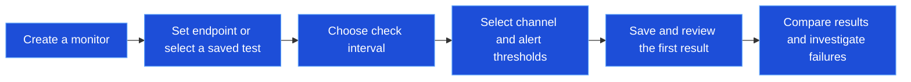

Monitors check your services on a schedule and alert you when they fail. Track availability and response time, then investigate failed checks.

## Setup workflow

Scroll horizontally on smaller screens to view all steps.

## Monitor types

Choose a type from **Monitor → Create**:

<Cards>
<Card icon={<ArrowLeftRight className="text-[oklch(0.6_0.11_205)] dark:text-[oklch(0.79_0.13_205)]" />} title="HTTP monitor">
API and endpoint checks with custom headers, authentication and response validation
</Card>

<Card icon={<LaptopMinimal className="text-[oklch(0.609_0.126_221.723)] dark:text-[oklch(0.789_0.154_211.53)]" />} title="Website monitor">
Website availability with SSL certificate expiration tracking
</Card>

<Card icon={<ChevronsLeftRightEllipsis className="text-[oklch(0.588_0.158_241.966)] dark:text-[oklch(0.746_0.16_232.661)]" />} title="Ping monitor">
TCP reachability on ports 443 and 80
</Card>

<Card icon={<EthernetPort className="text-[oklch(0.6_0.118_184.704)] dark:text-[oklch(0.777_0.152_181.912)]" />} title="Port monitor">
TCP or UDP port checks that a service accepts connections
</Card>

<Card icon={<Plug className="text-[oklch(0.57_0.25_320)] dark:text-[oklch(0.73_0.2_320)]" />} title="MCP monitor">
Remote MCP server login, required tools, an optional tool call and tool list changes
</Card>

<Card icon={<BrainCircuit className="text-[oklch(0.59_0.24_338)] dark:text-[oklch(0.74_0.18_340)]" />} title="AI endpoint monitor">
OpenAI-compatible chat API answers correctly and fast, using a streamed request
</Card>

<Card icon={<Laptop className="text-purple-600" />} title="Synthetic monitor">
Playwright browser tests on a schedule for full user journeys
</Card>

<Card icon={<HeartPulse className="text-[oklch(0.6_0.21_357)] dark:text-[oklch(0.74_0.16_358)]" />} title="Heartbeat monitor" href="/docs/app/heartbeat">
Alert when a cron job or scheduled agent misses a ping or reports a failure
</Card>
</Cards>

<Callout type="warn">
Creating an HTTP, website, ping, port or MCP monitor returns `400` when the target is a private, loopback or reserved address, including a hostname that resolves to one. Changing the type or target of an existing monitor is checked the same way; updates that leave both unchanged are not. Instances can allow these with `ALLOW_INTERNAL_TARGETS=true` (see [Optional configuration](/docs/app/deployment/self-hosted#optional-configuration)); unlike webhook channels, monitors do not also need `SELF_HOSTED=true`. Cloud metadata and link-local addresses such as `169.254.169.254` stay blocked even then.
</Callout>

## HTTP monitor

Checks availability, status code, response time and body content of APIs and web services.

| Option | Details |
|---|---|
| **HTTP Method** | GET, POST, PUT, DELETE, PATCH, HEAD, OPTIONS |
| **Custom Headers** | Tokens, API keys, any header |
| **Request Body** | JSON or form data for POST/PUT |
| **Authentication** | Basic Auth or Bearer Token. Pick the token or password from a project secret (recommended), or type it inline |
| **Expected Status** | Codes (`200`), ranges (`200-299`) or classes (`2xx`), comma-separated. Malformed entries are rejected when you save; a stored malformed entry never matches |
| **Keyword Validation** | Text must be present or absent in the response |

### AI endpoint monitor

Checks a chat-completions API the way your app calls it. Each check sends one short streamed request and reads the reply to the end, so it catches failures a status check misses. The CLI, API and MCP server model it as an HTTP monitor: use `--preset ai-endpoint` in the CLI or `config.aiEndpoint` in the API.

| Field | Default | Notes |
|---|---|---|
| Endpoint URL | `https://api.openai.com/v1/chat/completions` | Any OpenAI-compatible chat-completions URL |
| API key secret | — | Name of a project secret (**Variables**). The key is never stored on the monitor. Tick **No key (endpoint needs none)** for an open endpoint |
| Key header | `Authorization` | Sends `Bearer <key>`. Any other header name (for example Azure `api-key`) sends the raw key |
| Model | — | Required |
| Prompt | `Reply with the single word OK.` | Up to 2,000 characters |
| Max tokens | `16` | 1-512. Reasoning models (gpt-5, o-series) spend tokens on thinking, so they need more, for example 256 |
| Reply must contain | — | Optional, case-insensitive |
| First token limit (seconds) | 15 s | 0.5-60 s, and no more than the total time limit. Slower is a failed check |
| Total time limit (seconds) | 60 s | 5-120 s |

| What happened | Result |
|---|---|
| Stream completes with a non-empty reply (and the expected text) | Up |
| 401 or 403 | Down: key rejected |
| 429 for quota, credit or spend limit | Down: out of credit or over the spend limit |
| Any other 429 | Down: rate limited |
| An error inside a 200 reply, or `finish_reason: "error"` | Down |
| Stream ends early, or the reply is empty | Down |
| No first token within the limit | Timeout |

Two optional limits raise warnings without failing the check or opening an incident. **Warn when first token is slower than (ms)** warns after 3 slow checks in a row. **Warn when a call uses more tokens than** warns once per stretch above the limit. The monitor also warns when the served model differs from the last check, for example when a provider swaps `gpt-4o-mini` snapshots. See [Alerts](/docs/app/communicate/alerts#alert-types).

Each result records first-token time, total time, the served model and token counts (plus cost when the provider reports it). The reply text is not stored. On the monitor page, **AI details** beside the availability chart shows the latest check's first token, tokens per call, prompt and completion tokens, and the requested and served model. A served model from a different model than the one requested is marked **(differs)**; a dated version of it (`gpt-4o-2024-08-06` for `gpt-4o`) is not. The results table and response-time chart also show first-token time.

A secret in use by a monitor cannot be deleted, renamed or made non-secret. The error names up to five monitors. Point them at another secret first. Rotating the secret's value is always allowed.

Each check is a paid call on your key. The form shows about how many calls a month your interval and locations make. The default interval is 5 minutes and the failure threshold is 2, so one short rate limit does not alert.

<Callout type="warn">
Anyone who can edit a monitor can send a referenced secret to a URL they choose, the same trust level as writing a test that reads a secret. Viewers can do neither. Redirects are not followed and private addresses are refused, so the key only goes to the host you entered. Self-hosted: set `ALLOW_INTERNAL_TARGETS=true` to check an internal model server such as Ollama or vLLM.
</Callout>

## Website monitor

Web page availability with built-in SSL tracking.

| Checks | Details |
|---|---|
| **Status** | Expected status code (2xx by default) |
| **SSL** | Certificate is valid; expiration date |
| **Keyword** | Optional text on the page |

The **SSL Check** toggle appears only for `https://` targets. A monitor that already has it on keeps showing it, so you can turn it off. With it on:

| Situation | What happens |
|---|---|
| Certificate is valid | Read every 24 hours by default; every 6 hours near the warning window; hourly inside it |
| Expired, not yet valid, untrusted or wrong hostname | Check is **down**; re-read on every check until fixed |
| Certificate can't be read (timeout, reset) | Check stays up and retries next check; if the site stays up, an SSL alert is sent after 24 hours |
| Certificate renewed after an SSL warning | One **SSL certificate renewed** notice is sent on the next successful read |
| SSL Check just turned on, or target changed | Monitor page shows **No certificate data yet** until the next check |

Website monitors accept custom headers and Basic or Bearer authentication. The form always sends `GET` with no request body; use an HTTP monitor to send another method or a body.

## Ping monitor

TCP reachability and connection latency for hosts without an HTTP endpoint, such as servers, network infrastructure and VPN endpoints. The host must be reachable from the worker.

Ping monitors use TCP on ports 443 and 80, not ICMP. The check is up when either port accepts or refuses the connection (a refusal means the host answered) and down only when neither answers. The response time is that of the attempt that answered.

## Port monitor

Verifies that a TCP or UDP port accepts connections within the timeout, for example databases (5432, 3306), caches (6379, 11211) or mail (25, 587, 993).

**TCP:** with **Expected Status** set to **Port is Closed**, a refused connection passes. A timeout also passes, because a firewalled port drops packets, but only if the host still answers on port 443 or 80; an unreachable host fails. A DNS failure is always down.

**UDP:** UDP has no handshake. The worker sends one packet and waits up to two seconds. A reply proves the port open and a refusal proves it closed; only silence is ambiguous:

| Outcome | Result |
|---|---|
| Service replies | Up (open) |
| ICMP port-unreachable (connection refused) | Down, closed (passes with **Port is Closed**) |
| Silence | Up, reported as open or filtered; fails **Port is Closed** |

Many UDP services never reply, and a firewall that drops packets looks the same as an open port, so silence does not prove the service works. Use TCP or an application-level check when you need verification.

## Synthetic monitor

Runs a Playwright browser test on a schedule to validate user journeys such as login, signup and checkout.

<Steps>
<Step>
Save a Playwright test from the [Playground](/docs/app/automate/playground).
</Step>
<Step>

Create a **Synthetic Monitor** and select the test.

</Step>
<Step>

Set the check interval (minimum 5 minutes). Set it longer than the test's run time so executions do not overlap. A 2-minute test needs 5 minutes or more.

</Step>
</Steps>

## MCP monitor

Checks a remote MCP server the way an AI client would: connect, log in, list the tools and optionally call one. It catches a rejected token, a missing or failing tool and a silently edited tool list.

| Field | Notes |
|---|---|
| Server URL | The Streamable HTTP endpoint. `https` only, with no credentials or fragment in the URL |
| Login | **None**, **Bearer token** or **Custom header**. The token comes from a project secret (**Variables**) and is never stored on the monitor. A custom header also takes the header name |
| Protocol | **Auto** (default) probes `server/discover` (MCP 2026-07-28, stateless) and falls back to the 2025 `initialize` handshake for older servers. Pin `2025` or `2026` to skip the probe |
| Tools that must exist | Optional list of tool names. A missing one fails the check |
| Call a tool | Optional tool name, arguments (a JSON object, up to 8 KiB) and **Result must contain** text. Pick a read-only tool: it runs on every check, from every location |
| Slow after (ms) | Optional. Warns when a check is slower for 3 checks in a row |
| Timeout (seconds) | 5-60, default 30 |

**The tool call is real.** It runs on every check from every location, so a 1-minute monitor in three locations calls the tool about 130,000 times a month. Pick a tool with no side effects. Arguments are stored as plain settings, hidden only from viewers, so never put a token or personal data in them. Use the login field for credentials.

Changing the server URL or the login starts a fresh tool baseline and history. Only remote Streamable HTTP servers are supported: no local `npx` or `uvx` server, no OAuth and no legacy HTTP+SSE transport.

### Tool list changes

The first successful check stores the server's tools as a baseline. Later checks compare each tool's name, description and input schema with it. When any of them differ, Supercheck sends one **Tools changed** warning, lists what was added, removed or changed (and whether the description or the schema changed), and makes the new list the baseline. Tool descriptions are instructions to the calling model, so a silent edit is how a compromised server redirects agents. A change is a warning, not an incident, and a tool list that reverts warns again. With several locations, a change is recorded only after every location has reported and every location that is up sees the same new list. A server that lists more than 10 pages of tools fails the check. A down check never changes the baseline.

### Failure messages

| Message | Cause |
|---|---|
| `Secret X was not found` | The login secret does not exist in this project |
| `Login failed (401)` or `(403)` | The server rejected the token or header |
| Connection error (refused, DNS, TLS) or a reply that is not MCP | The server is unreachable, or the URL is not an MCP endpoint |
| Tool list error | The server returned an error for `tools/list` |
| `Tool search_docs missing` | A required tool is not in the list |
| Tool call failed | The tool returned an error, or a JSON-RPC error |
| Expected text not found | The tool result does not contain **Result must contain** |
| Timeout | The whole check took longer than the timeout (5-60 s, default 30) |

Each of these is a failed check and opens an incident after the failure threshold (default 2), at `sev2` by default. Checks record the protocol, server name and version, tool count, and connect, list and call times. Tool arguments and replies are not stored.

## Locations

Turn on **Multi-Location Monitoring** in the monitor form, then pick two or more **Locations**. With several locations, the **Aggregation Strategy** decides the monitor's overall status.

| Strategy | Monitor is Up when |
|---|---|
| **All Locations Up** | Every location is up |
| **Majority Up** (default) | More than 50% of locations are up |
| **Any Location Up** | At least one location is up |

Synthetic monitors can only use locations that allow browser execution; others are shown but disabled. See [Super Admin](/docs/app/admin/super-admin) for location settings.

## Alert configuration

| Setting | What it does |
|---------|-------------|
| **Enable Alerts** | Turns notifications on or off for this monitor |
| **Alert on failure** | At most 3 failure alerts per failure streak: the first when the failure threshold is reached, then reminders |
| **Alert on recovery** | One alert per outage once the recovery threshold is reached |
| **Failure Threshold** | Consecutive failures before the first alert (1–5 in the app; API: 1–100). 2–3 suits most monitors |
| **Recovery Threshold** | Consecutive healthy checks before the recovery alert (1–5 in the app; API: 1–100). 2 suits most monitors |
| **Alert on SSL certificate expiration** | Shown only for website monitors with **SSL Check** on. Warns when a certificate is within the days set in the monitor's **Alert in _N_ days** field (1–365, default 30), at most once per 24 hours |
| **Notification Channels** | Where alerts are sent. Channels linked through the notifications API appear here too, and linking or unlinking one through the API updates this list |

**Incidents** (in the same Alert Settings):

| Setting | What it does | Default |
|---------|-------------|---------|
| **Open an incident when this alerts** | Opens an incident, or joins the open one for this monitor | On |
| **Severity** | *Auto* derives SEV1 to SEV4 from the alert, or pick a fixed level | Auto |
| **Resolve automatically on recovery if nobody acknowledged it** | Resolves the incident when the monitor recovers, even if recovery alerts are off | On |

See [How alerts become incidents](/docs/app/investigate/incidents#how-alerts-become-incidents).

See [Threshold configuration](/docs/app/communicate/alerts#threshold-configuration) for a worked example and alert limiting.
## Monitor details page

Health, performance and history for one monitor.

The header shows the monitor name, the linked Playwright test ID for synthetic monitors (click to copy), and buttons for Pause, Edit, Delete and **AI Analyze**.

### Delete a monitor

Deleting a monitor takes effect at once: it disappears from lists, dashboards, status page pickers, plan counts and alerts, and no further checks run. Its results, reports and stored artifacts are then removed in the background, and a retry continues where it stopped. There is no undo. To stop checks temporarily, pause the monitor instead.

### AI Analyze

**AI Analyze** generates a report from the monitor's own data. You need permission to edit the monitor. Viewers cannot run it because it spends AI credits.

| Section | Content |
|---|---|
| **Report Details** | Monitor name, type, target, current status and analysis time |
| **Executive Summary** | Short overview of monitor health |
| **Performance Analysis** | Response time trends |
| **Availability Analysis** | Uptime and check results |
| **Anomaly Detection** | Unusual patterns in the data |
| **Recent Issues** | Errors with timestamps |
| **Recommendations** | Next steps, only when problems exist |

Self-hosted: an administrator must [configure an AI provider](/docs/app/deployment/self-hosted#optional-configuration) first.

<Accordions>
<Accordion title="Key metrics" id="key-metrics">

Nine key metrics sit below the header. Response times show in ms below 1 s (`360 ms`) and in seconds above (`1.25 s`). **P95 Resp** shows N/A until the window has at least 5 successful checks.

| Metric | Description |
|--------|-------------|
| **Status** | Current monitor status (Up, Down, Paused, Pending, Error). A **Maintenance** badge appears next to it while a maintenance window covers the monitor |
| **Interval** | How often checks run |
| **Resp Time** | Response time of the latest check |
| **Uptime** (Last 24 hours) | Percentage of successful checks in the last 24 hours. A multi-location check counts once, as up or down by the monitor's location rule, not once per region |
| **Avg Resp** and **P95 Resp** (Last 24 hours) | Average and 95th percentile response time |
| **Uptime** (Last 30 days) | Percentage of successful checks in the last 30 days, counted the same way. The per-location breakdown counts each region on its own |
| **Avg Resp** and **P95 Resp** (Last 30 days) | Average and 95th percentile response time |

**P95** is the response time that 95% of checks complete within, which exposes tail latency that averages hide.

</Accordion>
<Accordion title="Availability and response time charts" id="charts">

| Chart | What it shows |
|-------|---------------|
| **Availability Overview** | Bar chart of the last 100 checks: green for up, red for down |
| **Response Time** | Line chart of the most recent 100 check results. Hover for the exact response time and timestamp |

</Accordion>
<Accordion title="Recent check results table" id="check-results">

A paginated table of check results:

| Column | Description |
|--------|-------------|
| **Result** | Pass (✓) or Fail (✗) indicator |
| **Checked At** | When the check was performed (relative time) |
| **Location** | Where the check ran |
| **Response** | How long the check took |
| **First token**, **Tokens** | AI endpoint monitors only: time to the first streamed token and the token counts |
| **Tools** | MCP monitors only |
| **Pass rate** | Synthetic monitors that run an agent test |
| **Error** | A failed check's error message, truncated; hover the cell for the full text |

Synthetic monitors add a report icon in **Result**. The table pages through historical results (10 per page on small screens, as many rows as fit the panel on desktop). Turn on **Failures only** to list only checks that were not up (down, error or timeout, including failed checks during maintenance). **Filter by date** shows one day; you can pick today or any earlier day that is still kept, and the calendar says how many days check details are kept. Use the location menu on the availability chart to show one location. Changing a filter returns to the first page.

</Accordion>
</Accordions>

## Monitor reports

Synthetic monitors generate a detailed report when a check fails. Open it from the report icon in the **Result** column.

| Section | Description |
|---------|-------------|
| Header | Test title, file location, duration and Playwright project (browser). In the test list, **View Trace** opens the trace viewer with screenshots and network logs |
| **Errors** | Assertion failures with expected vs received values and a code frame. **Copy prompt** copies the error details for AI-assisted debugging |
| **Test Steps** | Timeline of all actions with pass/fail status and timing |
| **Screenshots**, **Videos**, **Traces**, **Attachments** | Files recorded during the check, when present |

## Maintenance windows

Schedule a maintenance window before planned work so nobody is paged for expected downtime. Open **Monitors → Maintenance**, or use **Schedule maintenance** on a monitor or service page, Quick Create or the command menu (Cmd+K).

| Setting | Detail |
|---|---|
| **Covers** | Chosen monitors, chosen services (every monitor mapped to them, including ones mapped later), or every monitor in the project |
| **When** | A local start date and time, a duration (5 minutes to 7 days) and an IANA time zone. A recurring window leaves at least 2 hours between one occurrence's end and the next start. Recurring windows repeat daily, weekly on chosen days, or monthly on a day from 1 to 28 or the last day, until an optional end date. Start times follow the wall clock across daylight-saving changes |
| **Status page** | A one-off window can also be shown as scheduled maintenance on status pages, with optional notices to subscribers at creation, start and end. Every monitor on the chosen components is muted too |

During a window:

- Checks keep running and results are stored, marked as maintenance. The monitors list shows a **Maintenance** badge next to the real status.
- No alerts are sent, no incidents open (a failure is judged by when it fired, so one from just before the window still opens its incident), and reminders for open incidents opened by alerts wait until the window ends. Incidents declared by a person still page, but a failure inside the window is not added to them as a related alert.
- Uptime on monitor pages, the dashboard and status pages leaves those checks out.
- Failures do not count toward the alert threshold. A monitor still down after the window alerts once it fails its threshold again. A monitor that recovers during the window recovers without a notification.

**End now** stops the active occurrence at once (a recurring window moves to its next one), **Extend** adds time, **Cancel** stops a scheduled window or the rest of a series, and **Delete** removes a window that is not active. A status-page maintenance follows: it ends, moves or is resolved as cancelled. Changing a window that is on a status page also needs status page update permission, and such a window must be cancelled before it can be deleted. Scheduling needs monitor update permission; deleting needs monitor delete permission. A project can have 100 upcoming or active windows. On Supercheck Cloud, scheduling, changing and extending a window need a paid plan or an active trial; an organization without one can still view, end and cancel windows (the API answers `402` with `subscription_required`).

If the app is down when an occurrence would start, it starts late. Alerting is never muted past a window's end.

Also available through `supercheck maintenance`, `/api/maintenance-windows` and the MCP tools `list_maintenance_windows`, `create_maintenance_window`, `end_maintenance_window`, `extend_maintenance_window` and `cancel_maintenance_window`.

## Monitor status

| Status | Meaning |
|--------|---------|
| **Up** | All checks passing |
| **Down** | The latest aggregated check failed. Notifications follow your alert thresholds |
| **Paused** | Monitoring disabled |
| **Pending** | Initial check in progress |
| **Maintenance** | Reserved status. Monitors keep checking during a maintenance window and only alerts are held back (see [Status pages](/docs/app/communicate/status-pages)) |
| **Error** | Configuration or system error. Fix the monitor configuration |

If a monitor's locations have no live worker, that check is skipped and not counted as down. With several locations, only the locations that ran are judged. A scheduled check that waited in a busy queue for more than three times the interval (at least 3 minutes) may be skipped when a newer result already exists; skipped checks record no result, downtime or alert.

## Check intervals

Available intervals: 1, 5, 10, 15 and 30 minutes, and 1, 3, 12 and 24 hours. Shorter intervals detect failures sooner and use more resources.

MCP and AI endpoint monitors have timeout fields in the form. For other types the timeout is set through the API or CLI (the form keeps the stored value). It must not exceed the interval, for example 60 s at 1 minute; the form rejects an interval shorter than the stored timeout.

## Related

<Cards>
<Card title="Notifications" href="/docs/app/communicate/alerts" description="Set up the channels that receive monitor alerts" />
<Card title="Status pages" href="/docs/app/communicate/status-pages" description="Show monitor health to your users" />
<Card title="Incident investigation" href="/docs/app/investigate/incidents" description="Investigate failed checks" />
</Cards>
