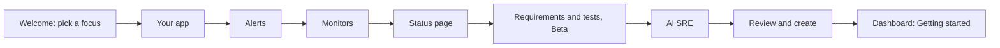

**Project setup** takes a new project from empty to watched, then creates everything in one step at the end. You can skip any step. It opens after sign-up and on **Create and set up** for a new project; reopen it from **Project setup** in the sidebar, <kbd>⌘</kbd> <kbd>K</kbd>, or **Organization → Projects**.

## Run the setup

<Steps>
<Step>
**Welcome.** Pick your focus; it reorders steps, never hides one.
</Step>
<Step>
**Your app.** Enter the URL and optionally choose **Scan**. It stores only codes, timings, paths and page titles. Private addresses are refused. A test account is saved at once as an encrypted [project secret](/docs/app/automate/variables).
</Step>
<Step>
**Alerts.** Add [notification channels](/docs/app/communicate/alerts) and send a test alert. Project admins can turn on **Repeat until acknowledged** (sets the reminder interval and, if the policy has no channels, adds yours) and **Also alert on warnings**.
</Step>
<Step>
**Monitors.** Pick pages for uptime and SSL; only the homepage starts ticked. Optionally add a [heartbeat](/docs/app/heartbeat).
</Step>
<Step>
**Status page.** Publish a [status page](/docs/app/communicate/status-pages), keep it as a draft, or choose **I don't need a status page**.
</Step>
<Step>
**Requirements and tests (Beta).** AI suggests [requirements](/docs/app/automate/requirements) from your scan; each then offers **Generate test**. **Suggest requirements** costs 1 AI credit, once per project per day, and the cost shows first. The step is locked on a trial and hidden when no AI provider is configured.
</Step>
<Step>
**AI SRE.** Connect GitHub, Sentry, Datadog, Grafana or Prometheus [connectors](/docs/app/investigate/connectors); each shows **Connected** or **Saved, but the token was rejected**. Private-network tools use a private agent from **Organization → Private Agents**. Needs a project admin; editors see **Ask a project admin**.
</Step>
<Step>
**Review and create.** A heartbeat's ping URL is shown once, here.
</Step>
</Steps>

## Focus and sidebar

**Review and create** is always last. Use **Change focus** in the user menu to switch.

| Focus | Steps start with | Sidebar order (first group open) |
|---|---|---|
| SRE and platform | App, Alerts, Monitors, AI SRE | Respond, Monitor, Communicate, Automate |
| QA engineers | App, Tests | Automate, Communicate, Respond, Monitor |
| Developers | Terminal commands and [coding-agent recipe](/docs/cli/after-ship-check) | Automate, Monitor, Respond, Communicate |
| Engineering leaders | Invite your team | Unchanged |
| Everything, or skipped | Default order | Unchanged |

## Getting started checklist

Until setup is finished or dismissed, the dashboard shows a **Getting started** card and the sidebar shows **Project setup** with a count such as `4/9`. **Dismiss** hides both for that project. Projects that already have monitors, tests, jobs or status pages see them only after you start setup.

Ticks come from what exists: a monitor, notification channel, heartbeat, status page (or "I don't need one"), requirement, test, job, connector or private agent, service, another member or invitation, and a [CLI token](/docs/cli/authentication). Items whose feature is off are hidden. 

## FAQ

<Accordions>
<Accordion title="Who can run setup?" id="roles">

Organization owners and admins run full setup, and project admins do when it has not started. Editors skip project-admin options such as AI SRE. Viewers see a read-only checklist. Invited members see only the focus question.

One person runs setup at a time. The [CLI](/docs/cli) and [MCP server](/docs/mcp) create every item setup creates.

</Accordion>
<Accordion title="Do plan limits apply?" id="limits">

Yes, as when creating by hand. Setup only adds items. Self-hosted installs have no plan limits.

</Accordion>
<Accordion title="What if one item fails?" id="failure">

The others stay created. Retry only that item.

</Accordion>
<Accordion title="Can I copy channels or connectors from another project?" id="copy">

**Alerts** and **AI SRE** offer **Copy all alert channels** or **Copy all connectors**, up to 10 of each. Secrets are never shown. A same-named item is reused only if its settings match; otherwise the copy is named `<name> (copied)`. Copies pass the same checks as by hand; connectors stay read-only.

</Accordion>
</Accordions>
