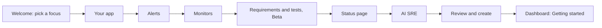

**Project setup** takes a new project from empty to watched in a few minutes. It asks what you use Supercheck for, then walks you through your app, alert channels, monitors and a status page, and creates everything in one step at the end. Every step can be skipped and picked up later.

It opens after you sign up, and again when you choose **Create and set up** for a new project. You can open it any time from **Project setup** in the sidebar, from <kbd>⌘</kbd> <kbd>K</kbd>, or from **Organization → Projects**.

## How it works

1. **Welcome.** Pick what you will mostly do. The choice only changes the order of the steps and of the sidebar; nothing is hidden.
2. **Your app.** Enter your app's URL and optionally **Scan** it. The scan reads the homepage and a few pages and shows whether the site is reachable, redirects, SSL certificate days left, response time and the pages it found. It never stores page bodies, only codes, timings, paths and page titles. Private addresses are refused, and a site behind bot protection or an unavailable scan simply skips this. You can add a test account here; it is saved straight away as an encrypted [project secret](/docs/app/automate/variables).
3. **Alerts.** Add email, Slack, Microsoft Teams, Discord, Telegram or a webhook (PagerDuty, Opsgenie, Splunk On-Call, Better Stack and incident.io presets) and send a test alert. Channels are saved as soon as you add them. Project admins can also turn on **Repeat until acknowledged** and **Also alert on warnings**. Repeat until acknowledged changes the project's notification policy: it sets the reminder interval and, if the policy has no channels yet, adds the channels you saved here.
4. **Monitors.** Pick the pages to watch for uptime and SSL (pages found by the scan are suggested; only the homepage starts ticked), how often, and optionally a [heartbeat](/docs/app/heartbeat) for a cron job, an AI endpoint or an MCP server.
5. **Requirements and tests (Beta).** AI suggests the key user journeys from your scan as [requirements](/docs/app/requirements). Tick the ones you want; Review creates them, and each one then offers **Generate test**. It uses 1 AI credit, once per project per day, and the cost is shown before you click **Suggest requirements**. It is locked on a trial with a link to upgrade, and hidden when no AI provider is configured. A **Test an AI agent** card opens the agent test form.
6. **Status page.** Name it, publish it or keep it as a draft, or choose **I don't need a status page**.
7. **AI SRE.** Connect GitHub, Sentry, Datadog, Grafana or Prometheus. Each connector is saved and tested right away and shows **Connected** or **Saved, but the token was rejected**. Tools inside a private network use a private agent from **Organization → Private agents**. You can also tick a suggested service named after your app's host. Needs a project admin; editors see **Ask a project admin**.
8. **Review and create.** Supercheck shows what is already saved and what will be created, then creates each item one by one. If one item fails, the others stay created and you can retry just that item. A heartbeat's ping URL is shown once, here.

**Copy from a project.** When the organization has another project you can reach, **Alerts** and **AI SRE** offer **Copy all alert channels** or **Copy all connectors** from it. Secrets are re-encrypted for the new project and never shown, and each item is listed by name as Copied, Already there or Failed. An item with the same name is reused only when its settings match; otherwise the copy is named `<name> (copied)`. Copies pass the same checks as creating the item by hand (endpoint rules, private agent access, channel settings). Connectors keep their risk level; like every connector they are read-only.

Setup uses the same checks as creating each item by hand: your role, your plan's limits and the audit log apply to every item. It adds new items and never deletes anything you already have. The one existing setting it changes is the project's notification policy, when you turn on **Repeat until acknowledged**: it sets the reminder interval and adds your saved channels only if the policy had none. Running it again only suggests what is new, and it does not recreate items you deleted.

## Focus and sidebar

| Focus | Steps start with | Sidebar order (first group open) |
|---|---|---|
| SRE and platform | Your app, Alerts, Monitors | Respond, Monitor, Communicate, Automate |
| QA engineers | Your app, Tests | Automate, Communicate, Respond, Monitor |
| Developers | Terminal commands and the [coding-agent recipe](/docs/cli/after-ship-check) | Automate, Monitor, Respond, Communicate |
| Engineering leaders | Invite your team | Unchanged, all groups open |
| A bit of everything, or skipped | Default order | Unchanged, all groups open |

Dashboard, Quick Create, Settings and Docs always stay visible. Change your focus from the user menu (**Change focus**).

## Getting started checklist

Until setup is finished or dismissed, the dashboard shows a **Getting started** card and the sidebar shows **Project setup** with a count such as `4/9`. On a project that already has monitors, tests, jobs or status pages, both appear only once you start setup, so existing projects are not nagged after an upgrade. Ticks come from what exists in the project, so they stay correct when you add or delete items elsewhere.

| Group | Item | Done when the project has |
|---|---|---|
| Watch it | Uptime and SSL monitors | a monitor |
| Watch it | Alert channel | a notification channel |
| Watch it | Heartbeat for a job | a heartbeat monitor |
| Watch it | Status page | a status page, or you chose "I don't need one" |
| Prove it | Requirements | a requirement |
| Prove it | Tests | a test |
| Prove it | Scheduled job or CI trigger | a job |
| Fix it fast | Connect your stack | a connector or private agent |
| Fix it fast | Services | a service |
| Team and code | Invite your team | another member or a pending invitation |
| Team and code | CLI token | a [CLI token](/docs/cli/authentication) |

**Next steps** links (not counted) point to opening a practice [incident](/docs/app/investigate/incidents) and scheduling maintenance. **Dismiss** hides the card and the sidebar entry for that project.

## Who sees what

| Role | Setup |
|---|---|
| Organization owner or admin | Full setup. **Create and set up** on new projects |
| Project admin | Full setup when the project's setup has not started |
| Project editor | Setup without project-admin options such as AI SRE (they show **Ask a project admin**) |
| Project viewer | Read-only checklist |
| Invited member | Only the focus question, then the dashboard |

Only one person runs setup for a project at a time; others see who is running it. On self-hosted installations there is no plan step and no plan limits.

Setup is in the app only. The [CLI](/docs/cli) and [MCP server](/docs/mcp) already create every item setup creates.
