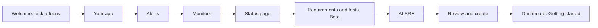

**Project setup** takes a new project from empty to watched in a few minutes, then creates everything in one step at the end. You can skip any step and finish it later.

It opens after you sign up and when you choose **Create and set up** for a new project. Reopen it from **Project setup** in the sidebar, <kbd>⌘</kbd> <kbd>K</kbd>, or **Organization → Projects**.

## Run the setup

The default order is below. Your [focus](#focus-and-sidebar) reorders it and never hides a step.

<Steps>
<Step>

### Welcome

Pick your focus.

</Step>
<Step>

### Your app

Enter the URL and optionally choose **Scan**. It shows reachability, redirects, SSL days left, response time and pages found. It stores only codes, timings, paths and page titles. Private addresses are refused, and a site behind bot protection skips the scan. A test account you add is saved at once as an encrypted [project secret](/docs/app/automate/variables).

</Step>
<Step>

### Alerts

Add email, Slack, Microsoft Teams, Discord, Telegram or webhook channels (presets: PagerDuty, Splunk On-Call, Better Stack, incident.io) and send a test alert. Channels save as you add them. Project admins can also turn on **Repeat until acknowledged** and **Also alert on warnings**. The first sets the reminder interval in the project's notification policy and, if the policy has no channels, adds the ones you saved here.

</Step>
<Step>

### Monitors

Pick pages to watch for uptime and SSL, and how often. Scan results are suggested; only the homepage starts ticked. Optionally add a [heartbeat](/docs/app/heartbeat) for a cron job, AI endpoint or MCP server.

</Step>
<Step>

### Status page

Name it and publish it or keep it as a draft, or choose **I don't need a status page**.

</Step>
<Step>

### Requirements and tests (Beta)

AI suggests user journeys from your scan as [requirements](/docs/app/automate/requirements). Tick the ones you want; each then offers **Generate test**. **Test an AI agent** opens the agent test form. Choosing **Suggest requirements** costs 1 AI credit, once per project per day, and the cost shows first. The step is locked on a trial and hidden when no AI provider is configured.

</Step>
<Step>

### AI SRE

Connect GitHub, Sentry, Datadog, Grafana or Prometheus. Each connector is saved and tested at once and shows **Connected** or **Saved, but the token was rejected**. Tools in a private network use a private agent from **Organization → Private Agents**. You can also tick a suggested service named after your app's host. Editors see **Ask a project admin**.

</Step>
<Step>

### Review and create

Review what is saved and what will be created. A heartbeat's ping URL is shown once, here.

</Step>
</Steps>

## Focus and sidebar

Your focus sets the step order after **Welcome** and the sidebar order. **Review and create** is always last. Change it with **Change focus** in the user menu. Dashboard, Quick Create, Settings and Docs always stay visible.

| Focus | Step order | Sidebar order (first group open) |
|---|---|---|
| SRE and platform | App, Alerts, Monitors, AI SRE, Status page, Tests | Respond, Monitor, Communicate, Automate |
| QA engineers | App, Tests, Alerts, Monitors, Status page, AI SRE | Automate, Communicate, Respond, Monitor |
| Developers | Terminal commands and [coding-agent recipe](/docs/cli/after-ship-check), App, Monitors, Alerts, Tests, Status page, AI SRE | Automate, Monitor, Respond, Communicate |
| Engineering leaders | Invite your team, App, Alerts, Monitors, Status page, Tests, AI SRE | Unchanged, all groups open |
| A bit of everything, or skipped | Default order | Unchanged, all groups open |

## Getting started checklist

Until setup is finished or dismissed, the dashboard shows a **Getting started** card and the sidebar shows **Project setup** with a count such as `4/9`. **Dismiss** hides both for that project. Ticks come from what exists in the project, so they stay correct when you add or delete items elsewhere.

| Group | Item | Done when the project has |
|---|---|---|
| Watch it | Uptime and SSL monitors | a monitor |
| Watch it | Alert channel | a notification channel |
| Watch it | Heartbeat for a job | a heartbeat monitor |
| Watch it | Status page | a status page, or you chose "I don't need one" |
| Prove it | Requirements | a requirement |
| Prove it | Tests | a test |
| Prove it | Scheduled job or CI trigger | a job |
| Fix it fast | Connect your stack | a connector or private agent |
| Fix it fast | Services | a service |
| Team and code | Invite your team | another member or a pending invitation |
| Team and code | CLI token | a [CLI token](/docs/cli/authentication) |

Items whose feature is off are hidden and not counted. **Next steps** links are not counted: a practice [incident](/docs/app/investigate/incidents), scheduling maintenance, and the [coding-agent recipe](/docs/cli/after-ship-check).

## Who sees what

| Role | Setup |
|---|---|
| Organization owner or admin | Full setup. **Create and set up** on new projects |
| Project admin | Full setup when the project's setup has not started |
| Project editor | Setup without project-admin options such as AI SRE (they show **Ask a project admin**) |
| Project viewer | Read-only checklist |
| Invited member | Only the focus question, then the dashboard |

Only one person runs setup for a project at a time. Others see who is running it.

<Callout>
Setup is in the app only. The [CLI](/docs/cli) and [MCP server](/docs/mcp) already create every item setup creates.
</Callout>

## FAQ

<Accordions>
<Accordion title="Does an existing project get the checklist?" id="existing-projects">

Not automatically. On a project that already has monitors, tests, jobs or status pages, the card and sidebar entry appear only after you start setup.

</Accordion>
<Accordion title="What happens if one item fails to create?" id="create-failure">

The other items stay created. Retry just the failed item from **Review and create**.

</Accordion>
<Accordion title="Do my role and plan limits apply?" id="limits">

Yes. Each item goes through the same API as creating it by hand, so your role and plan limits apply. Setup only adds items. Self-hosted installations have no plan step and no plan limits.

</Accordion>
<Accordion title="Can I copy channels or connectors from another project?" id="copy-from-project">

If the organization has another project you can reach, **Alerts** and **AI SRE** offer **Copy all alert channels** or **Copy all connectors**. Setup keeps up to 10 of each, so a copy is limited to the room left.

- Secrets are re-encrypted for the new project and never shown.
- Each item is listed as Copied, Already there or Failed.
- A same-named item is reused only when its settings match. Otherwise the copy is named `<name> (copied)`.
- Copies pass the same checks as creating by hand (endpoint rules, private agent access, channel settings).
- Connectors keep their risk level and stay read-only.

</Accordion>
</Accordions>

## Related

<Cards>
<Card title="Monitors" href="/docs/app/monitor" description="Uptime, SSL and other monitor types" />
<Card title="Notifications" href="/docs/app/communicate/alerts" description="Channels, thresholds and warnings" />
<Card title="Status pages" href="/docs/app/communicate/status-pages" description="Publish system health" />
<Card title="Requirements" href="/docs/app/automate/requirements" description="User journeys and generated tests" />
<Card title="Connectors" href="/docs/app/investigate/connectors" description="Connect AI SRE to your stack" />
</Cards>
