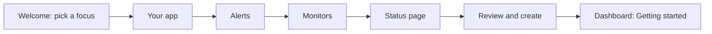

**Project setup** takes a new project from empty to watched in a few minutes. It asks what you use Supercheck for, then walks you through your app, alert channels, monitors and a status page, and creates everything in one step at the end. Every step can be skipped and picked up later.

It opens after you sign up, and again when you choose **Create and set up** for a new project. You can open it any time from **Project setup** in the sidebar, from <kbd>⌘</kbd> <kbd>K</kbd>, or from **Organization → Projects**.

## How it works

1. **Welcome.** Pick what you will mostly do. The choice only changes the order of the steps and of the sidebar; nothing is hidden.
2. **Your app.** Enter your app's URL. You can add a test account here; it is saved straight away as an encrypted [project secret](/docs/app/automate/variables).
3. **Alerts.** Add email, Slack, Microsoft Teams, Discord, Telegram or a webhook (PagerDuty, Opsgenie, Splunk On-Call, Better Stack and incident.io presets) and send a test alert. Channels are saved as soon as you add them. Project admins can also turn on **Remind until someone acknowledges** and **warnings**.
4. **Monitors.** Pick the pages to watch for uptime and SSL, how often, and optionally a [heartbeat](/docs/app/heartbeat) for a cron job, an AI endpoint or an MCP server.
5. **Status page.** Name it, publish it or keep it as a draft, or choose **I don't need a status page**.
6. **Review and create.** Supercheck shows what is already saved and what will be created, then creates each item one by one. If one item fails, the others stay created and you can retry just that item. A heartbeat's ping URL is shown once, here.

Setup uses the same checks as creating each item by hand: your role, your plan's limits and the audit log apply to every item. It never changes or deletes something you already have. Running it again only suggests what is new, and it does not recreate items you deleted.

## Focus and sidebar

| Focus | Steps start with | Sidebar order (first group open) |
|---|---|---|
| Keep production up | Your app, Alerts, Monitors | Respond, Monitor, Communicate, Automate |
| Test my app | Your app, Tests | Automate, Communicate, Respond, Monitor |
| Build with code and agents | Terminal commands and the [coding-agent recipe](/docs/cli/after-ship-check) | Automate, Monitor, Respond, Communicate |
| Lead a team | Invite your team | Unchanged, all groups open |
| Skipped | Default order | Unchanged, all groups open |

Dashboard, Quick Create, Settings and Docs always stay visible. Change your focus from the user menu (**Change persona**).

## Getting started checklist

Until setup is finished or dismissed, the dashboard shows a **Getting started** card and the sidebar shows **Project setup** with a count such as `4/9`. Ticks come from what exists in the project, so they stay correct when you add or delete items elsewhere.

| Group | Item | Done when the project has |
|---|---|---|
| Watch it | Uptime and SSL monitors | a monitor |
| Watch it | Alert channel | a notification channel |
| Watch it | Heartbeat for a job | a heartbeat monitor |
| Watch it | Status page | a status page, or you chose "I don't need one" |
| Prove it | Tests | a test |
| Prove it | Scheduled job or CI trigger | a job |
| Team and code | Invite your team | another member or a pending invitation |
| Team and code | CLI token | a [CLI token](/docs/cli/authentication) |

**Next steps** links (not counted) point to opening a practice [incident](/docs/app/investigate/incidents) and scheduling maintenance. **Dismiss** hides the card and the sidebar entry for that project.

## Who sees what

| Role | Setup |
|---|---|
| Organization owner or admin | Full setup. **Create and set up** on new projects |
| Project admin | Full setup when the project's setup has not started |
| Project editor | Setup without project-admin options (they show **Ask a project admin**) |
| Project viewer | Read-only checklist |
| Invited member | Only the focus question, then the dashboard |

Only one person runs setup for a project at a time; others see who is running it. On self-hosted installations there is no plan step and no plan limits.

Setup is in the app only. The [CLI](/docs/cli) and [MCP server](/docs/mcp) already create every item setup creates.
