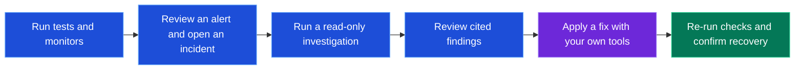

## Get Started

<Cards>
<Card icon={<CalendarClock className="text-purple-500" />} title="Automate" href="/docs/app/automate">
Create your first test — browser, API, database, or performance
</Card>

<Card icon={<Terminal className="text-amber-500" />} title="CLI" href="/docs/cli">
Install the Supercheck CLI for CI/CD integration and monitoring-as-code
</Card>

<Card icon={<MousePointerClick className="text-sky-500" />} title="Recorder" href="/docs/recorder">
Record browser interactions as Playwright code for the Supercheck Playground
</Card>
</Cards>

## Quickstart

<Steps>
<Step>

### Open a workspace

Explore the [live demo](https://demo.supercheck.dev) with sample data, or [self-host Supercheck](/docs/app/deployment/self-hosted) with Docker Compose. Supercheck Cloud is coming soon.

</Step>
<Step>

### Create a test

Write a browser, API, database, or performance test in the [Playground](/docs/app/automate/playground), or record one with the [Recorder](/docs/recorder).

</Step>
<Step>

### Run it on a schedule

Add the test to a [job](/docs/app/automate/jobs) with a cron schedule. To keep checking production, attach a Playwright test to a [synthetic monitor](/docs/app/monitor#synthetic-monitor). Add HTTP, website, ping, or port monitors for uptime.

</Step>
<Step>

### Get alerted

Add a [notification channel](/docs/app/communicate/alerts) such as email, Slack, or Teams, and select it on your monitors and jobs.

</Step>
<Step>

### Tell your users

Publish a [status page](/docs/app/communicate/status-pages) and link your monitors to its components.

</Step>
</Steps>

To manage all of this as code instead, start with the [CLI](/docs/cli).

## By Role

<Cards>
<Card icon={<Code className="text-sky-500" />} title="Developers" href="/solutions/developers">
Tests and monitors in your repository, deployed from CI
</Card>

<Card icon={<Layers className="text-rose-500" />} title="SRE and platform" href="/solutions/sre">
Uptime, alerting, status pages, and incident evidence
</Card>

<Card icon={<ClipboardCheck className="text-purple-500" />} title="QA engineers" href="/solutions/qa">
Record, run, and schedule Playwright and k6 suites
</Card>

<Card icon={<Users className="text-amber-500" />} title="Engineering leaders" href="/solutions/engineering-leaders">
Requirement coverage, roles, and audit log
</Card>
</Cards>

## Your Reliability Workflow

Scroll horizontally on smaller screens to view all steps.

AI SRE suggests checks and fixes. You apply changes and confirm recovery.

## Core Capabilities

<Cards>
<Card icon={<CalendarClock className="text-purple-500" />} title="Automate" href="/docs/app/automate">
Write tests, review AI suggestions, and schedule validated scripts.
</Card>

<Card icon={<Globe className="text-sky-500" />} title="Monitor" href="/docs/app/monitor">
Check uptime and receive failure or recovery alerts.
</Card>

<Card icon={<Radio className="text-rose-500" />} title="Communicate" href="/docs/app/communicate">
Configure alert channels and publish status updates for your users.
</Card>

<Card icon={<Search className="text-indigo-500" />} title="Respond" href="/docs/app/investigate">
Run read-only investigations, review cited evidence, and verify recovery.
</Card>

<Card icon={<UserCog className="text-amber-500" />} title="Settings" href="/docs/app/admin">
Manage projects, members, permissions, and integrations.
</Card>
</Cards>

## Your account

Open **Account** from the user menu to change your name or profile photo. Your email is read-only. Choose a PNG, JPEG or WebP photo up to 10 MB; Supercheck crops it to a square and shrinks it. Photos are visible only to people who share an organization with you.
